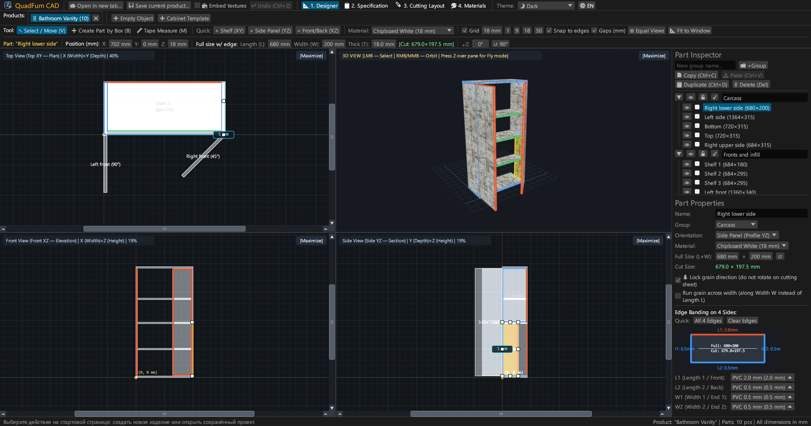
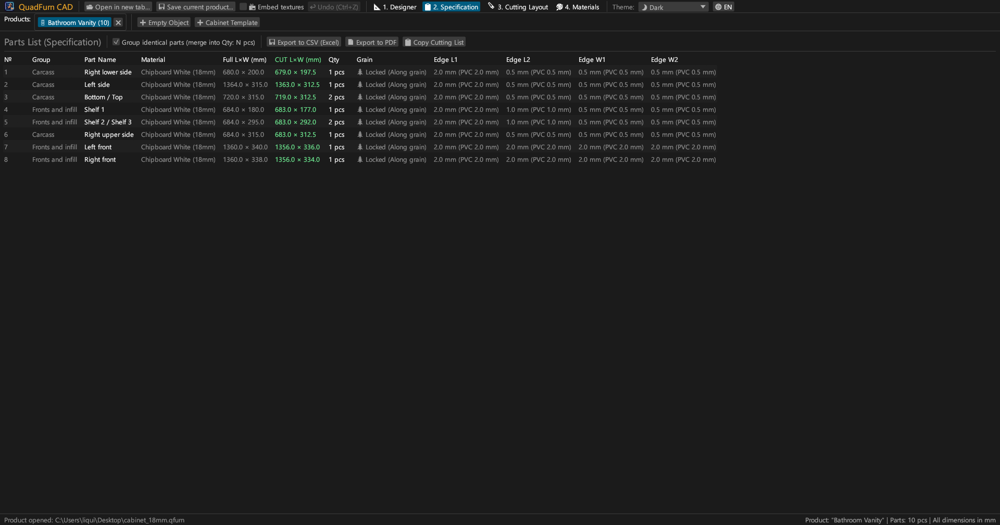
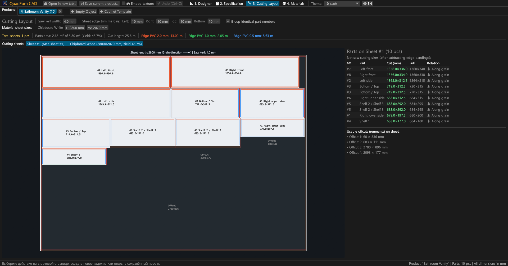
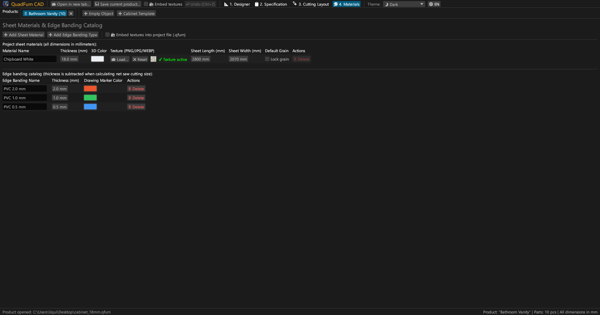
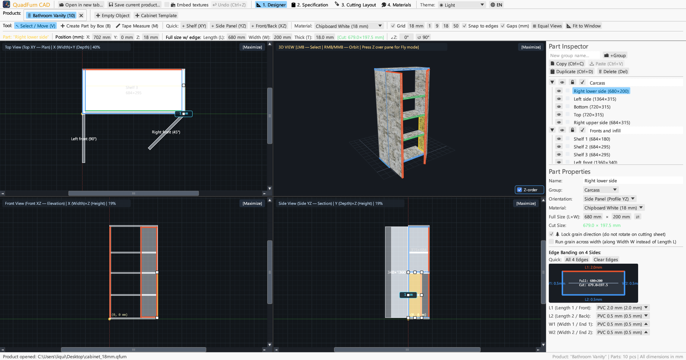
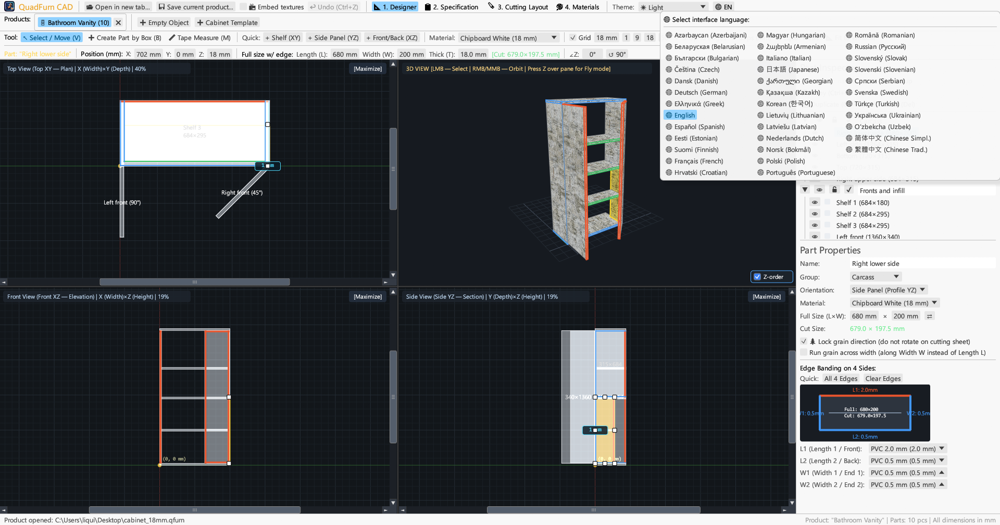

<div align="center">


# QuadFurn CAD

**Chipboard & Panel Furniture CAD — 4-Viewport Spatial Designer + Guillotine Sheet Cutting Optimizer**

[](https://github.com/rbm13s/QuadFurn/actions/workflows/build.yml)
[](https://github.com/rbm13s/QuadFurn/releases)
[](https://www.rust-lang.org/)
[](https://github.com/emilk/egui)
[](https://wgpu.rs/)
[](#8-themes--22-language-localization)
[](#getting-started)
[](https://rbm13s.github.io/QuadFurn/app/)
[](LICENSE)

<br/>

👉 **[🚀 Try QuadFurn CAD in Browser (WebAssembly)](https://rbm13s.github.io/QuadFurn/app/)** • **[🌐 Official Website](https://rbm13s.github.io/QuadFurn/)**

<br/>

**Languages / Языки / Мови / Sprachen:**<br/>
**English** •
[Русский](docs/README-ru.md) •
[Українська](docs/README-uk.md) •
[Deutsch](docs/README-de.md) •
[Polski](docs/README-pl.md) •
[Español](docs/README-es.md) •
[Français](docs/README-fr.md) •
[Italiano](docs/README-it.md) •
[Português](docs/README-pt.md) •
[Čeština](docs/README-cs.md) •
[Slovenčina](docs/README-sk.md) •
[Slovenščina](docs/README-sl.md) •
[Nederlands](docs/README-nl.md) •
[Dansk](docs/README-da.md) •
[Norsk](docs/README-no.md) •
[Svenska](docs/README-sv.md) •
[Magyar](docs/README-hu.md) •
[Română](docs/README-ro.md) •
[Türkçe](docs/README-tr.md) •
[简体中文](docs/README-zh-cn.md) •
[日本語](docs/README-ja.md) •
[한국어](docs/README-ko.md)

</div>

---

## Table of Contents

- [Introduction](#introduction)
- [Screenshots & Visual Tour](#screenshots--visual-tour)
- [Key Features](#key-features)
- [Functional Documentation](#functional-documentation)
  - [1. 4-Viewport CAD Designer & Precision Controls](#1-4-viewport-cad-designer--precision-controls)
  - [2. Inline Arithmetic Expressions in Numeric Fields](#2-inline-arithmetic-expressions-in-numeric-fields)
  - [3. Edge Banding & Automatic Net Saw Size Deduction](#3-edge-banding--automatic-net-saw-size-deduction)
  - [4. Guillotine 2D Sheet Cutting Optimization](#4-guillotine-2d-sheet-cutting-optimization)
  - [5. Multi-Product Tabs & Cross-Project Copy/Paste](#5-multi-product-tabs--cross-project-copypaste)
  - [6. Production Passport Export (Vector PDF, Excel CSV, Clipboard)](#6-production-passport-export-vector-pdf-excel-csv-clipboard)
  - [7. Sheet Materials, Textures & Edge Banding Catalog](#7-sheet-materials-textures--edge-banding-catalog)
  - [8. Themes & 22-Language Localization](#8-themes--22-language-localization)
- [Controls & Keyboard Shortcuts](#controls--keyboard-shortcuts)
- [Getting Started](#getting-started)
- [Settings & File Formats](#settings--file-formats)
- [Project Architecture](#project-architecture)

---

## Introduction

**QuadFurn CAD** is a high-performance cross-platform CAD application written in Rust, available both as a fast native desktop application (Windows, Linux, macOS) and as a zero-install WebAssembly (WASM) online version running directly in modern web browsers. It is designed for cabinet and panel furniture made of laminated chipboard (LDSP), MDF, HDF, and plywood, complete with automated specification generation and 2D guillotine sheet cutting optimization.

QuadFurn combines three essential furniture manufacturing capabilities into one cohesive workflow:
1. **4-Viewport Spatial Modeling**: Simultaneous editing across three synchronized 2D orthographic projections (**Top XY — Plan**, **Front XZ — Elevation**, **Side YZ — Section**) with viewport scrollbars, magnetic edge snapping, window equalizer button (`⊞ Equal Views`), intelligent edge-on thickness protection, and a real-time **3D Orbit / First-Person Fly (`Z` Noclip)** viewport.
2. **Precision Transform Bar**: Instant numeric coordinate (`X`, `Y`, `Z`), full dimension (`L × W × T`), and yaw angle (`∠Z`) input with built-in inline math evaluation (e.g., typing `600-4` or `720+18` directly into any input box).
3. **Sheet Cutting Layout & Edge Banding Deduction**: Automatic subtraction of PVC/ABS edge banding thickness from full part dimensions to compute exact **net saw cutting sizes**, paired with a guillotine 2D bin-packing optimizer that respects wood grain direction, saw kerf width, and sheet edge trim margins.

---

## Screenshots & Visual Tour

### 1. 4-Viewport Designer (Dark Theme)
Simultaneous 2D orthographic plans (**Top XY**, **Front XZ**, **Side YZ**) and textured **3D View** with perspective-correct UV mapping, depth-buffered painter's sorting, interactive 8-handle resize gizmos, and the right-hand **Part Inspector**.



### 2. Parts List (Specification) & Export
Grouped bill of materials displaying both **Full Dimensions (`L × W`)** and **Net Saw Cutting Dimensions (`CUT L × W`)** after subtracting edge banding thickness on all four sides (`L1`, `L2`, `W1`, `W2`).



### 3. Guillotine Sheet Cutting Layout
2D nesting of parts onto standard sheets (`2800 × 2070 mm`, etc.) with guillotine through-cuts, kerf allowance, edge trim margins, visual edge-banding markers, and a list of usable offcuts (remnants).



### 4. Sheet Materials & Edge Banding Catalog
Manage chipboard/MDF/HDF sheet thicknesses, 3D colors, custom surface textures (`PNG`, `JPG`, `WEBP`), sheet dimensions, default grain locks, and PVC/ABS edge banding types.



### 5. Light Theme Support
Clean high-contrast Light Theme alongside Dark Theme and automatic Windows System Theme synchronization.



### 6. 22 Built-in Languages (UI & PDF Export)
Instant runtime language switching via the **`🌐`** selector in the top toolbar, with automatic OS language detection on first launch and localized multi-page PDF exports.



---

## Key Features

- **Synchronized 4-Viewport Workspace**: Edit in Top (`XY`), Front (`XZ`), Side (`YZ`), or maximize any viewport with one click (`[Maximize]` / `[Restore 4 Views]`).
- **3D Hardware-Accelerated Preview**: Orbit camera (`RMB`/`MMB`) + first-person free-fly camera (`Z` key + `WASD`/`Space`/`Ctrl`) with perspective-correct subdivided texture rendering and exact OBB raycasting.
- **Magnetic Snapping & Live Gap Dimensions**: Automatic snapping to grid steps (`1`, `9`, `18`, `50 mm`, or custom) and adjacent part faces/corners (`0 mm` flush joint), plus real-time distance callouts to neighboring parts.
- **Box-Selection & Group Transform**: Drag a marquee selection box in any 2D viewport to select multiple parts, move them together, duplicate (`Ctrl+D`), or copy/paste them across different open furniture projects (`Ctrl+C` / `Ctrl+V`).
- **Inline Math Calculator**: Every numeric input field accepts arithmetic expressions like `600+100`, `800-36`, `720/2`, or `45+15`.
- **Automatic Saw Cut Deduction**: Assign PVC/ABS edge banding (`0.4 mm`, `0.5 mm`, `1.0 mm`, `2.0 mm`, etc.) to any of the 4 part edges (`L1`, `L2`, `W1`, `W2`) and immediately see the net saw size:
  $$\text{Cut Length} = L_{\text{full}} - E_{L1} - E_{L2}, \quad \text{Cut Width} = W_{\text{full}} - E_{W1} - E_{W2}$$
- **Guillotine 2D Nesting Engine**: Multi-sheet guillotine packer honoring grain orientation locks, cross-grain overrides, saw blade kerf, and 4-side sheet trim margins.
- **4-Section Vector PDF Production Passport**: One-click export of a complete, print-ready A4 Landscape PDF document in the active interface language containing:
  1. Parts Specification Table
  2. 4-Viewport Designer Projections (`Top XY`, `3D Isometric`, `Front XZ`, `Side YZ`)
  3. Guillotine Cutting Layouts for Every Sheet
  4. Sheet Materials & Edge Banding Summary with `+15%` linear meter waste calculation

---

## Functional Documentation

### 1. 4-Viewport CAD Designer & Precision Controls

The **Designer** tab (`📐 1. Designer`) is divided into three main areas:

1. **Top Toolbars**:
   - **Editor Tools**:
     - `↖ Select / Move (V)`: Click a part to select it, drag inside to move it, or drag any of the 8 resize handles (corners & midpoints) in 2D views to resize it in place. Drag on empty space to draw a **marquee selection box** for multi-part selection.
     - `➕ Create Part by Box (B)`: Drag a rectangle in any 2D view (`Top XY`, `Front XZ`, or `Side YZ`) to create a new board oriented to that plane (`Shelf XY`, `Side Panel YZ`, or `Front/Back XZ`).
     - `📏 Tape Measure (M)`: Measure exact point-to-point distances (`ΔX`, `ΔY`, `L`) in millimeters in any 2D view.
   - **Quick Part Insertion**: One-click buttons (`+ Shelf (XY)`, `+ Side Panel (YZ)`, `+ Front/Back (XZ)`) to drop standard panels into the workspace.
   - **Grid & Snapping Controls**: Toggle grid snapping, choose grid step presets (`1`, `9`, `18`, `50 mm`), enable magnetic edge snapping (`Snap to edges`), and toggle live neighbor distance callouts (`Gaps (mm)`).
   - **Camera Framing**:
     - `🔍 Center View`: Centers all 2D/3D cameras on the origin/model center.
     - `📐 Fit to Window`: Automatically calculates the bounding box of all visible parts and zooms/pans all 4 viewports so the entire product fits comfortably in each pane.
   - **Precision Transform Bar**: Displays and edits the active part's `X`, `Y`, `Z` coordinates, full `Length (L)`, `Width (W)`, `Thickness (T)`, real-time green `[Cut: L × W mm]` badge, and horizontal rotation angle `∠Z` (allowing angled doors/facades at `45°`, `90°`, etc. in Top XY view).

2. **Quad Viewports**:
   - **Top View (`Top XY — Plan`)**, **Front View (`Front XZ — Elevation`)**, and **Side View (`Side YZ — Section`)** feature interactive horizontal and vertical scrollbars, dynamic millimeter rulers, and edge-banding color highlights along panel perimeters.
   - **3D View**: Supports orbit rotation (`RMB` or `MMB` drag), zoom (`Mouse Wheel`), left-click 3D part selection, and **First-Person Fly Mode** (press **`Z`** while hovering over the 3D pane to lock the cursor and fly with `WASD`, `Space`, `Ctrl`/`Shift`).

3. **Right-Hand Part Inspector (`Part Inspector` & `Part Properties`)**:
   - Organize parts into custom **Groups** (e.g., *Carcass*, *Doors & Fronts*, *Drawers*).
   - Per-group and per-part **Visibility (`👁`)** and **Lock (`🔒`)** toggles.
   - Edit part orientation, sheet material, full dimensions (`L × W` with quick swap `⇄`), wood grain lock (`🌲 Lock grain direction`), cross-grain direction (`🔄 Run grain across width`), and interactive 4-side edge banding diagram.

---

### 2. Inline Arithmetic Expressions in Numeric Fields

All numeric fields across QuadFurn CAD (part coordinates `X/Y/Z`, dimensions `L/W`, rotation angle `∠Z`, grid step, material thickness, sheet sizes, saw kerf, and trim margins) support inline mathematical expressions:
- **Addition & Subtraction**: Click a field containing `600`, type `600+100` (or `600-4`), and press `Enter` or click away — the field automatically evaluates to `700` (or `596`).
- **Multiplication, Division & Parentheses**: Expressions such as `(800-36)/2` or `18*2` are evaluated on commit.
- Both `.` and `,` are accepted as decimal separators, and trailing unit suffixes (`mm`, `мм`, `°`) are ignored automatically.

---

### 3. Edge Banding & Automatic Net Saw Size Deduction

In furniture manufacturing, edge banding thickness must be subtracted from the finished (full) size of a panel before cutting on a panel saw:
- Each part has 4 edges: **`L1`** (Length 1 / Front), **`L2`** (Length 2 / Back), **`W1`** (Width 1 / End 1), and **`W2`** (Width 2 / End 2).
- Assigning e.g. `2.0 mm` PVC edge banding to `L1` and `0.5 mm` PVC edge banding to `L2`, `W1`, `W2` on a `680 × 200 mm` panel automatically computes the **Net Saw Cut Size**:
  - $\text{Cut } L = 680 - 2.0 - 0.5 = 677.5\text{ mm}$
  - $\text{Cut } W = 200 - 0.5 - 0.5 = 199.0\text{ mm}$
- Colored edge markers are drawn on both the interactive 2D/3D diagrams and the cutting layout sheets.

---

### 4. Guillotine 2D Sheet Cutting Optimization

The **Cutting Layout** tab (`🪚 3. Cutting Layout`) automatically packs all visible parts onto sheets of their respective materials:
- **Configurable Saw Parameters**:
  - **Saw Kerf Width** (default `4.0 mm`)
  - **Sheet Edge Trim Margins** (`Left`, `Right`, `Top`, `Bottom`, default `10 mm`) to clean factory board edges before cutting.
- **Grain Direction Enforcement**:
  - Parts with **Locked Grain (`🌲`)** are never rotated $90^\circ$ against the sheet's grain direction (`Sheet Length L`).
  - Parts with **Free Grain** may be rotated $90^\circ$ by the optimizer whenever it improves sheet yield.
- **Visual Cutting Map & Offcuts**:
  - Displays each sheet with red guillotine cut lines, part numbers `#1..#N`, net saw dimensions, edge banding color bars, and labeled usable **Offcuts (Remnants)**.
  - Reports total sheets required, net parts area vs. total sheet area ($\text{m}^2$), material yield percentage (%), total linear saw cut length ($\text{m}$), and total linear meters of each edge banding type.

---

### 5. Multi-Product Tabs & Cross-Project Copy/Paste

- **Start Page & Recent Projects**: On launch, QuadFurn opens a Start Page where you can create a new empty product, start from a ready-made 2-door cabinet template, browse for a `.qfurn`/`.json` project file, or pick from the **10 most recently opened projects**.
- **Multiple Open Products**: Open or create several furniture items simultaneously in the **Products** tab bar (double-click any tab title to rename the product).
- **Cross-Project Multi-Part Copy & Paste**: Select one or multiple parts in one product tab, press `Ctrl+C`, switch to another open product tab (or another running instance of QuadFurn), and press `Ctrl+V`. Missing materials and edge bandings referenced by the copied parts are automatically transferred or matched by name/thickness in the target project.
- **Unsaved Changes Protection**: Closing a modified product tab or exiting the application prompts a confirmation dialog (`Save and exit`, `Exit without saving`, `Cancel`).

---

### 6. Production Passport Export (Vector PDF, Excel CSV, Clipboard)

From the **Specification** tab (`📋 2. Specification`), you can export production data in three formats:
1. **`📄 Export to PDF` (Multi-Page Vector A4 Landscape Production Passport)**:
   - **Section 1**: Full Parts Specification Table with net saw dimensions, grain flags, and edge bandings.
   - **Section 2**: 4-Viewport Designer Preview page (`Top XY`, `3D Isometric`, `Front XZ`, `Side YZ`) with overall product bounding dimensions.
   - **Section 3**: Dedicated Guillotine Cutting Layout page for every sheet.
   - **Section 4**: Sheet Materials & Edge Banding Catalog with sheet counts and linear edge banding consumption (net meters and $+15\%$ waste allowance).
   - *Note*: The entire PDF document is generated in the **currently active interface language** with embedded TrueType/CID fonts (`Identity-H` + `/ToUnicode` CMap for full search/copy support across Latin, Cyrillic, and CJK scripts).
2. **`💾 Export to CSV (Excel)`**: UTF-8 with BOM `;`-delimited spreadsheet ready to open directly in Microsoft Excel.
3. **`📋 Copy Cutting List`**: Copies a tab-separated table of net saw dimensions to the clipboard for pasting into external cutting software or spreadsheets.

---

### 7. Sheet Materials, Textures & Edge Banding Catalog

In the **Materials** tab (`🎨 4. Materials`):
- Add, edit, or delete **Sheet Materials** (`18 mm Chipboard`, `16 mm MDF`, `3 mm HDF`, etc.) with custom RGB colors, sheet dimensions (`Length × Width`), and default grain lock settings.
- Load surface textures in **`PNG`**, **`JPG`/`JPEG`**, or **`WEBP`** formats for realistic 3D rendering.
- **Texture Portability & Relative Path Fallbacks**: When saving, QuadFurn computes relative paths from the project file to external texture images. When reopening a `.qfurn` file on another PC or from a moved folder, it automatically searches for texture files:
  1. Embedded directly within the project (Base64)
  2. In the same directory as the `.qfurn` project file
  3. In a `./textures/` subfolder next to the project file
  4. By relative path or original absolute path
- **Project Texture Packaging (`📦 Embed textures into project file`)**: Toggle the `📦 Embed textures` checkbox (accessible both next to the `Save` button in the top menu and in the Materials Manager toolbar) to store active texture images directly inside the `.qfurn` JSON file as Base64. This produces a completely self-contained project file that can be transferred anywhere without missing textures.
- **Interactive Missing Textures Resolver (`🔍 Locate Missing Textures`)**: If a project references external textures that cannot be found when opening, QuadFurn presents a sequential modal dialog displaying each missing texture by material name and expected filename with options to `📂 Browse for file...`, `⏭ Skip`, or `✖ Skip all`.
- **Drag & Drop Support**: Drag and drop `.qfurn` project files or texture images (`PNG`, `JPG`, `WEBP`) directly onto the application window to open projects or immediately attach and resolve missing textures.
- **GPU Safety & Auto-Downscaling**: Files exceeding 60 MB are blocked with a clear warning, while ultra-high resolution images (> 4096 px or hardware limit) are automatically downscaled to preserve GPU performance.
- Add, edit, or delete **Edge Banding Types** with custom thicknesses (`mm`) and drawing marker colors. Deleting a material or edge banding that is in use shows a safety confirmation dialog and cleanly reassigns/clears affected parts.

---

### 8. Themes & 22-Language Localization

- **Color Themes**: Switch between **🌙 Dark**, **☀ Light**, and **🖥 System** themes from the top bar.
- **22 Built-in Languages**:
  `Čeština`, `Dansk`, `Deutsch`, `English`, `Español`, `Français`, `Italiano`, `Korean (한국어)`, `Magyar`, `Nederlands`, `Norsk (Bokmål)`, `Polski`, `Português`, `Română`, `Russian (Русский)`, `Slovenski`, `Slovenský`, `Svenska`, `Türkçe`, `Українська (Ukrainian)`, `简体中文 (Chinese Simplified)`, and `日本語 (Japanese)`.
- **First-Launch OS Language Detection**: On first launch, QuadFurn detects your operating system's UI language and starts in that language automatically (falling back to `English` if the OS language is not in the supported list). Both your chosen language and theme are saved automatically in `%APPDATA%\QuadFurn\settings.json`.

---

## Controls & Keyboard Shortcuts

| Input / Shortcut | Action |
| :--- | :--- |
| **`V`** | Activate **Select & Move** tool (with 8 resize handles on face-on parts & 2 edge handles on edge-on parts, plus marquee box selection) |
| **`B`** | Activate **Create Part by Box** tool in 2D viewports |
| **`M`** | Activate **Tape Measure** tool in 2D viewports |
| **`LMB` Drag (2D View)** | Move selected part(s), drag resize handles, or draw marquee selection box on empty space |
| **`Shift / Ctrl (Cmd) + LMB` (2D View)** | Toggle part in/out of current multi-selection group |
| **`RMB` / `MMB` Drag (2D View)** | Pan 2D orthographic camera |
| **`Mouse Wheel` (2D / 3D)** | Zoom camera in/out around cursor |
| **`RMB` / `MMB` Drag (3D View)** | Orbit 3D camera around target |
| **`Z` (hovering 3D View)** | Toggle **3D First-Person Fly Mode (Noclip)** (layout-independent) |
| **`W` `A` `S` `D` / `Space` / `Ctrl (Cmd)`** | Fly forward/left/back/right/up/down in 3D Fly Mode (`Shift` for speed boost) |
| **`Ctrl + S` / `Cmd (⌘) + S`** | Save current furniture product (`.qfurn` / `.json`) |
| **`Ctrl + Z` / `Cmd (⌘) + Z`** | Undo last action in active product tab (up to 40 steps, layout-independent) |
| **`Ctrl + C` / `Cmd (⌘) + C`** | Copy selected part(s) to shared clipboard |
| **`Ctrl + V` / `Cmd (⌘) + V`** | Paste selected part(s) (works across different product tabs) |
| **`Ctrl + D` / `Cmd (⌘) + D`** | Duplicate selected part(s) |
| **`Delete` / `Backspace`** | Delete selected part(s) |
| **`←` `→` `↑` `↓` (2D View)** | Nudge selected part(s) by current grid step (`Shift` for double step) |

---

## Getting Started

### Pre-Built Binaries (GitHub Actions / Releases)
Every push and release automatically builds ready-to-run packages via [GitHub Actions](https://github.com/rbm13s/QuadFurn/actions):
- **Windows (`x86_64`)**: `QuadFurn-windows-x86_64.zip` — portable `QuadFurn.exe` with embedded icon.
- **Linux (`Debian 12+ / Ubuntu 22.04+ x86_64`)**:
  - `quadfurn_<version>_amd64.deb` — Debian/Ubuntu installer package (installs binary, desktop menu entry, and application icon):
    ```bash
    sudo apt install ./quadfurn_0.2.3_amd64.deb
    ```
  - `QuadFurn-linux-x86_64.tar.gz` — portable standalone Linux archive.
- **macOS (`Universal: Apple Silicon M1–M4 + Intel x86_64`)**: `QuadFurn-macos-universal.zip` — native `QuadFurn.app` bundle with Retina `.icns` icon.

---

### Building from Source

#### Prerequisites
- [Rust Toolchain](https://rustup.rs/) (`stable`, Rust 2021 edition)
- **Linux (Debian / Ubuntu)** system libraries:
  ```bash
  sudo apt-get update && sudo apt-get install -y \
    build-essential pkg-config libxcb-render0-dev libxcb-shape0-dev \
    libxcb-xfixes0-dev libxkbcommon-dev libxkbcommon-x11-dev libssl-dev \
    libgtk-3-dev libglib2.0-dev libatk1.0-dev libgdk-pixbuf-2.0-dev \
    libcairo2-dev libpango1.0-dev libgl1-mesa-dev fonts-dejavu-core fonts-noto-cjk
  ```
- **macOS**: Xcode Command Line Tools (`xcode-select --install`)
- **Windows**: Windows 10 / 11 with MSVC Build Tools

#### Build & Run Commands
```bash
# Run in development mode
cargo run

# Build optimized release executable
cargo build --release

# Run unit tests (cutter, math parser, multi-part copy/paste, multi-language PDF export)
cargo test
```

---

## Settings & File Formats

- **User Settings (`settings.json`)**:
  Stored automatically in the platform's standard configuration directory:
  - **Windows**: `%APPDATA%\QuadFurn\settings.json` (`C:\Users\<User>\AppData\Roaming\QuadFurn\settings.json`)
  - **Linux**: `$XDG_CONFIG_HOME/QuadFurn/settings.json` or `~/.config/QuadFurn/settings.json`
  - **macOS**: `~/Library/Application Support/QuadFurn/settings.json`
  
  Persists:
  - `theme_choice` (`Dark`, `Light`, `System`)
  - `language` (`En`, `Ru`, `Uk`, `De`, `Fr`, `Es`, `It`, `Pl`, `Cs`, `Sk`, `Da`, `Nl`, `No`, `Sv`, `Hu`, `Ro`, `Sl`, `Pt`, `Tr`, `Ko`, `ZhCn`, `Ja`)
  - `recent_projects` (up to 10 recently opened `.qfurn` / `.json` file paths)
- **Project Files (`.qfurn` / `.json`)**:
  Human-readable, UTF-8 JSON files containing all parts, groups, materials, textures, edge bandings, and cutting settings for a furniture product. When `embed_textures` is enabled, texture image bytes are bundled as Base64 strings directly in the JSON file; otherwise, portable relative paths and fallback filenames are used.

---

## Project Architecture

```text
QuadFurn/
├── .github/
│   └── workflows/
│       └── build.yml          # GitHub Actions CI/CD (Linux .deb/.tar.gz, macOS Universal .app, Windows .zip)
├── assets/
│   ├── icon.jpeg              # Application logo & source image for Windows/Linux/macOS icons
│   └── icon.ico               # Windows application icon
├── docs/                      # Localized documentation & GitHub Pages (22 languages)
│   └── screenshots/           # UI screenshots for all 22 supported languages
├── src/
│   ├── main.rs                # App entry point, multi-tab workspace, Start Page, settings & shortcuts
│   ├── model.rs               # Core data structures (Project, PartBlock, SheetMaterial, EdgeBanding, OBB)
│   ├── viewport.rs            # 4-viewport workspace controller, 2D ortho & 3D wgpu/painter rendering
│   ├── snapping.rs            # Magnetic grid & part-edge snapping, 2D projection axes
│   ├── cutter.rs              # Specification grouping, edge deduction & guillotine 2D bin-packing engine
│   ├── export.rs              # Multi-page localized vector PDF generator, CSV & cutting list exporters
│   ├── ui_panels.rs           # Top transform bar, right Part Inspector, Specification, Cutting & Materials UI
│   └── i18n.rs                # 22-language localization dictionaries & OS locale auto-detection
├── build.rs                   # Converts assets/icon.jpeg into multi-size ICO & embeds PE resource on Windows
├── Cargo.toml                 # Package manifest & dependencies
└── LICENSE                    # MIT License
```

---

## License

This project is licensed under the [MIT License](LICENSE) — feel free to use, modify, and distribute for commercial or personal projects.


