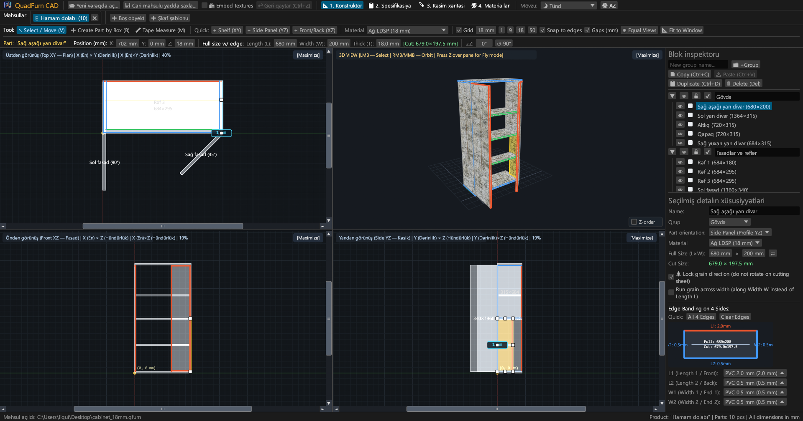
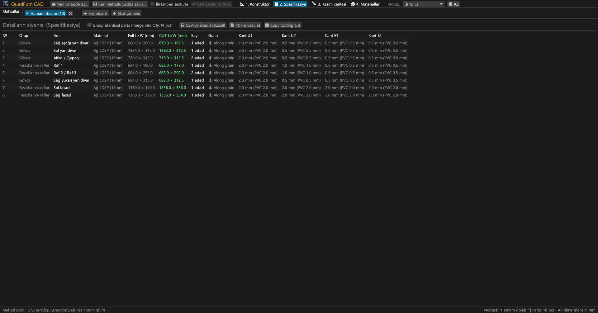
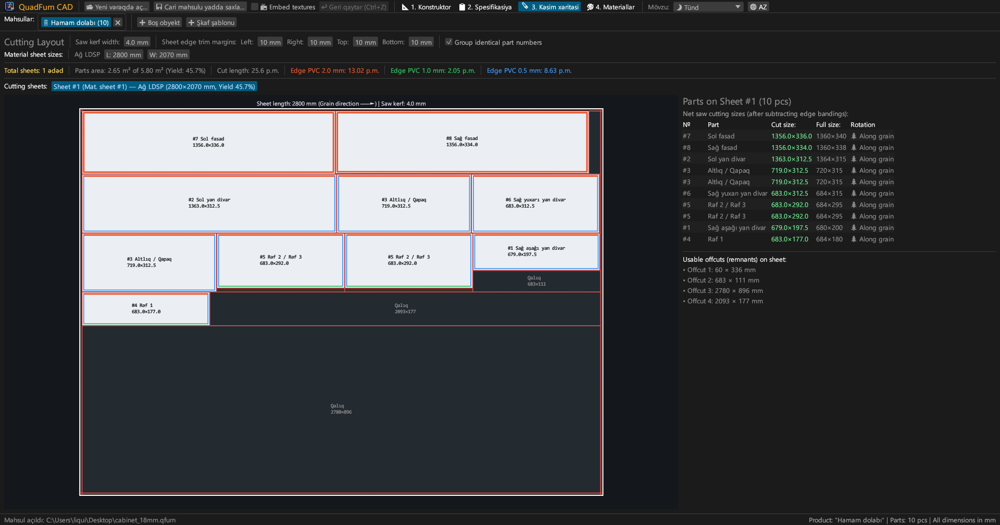
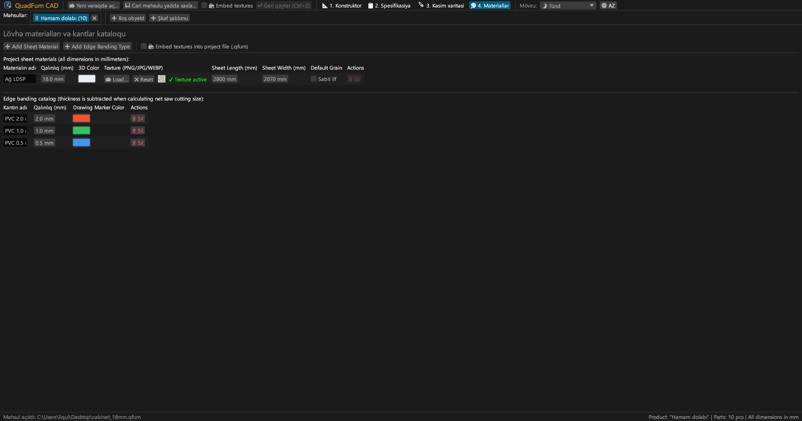
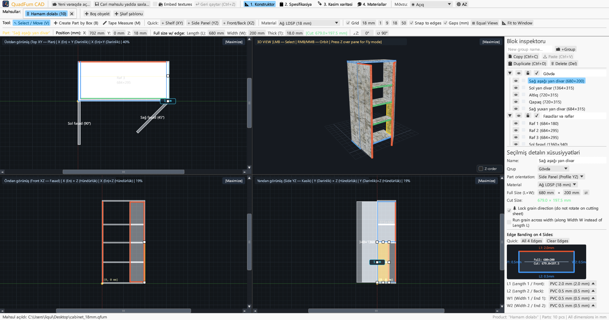
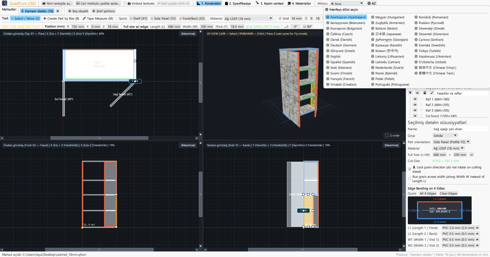

# QuadFurn CAD

**DSP korpus mebeli CAD — 4 görüntülü məkan dizayneri + təbəqə materiallarının giyotin kəsim optimizatoru**

 

👉 **[🚀 QuadFurn CAD-ı brauzerdə işə salın (WebAssembly)](https://rbm13s.github.io/QuadFurn/app/)** • **[🌐 Rəsmi veb sayt](https://rbm13s.github.io/QuadFurn/az.html)**

 

**Languages / Языки / Мови / Sprachen:** 
[English](../README.md) •
[Русский](README-ru.md) •
[Українська](README-uk.md) •
[Беларуская](README-be.md) •
[Қазақша](README-kk.md) •
[ქართული](README-ka.md) •
[Հայերեն](README-hy.md) •
**Azərbaycan** •
[Oʻzbekcha](README-uz.md) •
[Deutsch](README-de.md) •
[Français](README-fr.md) •
[Español](README-es.md) •
[Italiano](README-it.md) •
[Português](README-pt.md) •
[Polski](README-pl.md) •
[Čeština](README-cs.md) •
[Slovenčina](README-sk.md) •
[Slovenščina](README-sl.md) •
[Български](README-bg.md) •
[Српски](README-sr.md) •
[Hrvatski](README-hr.md) •
[Nederlands](README-nl.md) •
[Dansk](README-da.md) •
[Norsk](README-no.md) •
[Svenska](README-sv.md) •
[Suomi](README-fi.md) •
[Eesti](README-et.md) •
[Latviešu](README-lv.md) •
[Lietuvių](README-lt.md) •
[Magyar](README-hu.md) •
[Română](README-ro.md) •
[Türkçe](README-tr.md) •
[Ελληνικά](README-el.md) •
[简体中文](README-zh-cn.md) •
[繁體中文](README-zh-tw.md) •
[日本語](README-ja.md) •
[한국어](README-ko.md)

---

## Məzmun

- [Giriş](#giriş)
- [Ekran görüntüləri](#ekran-görüntüləri)
- [Əsas imkanlar](#əsas-imkanlar)
- [Funksional sənədlər](#funksional-sənədlər)
- [İdarəetmə və qısayollar](#idarəetmə-və-qısayollar)
- [Lisenziya](#lisenziya)

---

## Giriş

**QuadFurn CAD** — laminat lövhə (DSP), MDF və fanerdən korpus mebeli layihələndirilməsi, avtomatik spesifikasiya tərtibi və 2D giyotin kəsim optimallaşdırılması üçün Rust dilində yazılmış yüksək məhsuldarlıqlı çarpaz platformalı CAD proqramıdır.

---

## Ekran görüntüləri

### 1. 4 görüntülü CAD dizayner (Qaranlıq mövzu)
Sinxron 2D proyeksiya (**Üstdən XY**, **Qabaqdan XZ**, **Yandan YZ**) və **3D pəncərə**:

### 2. Hissələr spesifikasiyası
Kənar bantlama qalınlığının çıxılmasından sonrakı kəsim ölçüləri:

### 3. Giyotin kəsim xəritələri
Standart lövhələrdə optimal yerləşdirmə:

### 4. Materiallar və kənarlar
Lövhə qalınlıqları, rənglər və teksturalar (`PNG`, `JPG`, `WEBP`):

### 5. İşıqlı mövzu
Kontrastlı işıqlı mövzu:

### 6. 37 daxili dil
37 interfeys dili arasında dərhal keçid:

---

## Lisenziya

Layihə sərbəst [MIT License](../LICENSE) lisenziyası altında yayılır.
