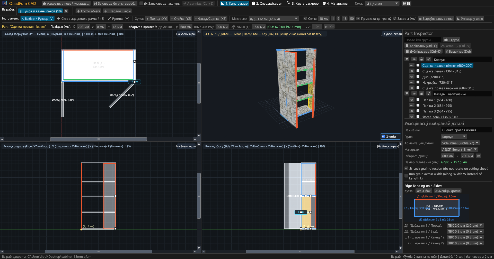
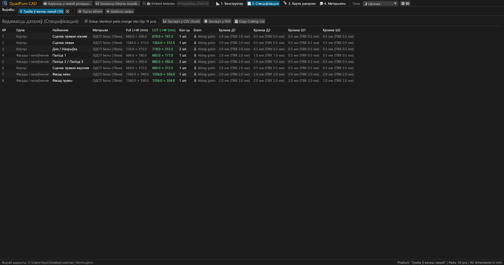
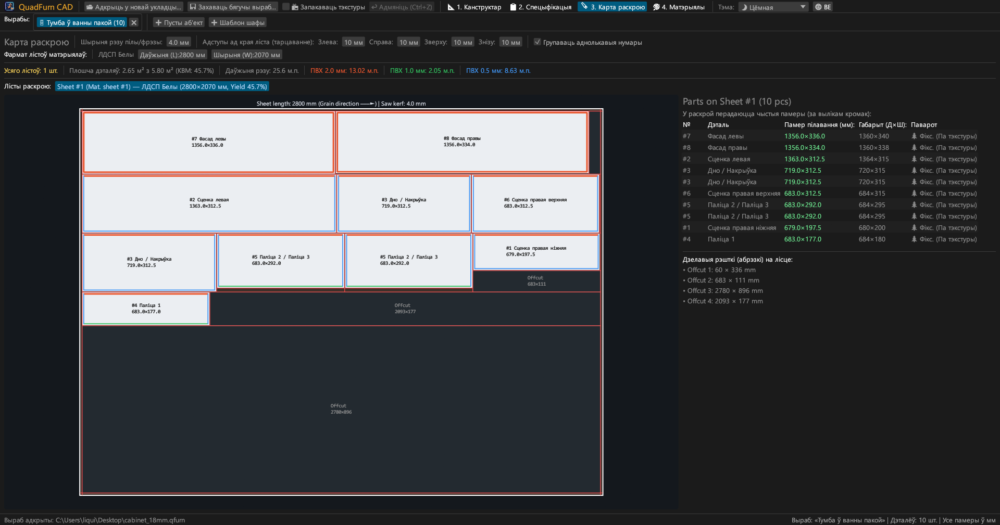
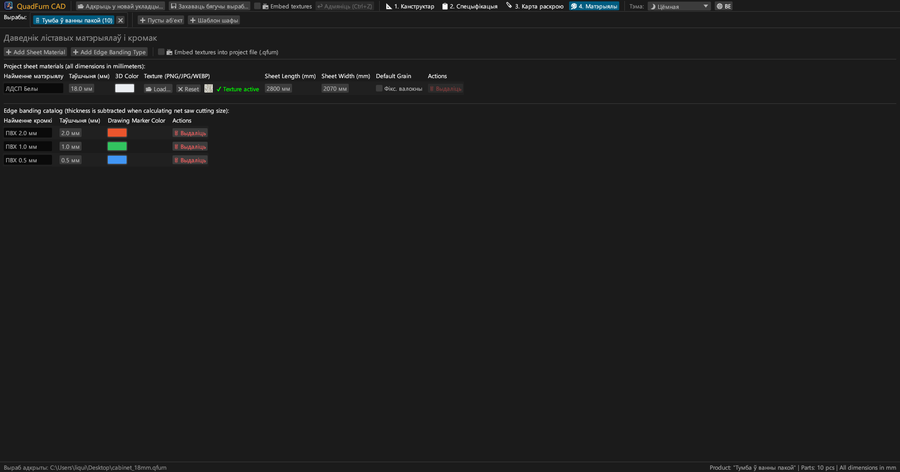
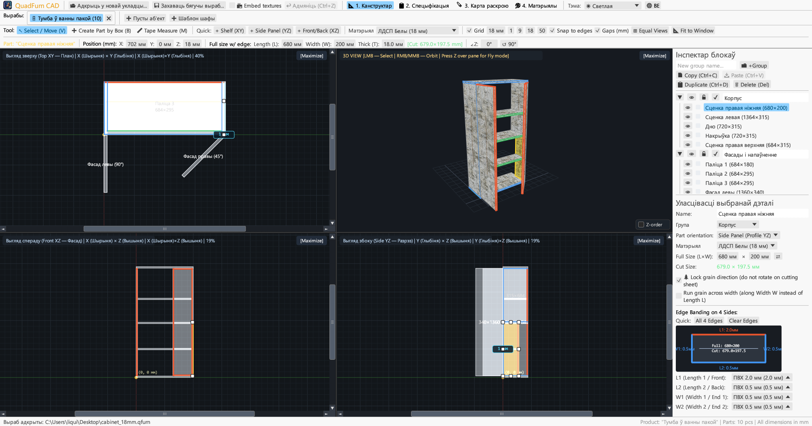
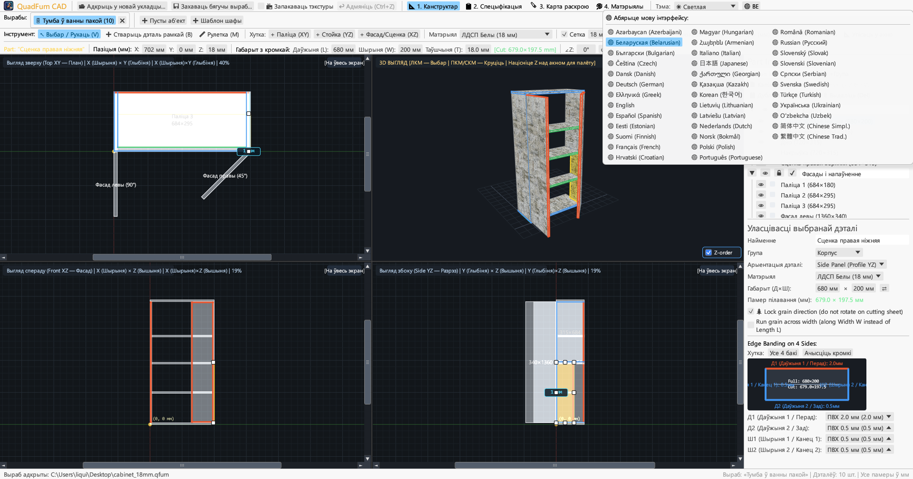

<div align="center">


# QuadFurn CAD

**САПР корпуснай мэблі з ЛДСП — 4-відавы прасторавы канструктар + гільяцінны раскрой ліставых матэрыялаў**

[](https://github.com/rbm13s/QuadFurn/actions/workflows/build.yml)
[](https://github.com/rbm13s/QuadFurn/releases)
[](https://www.rust-lang.org/)
[](https://github.com/emilk/egui)
[](https://wgpu.rs/)
[](#8-тэмы-афармлення-і-лакалізацыя-на-37-моў)
[](#хуткі-старт)
[](https://rbm13s.github.io/QuadFurn/app/)
[](../LICENSE)

<br/>

👉 **[🚀 Запусціць QuadFurn CAD прама ў браўзеры (WebAssembly)](https://rbm13s.github.io/QuadFurn/app/)** • **[🌐 Афіцыйны сайт](https://rbm13s.github.io/QuadFurn/be.html)**

<br/>

**Languages / Языки / Мови / Sprachen:**<br/>
[English](../README.md) •
[Русский](README-ru.md) •
[Українська](README-uk.md) •
**Беларуская** •
[Қазақша](README-kk.md) •
[ქართული](README-ka.md) •
[Հայերեն](README-hy.md) •
[Azərbaycan](README-az.md) •
[Oʻzbekcha](README-uz.md) •
[Deutsch](README-de.md) •
[Français](README-fr.md) •
[Español](README-es.md) •
[Italiano](README-it.md) •
[Português](README-pt.md) •
[Polski](README-pl.md) •
[Čeština](README-cs.md) •
[Slovenčina](README-sk.md) •
[Slovenščina](README-sl.md) •
[Български](README-bg.md) •
[Српски](README-sr.md) •
[Hrvatski](README-hr.md) •
[Nederlands](README-nl.md) •
[Dansk](README-da.md) •
[Norsk](README-no.md) •
[Svenska](README-sv.md) •
[Suomi](README-fi.md) •
[Eesti](README-et.md) •
[Latviešu](README-lv.md) •
[Lietuvių](README-lt.md) •
[Magyar](README-hu.md) •
[Română](README-ro.md) •
[Türkçe](README-tr.md) •
[Ελληνικά](README-el.md) •
[简体中文](README-zh-cn.md) •
[繁體中文](README-zh-tw.md) •
[日本語](README-ja.md) •
[한국어](README-ko.md)

</div>

---

## Змест

- [Уводзіны](#уводзіны)
- [Скрыншоты і візуальны агляд](#скрыншоты-і-візуальны-агляд)
- [Ключавыя магчымасці](#ключавыя-магчымасці)
- [Функцыянальная дакументацыя](#функцыянальная-дакументацыя)
  - [1. 4-відавы CAD-канструктар і дакладнае пазіцыянаванне](#1-4-відавы-cad-канструктар-і-дакладнае-пазіцыянаванне)
  - [2. Матэматычныя выразы ў лікавых палях](#2-матэматычныя-выразы-ў-лікавых-палях)
  - [3. Кромкаабліцоўка і аўтаматычны вылік прыпуску пад кромку](#3-кромкаабліцоўка-і-аўтаматычны-вылік-прыпуску-пад-кромку)
  - [4. Аптымізацыя гільяціннага 2D-раскрою](#4-аптымізацыя-гільяціннага-2d-раскрою)
  - [5. Укладкі вырабаў і буфер абмену паміж праектамі](#5-укладкі-вырабаў-і-буфер-абмену-паміж-праектамі)
  - [6. Экспарт вытворчага пашпарта (вектарны PDF, CSV Excel, буфер)](#6-экспарт-вытворчага-пашпарта-вектарны-pdf-csv-excel-буфер)
  - [7. Даведнік ліставых матэрыялаў, тэкстур і кромак](#7-даведнік-ліставых-матэрыялаў-тэкстур-і-кромак)
  - [8. Тэмы афармлення і лакалізацыя на 37 моў](#8-тэмы-афармлення-і-лакалізацыя-на-37-моў)
- [Кіраванне і гарачыя клавішы](#кіраванне-і-гарачыя-клавішы)
- [Хуткі старт](#хуткі-старт)
- [Налады і фарматы файлаў](#налады-і-фарматы-файлаў)
- [Архітэктура праекта](#архітэктура-праекта)
- [Ліцэнзія](#ліцэнзія)

---

## Уводзіны

**QuadFurn CAD** — гэта высокапрадукцыйная шматплатформенная CAD-праграма на Rust, даступная як хуткае натыўнае дэсктопнае прыкладанне (Windows, Linux, macOS), так і ў выглядзе анлайн-версіі WebAssembly (WASM), якая працуе непасрэдна ў сучасных вэб-браўзерах. Яна прызначана для канструявання корпуснай мэблі з ламінаванай ДСП (ЛДСП), МДФ, ХДФ і фанеры, у камплекце з аўтаматычнай генерацыяй спецыфікацый і 2D-аптымізатарам гільяціннага раскрою лістоў.

QuadFurn спалучае тры важныя вытворчыя інструменты ў адзіным працэсе:
1. **4-відавое прасторавае мадэляванне**: Адначасовае рэдагаванне ў трох сінхранізаваных 2D-праекцыях (**Зверху XY — План**, **Спераду XZ — Фасад**, **Збоку YZ — Разрэз**) са скролбарамі, магнітнай прывязкай, кнопкай выраўноўвання вокнаў (`⊞ Выраўнаваць вокны`), інтэлектуальнай абаронай таўшчыні тарцоў і рэжымам **3D-арбіты / палёту ад першай асобы (`Z` Noclip)**.
2. **Панэль дакладнай трансфармацыі**: Імгненны ўвод каардынат (`X`, `Y`, `Z`), поўных памераў (`Д × Ш × Т`) і вугла павароту (`∠Z`) з убудаваным вылічэннем арыфметычных выразаў (напрыклад, увод `600-4` або `720+18` прама ў поле).
3. **Раскрой лістоў і аўтаматычны вылік кромкі**: Аўтаматычнае адыманне таўшчыні кромкі ПВХ/АБС ад габарытных памераў дэталі для разліку дакладных **чыстых пілільных памераў**, у спалучэнні з алгарытмам гільяціннага раскрою з улікам валокнаў дрэва, шырыні прапілу пілы і адступаў абрэзкі ліста.

---

## Скрыншоты і візуальны агляд

### 1. 4-відавы CAD-канструктар (Цёмная тэма)
Сінхронныя 2D-праекцыі (**Зверху XY**, **Спераду XZ**, **Збоку YZ**) і апаратнае **3D-акно** з тэкстурамі, 8 маркерамі змены памеру і правым **Інспектарам дэталей**.



### 2. Спецыфікацыя дэталей і экспарт
Згрупаваная табліца дэталей з адлюстраваннем **Габарытных памераў (`Д × Ш`)** і **Пілільных памераў (`Піл Д × Ш`)** пасля выліку таўшчыні кромкі з 4 бакоў (`Д1`, `Д2`, `Ш1`, `Ш2`).



### 3. Карты гільяціннага раскрою
Аптымальная раскладка дэталей на стандартных лістах (`2800 × 2070 мм` і інш.) са скразнымі рэзамі, улікам прапілу пілы, кромкамі і карыснымі дзелавымі рэшткамі.



### 4. Даведнік матэрыялаў і кромак
Кіраванне таўшчынямі ЛДСП/МДФ, адвольнымі колерамі, тэкстурамі дэкораў (`PNG`, `JPG`, `WEBP`), памерамі лістоў, фіксацыяй тэкстуры і тыпамі кромак ПВХ/АБС.



### 5. Светлая тэма афармлення
Кантрасная светлая тэма нароўні з цёмнай і аўтаматычнай сінхранізацыяй з сістэмнай тэмай Windows.



### 6. 37 убудаваных моў (інтэрфейс і PDF)
Імгненнае пераключэнне паміж 37 убудаванымі мовамі праз кнопку **`🌐`** у верхнім меню, аўтавызначэнне мовы АС і лакалізаваны экспарт у PDF.



---

## Ключавыя магчымасці

- **Сінхранізаваныя 4 вокны праекцый**: Рэдагаванне ў відах Зверху (`XY`), Спераду (`XZ`), Збоку (`YZ`) або разгортванне любога акна ў адзін клік (`[Разгарнуць]` / `[4 Віды]`).
- **3D-прагляд з апаратным паскарэннем**: Кручэнне арбітай (`ПКМ`/`СКМ`) + вольны палёт ад першай асобы (`Z` + `WASD`/`Прабел`/`Ctrl`) з тэкстурамі і OBB-трасіроўкай прамяня.
- **Магнітная прывязка і вымярэнні зазораў**: Аўтапрывязка да кроку сеткі (`1`, `9`, `18`, `50 мм` або адвольны) і да граней суседніх дэталей (`0 мм` стык у стык), а таксама дынамічныя вынаскі адлегласцей да суседніх панэляў.
- **Рамачнае вылучэнне і групавая трансфармацыя**: Вылучэнне рамкай у любым 2D-акне некалькіх дэталей, іх сумеснае перамяшчэнне, дубліраванне (`Ctrl+D`) і капіраванне/ўстаўка паміж адкрытымі вырабамі (`Ctrl+C` / `Ctrl+V`).
- **Убудаваны калькулятар**: Усе лікавыя палі прымаюць выразы віду `600+100`, `800-36`, `720/2` або `45+15`.
- **Аўтаматычны вылік кромкі**: Прызначэнне кромкі ПВХ/АБС (`0.4 мм`, `0.8 мм`, `1.0 мм`, `2.0 мм` і інш.) на любую з 4 граней (`Д1`, `Д2`, `Ш1`, `Ш2`) з разлікам чыстага пілільнага памеру:
  $$\text{Піл Даўжыня} = L_{\text{габ}} - E_{L1} - E_{L2}, \quad \text{Піл Шырыня} = W_{\text{габ}} - E_{W1} - E_{W2}$$
- **Рухавік гільяціннага раскрою**: Раскрой на некалькі лістоў з улікам кірунку валокнаў дрэва, шырыні прапілу пілы і адступаў абрэзкі ліста па 4 баках.
- **Вектарны PDF-пашпарт вырабу з 4 раздзелаў**: Экспарт гатовага да друку альбома фармату A4 Альбомная на выбранай мове:
  1. Спецыфікацыя дэталей
  2. 4 праекцыі вырабу (`Зверху XY`, `3D Ізаметрыя`, `Спераду XZ`, `Збоку YZ`)
  3. Карты раскрою для кожнага ліста
  4. Зводная ведамасць матэрыялаў і кромак з разлікам пагонных метраў і запасам `+15%`

---

## Функцыянальная дакументацыя

### 1. 4-відавы CAD-канструктар і дакладнае пазіцыянаванне

Укладка **Канструктар** (`📐 1. Канструктар`) падзелена на тры асноўныя вобласці:
1. **Верхняя панэль інструментаў**: Выбар інструментаў (`Выбар / Зрух (V)`, `Стварыць дэталь рамкай (B)`, `Лінейка (M)`), хуткая ўстаўка паліцы, стойкі або фасада, выбар кроку сеткі і магнітнае прыліпанне, панэль дакладнай трансфармацыі (`X`, `Y`, `Z`, `L`, `W`, `T`, `∠Z`).
2. **4 вокны праекцый**: Сінхронныя артаганальныя праекцыі Зверху (`XY`), Спераду (`XZ`), Збоку (`YZ`) з лінейкамі і паласой пракруткі, плюс апаратнае 3D-акно з рэжымам палёту `Z` Noclip.
3. **Правы інспектар дэталей**: Кіраванне групамі (*Корпус*, *Фасады*, *Скрыні*), бачнасцю (`👁`), блакіроўкай (`🔒`), матэрыялам і інтэрактыўнай схемай нанясення кромкі на 4 тарцы.

---

### 2. Матэматычныя выразы ў лікавых палях

Усе палі ўводу лікаў у QuadFurn CAD падтрымліваюць вылічэнне арыфметыкі: складанне, адыманне, памнажэнне, дзяленне і дужкі (напрыклад `(800-36)/2` або `600-4`). Раздзяляльнікам можа быць як кропка, так і коска.

---

### 3. Кромкаабліцоўка і аўтаматычны вылік прыпуску пад кромку

Прызначэнне таўшчыні кромкі (ПВХ/АБС ад `0.4` да `2.0 мм`) на любыя з чатырох тарцоў дэталі (`Д1`, `Д2`, `Ш1`, `Ш2`) імгненна памяншае пілільны памер на адпаведную велічыню для дакладнага распілу на фарматна-раскроечным станку.

---

### 4. Аптымізацыя гільяціннага 2D-раскрою

Укладка **Раскрой** (`🪚 3. Карта раскрою`) раскладвае дэталі па лістах са скразнымі гільяціннымі рэзамі. Улічваецца шырыня рэзу пілы, тэхналагічны апіл краёў ліста, арыентацыя валокнаў тэкстуры дрэва і выяўленне карысных рэшткаў.

---

### 5. Укладкі вырабаў і буфер абмену паміж праектамі

Падтрымка адначасовай працы з некалькімі вырабамі ва ўкладках. Скапіруйце дэталі праз `Ctrl+C` у адным праекце і ўстаўце праз `Ctrl+V` у іншы з аўтаматычным пераносам матэрыялаў і кромак.

---

### 6. Экспарт вытворчага пашпарта (вектарны PDF, CSV Excel, буфер)

Экспарт спецыфікацый у адзін клік: шматстаронкавы вектарны PDF-альбом фармату A4 Альбомная на выбранай мове, табліца Excel (CSV з раздзяляльнікам `;` і UTF-8 BOM) або капіраванне памераў піла ў буфер абмену.

---

### 7. Даведнік ліставых матэрыялаў, тэкстур і кромак

Кіраванне бібліятэкай матэрыялаў і таўшчынь, загрузка рэалістычных тэкстур (`PNG`, `JPG`, `WEBP`), упакоўка тэкстур непасрэдна ў файл `.qfurn` (Base64) для надзейнай перасылкі без страты малюнкаў і інтэрактыўны пошук адсутных файлаў.

---

### 8. Тэмы афармлення і лакалізацыя на 37 моў

Пераключэнне паміж цёмнай, светлай і сістэмнай тэмамі. Поўная лакалізацыя інтэрфейсу і PDF-дакументацыі на 37 моў з аўтаматычным вызначэннем мовы аперацыйнай сістэмы пры першым запуску.

---

## Кіраванне і гарачыя клавішы

| Клавіша / Спалучэнне | Дзеянне |
| :--- | :--- |
| **`V`** | Інструмент **Выбар і перамяшчэнне** (8 маркераў змены памеру і рамка вылучэння) |
| **`B`** | Інструмент **Стварыць дэталь рамкай** у 2D-вокнах |
| **`M`** | Інструмент **Лінейка** у 2D-вокнах |
| **Заціск `ЛКМ` (2D)** | Перамяшчэнне дэталей, цяга маркераў памеру або вылучэнне рамкай |
| **`Shift + ЛКМ` (2D)** | Перамяшчэнне строга па гарызанталі або вертыкалі |
| **`Ctrl / Cmd + ЛКМ` (2D)** | Адключэнне магнітнага прыліпання да граней |
| **`Alt + ЛКМ` (2D)** | Хуткае дубліраванне (капіраванне) дэталі пры перацягванні |
| **`Shift / Ctrl + ЛКМ` (2D)** | Даданне / выключэнне дэталі з групы вылучэння |
| **Заціск `ПКМ` / `СКМ` (2D)** | Панарамаванне 2D-камеры |
| **`Кола мышы` (2D / 3D)** | Маштабаванне (зум) камеры |
| **Заціск `ПКМ` / `СКМ` (3D)** | Кручэнне 3D-арбіты вакол мадэлі |
| **`Z` (над акном 3D)** | Рэжым палёту ад першай асобы (Noclip, кіраванне WASD + мышкай) |
| **`W` `A` `S` `D` / `Прабел` / `Ctrl`** | Палёт наперад/улева/назад/управа/уверх/уніз у 3D (`Shift` — паскарэнне) |
| **`Ctrl + S` / `Cmd + S`** | Захаваць выраб у файл `.qfurn` / `.json` |
| **`Ctrl + Z` / `Cmd + Z`** | Адмяніць апошняе дзеянне (да 40 крокаў гісторыі) |
| **`Ctrl + C` / `Ctrl + V`** | Капіраваць / уставіць выбраныя дэталі (працуе паміж укладкамі) |
| **`Ctrl + D`** | Дубліраваць выбраныя дэталі са зрухам |
| **`Delete` / `Backspace`** | Выдаліць выбраныя дэталі |
| **`←` `→` `↑` `↓` (2D)** | Зрух дэталей на крок сеткі (`Shift` — двайны крок) |

---

## Хуткі старт

### Гатовыя зборкі (GitHub Actions / Рэлізы)
- **Windows (`x86_64`)**: `QuadFurn-windows-x86_64.zip` — партатыўны выканальны файл `QuadFurn.exe` з убудаванай іконкай.
- **Linux (`Debian 12+ / Ubuntu 22.04+ x86_64`)**:
  - `quadfurn_0.2.6_amd64.deb` — установачны пакет для Debian / Ubuntu:
    ```bash
    sudo apt install ./quadfurn_0.2.6_amd64.deb
    ```
  - `QuadFurn-linux-x86_64.tar.gz` — партатыўны архіў.
- **macOS (`Universal: Apple Silicon + Intel`)**: `QuadFurn-macos-universal.zip` — натыўны бандл `QuadFurn.app`.

---

### Зборка з зыходнага кода

```bash
# Запуск у рэжыме распрацоўкі
cargo run

# Зборка аптымізаванага рэлізнага файла
cargo build --release

# Запуск тэстаў
cargo test
```

---

## Налады і фарматы файлаў

- **Налады карыстальніка (`settings.json`)**: Захоўваюцца аўтаматычна ў стандартным каталогу канфігурацыі АС (`%APPDATA%\QuadFurn\settings.json` у Windows, `~/.config/QuadFurn/settings.json` у Linux). Захоўваюць выбар тэмы, мову і спіс з 10 апошніх адкрытых праектаў.
- **Файлы праектаў (`.qfurn` / `.json`)**: Тэкставы фармат JSON у кадзіроўцы UTF-8, які змяшчае ўсе дэталі, групы, матэрыялы, кромкі і налады раскрою. Пры ўключанай опцыі `embed_textures` выявы тэкстур захоўваюцца прама ўнутры файла ў выглядзе радкоў Base64.

---

## Архітэктура праекта

```text
QuadFurn/
├── assets/                    # Лагатып, іконкі і рэсурсы
├── docs/                      # Лакалізаваная дакументацыя (37 моў) і GitHub Pages
├── src/
│   ├── main.rs                # Точка ўваходу, укладкі, стартовая старонка, налады
│   ├── model.rs               # Структуры даных (Project, PartBlock, SheetMaterial, EdgeBanding)
│   ├── viewport.rs            # 4-відавы кантролер працоўнай вобласці, 2D і 3D рэндэр
│   ├── snapping.rs            # Магнітная сетка і прывязка дэталей
│   ├── cutter.rs              # Групоўка спецыфікацыі, вылік кромкі і гільяцінны 2D-раскрой
│   ├── export.rs              # Вектарны PDF-альбом, экспарт CSV і спісаў раскрою
│   ├── ui_panels.rs           # Панэль трансфармацыі, інспектар, раскрой і матэрыялы
│   └── i18n.rs                # Слоўнікі лакалізацыі на 37 моў і аўтавызначэнне мовы
├── Cargo.toml                 # Маніфест пакета
└── LICENSE                    # Ліцэнзія MIT
```

---

## Ліцэнзія

Праект распаўсюджваецца пад свабоднай ліцэнзіяй [MIT License](../LICENSE).
