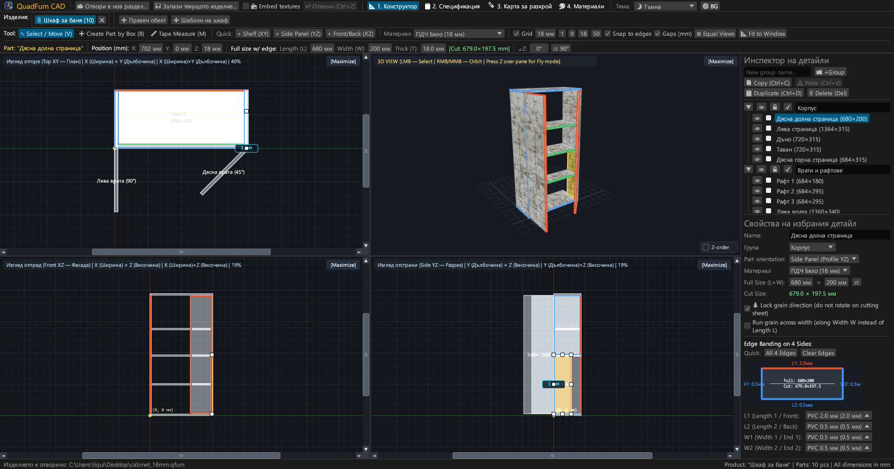
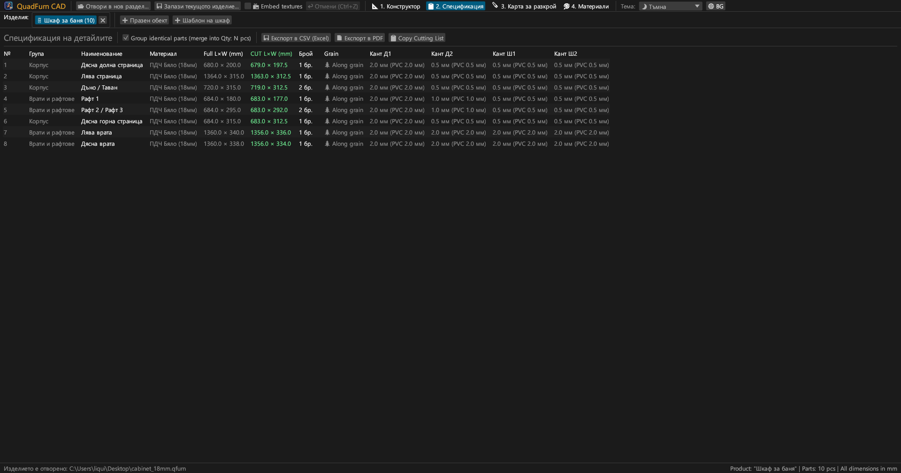
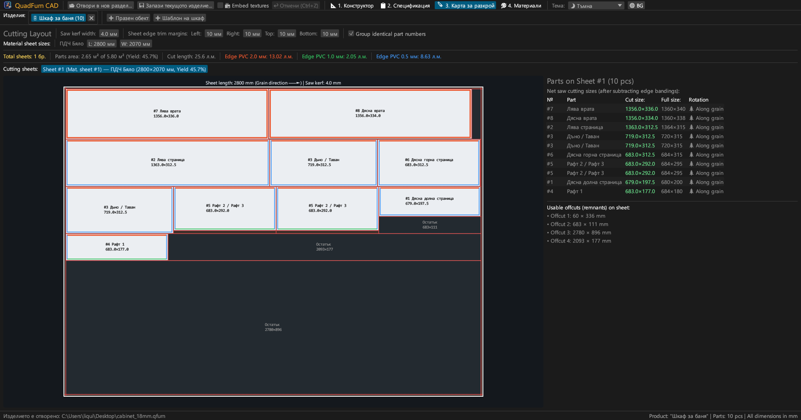
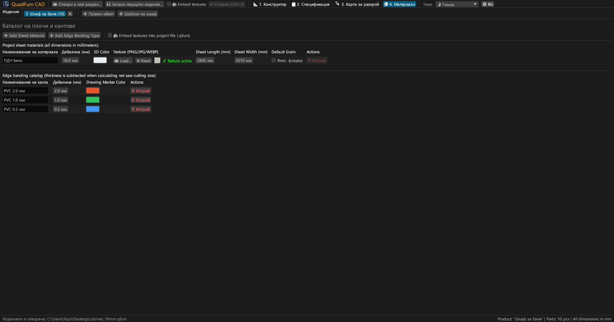
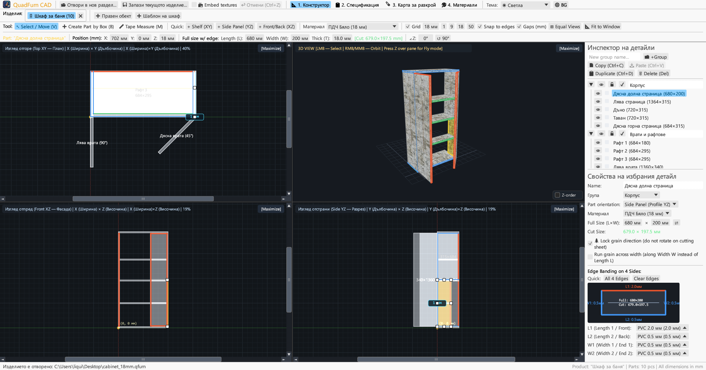
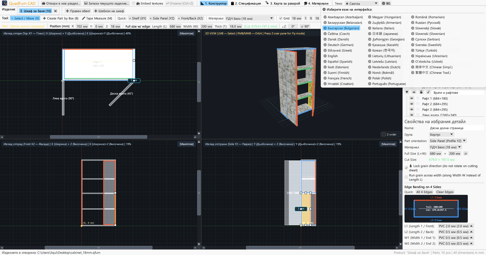

# QuadFurn CAD

**САПР за корпусна мебел от ПДЧ — 4-проекционен пространствен конструктор + гилотинно разкрояване на плочи**

 

👉 **[🚀 Стартиране на QuadFurn CAD директно в браузъра (WebAssembly)](https://rbm13s.github.io/QuadFurn/app/)** • **[🌐 Официален сайт](https://rbm13s.github.io/QuadFurn/bg.html)**

 

**Languages / Языки / Мови / Sprachen:** 
[English](../README.md) •
[Русский](README-ru.md) •
[Українська](README-uk.md) •
[Беларуская](README-be.md) •
[Қазақша](README-kk.md) •
[ქართული](README-ka.md) •
[Հայերեն](README-hy.md) •
[Azərbaycan](README-az.md) •
[Oʻzbekcha](README-uz.md) •
[Deutsch](README-de.md) •
[Français](README-fr.md) •
[Español](README-es.md) •
[Italiano](README-it.md) •
[Português](README-pt.md) •
[Polski](README-pl.md) •
[Čeština](README-cs.md) •
[Slovenčina](README-sk.md) •
[Slovenščina](README-sl.md) •
**Български** •
[Српски](README-sr.md) •
[Hrvatski](README-hr.md) •
[Nederlands](README-nl.md) •
[Dansk](README-da.md) •
[Norsk](README-no.md) •
[Svenska](README-sv.md) •
[Suomi](README-fi.md) •
[Eesti](README-et.md) •
[Latviešu](README-lv.md) •
[Lietuvių](README-lt.md) •
[Magyar](README-hu.md) •
[Română](README-ro.md) •
[Türkçe](README-tr.md) •
[Ελληνικά](README-el.md) •
[简体中文](README-zh-cn.md) •
[繁體中文](README-zh-tw.md) •
[日本語](README-ja.md) •
[한국어](README-ko.md)

---

## Съдържание

- [Въведение](#въведение)
- [Екранни снимки и визуален преглед](#екранни-снимки-и-визуален-преглед)
- [Основни възможности](#основни-възможности)
- [Функционална документация](#функционална-документация)
- [Управление и клавишни комбинации](#управление-и-клавишни-комбинации)
- [Лиценз](#лиценз)

---

## Въведение

**QuadFurn CAD** е високопроизводително междуплатформено CAD приложение, написано на Rust, налично както като бързо настолно приложение (Windows, Linux, macOS), така и като онлайн версия WebAssembly (WASM) директно в съвременни браузъри. Предназначено е за проектиране на корпусна мебел от ламинирано ПДЧ, МДФ, HDF и шперплат с автоматично генериране на спецификации и 2D оптимизация за гилотинно разкрояване.

---

## Екранни снимки и визуален преглед

### 1. 4-проекционен CAD конструктор (Тъмна тема)
Синхронни 2D проекции (**Отгоре XY**, **Отпред XZ**, **Отстрани YZ**) и хардуерен **3D изглед**:

### 2. Спецификация на детайлите
Таблица с размери след приспадане на канта:

### 3. Карти за гилотинно разкрояване
Оптимално подреждане върху стандартни плочи:

### 4. Материали и кантове
Управление на дебелини, декори и PVC/ABS кантове:

### 5. Светла тема
Контрастна светла тема:

### 6. 37 вградени езика
Моментално превключване между 37 езика чрез **`🌐`**:

---

## Лиценз

Проектът се разпространява под свободен [MIT License](../LICENSE) лиценз.
