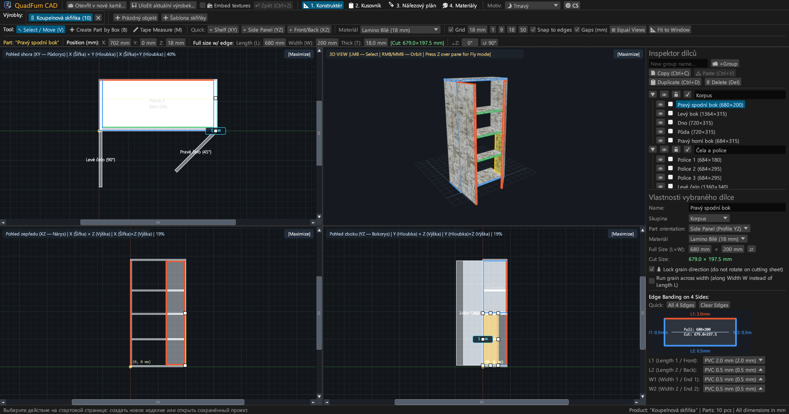
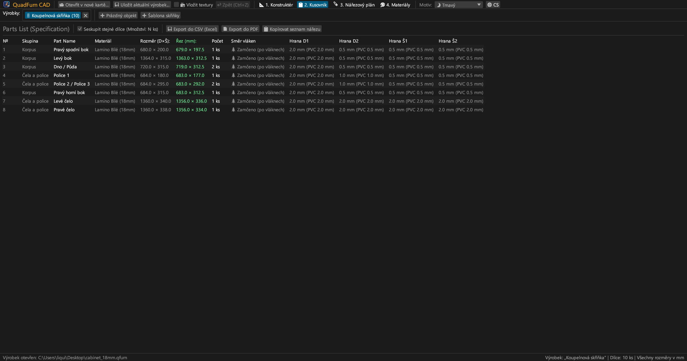
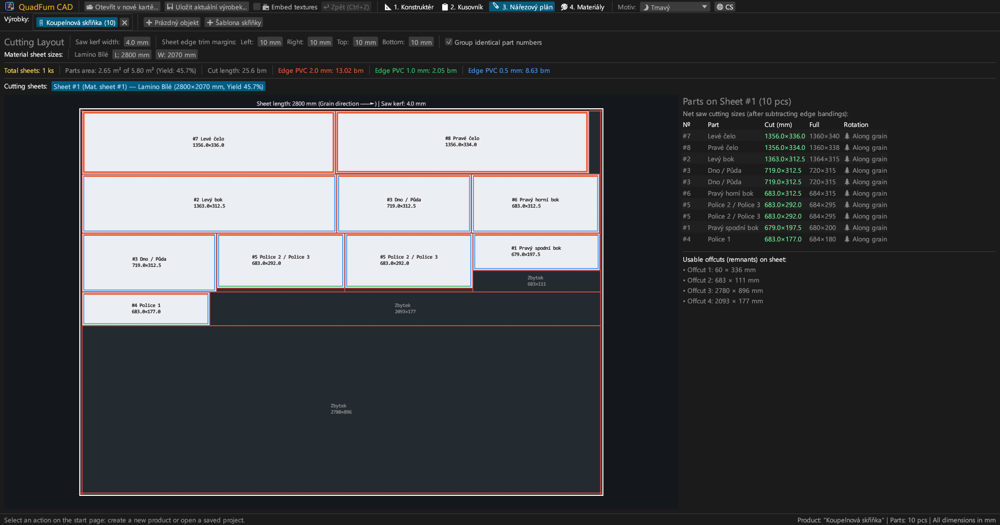
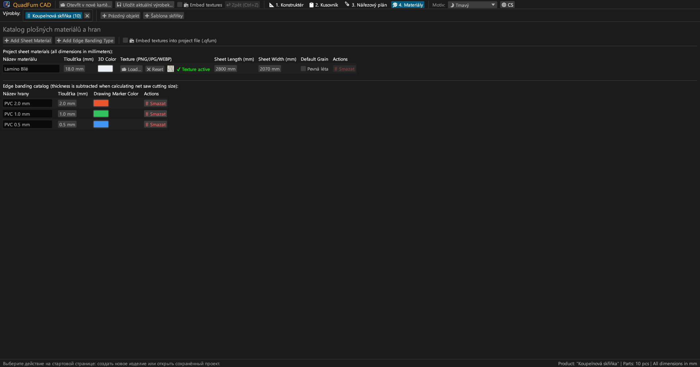
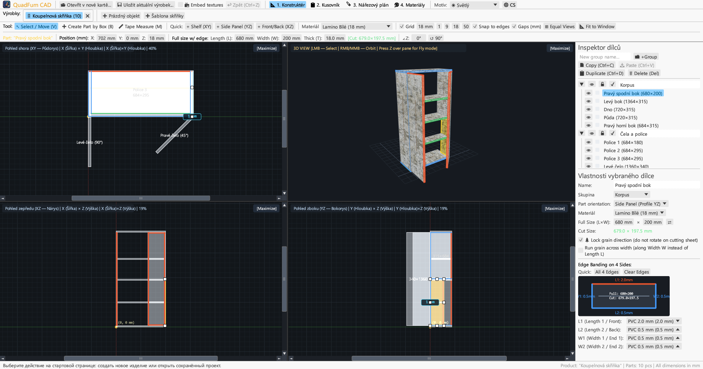
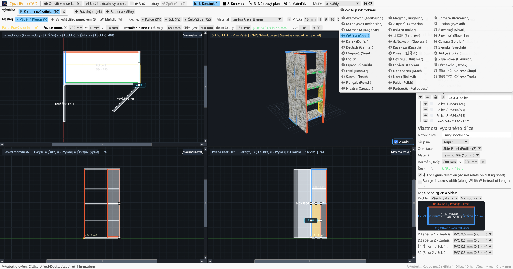

<div align="center">


# QuadFurn CAD

**CAD pro deskový nábytek a lamino — 4pohledový prostorový konstruktér + Gilotinový optimalizátor nářezových plánů**

[](https://github.com/rbm13s/QuadFurn/actions/workflows/build.yml)
[](https://github.com/rbm13s/QuadFurn/releases)
[](https://www.rust-lang.org/)
[](https://github.com/emilk/egui)
[](https://wgpu.rs/)
[](#8-grafické-motivy-a-lokalizace-do-22-jazyků)
[](#začínáme)
[](../LICENSE)

<br/>

**Languages / Языки / Мови / Sprachen:**<br/>
[English](../README.md) •
[Русский](README-ru.md) •
[Українська](README-uk.md) •
[Deutsch](README-de.md) •
[Polski](README-pl.md) •
[Español](README-es.md) •
[Français](README-fr.md) •
[Italiano](README-it.md) •
[Português](README-pt.md) •
**Čeština** •
[Slovenčina](README-sk.md) •
[Slovenščina](README-sl.md) •
[Nederlands](README-nl.md) •
[Dansk](README-da.md) •
[Norsk](README-no.md) •
[Svenska](README-sv.md) •
[Magyar](README-hu.md) •
[Română](README-ro.md) •
[Türkçe](README-tr.md) •
[简体中文](README-zh-cn.md) •
[日本語](README-ja.md) •
[한국어](README-ko.md)

</div>

---

## Obsah

- [Úvod](#úvod)
- [Snímky obrazovky a vizuální představení](#snímky-obrazovky-a-vizuální-představení)
- [Klíčové vlastnosti](#klíčové-vlastnosti)
- [Funkční dokumentace](#funkční-dokumentace)
  - [1. 4pohledový CAD konstruktér a přesné polohování](#1-4pohledový-cad-konstruktér-a-přesné-polohování)
  - [2. Aritmetické výrazy v číselných polích](#2-aritmetické-výrazy-v-číselných-polích)
  - [3. Hranování a automatický odpočet tloušťky hrany z řezného rozměru](#3-hranování-a-automatický-odpočet-tloušťky-hrany-z-řezného-rozměru)
  - [4. 2D gilotinová optimalizace nářezových plánů](#4-2d-gilotinová-optimalizace-nářezových-plánů)
  - [5. Záložky projektů a schránka mezi projekty](#5-záložky-projektů-a-schránka-mezi-projekty)
  - [6. Export výrobního pasu (vektorové PDF, CSV, schránka)](#6-export-výrobního-pasu-vektorové-pdf-csv-schránka)
  - [7. Katalog plošných materiálů, textur a hran](#7-katalog-plošných-materiálů-textur-a-hran)
  - [8. Grafické motivy a lokalizace do 22 jazyků](#8-grafické-motivy-a-lokalizace-do-22-jazyků)
- [Ovládání a klávesové zkratky](#ovládání-a-klávesové-zkratky)
- [Začínáme](#začínáme)
- [Nastavení a formáty souborů](#nastavení-a-formáty-souborů)
- [Architektura projektu](#architektura-projektu)
- [Licence](#licence)

---

## Úvod

**QuadFurn CAD** je rychlá, nativní desktopová CAD aplikace napsaná v jazyce Rust, určená pro navrhování korpusového a deskového nábytku z laminované dřevotřísky (LDTD), MDF, HDF a překližky, včetně automatického generování kusovníků a 2D gilotinové optimalizace nářezových plánů velkoplošných materiálů.

QuadFurn spojuje to nejlepší z ergonomie tří osvědčených nástrojů:
1. **4pohledové prostorové modelování**: Současná práce ve třech synchronizovaných 2D pravoúhlých průmětech (**Půdorys XY**, **Nárys XZ**, **Bokorys YZ**) s posuvníky, magnetickým přichytáváním k hranám a interaktivním **3D pohledem (Orbit / Volný let z pohledu první osoby `Z` Noclip)**.
2. **Přesný transformační panel**: Okamžité zadávání souřadnic (`X`, `Y`, `Z`), rozměrů dílce (`L × W × T`) a úhlu natočení (`∠Z`) s integrovaným vyhodnocováním matematických výrazů (např. `600-4` nebo `720+18`).
3. **Nářezové plány a automatický odpočet hran**: Automatický odpočet tloušťky ABS/PVC hran ze všech 4 stran pro zjištění přesných **čistých řezných rozměrů pro formátovací pilu**, propojený s gilotinovým 2D algoritmem respektujícím směr letokruhů dřeva, prořez pilového kotouče a formátovací ořez desek.

---

## Snímky obrazovky a vizuální představení

### 1. 4pohledový CAD konstruktér (Tmavý motiv)
Synchronní pravoúhlé průměty (**Půdorys XY**, **Nárys XZ**, **Bokorys YZ**) a perspektivní **3D pohled** s texturováním, 8bodovými manipulačními body změny rozměrů a pravým **Inspektorem dílců**.



### 2. Kusovník dílců a specifikace
Přehledná tabulka zobrazující jak **Hotové rozměry dílce (`L × W`)**, tak **Čisté řezné rozměry na pilu (`CUT L × W`)** po odečtení tloušťky hran na jednotlivých stranách (`L1`, `L2`, `W1`, `W2`).



### 3. Gilotinový nářezový plán velkoplošných desek
Optimalizované rozvržení dílců na standardní formáty desek (`2800 × 2070 mm` apod.) s průchozími gilotinovými řezy, prořezem kotouče, ořezem okrajů, označením hran a evidencí využitelných zbytků.



### 4. Katalog materiálů a hran
Správa tlouštěk plošných materiálů, 3D barev, vlastních textur povrchů (`PNG`, `JPG`, `WEBP`), zámků struktury dřeva a typů ABS/PVC hran.



### 5. Podpora světlého motivu
Moderní světlý motiv s vysokým kontrastem vedle tmavého motivu s možností automatické synchronizace se systémovým nastavením Windows/macOS/Linux.



### 6. 22 integrovaných jazyků (Rozhraní i PDF export)
Okamžité přepínání jazyků bez restartu tlačítkem **`🌐`** v horní liště, automatická detekce jazyka operačního systému při prvním spuštění a lokalizované vícejazyčné PDF výstupy.



---

## Klíčové vlastnosti

- **Synchronizovaný 4pohledový pracovní prostor**: Navrhujte v Půdorysu (`XY`), Nárysu (`XZ`), Bokorysu (`YZ`), nebo libovolné okno zvětšete na celou plochu (`[Zvětšit]` / `[Obnovit 4 pohledy]`).
- **Hardwarově akcelerovaný 3D náhled**: Orbitální kamera (`Pravé`/`Prostřední tlačítko myši`) + volný let z první osoby z pohledu první osoby (`klávesa Z` + `WASD`/`Mezerník`/`Ctrl`) s perspektivní UV texturací a přesným OBB paprskovým výběrem.
- **Magnetické přichytávání a dynamické kótování mezer**: Automatický úchyt k mřížce (`1`, `9`, `18`, `50 mm` nebo vlastní), přilnutí k plochám a hranám sousedních dílců (`0 mm`) a zobrazení reálných vzdáleností v milimetrech k sousedním deskám.
- **Rámečkový výběr a skupinová transformace**: Tažením myši ve 2D pohledech vyberte více dílců naráz, posouvejte je společně, duplikujte (`Ctrl+D`) nebo kopírujte mezi otevřenými výrobky (`Ctrl+C` / `Ctrl+V`).
- **Integrovaná kalkulačka**: Všechna číselná pole přijímají matematické vzorce jako `600+100`, `800-36`, `720/2` nebo `45+15`.
- **Automatický odpočet hran při řezání**: Přiřaďte ABS hrany (`0.4 mm`, `0.5 mm`, `1.0 mm`, `2.0 mm` atd.) na kteroukoli ze 4 stran dílce (`L1`, `L2`, `W1`, `W2`) a systém okamžitě vypočítá řezný rozměr:
  $$\text{Délka řezu} = L_{\text{hotová}} - E_{L1} - E_{L2}, \quad \text{Šířka řezu} = W_{\text{hotová}} - E_{W1} - E_{W2}$$
- **2D gilotinový optimalizační modul**: Rozvržení dílců na více desek s respektováním směru letokruhů dřeva, šířky prořezu kotouče a formátovacího ořezu okrajů desky.
- **Kompletní výrobní pas ve vektorovém PDF formátu A4 na šířku**: Export jedním kliknutím v aktivním jazyce obsahující:
  1. Kompletní kusovník dílců
  2. 4pohledové technické výkresy (`Půdorys XY`, `3D Izometrie`, `Nárys XZ`, `Bokorys YZ`) s vnějšími kótami
  3. Detailní gilotinové nářezové plány pro každou desku
  4. Souhrn spotřeby velkoplošných desek a běžných metrů hran s připočtením `+15 %` rezervy na prořez

---

## Funkční dokumentace

### 1. 4pohledový CAD konstruktér a přesné polohování

Záložka **Konstruktér** (`📐 1. Konstruktér`) se skládá ze tří hlavních částí:

1. **Horní nástrojové lišty**:
   - **Kreslicí nástroje**:
     - `↖ Vybrat / Posunout (V)`: Kliknutím vyberete dílec, tažením posouváte, nebo měníte rozměry pomocí 8 úchopových bodů ve 2D. Tažením v prázdném prostoru vytvoříte obdélníkový výběr více dílců.
     - `➕ Vytvořit dílec rámečkem (B)`: Tažením obdélníku ve 2D pohledu (`Půdorys XY`, `Nárys XZ` nebo `Bokorys YZ`) vytvoříte novou desku odpovídající dané rovině.
     - `📏 Měřicí pásmo (M)`: Měření přesných vzdáleností bod od bodu (`ΔX`, `ΔY`, `L`) v milimetrech.
   - **Rychlé vkládání dílců**: Tlačítka pro vložení police (`+ Police (XY)`), boku (`+ Bok (YZ)`) nebo dvířek/zad (`+ Dvířka/Záda (XZ)`).
   - **Mřížka a přichytávání**: Nastavení kroku mřížky (`1`, `9`, `18`, `50 mm`), magnetické přichycení k hranám sousedních dílců a zobrazení mezer.
   - **Nastavení kamery**:
     - `🔍 Vycentrovat pohled`: Vycentruje zobrazení na počátek nebo střed nábytku.
     - `📐 Přizpůsobit oknu`: Automaticky spočítá rozměry výrobku a přizpůsobí měřítko ve všech 4 oknech současně.
   - **Přesná transformační lišta**: Zobrazení a přímá editace souřadnic `X`, `Y`, `Z`, rozměrů dílce `L`, `W`, `T`, zeleného štítku čistého řezu `[Řez: L × W mm]` a úhlu otočení `∠Z`.

2. **Čtyři pracovní okna**:
   - **2D pravoúhlé průměty (`Půdorys XY`, `Nárys XZ`, `Bokorys YZ`)** s posuvníky, milimetrovými pravítky a barevným zvýrazněním olepených hran.
   - **3D pohled**: Orbitální otáčení (`Pravé` nebo `Prostřední tlačítko myši`), přibližování kolečkem, 3D výběr a **Režim volného letu (Noclip)** (stiskněte **`Z`** nad 3D oknem a létejte pomocí kláves `WASD`, `Mezerník`, `Ctrl`/`Shift`).

3. **Pravý Inspektor dílců**:
   - Třídění dílců do uživatelských **Skupin** (*Korpus*, *Dvířka*, *Zásuvky*).
   - Přepínače viditelnosti (`👁`) a zamknutí proti nechtěné úpravě (`🔒`).
   - Nastavení materiálu, orientace dílce, rozměrů (`L × W` s prohozením `⇄`), zámku směru letokruhů (`🌲 Zamknout směr letokruhů`), příčných letokruhů (`🔄 Příčné letokruhy`) a interaktivní schéma 4 hran.

---

### 2. Aritmetické výrazy v číselných polích

Všechna číselná pole v programu umožňují zadávání matematických výrazů:
- **Sčítání a odčítání**: V poli s hodnotou `600` napište `600+100` nebo `600-4` a stiskněte `Enter` — hodnota se okamžitě přepočte na `700` nebo `596`.
- **Násobení, dělení a závorky**: Výrazy jako `(800-36)/2` nebo `18*2` se vyhodnotí automaticky.
- Lze používat tečku `.` i čárku `,` jako desetinný oddělovač a jednotky (`mm`, `°`) jsou automaticky odfiltrovány.

---

### 3. Hranování a automatický odpočet tloušťky hrany z řezného rozměru

- Každý deskový dílec má 4 strany: **`L1`** (Délka 1 / Přední), **`L2`** (Délka 2 / Zadní), **`W1`** (Šířka 1 / Boční 1) a **`W2`** (Šířka 2 / Boční 2).
- Zadáte-li na dílec o rozměru `680 × 200 mm` ABS hranu `2.0 mm` na stranu `L1` a `0.5 mm` na strany `L2`, `W1`, `W2`, program spočítá **Čistý řezný rozměr na pilu**:
  - $\text{Řez } L = 680 - 2.0 - 0.5 = 677.5\text{ mm}$
  - $\text{Řez } W = 200 - 0.5 - 0.5 = 199.0\text{ mm}$
- Hrany jsou barevně zobrazeny jak ve 2D/3D zobrazení dílce, tak na nářezovém plánu desek.

---

### 4. 2D gilotinová optimalizace nářezových plánů

Záložka **Nářezový plán** (`🪚 3. Nářezový plán`) vypočítá optimální rozložení dílců na velkoplošné desky:
- **Nastavitelné parametry řezání**:
  - **Šířka prořezu pilového kotouče** (výchozí `4.0 mm`).
  - **Formátovací ořez okrajů desky** (`Vlevo`, `Vpravo`, `Nahoře`, `Dole`, výchozí `10 mm`) pro začištění hran z výroby.
- **Respektování směru struktury dřeva**:
  - Dílce se **Zamknutou strukturou (`🌲`)**: nesmí být otočeny o $90^\circ$ proti směru letokruhů desky (`Délka L`).
  - Dílce s **Volnou strukturou**: mohou být libovolně otáčeny o $90^\circ$ pro dosažení maximální výtěžnosti.
- **Grafická mapa řezů a evidence využitelných zbytků**:
  - Každá deska zobrazuje červené gilotinové řezy, očíslování dílců, řezné rozměry, barevné proužky hran a okótované využitelné zbytky.
  - Podrobné statistiky: počet potřebných desek, výtěžnost materiálu v procentech (%), délka řezů a spotřeba hran v běžných metrech.

---

### 5. Záložky projektů a schránka mezi projekty

- **Úvodní stránka a historie**: Vytvoření nového prázdného výrobku, start ze šablony 2dveřové skříňky, otevření souborů `.qfurn`/`.json` nebo rychlý výběr z **10 naposledy otevřených projektů**.
- **Práce ve více záložkách současně**: Navrhujte více skříněk najednou v horní liště záložek (dvojitým kliknutím lze výrobek přejmenovat).
- **Kopírování a vkládání dílců mezi projekty**: Vyberte dílce v jednom výrobku, stiskněte `Ctrl+C`, přepněte se do jiné záložky (nebo jiné spuštěné instance QuadFurn) a stiskněte `Ctrl+V`. Chybějící materiály a hrany se v cílovém projektu automaticky vytvoří.
- **Ochrana před ztrátou dat**: Při zavírání neuloženého výrobku nebo ukončení programu se zobrazí potvrzovací dialog (`Uložit a odejít`, `Odejít bez uložení`, `Zrušit`).

---

### 6. Export výrobního pasu (vektorové PDF, CSV, schránka)

V záložce **Kusovník** (`📋 2. Kusovník`):
1. **`📄 Exportovat do PDF` (Kompletní vektorový výrobní pas A4 na šířku)**:
   - **Část 1**: Kusovník dílců s hotovými i řeznými rozměry, olepením a směrem letokruhů.
   - **Část 2**: 4pohledové technické výkresy (`Půdorys XY`, `3D Izometrie`, `Nárys XZ`, `Bokorys YZ`) s celkovými vnějšími rozměry.
   - **Část 3**: Detailní gilotinové nářezové plány pro každou desku.
   - **Část 4**: Přehled plošných materiálů a spotřeby hran (čistá délka a $+15 \%$ rezerva).
   - Dokument je vygenerován v **aktuálně nastaveném jazyce** s vloženými TrueType/CID vektorovými písmy.
2. **`💾 Exportovat do CSV (Excel)`**: Tabulkový soubor v kódování UTF-8 s BOM a oddělovačem `;`, přímo otevíratelný v Microsoft Excel nebo LibreOffice Calc.
3. **`📋 Zkopírovat seznam pro řezání`**: Zkopíruje tabulku řezných rozměrů do schránky s tabulátory pro snadné vložení do externích optimalizačních programů nebo tabulek.

---

### 7. Katalog plošných materiálů, textur a hran

V záložce **Materiály** (`🎨 4. Materiály`):
- Definujte **Plošné materiály** (`Lamino 18 mm`, `MDF 16 mm`, `Sololit 3 mm` apod.) s vlastními RGB barvami, formátem desky (`Délka × Šířka`) a výchozím zámkem směru letokruhů.
- Načítejte realistické textury povrchů ve formátech **`PNG`**, **`JPG`/`JPEG`** nebo **`WEBP`**.
- **Přenositelnost a automatické dohledávání textur**: Při otevření souboru `.qfurn` na jiném počítači nebo z přesunuté složky program hledá obrázky:
  1. Uložené přímo v souboru projektu (Base64)
  2. Ve stejné složce jako soubor `.qfurn`
  3. V podsložce `./textures/` vedle souboru projektu
  4. Podle relativní nebo původní absolutní cesty
- **Uložení textur přímo do projektu (`📦 Zabalit textury do souboru projektu`)**: Zaškrtněte tuto volbu v horní liště nebo v záložce Materiály pro uložení obrázků ve formátu Base64 přímo do souboru `.qfurn`. Soubor se stane zcela nezávislým a lze jej přenášet kamkoli bez obav ze ztráty textur.
- **Ochrana grafické karty**: Soubory větší než 60 MB jsou odmítnuty s varováním a obrázky s vysokým rozlišením (> 4096 px) jsou automaticky zmenšeny pro plynulý chod.
- Správa **Typů hran** s tloušťkou v milimetrech a barvou zvýraznění. Odstranění používaného materiálu či hrany vyžaduje bezpečnostní potvrzení.

---

### 8. Grafické motivy a lokalizace do 22 jazyků

- **Grafické motivy**: Snadné přepínání mezi motivy **🌙 Tmavý**, **☀ Světlý** a **🖥 Systémový** v horní liště.
- **22 vestavěných jazyků**:
  `Čeština`, `English`, `Русский`, `Українська`, `Deutsch`, `Polski`, `Español`, `Français`, `Italiano`, `Português`, `Slovenčina`, `Slovenščina`, `Nederlands`, `Dansk`, `Norsk`, `Svenska`, `Magyar`, `Română`, `Türkçe`, `简体中文`, `日本語` a `한국어`.
- **Automatická detekce jazyka operačního systému**: Při prvním spuštění aplikace automaticky nastaví jazyk podle systému. Volba jazyka a motivu se ukládá do `%APPDATA%\QuadFurn\settings.json`.

---

## Ovládání a klávesové zkratky

| Klávesová zkratka | Akce |
| :--- | :--- |
| **`V`** | Aktivovat nástroj **Vybrat a posunout** (s 8 manipulačními body a rámečkovým výběrem) |
| **`B`** | Aktivovat nástroj **Vytvořit dílec rámečkem** ve 2D pohledech |
| **`M`** | Aktivovat nástroj **Měřicí pásmo** ve 2D pohledech |
| **Tažení `Levým tlačítkem` (2D)** | Posunout vybrané dílce, upravit rozměr úchopem nebo táhnout výběrový rámeček v prázdnu |
| **`Shift + Levým tlačítkem` (2D)** | Přidat nebo odebrat dílec z vícenásobného výběru |
| **Tažení `Pravým` / `Prostředním tlačítkem` (2D)** | Posun zobrazení (Panoráma 2D) |
| **`Kolečko myši` (2D / 3D)** | Přiblížení / oddálení pohledu na pozici kurzoru |
| **Tažení `Pravým` / `Prostředním tlačítkem` (3D)** | Orbitální rotace 3D kamery |
| **`Z` (nad 3D oknem)** | Zapnout / vypnout **Režim volného letu (Noclip)** |
| **`W` `A` `S` `D` / `Mezerník` / `Ctrl`** | Pohyb dopředu/doleva/dozadu/doprava/nahoru/dolů ve 3D letu (`Shift` zrychluje) |
| **`Ctrl + S`** | Uložit aktuální výrobek (`.qfurn` / `.json`) |
| **`Ctrl + Z`** | Vrátit zpět poslední krok (historie až 40 kroků) |
| **`Ctrl + C` / `Ctrl + V`** | Kopírovat / Vložit vybrané dílce (funguje i mezi různými záložkami) |
| **`Ctrl + D`** | Duplikovat vybrané dílce |
| **`Delete` / `Backspace`** | Smazat vybrané dílce |
| **`←` `→` `↑` `↓` (2D pohledy)** | Posun vybraných dílů o krok zvolené mřížky (`Shift` pro dvojnásobný krok) |

---

## Začínáme

### Předpřipravené instalační balíčky (GitHub Releases)
Každé sestavení automaticky generuje hotové balíčky přes [GitHub Actions](https://github.com/rbm13s/QuadFurn/actions):
- **Windows (`x86_64`)**: `QuadFurn-windows-x86_64.zip` — přenosný `QuadFurn.exe` s integrovanou ikonou.
- **Linux (`Debian 12+ / Ubuntu 22.04+ x86_64`)**:
  - `quadfurn_<verze>_amd64.deb` — instalační balíček pro Debian/Ubuntu (nainstaluje spustitelný soubor, položku v nabídce i ikony):
    ```bash
    sudo apt install ./quadfurn_0.2.3_amd64.deb
    ```
  - `QuadFurn-linux-x86_64.tar.gz` — přenosný archiv pro Linux.
- **macOS (`Univerzální: Apple Silicon M1–M4 + Intel x86_64`)**: `QuadFurn-macos-universal.zip` — nativní aplikace `QuadFurn.app` s Retina ikonou.

---

### Sestavení ze zdrojových kódů

#### Požadavky
- [Rust Toolchain](https://rustup.rs/) (`stable`, edice Rust 2021)
- Systémové knihovny pro **Linux (Debian / Ubuntu)**:
  ```bash
  sudo apt-get update && sudo apt-get install -y \
    build-essential pkg-config libxcb-render0-dev libxcb-shape0-dev \
    libxcb-xfixes0-dev libxkbcommon-dev libxkbcommon-x11-dev libssl-dev \
    libgtk-3-dev libglib2.0-dev libatk1.0-dev libgdk-pixbuf-2.0-dev \
    libcairo2-dev libpango1.0-dev libgl1-mesa-dev fonts-dejavu-core fonts-noto-cjk
  ```
- **macOS**: Nástroje příkazové řádky Xcode (`xcode-select --install`)
- **Windows**: Windows 10 / 11 s nástroji MSVC C++ Build Tools

#### Příkazy pro kompilaci
```bash
# Spuštění ve vývojovém režimu
cargo run

# Kompilace optimalizovaného vydání
cargo build --release

# Spuštění sady jednotkových testů
cargo test
```

---

## Nastavení a formáty souborů

- **Uživatelské nastavení (`settings.json`)**:
  Ukládá se automaticky do standardního konfiguračního adresáře:
  - **Windows**: `%APPDATA%\QuadFurn\settings.json`
  - **Linux**: `~/.config/QuadFurn/settings.json`
  - **macOS**: `~/Library/Application Support/QuadFurn/settings.json`
  
  Uchovává:
  - `theme_choice` (`Dark`, `Light`, `System`)
  - `language` (`Cs`, `En`, `Ru` atd.)
  - `recent_projects` (až 10 naposledy otevřených souborů)
- **Projektové soubory (`.qfurn` / `.json`)**:
  Čitelné soubory ve formátu JSON v kódování UTF-8 obsahující všechny dílce, skupiny, materiály, textury, hrany a nastavení nářezu. Při zapnutí zabalení textur jsou obrázky uloženy přímo v souboru v kódování Base64.

---

## Architektura projektu

```text
QuadFurn/
├── .github/
│   └── workflows/
│       └── build.yml          # CI/CD automatizace GitHub Actions (Linux .deb/.tar.gz, macOS .app, Windows .zip)
├── assets/
│   ├── icon.jpeg              # Logo programu a zdrojová ikona
│   └── screenshots/           # Snímky obrazovky pro dokumentaci
├── docs/                      # Lokalizovaná dokumentace ve 22 jazycích
├── src/
│   ├── main.rs                # Vstupní bod, správa záložek projektů, úvodní obrazovka a klávesové zkratky
│   ├── model.rs               # Datový model (Project, PartBlock, SheetMaterial, EdgeBanding, OBB)
│   ├── viewport.rs            # 4pohledový vykreslovací modul pracovní plochy, 2D a 3D zobrazení wgpu/painter
│   ├── snapping.rs            # Magnetické přichytávání k mřížce a hranám, průmětové osy
│   ├── cutter.rs              # 2D optimalizátor nářezových plánů a odpočet hran
│   ├── export.rs              # Generátor vektorového PDF formátu A4 a export do formátu CSV
│   ├── ui_panels.rs           # Transformační panel, Inspektor dílců, Kusovník, Nářezový plán a Materiály
│   └── i18n.rs                # Překladové slovníky pro 22 jazyků a autodetekce jazyka systému
├── build.rs                   # Automatická konverze ikony Windows ICO a PE zdroj
├── Cargo.toml                 # Konfigurace balíčku a závislosti
└── LICENSE                    # Licence MIT
```

---

## Licence

Tento projekt je licencován pod svobodnou licencí [MIT](../LICENSE) — volně použitelný, modifikovatelný a šiřitelný pro komerční i osobní projekty.


