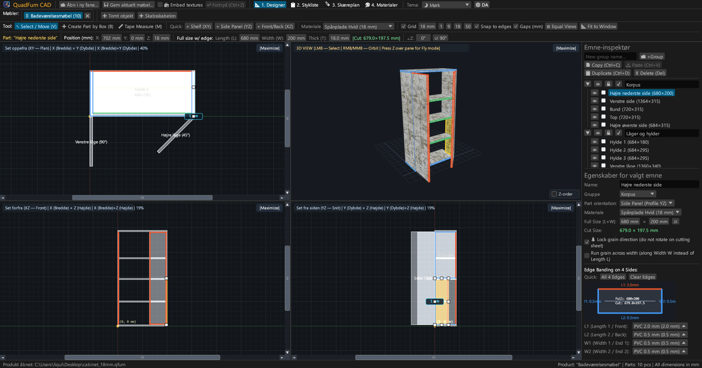
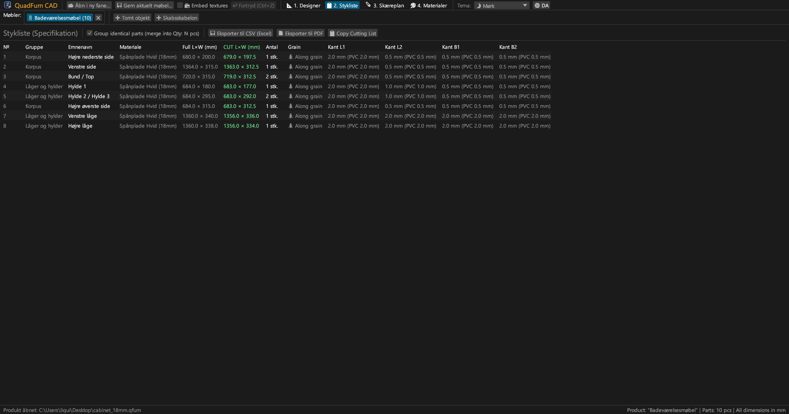
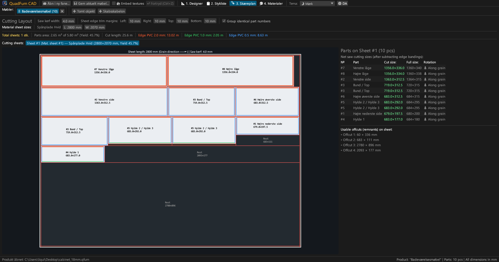
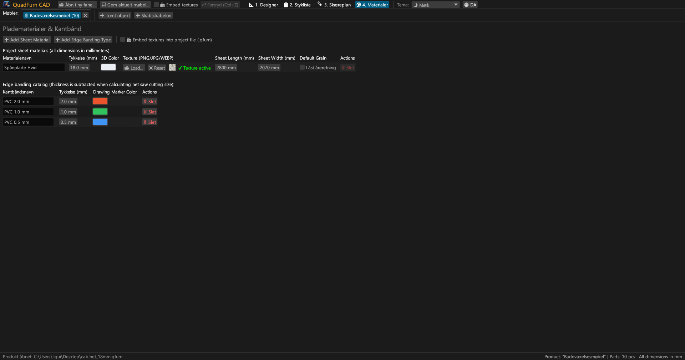
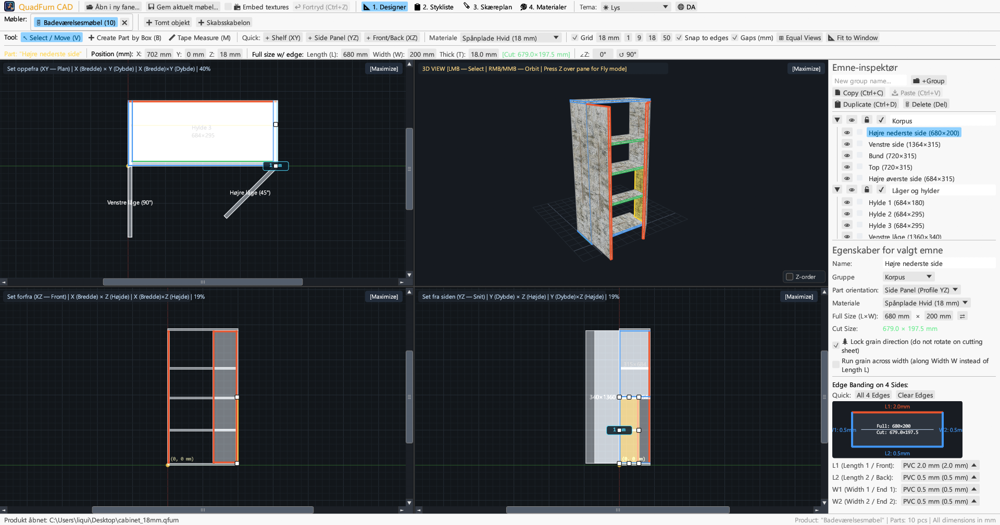
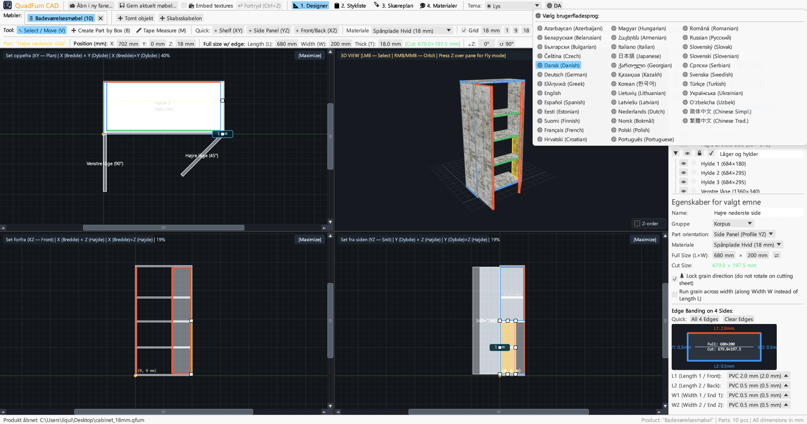

<div align="center">


# QuadFurn CAD

**CAD til plade- og spånplademøbler — Rumlig 4-visnings designer + Guillotine pladeoptimeringsprogram**

[](https://github.com/rbm13s/QuadFurn/actions/workflows/build.yml)
[](https://github.com/rbm13s/QuadFurn/releases)
[](https://www.rust-lang.org/)
[](https://github.com/emilk/egui)
[](https://wgpu.rs/)
[](#8-visuelle-temaer-og-lokalisering-på-22-sprog)
[](#kom-godt-i-gang)
[](../LICENSE)

<br/>

**Languages / Языки / Мови / Sprachen:**<br/>
[English](../README.md) •
[Русский](README-ru.md) •
[Українська](README-uk.md) •
[Беларуская](README-be.md) •
[Қазақша](README-kk.md) •
[ქართული](README-ka.md) •
[Հայերեն](README-hy.md) •
[Azərbaycan](README-az.md) •
[Oʻzbekcha](README-uz.md) •
[Deutsch](README-de.md) •
[Français](README-fr.md) •
[Español](README-es.md) •
[Italiano](README-it.md) •
[Português](README-pt.md) •
[Polski](README-pl.md) •
[Čeština](README-cs.md) •
[Slovenčina](README-sk.md) •
[Slovenščina](README-sl.md) •
[Български](README-bg.md) •
[Српски](README-sr.md) •
[Hrvatski](README-hr.md) •
[Nederlands](README-nl.md) •
**Dansk** •
[Norsk](README-no.md) •
[Svenska](README-sv.md) •
[Suomi](README-fi.md) •
[Eesti](README-et.md) •
[Latviešu](README-lv.md) •
[Lietuvių](README-lt.md) •
[Magyar](README-hu.md) •
[Română](README-ro.md) •
[Türkçe](README-tr.md) •
[Ελληνικά](README-el.md) •
[简体中文](README-zh-cn.md) •
[繁體中文](README-zh-tw.md) •
[日本語](README-ja.md) •
[한국어](README-ko.md)

</div>

---

## Indholdsfortegnelse

- [Introduktion](#introduktion)
- [Skærmbilleder og visuel gennemgang](#skærmbilleder-og-visuel-gennemgang)
- [Nøglefunktioner](#nøglefunktioner)
- [Funktionel dokumentation](#funktionel-dokumentation)
  - [1. 4-visnings CAD-designer & præcisionsstyring](#1-4-visnings-cad-designer--præcisionsstyring)
  - [2. Matematiske udtryk i numeriske felter](#2-matematiske-udtryk-i-numeriske-felter)
  - [3. Kantbånd og automatisk fradrag i savmål](#3-kantbånd-og-automatisk-fradrag-i-savmål)
  - [4. 2D guillotine skæreoptimering](#4-2d-guillotine-skæreoptimering)
  - [5. Projektfaner og udklipsholder på tværs af projekter](#5-projektfaner-og-udklipsholder-på-tværs-af-projekter)
  - [6. Eksport af produktionspas (vektor-PDF, CSV, udklipsholder)](#6-eksport-af-produktionspas-vektor-pdf-csv-udklipsholder)
  - [7. Plade-, tekstur- og kantbåndskatalog](#7-plade--tekstur--og-kantbåndskatalog)
  - [8. Visuelle temaer og lokalisering på 37 sprog](#8-visuelle-temaer-og-lokalisering-på-22-sprog)
- [Styring og tastaturgenveje](#styring-og-tastaturgenveje)
- [Kom godt i gang](#kom-godt-i-gang)
- [Indstillinger og filformater](#indstillinger-og-filformater)
- [Projektarkitektur](#projektarkitektur)
- [Licens](#licens)

---

## Introduktion

**QuadFurn CAD** er et højtydende multiplatform CAD-program skrevet i Rust, tilgængeligt både som en hurtig native desktop-applikation (Windows, Linux, macOS) og som en installationsfri WebAssembly (WASM) online version, der kører direkte i moderne webbrowsere. Det er udviklet til design af skabs- og plademøbler af lamineret spånplade (melamin), MDF, HDF og krydsfiner, komplet med automatisk styklistegenerering og 2D guillotine pladeskæringsoptimering.

QuadFurn forener ergonomien fra tre klassiske værktøjer i ét samlet arbejdsflow:
1. **Rumlig modellering i 4 visninger**: Samtidig redigering i tre synkroniserede 2D-projektioner (**Ovenfra XY — Plan**, **Front XZ — Opstalt**, **Side YZ — Snit**) med rullebjælker, magnetisk snapping, vinduesudligningsknap (`⊞ Udlign vinduer`), intelligent tykkelsesbeskyttelse for kantvendte dele og en realtids **3D Orbit / Førstepersons flyvning (`Z` Noclip)** visning.
2. **Præcisionstransformeringslinje**: Øjeblikkelig numerisk indtastning af koordinater (`X`, `Y`, `Z`), pladestørrelse (`L × W × T`) og rotationsvinkel (`∠Z`) med indbygget matematisk beregning i alle felter (f.eks. `600-4` eller `720+18`).
3. **Pladeskæring og automatisk kantbåndsfradrag**: Automatisk fradrag af PVC/ABS-kantbåndstykkelse på alle 4 kanter for at beregne det nøjagtige **netto savmål for formatsaven**, koblet med en 2D guillotine-nestingmotor, der overholder træets åreretning, savklingens snitbredde og renskæring af pladekanter.

---

## Skærmbilleder og visuel gennemgang

### 1. 4-visnings CAD-designer (Mørkt tema)
Synkrone ortogonale planer (**Plan XY**, **Front XZ**, **Side YZ**) og tekstureret **3D-visning** med perspektivkorrekt UV-kortlægning, 8-punkts størrelseshåndtag og højre **Elementinspektør**.



### 2. Komponentliste (Stykliste) og specifikationer
Overskuelig tabel, der viser både **Færdigmål (`L × W`)** og **Netto savmål (`CUT L × W`)** efter fradrag af kantbånd på hver kant (`L1`, `L2`, `W1`, `W2`).



### 3. Guillotine skæreoptimering af plader
Nesting på standard pladestørrelser (`2800 × 2070 mm` osv.) med gennemgående guillotinesnit, klingetab, kantbeskæring, visuelle kantbåndsmarkeringer og oversigt over brugbare rester.



### 4. Plade- og kantbåndskatalog
Håndtering af pladetykkelser, 3D-farver, brugerdefinerede overfladeteksturer (`PNG`, `JPG`, `WEBP`), årelås og ABS/PVC-kantbåndstyper.



### 5. Understøttelse af Lyst tema
Moderne lyst tema med høj kontrast ved siden af det mørke tema, inklusive automatisk synkronisering med styresystemets indstillinger.



### 6. 37 indbyggede sprog (Brugerflade og PDF-eksport)
Øjeblikkeligt sprogskift uden genstart via knappen **`🌐`** i værktøjslinjen, automatisk registrering af operativsystemets sprog ved første start og oversatte PDF-rapporter.



---

## Nøglefunktioner

- **Synkroniseret 4-visnings arbejdsområde**: Arbejd i Plan (`XY`), Front (`XZ`), Side (`YZ`), eller maksimér enhver visning med et enkelt klik (`[Maksimer]` / `[Gendan 4 visninger]`).
- **Hardwareaccelereret 3D-forhåndsvisning**: Orbit-kamera (`Højre museknap`/`Midterknap`) + fri flyvetilstand i førstepersonsperspektiv (`tast Z` + `WASD`/`Mellemrum`/`Ctrl`) med UV-teksturer og præcis OBB-strålekastning.
- **Magnetisk snappe-funktion og dynamiske mellemrumsmål**: Automatisk snapping til gitter (`1`, `9`, `18`, `50 mm` eller brugerdefineret), magnetisk fasthæftning til tilstødende flader og kanter (`0 mm`) og visning af reelle afstande i millimeter til naboplader.
- **Rammemarkering og gruppetransformation**: Træk en markeringsramme i en 2D-visning for at flytte flere plader sammen, duplikere (`Ctrl+D`) eller kopiere dem på tværs af åbne møbelprojekter (`Ctrl+C` / `Ctrl+V`).
- **Indbygget lommeregner**: Alle numeriske felter accepterer matematiske formler som `600+100`, `800-36`, `720/2` eller `45+15`.
- **Automatisk fradrag for kantbånd ved tilskæring**: Tildel kantbånd (`0.4 mm`, `0.5 mm`, `1.0 mm`, `2.0 mm` osv.) til de 4 sider (`L1`, `L2`, `W1`, `W2`), og programmet beregner straks savmålet:
  $$\text{Savlængde} = L_{\text{færdig}} - E_{L1} - E_{L2}, \quad \text{Savbredde} = W_{\text{færdig}} - E_{W1} - E_{W2}$$
- **2D guillotine-nestingmotor**: Flerplade-algoritme, der overholder træets åreretning, klingebredde og renskæringsmargener på alle 4 sider.
- **Komplet produktionspas i vektor-PDF A4 Liggende**: Eksportér med et enkelt klik på det aktive sprog:
  1. Komplet stykliste over alle elementer
  2. Tekniske 4-visnings arbejdstegninger (`Plan XY`, `3D Isometrisk`, `Front XZ`, `Side YZ`)
  3. Detaljerede skæreplaner for hver enkelt plade
  4. Materialeoversigt og løbende meter kantbånd med `+15 %` spildtillæg

---

## Funktionel dokumentation

### 1. 4-visnings CAD-designer & præcisionsstyring

Fanen **Designer** (`📐 1. Designer`) består af tre primære sektioner:

1. **Øverste værktøjslinjer**:
   - **Tegneværktøjer**:
     - `↖ Vælg / Flyt (V)`: Klik for at vælge et element, træk for at flytte, eller brug håndtagene (8 håndtag på fladen og 2 kanthåndtag fra siden). Træk i tomt rum for at oprette en markeringsramme. Under træk i 2D: hold **`Shift`** nede for at låse bevægelsen til vandret eller lodret akse, hold **`Ctrl` (`Cmd`)** for at ignorere kantfastgørelse, og hold **`Alt`** for at duplikere delen ved slip.
     - `➕ Opret element med ramme (B)`: Træk et rektangel i en 2D-visning (`Plan XY`, `Front XZ` eller `Side YZ`) for at indsætte en plade i det plan.
     - `📏 Målebånd (M)`: Mål nøjagtige afstande punkt til punkt (`ΔX`, `ΔY`, `L`) i millimeter.
   - **Hurtig indsættelse**: Knapper til at indsætte hylder (`+ Hylde (XY)`), sider (`+ Side (YZ)`) eller låger/bagbeklædning (`+ Låge/Bagplade (XZ)`).
   - **Gitter og snapping**: Vælg gittertrin (`1`, `9`, `18`, `50 mm`), magnetisk snappe-funktion til tilstødende kanter og dynamiske mellemrum.
   - **Kamerajustering**:
     - `🔍 Centrer visning`: Centrerer kameraet på nulpunktet eller møblets midte.
     - `📐 Tilpas til vindue`: Beregner automatisk møblets ydre mål og tilpasser skalaen i alle 4 ruder på én gang.
   - **Præcisionstransformeringslinje**: Direkte indtastning og redigering af koordinater `X`, `Y`, `Z`, elementstørrelse `L`, `W`, `T`, grønt savmålsmærke `[Sav: L × W mm]` og rotationsvinkel `∠Z`.

2. **Fire visningsruder**:
   - **2D ortogonale visninger (`Plan XY`, `Front XZ`, `Side YZ`)** med rullebjælker, millimeterlinealer og farvede kantbåndsmarkeringer.
   - **3D-visning**: Orbit-rotation (`Højre` eller `Midterste museknap`), zoom med rullehjul, 3D-valg og **Førstepersons Flyvetilstand (Noclip)** (tryk **`Z`** over 3D-ruden og flyv med `WASD`, `Mellemrum`, `Ctrl`/`Skift`).

3. **Højre Elementinspektør**:
   - Gruppering af elementer i **Grupper** (*Korpus*, *Låger*, *Skuffer*).
   - Synlighedskontrol (`👁`) og låsning mod redigering (`🔒`).
   - Materialevalg, orientering, dimensioner (`L × W` med ombytningsknap `⇄`), årelås (`🌲 Lås åreretning`), tværgående åreretning (`🔄 Tværgående årer`) og interaktivt 4-sidet kantbåndsskema.

---

### 2. Matematiske udtryk i numeriske felter

Alle numeriske indtastningsfelter understøtter matematiske formler:
- **Addition og subtraktion**: Skriv f.eks. `600+100` eller `600-4` i et felt med `600` og tryk på `Enter` — værdien beregnes med det samme til `700` eller `596`.
- **Multiplikation, division og parenteser**: Formler som `(800-36)/2` eller `18*2` udregnes automatisk.
- Både punktum `.` og komma `,` accepteres som decimalseparator, og måleenheder (`mm`, `°`) ignoreres automatisk.

---

### 3. Kantbånd og automatisk fradrag i savmål

- Hvert pladeelement har 4 kanter: **`L1`** (Længde 1 / Foran), **`L2`** (Længde 2 / Bagved), **`W1`** (Bredde 1 / Side 1) og **`W2`** (Bredde 2 / Side 2).
- Hvis du tildeler et PVC-kantbånd på `2.0 mm` til `L1` og `0.5 mm` til `L2`, `W1`, `W2` på et element på `680 × 200 mm`, beregner QuadFurn automatisk det **Nettomål, der skal saves**:
  - $\text{Savlængde } L = 680 - 2.0 - 0.5 = 677.5\text{ mm}$
  - $\text{Savbredde } W = 200 - 0.5 - 0.5 = 199.0\text{ mm}$
- Kantbåndene markeres med tydelige farvede striber i både 2D/3D-visningerne og på skæreplanen.

---

### 4. 2D guillotine skæreoptimering

Fanen **Skæreplan** (`🪚 3. Skæreplan`) beregner den mest fordelagtige fordeling af pladeelementer på råpladerne:
- **Justerbare savparametre**:
  - **Savklingens snitbredde** (standard `4.0 mm`).
  - **Renskæring af pladekanter** (`Venstre`, `Højre`, `Top`, `Bund`, standard `10 mm`) til bortskæring af fabriksskader.
- **Overholdelse af træets åreretning**:
  - Elementer med **Låst åreretning (`🌲`)**: fastholdes strengt parallelt med pladens længderetning (`Pladelængde L`).
  - Elementer med **Fri åreretning**: må roteres $90^\circ$ af optimeringsmotoren, hvis det forbedrer udnyttelsen.
- **Visuelt skærekort og brugbare rester**:
  - Visning af hver plade med røde guillotinesnitlinjer, elementnumre, savmål, kantbåndsangivelser og opmålte genanvendelige rester.
  - Omfattende statistik: antal nødvendige plader, materialeudnyttelse i procent (%), samlet skærelængde og kantbåndsforbrug i meter.

---

### 5. Projektfaner og udklipsholder på tværs af projekter

- **Startside og seneste projekter**: Opret et tomt møbel, start ud fra en 2-dørs skabelon, åbn `.qfurn`/`.json`-filer eller vælg blandt de **10 senest åbnede projekter**.
- **Flere møbelfaner på én gang**: Konstruer flere moduler parallelt (dobbeltklik på fanenavnet for at omdøbe det).
- **Kopier og indsæt mellem projekter**: Markér elementer i én fane, tryk `Ctrl+C`, skift til en anden fane (eller en anden åben instans af QuadFurn), og tryk `Ctrl+V`. Manglende materialer og kantbånd oprettes automatisk i destinationsprojektet.
- **Sikkerhed mod datatab**: Ved lukning af en ændret fane eller afslutning af programmet vises en bekræftelsesdialog (`Gem og afslut`, `Afslut uden at gemme`, `Annuller`).

---

### 6. Eksport af produktionspas (vektor-PDF, CSV, udklipsholder)

I fanen **Stykliste** (`📋 2. Stykliste`):
1. **`📄 Eksportér til PDF` (Vektorielt A4 Liggende produktionspas)**:
   - **Sektion 1**: Fuld stykliste med færdigmål, savmål, kantbånd og åreretning.
   - **Sektion 2**: Tekniske 4-visnings arbejdstegninger (`Plan XY`, `3D Isometrisk`, `Front XZ`, `Side YZ`) med ydre mål.
   - **Sektion 3**: Detaljerede guillotineskæreplaner for hver enkelt plade.
   - **Sektion 4**: Pladeoversigt og forbrug af kantbånd (netto meter og $+15 \%$ sikkerhedstillæg).
   - Dokumentet genereres på det **aktive sprog** med indlejrede TrueType/CID-vektorskrifttyper.
2. **`💾 Eksportér til CSV (Excel)`**: Regneark i UTF-8 med BOM og semikolon `;`, klar til Microsoft Excel eller LibreOffice Calc.
3. **`📋 Kopiér skæreliste`**: Kopierer savmålene til udklipsholderen med tabulatorer for nem overførsel til eksterne skæreprogrammer eller regneark.

---

### 7. Plade-, tekstur- og kantbåndskatalog

I fanen **Materialer** (`🎨 4. Materialer`):
- Opret og rediger **Pladematerialer** (`Spånplade 18 mm`, `MDF 16 mm`, `HDF 3 mm` osv.) med RGB-farver, råplademål (`L × W`) og standard årelås.
- Indlæs overfladeteksturer i formaterne **`PNG`**, **`JPG`/`JPEG`** eller **`WEBP`** til fotorealistisk 3D-visning.
- **Portabilitet og automatisk lokalisering af teksturer**: Ved genåbning af en `.qfurn`-fil leder QuadFurn automatisk efter billederne:
  1. Integreret direkte i projektfilen (Base64)
  2. I samme mappe som `.qfurn`-projektfilen
  3. I en undermappe `./textures/` ved siden af projektfilen
  4. Via den relative sti eller den oprindelige absolutte sti
- **Integrering af teksturer i filen (`📦 Integrer teksturer i projektfilen`)**: Slå denne indstilling til i topbjælken eller under Materialer for at gemme billederne direkte som Base64 i `.qfurn`-filen. Filen bliver derved komplet uafhængig og kan flyttes overalt uden manglende teksturer.
- **Grafikkortbeskyttelse**: Filer over 60 MB afvises med en klar advarsel, og meget høje opløsninger (> 4096 px) nedskaleres automatisk.
- Administration af **Kantbåndstyper** med tykkelse i millimeter og farvekoder. Sletning af materialer eller kantbånd i brug kræver sikkerhedsbekræftelse.

---

### 8. Visuelle temaer og lokalisering på 37 sprog

- **Visuelle temaer**: Skift let mellem **🌙 Mørkt**, **☀ Lyst** og **🖥 Systemtema** i den øverste værktøjslinje.
- **22 indbyggede sprog**:
  `Dansk`, `English`, `Русский`, `Українська`, `Deutsch`, `Polski`, `Español`, `Français`, `Italiano`, `Português`, `Čeština`, `Slovenčina`, `Slovenščina`, `Nederlands`, `Norsk`, `Svenska`, `Magyar`, `Română`, `Türkçe`, `简体中文`, `日本語` og `한국어`.
- **Automatisk registrering ved første start**: Registrerer automatisk operativsystemets sprog og anvender det som standard. Valget gemmes i `%APPDATA%\QuadFurn\settings.json`.

---

## Styring og tastaturgenveje

| Genvej | Handling |
| :--- | :--- |
| **`V`** | Aktivér værktøjet **Vælg og flyt** (8 skaleringshåndtag på fladen og 2 kanthåndtag fra siden, plus rammemarkering) |
| **`B`** | Aktivér værktøjet **Opret element med ramme** i 2D-visninger |
| **`M`** | Aktivér **Målebånd** i 2D-visninger |
| **Træk med `Venstre museknap` (2D)** | Flyt elementer, justér håndtag eller træk markeringsramme i tomt rum |
| **`Shift + Venstreklik` Træk (2D)** | Lås delens bevægelse strengt til vandret eller lodret akse |
| **`Ctrl / Cmd + Venstreklik` Træk (2D)** | Deaktiver magnetisk kantfastgørelse midlertidigt under træk |
| **`Alt + Venstreklik` Træk (2D)** | Dupliker valgte del(e) til destinationspositionen ved slip |
| **`Skift / Ctrl (Cmd) + Venstre museknap` (2D)** | Tilføj eller fjern element fra flervalgsmarkeringen |
| **Træk med `Højre` / `Midterste museknap` (2D)** | Panorér visningen (2D pan) |
| **`Rullehjul på mus` (2D / 3D)** | Zoom ind/ud centreret på markøren |
| **Træk med `Højre` / `Midterste museknap` (3D)** | Orbit-rotation af 3D-kameraet |
| **`Z` (over 3D-ruden)** | Slå **Førstepersons Flyvetilstand (Noclip)** til/fra |
| **`W` `A` `S` `D` / `Mellemrum` / `Ctrl (Cmd)`** | Flyv frem/venstre/tilbage/højre/op/ned i 3D (`Skift` for højere fart) |
| **`Ctrl + S` / `Cmd (⌘) + S`** | Gem det aktive møbel (`.qfurn` / `.json`) |
| **`Ctrl + Z` / `Cmd (⌘) + Z`** | Fortryd sidste handling (historik på op til 40 trin) |
| **`Ctrl + C` / `Cmd (⌘) + C`** | Kopiér markerede dele til udklipsholderen |
| **`Ctrl + V` / `Cmd (⌘) + V`** | Indsæt dele (fungerer på tværs af faner) |
| **`Ctrl + D` / `Cmd (⌘) + D`** | Duplikér markerede elementer |
| **`Delete` / `Backspace`** | Slet markerede elementer |
| **`←` `→` `↑` `↓` (2D-visninger)** | Flyt valgte dele med det valgte gittertrin (`Shift` for dobbelt trin) |

---

## Kom godt i gang

### Færdigbyggede installationspakker (GitHub Releases)
Hver udgivelse genererer automatisk installationspakker via [GitHub Actions](https://github.com/rbm13s/QuadFurn/actions):
- **Windows (`x86_64`)**: `QuadFurn-windows-x86_64.zip` — bærbar `QuadFurn.exe` med integreret ikon.
- **Linux (`Debian 12+ / Ubuntu 22.04+ x86_64`)**:
  - `quadfurn_<version>_amd64.deb` — officiel installationspakke for Debian/Ubuntu (installerer programfil, menupunkt og systemikoner):
    ```bash
    sudo apt install ./quadfurn_0.2.5_amd64.deb
    ```
  - `QuadFurn-linux-x86_64.tar.gz` — bærbar Linux-arkivfil.
- **macOS (`Universel: Apple Silicon M1–M4 + Intel x86_64`)**: `QuadFurn-macos-universal.zip` — nativ `QuadFurn.app` med Retina-ikon.

---

### Kompilering fra kildekode

#### Forudsætninger
- [Rust Toolchain](https://rustup.rs/) (`stable`, udgave Rust 2021)
- Systembiblioteker på **Linux (Debian / Ubuntu)**:
  ```bash
  sudo apt-get update && sudo apt-get install -y \
    build-essential pkg-config libxcb-render0-dev libxcb-shape0-dev \
    libxcb-xfixes0-dev libxkbcommon-dev libxkbcommon-x11-dev libssl-dev \
    libgtk-3-dev libglib2.0-dev libatk1.0-dev libgdk-pixbuf-2.0-dev \
    libcairo2-dev libpango1.0-dev libgl1-mesa-dev fonts-dejavu-core fonts-noto-cjk
  ```
- **macOS**: Xcode Command Line Tools (`xcode-select --install`)
- **Windows**: Windows 10 / 11 med Visual C++ Build Tools

#### Kompileringskommandoer
```bash
# Kør i udviklingstilstand
cargo run

# Kompiler optimeret version til udgivelse
cargo build --release

# Kør enhedstests
cargo test
```

---

## Indstillinger og filformater

- **Brugerindstillinger (`settings.json`)**:
  Gemmes automatisk i operativsystemets standardkonfigurationsmappe:
  - **Windows**: `%APPDATA%\QuadFurn\settings.json`
  - **Linux**: `~/.config/QuadFurn/settings.json`
  - **macOS**: `~/Library/Application Support/QuadFurn/settings.json`
  
  Husker:
  - `theme_choice` (`Dark`, `Light`, `System`)
  - `language` (`Da`, `En`, `Ru` osv.)
  - `recent_projects` (op til 10 senest åbnede filer)
- **Projektfiler (`.qfurn` / `.json`)**:
  Letlæselige JSON-tekstfiler i UTF-8 med alle elementer, grupper, materialer, teksturer, kantbånd og savindstillinger. Når integrering af teksturer er aktiveret, gemmes billeder som Base64-strenge inde i filen.

---

## Projektarkitektur

```text
QuadFurn/
├── .github/
│   └── workflows/
│       └── build.yml          # CI/CD-arbejdsgange på GitHub Actions (Linux .deb/.tar.gz, macOS .app, Windows .zip)
├── assets/
│   ├── icon.jpeg              # Programikon og kildebillede
│   └── screenshots/           # Skærmbilleder til dokumentationen
├── docs/                      # Dokumentation oversat til 37 sprog
├── src/
│   ├── main.rs                # Indgangspunkt, håndtering af projektfaner, startside og tastaturgenveje
│   ├── model.rs               # Datamodel (Project, PartBlock, SheetMaterial, EdgeBanding, OBB)
│   ├── viewport.rs            # 4-visnings controller, 2D og 3D rendering wgpu/painter
│   ├── snapping.rs            # Magnetisk snappe-funktion til gitter og kanter, projektionsakser
│   ├── cutter.rs              # 2D guillotine skæreoptimering og fradrag for kantbånd
│   ├── export.rs              # Vektoriel PDF A4 Liggende eksportør og CSV-eksportør
│   ├── ui_panels.rs           # Transformeringslinje, Elementinspektør, Stykliste, Skæreplan og Materialer
│   └── i18n.rs                # Oversættelsesordbøger for 37 sprog og automatisk registrering af OS-sprog
├── build.rs                   # Automatisk konvertering af ICO-ikon til Windows og PE-ressource
├── Cargo.toml                 # Pakkekonfiguration og afhængigheder
└── LICENSE                    # MIT-licens
```

---

## Licens

Dette projekt er udgivet under [MIT-licensen](../LICENSE) — frit tilgængeligt for privat og kommerciel anvendelse, modifikation og videredistribution.


