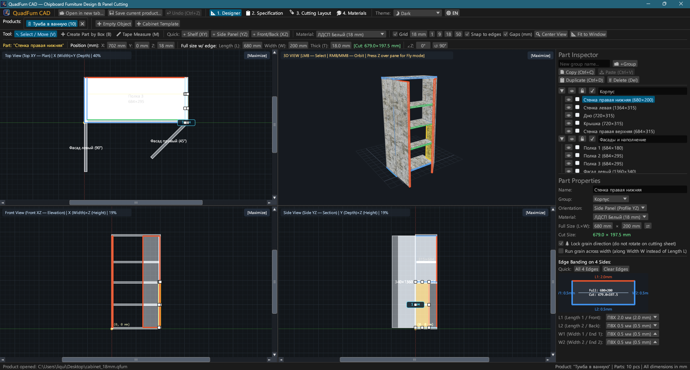
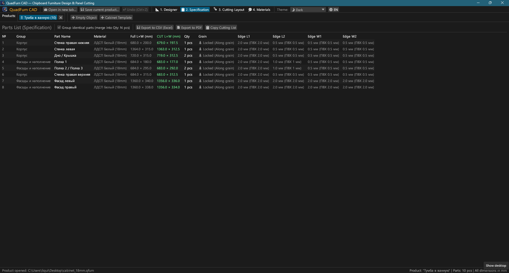
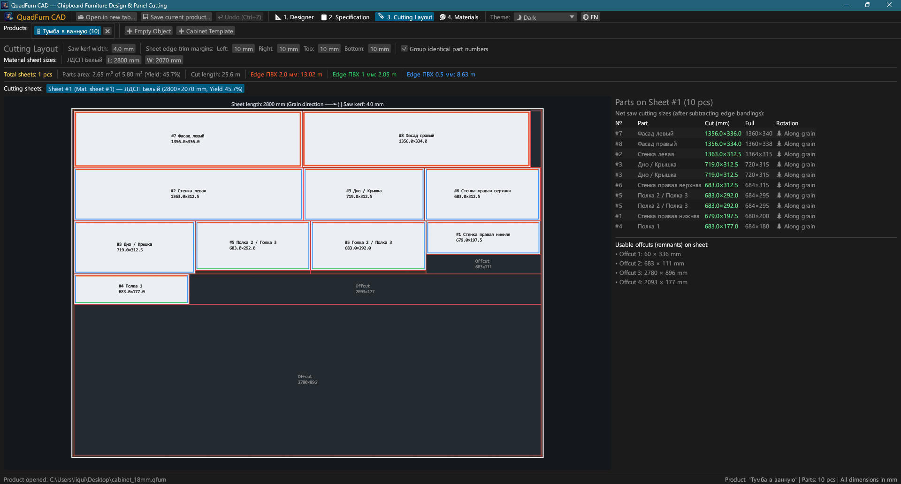
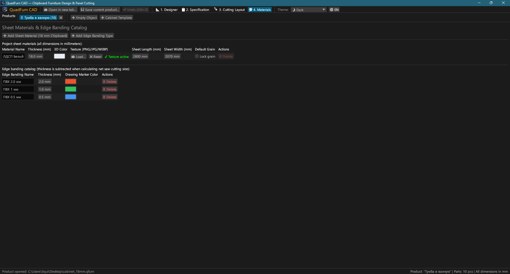
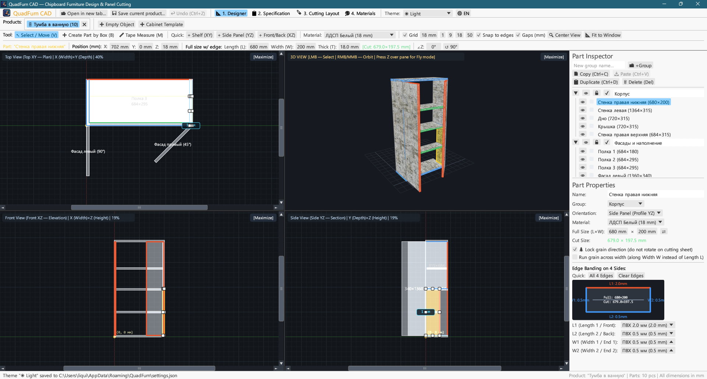
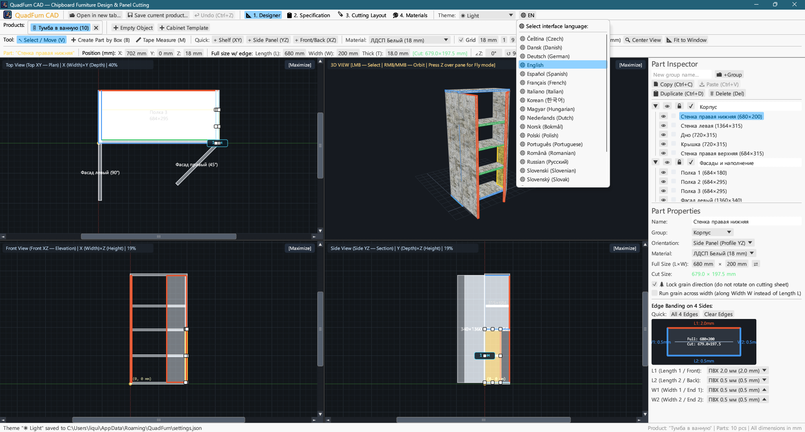

<div align="center">


# QuadFurn CAD

**Möbel-CAD für Spanplatten & Kastenmöbel — 4-Projektionen-Raumplaner + Guillotinen-Plattenzuschnitt-Optimierer**

[](https://github.com/rbm13s/QuadFurn/actions/workflows/build.yml)
[](https://github.com/rbm13s/QuadFurn/releases)
[](https://www.rust-lang.org/)
[](https://github.com/emilk/egui)
[](https://wgpu.rs/)
[](#8-farbthemen--lokalisierung-in-22-sprachen)
[](#erste-schritte)
[](../LICENSE)

<br/>

**Languages / Языки / Мови / Sprachen:**<br/>
[English](../README.md) •
[Русский](README-ru.md) •
[Українська](README-uk.md) •
**Deutsch** •
[Polski](README-pl.md) •
[Español](README-es.md) •
[Français](README-fr.md) •
[Italiano](README-it.md) •
[Português](README-pt.md) •
[Čeština](README-cs.md) •
[Slovenčina](README-sk.md) •
[Slovenščina](README-sl.md) •
[Nederlands](README-nl.md) •
[Dansk](README-da.md) •
[Norsk](README-no.md) •
[Svenska](README-sv.md) •
[Magyar](README-hu.md) •
[Română](README-ro.md) •
[Türkçe](README-tr.md) •
[简体中文](README-zh-cn.md) •
[日本語](README-ja.md) •
[한국어](README-ko.md)

</div>

---

## Inhaltsverzeichnis

- [Einführung](#einführung)
- [Screenshots & Visuelle Tour](#screenshots--visuelle-tour)
- [Hauptfunktionen](#hauptfunktionen)
- [Funktionsdokumentation](#funktionsdokumentation)
  - [1. 4-Projektionen-CAD-Designer (Hammer Editor + CorelDRAW Workflow)](#1-4-projektionen-cad-designer-hammer-editor--coreldraw-workflow)
  - [2. Mathematische Ausdrücke in numerischen Feldern](#2-mathematische-ausdrücke-in-numerischen-feldern)
  - [3. Kantenanleimen & automatischer Sägeabzug](#3-kantenanleimen--automatischer-sägeabzug)
  - [4. Guillotinen-2D-Plattenzuschnitt-Optimierung (Cutting 3 Stil)](#4-guillotinen-2d-plattenzuschnitt-optimierung-cutting-3-stil)
  - [5. Produkt-Tabs & Projektübergreifendes Kopieren/Einfügen](#5-produkt-tabs--projektübergreifendes-kopiereneinfügen)
  - [6. Produktionspass-Export (Vektor-PDF, Excel CSV, Zwischenablage)](#6-produktionspass-export-vektor-pdf-excel-csv-zwischenablage)
  - [7. Plattenwerkstoffe, Texturen & Kantenkatalog](#7-plattenwerkstoffe-texturen--kantenkatalog)
  - [8. Farbthemen & Lokalisierung in 22 Sprachen](#8-farbthemen--lokalisierung-in-22-sprachen)
- [Bedienung & Tastenkombinationen](#bedienung--tastenkombinationen)
- [Erste Schritte](#erste-schritte)
- [Einstellungen & Dateiformate](#einstellungen--dateiformate)
- [Projektarchitektur](#projektarchitektur)
- [Lizenz](#lizenz)

---

## Einführung

**QuadFurn CAD** ist eine schnelle, native Desktop-CAD-Anwendung in Rust für die Konstruktion von Korpus- und Plattenmöbeln aus beschichteten Spanplatten, MDF, HDF und Sperrholz, komplett mit automatischer Stücklistenerstellung und 2D-Guillotinen-Plattenzuschnitt-Optimierung.

QuadFurn kombiniert die besten Arbeitsabläufe aus drei klassischen Werkzeugen:
1. **Valve Hammer Editor 4-Projektionen-Modellierung**: Gleichzeitiges Arbeiten in drei synchronisierten 2D-Projektionen (**Draufsicht XY — Grundriss**, **Frontansicht XZ — Aufriss**, **Seitenansicht YZ — Schnitt**) mit Scrollbalken, magnetischem Fangen und einem Echtzeit-**3D-Orbit-/Freiflugfenster (`Z` Noclip)**.
2. **CorelDRAW Präzisions-Transformationsleiste**: Sofortige Eingabe von Koordinaten (`X`, `Y`, `Z`), Abmessungen (`L × B × T`) und Drehwinkel (`∠Z`) mit direktem Rechenausdruck (z. B. Eingabe von `600-4` oder `720+18`).
3. **Cutting 3 Plattenaufteilung & Kantenstärkenabzug**: Automatischer Abzug der PVC/ABS-Kantenstärke von den Fertigmaßen zur Berechnung exakter **Netto-Sägezuschnittmaße**, kombiniert mit einem 2D-Guillotinen-Packer unter Berücksichtigung von Faserrichtung, Sägeschnittbreite und Besäumschnitt.

---

## Screenshots & Visuelle Tour

### 1. 4-Projektionen-Designer (Dunkles Design)
Gleichzeitige 2D-Projektionen (**Draufsicht XY**, **Front XZ**, **Seite YZ**) und texturiertes **3D-Fenster** mit perspektivischer Texturierung, Tiefensortierung, 8 interaktiven Größenänderungs-Griffen und dem rechten **Bauteil-Inspektor**.



### 2. Stückliste (Spezifikation) & Export
Gruppierte Stückliste mit Anzeige von **Fertigmaßen (`L × B`)** und **Netto-Sägezuschnittmaßen (`Schnitt L × B`)** nach Abzug der Kantenstärken an allen vier Seiten (`L1`, `L2`, `B1`, `B2`).



### 3. Guillotinen-Plattenzuschnitt
Optimierte Verschachtelung der Bauteile auf Standardplatten (`2800 × 2070 mm` etc.) mit durchgehenden Schnitten, Sägeblattbreite, Besäumrändern, Farbkantenmarkierungen und verwertbaren Restplatten.



### 4. Plattenmaterialien & Kantenkatalog
Verwalten von Plattenstärken, 3D-Farben, Oberflächendekoren (`PNG`, `JPG`, `WEBP`), Plattenmaßen, Faserrichtungsfixierung und PVC/ABS-Kantentypen.



### 5. Helles Design
Klares, kontrastreiches helles Design neben dem dunklen Design und automatischer Synchronisation mit dem Betriebssystem.



### 6. 22 integrierte Sprachen (UI & PDF-Export)
Sofortige Umschaltung der Sprache über die Schaltfläche **`🌐`** in der oberen Symbolleiste, automatische Erkennung der Systemsprache beim ersten Start und lokalisierter PDF-Export.



---

## Hauptfunktionen

- **Synchronisierter 4-Projektionen-Arbeitsbereich**: Bearbeitung in Draufsicht (`XY`), Front (`XZ`), Seite (`YZ`) oder Maximierung jedes Fensters mit einem Klick (`[Maximieren]` / `[4 Ansichten]`).
- **Hardwarebeschleunigte 3D-Vorschau**: Orbit-Kamera (`RMB`/`MMB`) + Ego-Freiflug-Kamera im Hammer-Stil (`Z`-Taste + `WASD`/`Leertaste`/`Ctrl`) mit OBB-Raycasting.
- **Magnetisches Fangen & Live-Abstandsmessung**: Automatisches Fangen an Rasterschritten (`1`, `9`, `18`, `50 mm`) und an Kanten benachbarter Bauteile (`0 mm` Bündigstoß) mit Abstandsanzeigen.
- **Rahmenauswahl & Gruppentransformation**: Rechteckige Rahmenauswahl in 2D-Ansichten, gemeinsames Verschieben, Duplizieren (`Ctrl+D`) und Kopieren/Einfügen zwischen Projekten (`Ctrl+C` / `Ctrl+V`).
- **Integrierter Rechner**: Alle numerischen Felder akzeptieren mathematische Ausdrücke wie `600+100`, `800-36`, `720/2` oder `45+15`.
- **Automatischer Kantenabzug**: Zuweisung von Kantenbändern (`0.4 mm`, `0.8 mm`, `1.0 mm`, `2.0 mm` usw.) an beliebige der 4 Kanten (`L1`, `L2`, `B1`, `B2`):
  $$\text{Schnittlänge} = L_{\text{voll}} - K_{L1} - K_{L2}, \quad \text{Schnittbreite} = B_{\text{voll}} - K_{B1} - K_{B2}$$
- **Guillotinen-2D-Verschachtelung**: Plattenzuschnitt unter Beachtung der Holzmaserung, Sägeblattfuge und 4-seitigen Besäumschnitten.
- **4-teiliger Vektor-PDF-Produktionspass**: Export eines druckfertigen A4-Querformat-PDFs in der aktiven Sprache:
  1. Stücklistentabelle
  2. 4 Projektionsansichten (`Draufsicht XY`, `3D Isometrie`, `Front XZ`, `Seite YZ`)
  3. Schnittpläne für jede Platte
  4. Material- und Kantenverbrauchsübersicht mit `+15%` Verschnittzugabe

---

## Funktionsdokumentation

### 1. 4-Projektionen-CAD-Designer (Hammer Editor + CorelDRAW Workflow)

Der Reiter **Designer** (`📐 1. Designer`) gliedert sich in drei Hauptbereiche:

1. **Obere Werkzeugleiste**:
   - **Editor-Werkzeuge**:
     - `↖ Auswählen / Verschieben (V)`: Klick wählt ein Bauteil aus, Ziehen verschiebt es, Ziehen an einem der 8 Griffe skaliert es. Ziehen auf freier Fläche spannt einen **Auswahlrahmen** auf.
     - `➕ Bauteil per Rahmen erstellen (B)`: Ziehen eines Rechtecks in einer 2D-Ansicht erzeugt eine Platte in dieser Ebene (`Fachboden XY`, `Seitenwand YZ`, `Front/Rückwand XZ`).
     - `📏 Messband (M)`: Misst exakte Abstände (`ΔX`, `ΔY`, `L`) in Millimetern.
   - **Schnellbausteine**: Direkte Tasten (`+ Fachboden (XY)`, `+ Seitenwand (YZ)`, `+ Front (XZ)`).
   - **Raster & Fangen**: Rasterschritte (`1`, `9`, `18`, `50 mm`), Kantenfangen und Abstände zu Nachbarn (`Abstände (mm)`).
   - **Kamera-Zentrierung**:
     - `🔍 Zentrieren`: Zentriert alle Kameras auf das Modell.
     - `📐 In Fenster einpassen`: Berechnet die Gesamtabmessungen und zoomt alle 4 Ansichten optimal ein.
   - **CorelDRAW Transformationsleiste**: Anzeige und Änderung von `X`, `Y`, `Z`, `Länge (L)`, `Breite (B)`, `Stärke (T)`, grünem Zuschnittabzeichen `[Schnitt: L × B mm]` und Drehwinkel `∠Z`.

2. **4 Ansichtsfenster**:
   - **Draufsicht (`Draufsicht XY`)**, **Frontansicht (`Front XZ`)** und **Seitenansicht (`Seite YZ`)** mit Scrollbalken, Linealen und Farbkantenmarkierungen.
   - **3D-Ansicht**: Orbit-Drehung (`RMB`/`MMB`), Zoom (`Mausrad`) und **Ego-Freiflugmodus** (Taste **`Z`** über dem 3D-Fenster).

3. **Rechter Inspektor (`Bauteil-Inspektor` & `Bauteil-Eigenschaften`)**:
   - Gruppierung von Bauteilen (*Korpus*, *Fronten*, *Schubladen*).
   - Umschalten von **Sichtbarkeit (`👁`)** und **Sperre (`🔒`)**.
   - Werkstoffauswahl, Maße (`L × B` mit Tausch `⇄`), Faserfixierung (`🌲 Faserrichtung sperren`) und interaktives 4-Seiten-Kantenanleimdiagramm.

---

### 2. Mathematische Ausdrücke in numerischen Feldern

Alle Zahlenfelder in QuadFurn CAD unterstützen direkte Rechenausdrücke:
- **Addition & Subtraktion**: In ein Feld mit `600` klicken, `600+100` (oder `600-4`) eingeben und `Enter` drücken — das Feld rechnet automatisch auf `700` (oder `596`).
- **Multiplikation, Division & Klammern**: Ausdrücke wie `(800-36)/2` oder `18*2` werden direkt ausgewertet.
- Punkt `.` und Komma `,` werden gleichermaßen als Dezimaltrennzeichen akzeptiert, Einheiten wie `mm` oder `°` werden automatisch ignoriert.

---

### 3. Kantenanleimen & automatischer Sägeabzug

In der Möbelfertigung muss die Kantenstärke vor dem Zuschnitt vom Fertigmaß abgezogen werden:
- Jedes Bauteil hat 4 Kanten: **`L1`** (Länge 1 / Vorne), **`L2`** (Länge 2 / Hinten), **`B1`** (Breite 1 / Seite 1) und **`B2`** (Breite 2 / Seite 2).
- Zuweisung von z. B. `2.0 mm` PVC auf `L1` und `0.4 mm` auf `L2`, `B1`, `B2` bei einem Bauteil von `680 × 200 mm` ergibt:
  - $\text{Schnitt } L = 680 - 2.0 - 0.4 = 677.6\text{ mm}$
  - $\text{Schnitt } B = 200 - 0.4 - 0.4 = 199.2\text{ mm}$
- Farbige Kantenmarkierungen werden in 2D, 3D und auf den Schnittplänen visualisiert.

---

### 4. Guillotinen-2D-Plattenzuschnitt-Optimierung (Cutting 3 Stil)

Der Reiter **Zuschnitt** (`🪚 3. Zuschnitt`) verschachtelt alle sichtbaren Bauteile automatisch auf Platten:
- **Sägeparameter**: Sägeblattbreite (Standard `4.0 mm`), Besäumschnitt an allen 4 Plattenrändern (Standard `10 mm`).
- **Faserrichtung**: Bauteile mit fester Maserung (`🌲`) werden niemals quer zur Plattenfaser gedreht. Bauteile mit freier Maserung dreht der Algorithmus zur optimalen Ausnutzung.
- **Schnittpläne & Reststücke**: Anzeige durchgehender Schnittlinien, Bauteilnummern `#1..#N`, Zuschnittmaße und beschrifteter Restplatten.

---

### 5. Produkt-Tabs & Projektübergreifendes Kopieren/Einfügen

- **Startseite & Zuletzt geöffnet**: Schneller Zugriff auf neue leere Projekte, 2-türige Schrankvorlagen oder die **10 zuletzt geöffneten Dateien**.
- **Mehrere offene Möbelstücke**: Paralleles Arbeiten in Tabs (Doppelklick zum Umbenennen).
- **Tabübergreifendes Kopieren (`Ctrl+C` / `Ctrl+V`)**: Bauteile markieren, kopieren und in ein anderes Produkt einfügen — Materialien und Kanten werden automatisch abgeglichen.
- **Schutz vor Datenverlust**: Bestätigungsdialog beim Schließen ungespeicherter Dokumente.

---

### 6. Produktionspass-Export (Vektor-PDF, Excel CSV, Zwischenablage)

Im Reiter **Spezifikation** (`📋 2. Spezifikation`):
1. **`📄 PDF exportieren` (Mehrseitiger A4-Querformat-Produktionspass)**:
   - Stückliste mit Netto-Zuschnittmaßen und Kanten.
   - 4-Projektionen-Übersichtsseite mit Hauptabmessungen.
   - Detaillierte Schnittpläne für jede Platte.
   - Material- und Kantenzusammenfassung inklusive `+15%` Verschnittzugabe.
2. **`💾 In CSV exportieren (Excel)`**: Semikolon-getrennte Tabelle mit UTF-8-BOM für Microsoft Excel.
3. **`📋 Zuschnittliste kopieren`**: Tabulatorgetrennter Text zum Einfügen in externe Optimierer (Cutting 3 etc.).

---

### 7. Plattenwerkstoffe, Texturen & Kantenkatalog

Im Reiter **Materialien** (`🎨 4. Materialien`):
- Verwalten von Plattenmaterialien (`18 mm Spanplatte`, `16 mm MDF`, `3 mm HDF` etc.) mit 3D-Farben und Plattenformaten.
- Laden von Texturen (`PNG`, `JPG`, `WEBP`) für fotorealistisches Rendering.
- **Portabilität & Relative Pfade**: Automatisches Auffinden von Texturen im Projektordner oder im `./textures/`-Unterordner.
- **Texturen einbetten (`📦 Texturen in Projektdatei einbetten`)**: Speichert Bilder als Base64 direkt in der `.qfurn`-Datei für vollständige Portabilität.
- **GPU-Schutz**: Dateien über 60 MB werden abgefangen, übergroße Texturen automatisch herunterskaliert.

---

### 8. Farbthemen & Lokalisierung in 22 Sprachen

- **Themen**: Wechsel zwischen **🌙 Dunkel**, **☀ Hell** und **🖥 System** in der oberen Leiste.
- **22 Sprachen**: Vollständig lokalisierte Oberfläche und PDF-Generierung.
- **Systemsprachenerkennung**: Startet automatisch in der Sprache Ihres Betriebssystems.

---

## Bedienung & Tastenkombinationen

| Eingabe / Tastenkürzel | Aktion |
| :--- | :--- |
| **`V`** | Werkzeug **Auswählen & Verschieben** aktivieren (mit 8 Griffen & Rahmenauswahl) |
| **`B`** | Werkzeug **Bauteil per Rahmen erstellen** in 2D-Fenstern |
| **`M`** | Werkzeug **Messband** in 2D-Fenstern |
| **`LMB` Ziehen (2D)** | Ausgewählte Bauteile verschieben, Griffe ziehen oder Rahmen aufziehen |
| **`Shift + LMB` (2D)** | Bauteil zur Mehrfachauswahl hinzufügen/entfernen |
| **`RMB` / `MMB` Ziehen (2D)** | 2D-Kamera verschieben (Pan) |
| **`Mausrad` (2D / 3D)** | Kamera zoomen |
| **`RMB` / `MMB` Ziehen (3D)** | 3D-Kamera um das Modell drehen (Orbit) |
| **`Z` (über 3D-Fenster)** | **3D-Freiflugmodus (Noclip)** ein-/ausschalten |
| **`W` `A` `S` `D` / `Leertaste` / `Ctrl`** | Vorwärts/links/rückwärts/rechts/auf/ab im 3D-Flugmodus (`Shift` für Turbo) |
| **`Ctrl + S`** | Aktuelles Möbelprojekt speichern (`.qfurn` / `.json`) |
| **`Ctrl + Z`** | Letzte Aktion im aktiven Tab rückgängig machen (bis zu 40 Schritte) |
| **`Ctrl + C` / `Ctrl + V`** | Ausgewählte Bauteile kopieren / einfügen (tabübergreifend) |
| **`Ctrl + D`** | Ausgewählte Bauteile duplizieren |
| **`Delete` / `Backspace`** | Ausgewählte Bauteile löschen |

---

## Erste Schritte

### Fertige Installationspakete (GitHub Releases)
Automatisierte Builds bei jedem Commit über [GitHub Actions](https://github.com/rbm13s/QuadFurn/actions):
- **Windows (`x86_64`)**: `QuadFurn-windows-x86_64.zip` — portable `QuadFurn.exe` mit integriertem Icon.
- **Linux (`Debian 12+ / Ubuntu 22.04+ x86_64`)**:
  - `quadfurn_<version>_amd64.deb` — Debian/Ubuntu-Installationspaket:
    ```bash
    sudo apt install ./quadfurn_0.2.1_amd64.deb
    ```
  - `QuadFurn-linux-x86_64.tar.gz` — portables Standalone-Archiv.
- **macOS (`Universal: Apple Silicon + Intel x86_64`)**: `QuadFurn-macos-universal.zip` — native `QuadFurn.app` mit Retina-Icon.

---

### Aus dem Quellcode bauen

#### Voraussetzungen
- [Rust Toolchain](https://rustup.rs/) (`stable`, Edition 2021)
- Systembibliotheken für **Linux (Debian / Ubuntu)**:
  ```bash
  sudo apt-get update && sudo apt-get install -y \
    build-essential pkg-config libxcb-render0-dev libxcb-shape0-dev \
    libxcb-xfixes0-dev libxkbcommon-dev libxkbcommon-x11-dev libssl-dev \
    libgtk-3-dev libglib2.0-dev libatk1.0-dev libgdk-pixbuf-2.0-dev \
    libcairo2-dev libpango1.0-dev libgl1-mesa-dev fonts-dejavu-core fonts-noto-cjk
  ```
- **macOS**: Xcode Command Line Tools (`xcode-select --install`)
- **Windows**: Windows 10 / 11 mit MSVC Build Tools

```bash
# Entwicklungsmodus ausführen
cargo run

# Optimiertes Release-Binary kompilieren
cargo build --release

# Tests ausführen
cargo test
```

---

## Einstellungen & Dateiformate

- **Benutzereinstellungen (`settings.json`)**:
  Gespeichert in:
  - **Windows**: `%APPDATA%\QuadFurn\settings.json`
  - **Linux**: `$XDG_CONFIG_HOME/QuadFurn/settings.json`
  - **macOS**: `~/Library/Application Support/QuadFurn/settings.json`
- **Projektdateien (`.qfurn` / `.json`)**:
  Lesbare UTF-8 JSON-Dateien mit allen Bauteilen, Materialien, Kanten und Schnittparametern.

---

## Projektarchitektur

```text
QuadFurn/
├── .github/
│   └── workflows/
│       └── build.yml          # GitHub Actions CI/CD
├── assets/
│   ├── icon.jpeg              # Anwendungslogo
│   └── screenshots/           # Screenshots für Dokumentation
├── docs/                      # Lokalisierte Dokumentation (22 Sprachen)
├── src/
│   ├── main.rs                # Einstiegspunkt, Fensterverwaltung, Tabs
│   ├── model.rs               # Datenmodell (Project, PartBlock, SheetMaterial, EdgeBanding)
│   ├── viewport.rs            # 4-Ansichten-Controller, 2D/3D Renderer
│   ├── snapping.rs            # Magnetisches Fangen & Abstände
│   ├── cutter.rs              # Stückliste & 2D-Guillotinen-Zuschnitt
│   ├── export.rs              # PDF-, CSV- und Schnittdatenexport
│   ├── ui_panels.rs           # Symbolleisten, Inspektor, Einstellungsdialoge
│   └── i18n.rs                # 22-Sprachen-Lokalisierungswörterbücher
├── build.rs                   # Windows Icon-Einbettung
├── Cargo.toml                 # Paketmanifest
└── LICENSE                    # MIT-Lizenz
```

---

## Lizenz

Dieses Projekt ist unter der [MIT-Lizenz](../LICENSE) lizenziert — freie Verwendung für private und kommerzielle Zwecke.

