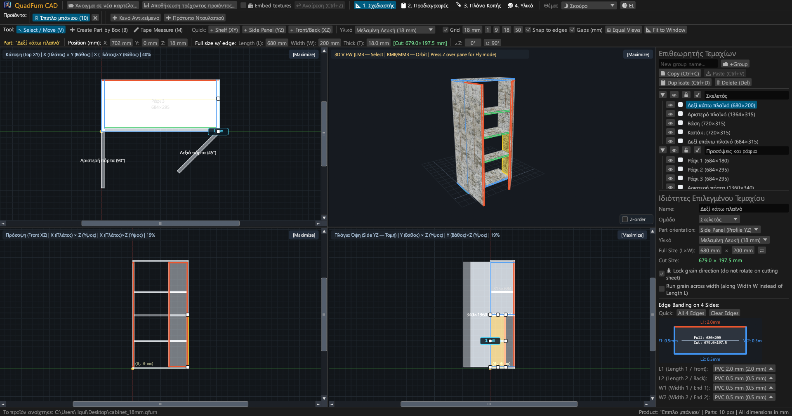
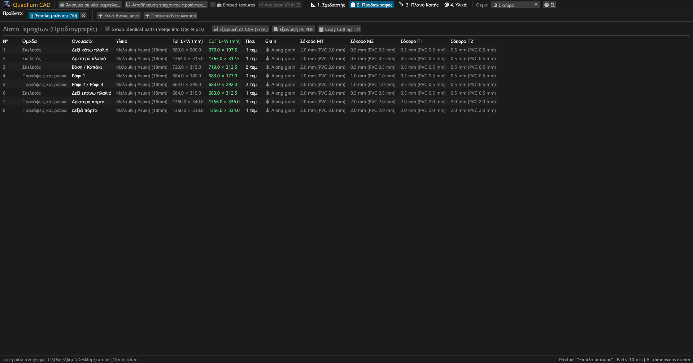
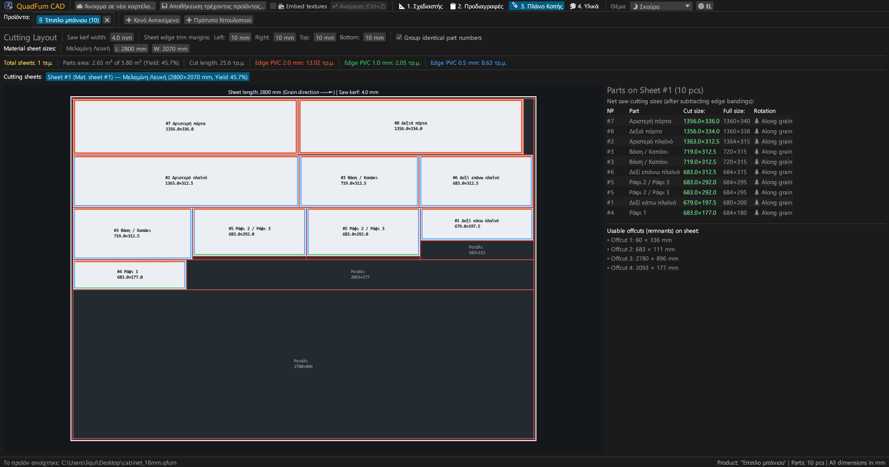
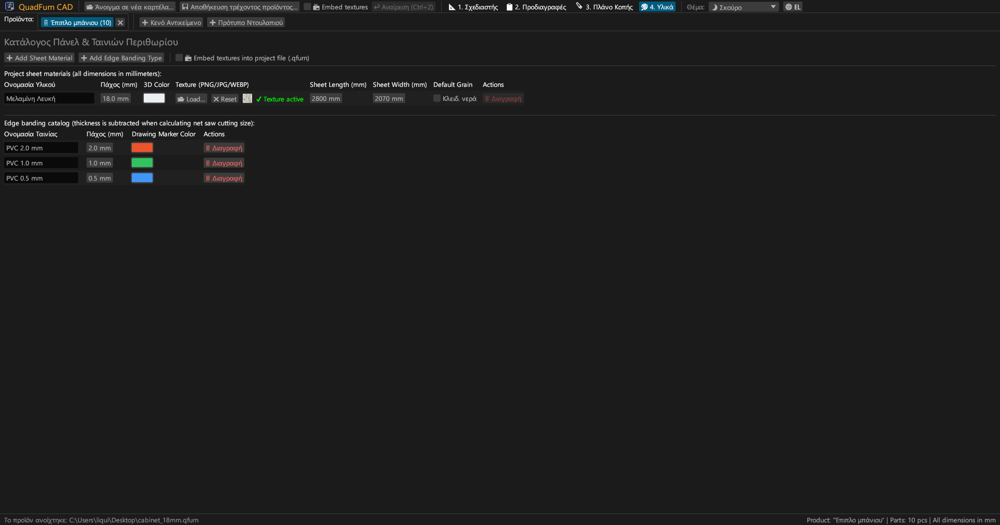
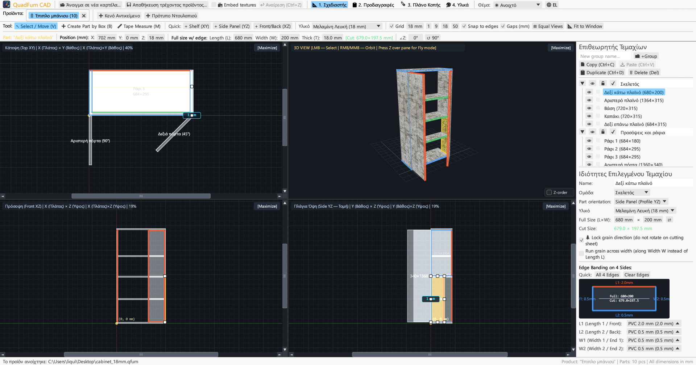
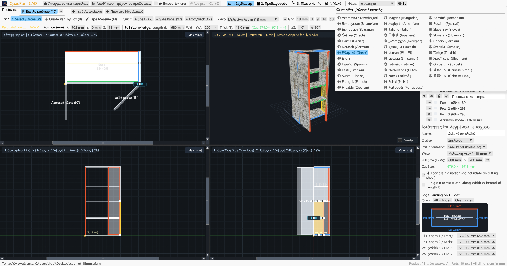

# QuadFurn CAD

**CAD για έπιπλα κουτιού από μοριοσανίδα — Σχεδιαστής 4 προβολών + Βελτιστοποίηση γκιλοτίνας κοπής πάνελ**

 

👉 **[🚀 Εκτελέστε το QuadFurn CAD στο πρόγραμμα περιήγησης (WebAssembly)](https://rbm13s.github.io/QuadFurn/app/)** • **[🌐 Επίσημος ιστότοπος](https://rbm13s.github.io/QuadFurn/el.html)**

 

**Languages / Языки / Мови / Sprachen:** 
[English](../README.md) •
[Русский](README-ru.md) •
[Українська](README-uk.md) •
[Беларуская](README-be.md) •
[Қазақша](README-kk.md) •
[ქართული](README-ka.md) •
[Հայերեն](README-hy.md) •
[Azərbaycan](README-az.md) •
[Oʻzbekcha](README-uz.md) •
[Deutsch](README-de.md) •
[Français](README-fr.md) •
[Español](README-es.md) •
[Italiano](README-it.md) •
[Português](README-pt.md) •
[Polski](README-pl.md) •
[Čeština](README-cs.md) •
[Slovenčina](README-sk.md) •
[Slovenščina](README-sl.md) •
[Български](README-bg.md) •
[Српски](README-sr.md) •
[Hrvatski](README-hr.md) •
[Nederlands](README-nl.md) •
[Dansk](README-da.md) •
[Norsk](README-no.md) •
[Svenska](README-sv.md) •
[Suomi](README-fi.md) •
[Eesti](README-et.md) •
[Latviešu](README-lv.md) •
[Lietuvių](README-lt.md) •
[Magyar](README-hu.md) •
[Română](README-ro.md) •
[Türkçe](README-tr.md) •
**Ελληνικά** •
[简体中文](README-zh-cn.md) •
[繁體中文](README-zh-tw.md) •
[日本語](README-ja.md) •
[한국어](README-ko.md)

---

## Περιεχόμενα

- [Εισαγωγή](#εισαγωγή)
- [Στιγμιότυπα οθόνης](#στιγμιότυπα-οθόνης)
- [Βασικά χαρακτηριστικά](#βασικά-χαρακτηριστικά)
- [Λειτουργική τεκμηρίωση](#λειτουργική-τεκμηρίωση)
- [Χειρισμός και συντομεύσεις](#χειρισμός-και-συντομεύσεις)
- [Άδεια χρήσης](#άδεια-χρήσης)

---

## Εισαγωγή

Το **QuadFurn CAD** είναι μια εφαρμογή CAD υψηλής απόδοσης γραμμένη σε Rust για τον σχεδιασμό επίπλων κουτιού από μελαμίνη/μοριοσανίδα, MDF και κόντρα πλακέ, με αυτόματη αφαίρεση περιθωρίων σοκόρου (PVC/ABS) και βελτιστοποίηση κοπής πάνελ γκιλοτίνας 2D.

---

## Στιγμιότυπα οθόνης

### 1. Σχεδιαστής CAD 4 προβολών (Σκούρο θέμα)
Συγχρονισμένες 2D ορθογραφικές προβολές (**Κάτοψη XY**, **Πρόσοψη XZ**, **Πλάγια τομή YZ**) και **3D προβολή**:

### 2. Προδιαγραφές εξαρτημάτων
Πίνακας διαστάσεων μετά την αφαίρεση του σοκόρου:

### 3. Χάρτες κοπής
Βέλτιστη τοποθέτηση σε τυποποιημένα φύλλα:

### 4. Υλικά και σοκόρα
Διαχείριση παχών πάνελ, χρωμάτων και υφών (`PNG`, `JPG`, `WEBP`):

### 5. Φωτεινό θέμα
Φωτεινό θέμα υψηλής αντίθεσης:

### 6. 37 ενσωματωμένες γλώσσες
Άμεση εναλλαγή μεταξύ 37 γλωσσών διεπαφής:

---

## Άδεια χρήσης

Το έργο διανέμεται υπό την ελεύθερη άδεια [MIT License](../LICENSE).
