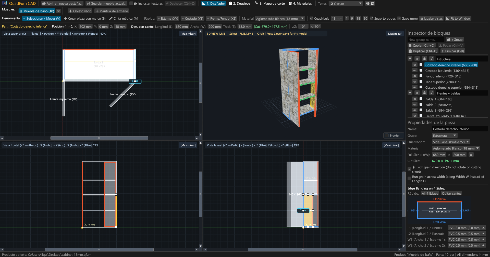
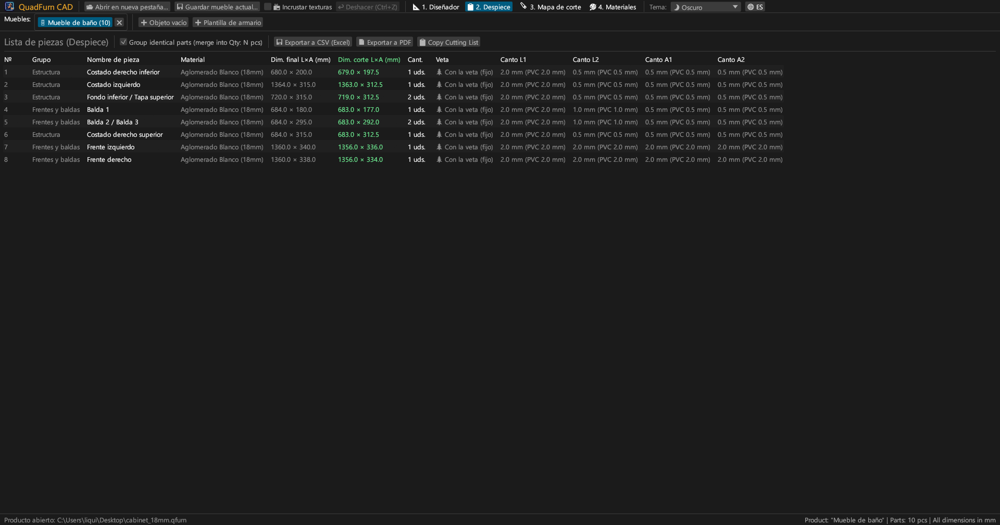
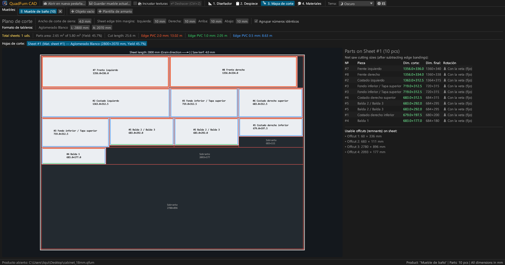
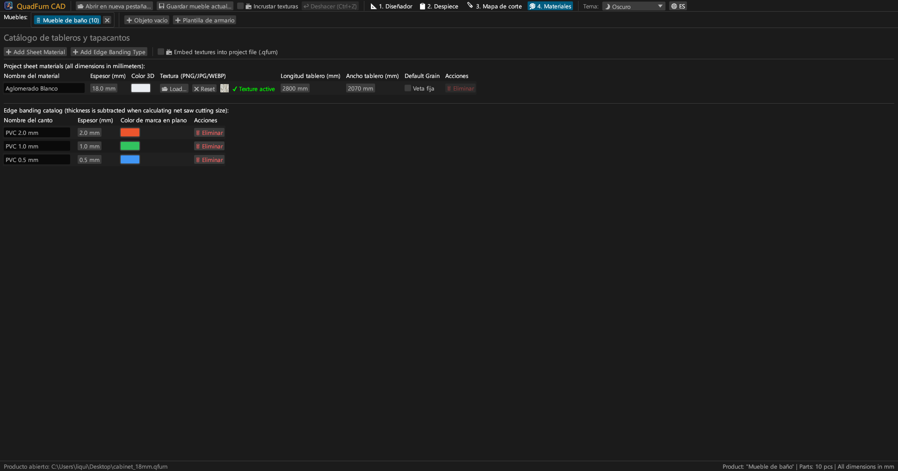
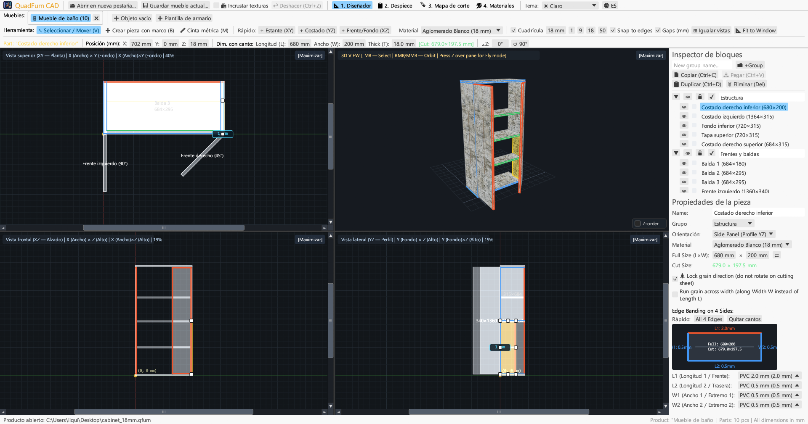
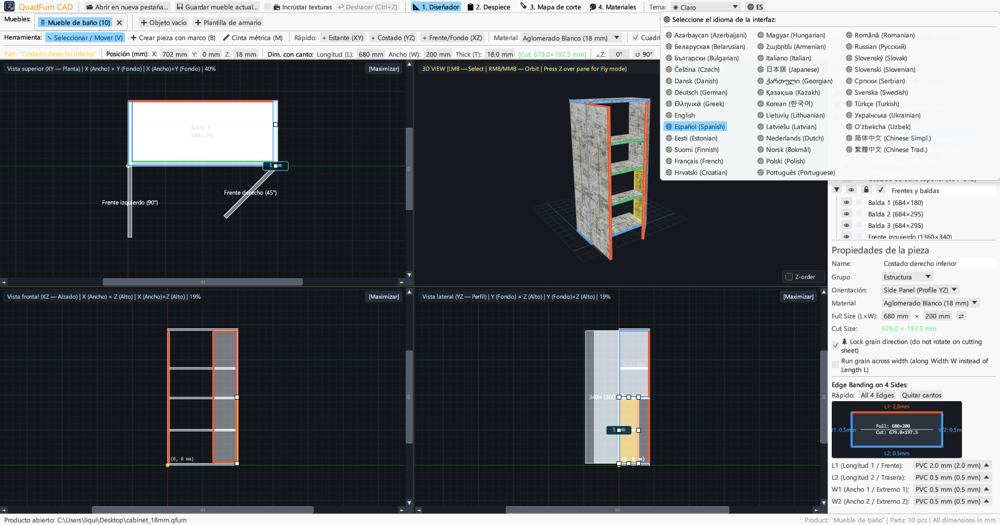

<div align="center">


# QuadFurn CAD

**CAD de muebles de paneles y aglomerado — Diseñador espacial de 4 vistas + Optimizador de corte de tableros por guillotina**

[](https://github.com/rbm13s/QuadFurn/actions/workflows/build.yml)
[](https://github.com/rbm13s/QuadFurn/releases)
[](https://www.rust-lang.org/)
[](https://github.com/emilk/egui)
[](https://wgpu.rs/)
[](#8-temas-visuales-y-localización-en-22-idiomas)
[](#primeros-pasos)
[](../LICENSE)

<br/>

**Languages / Языки / Мови / Sprachen:**<br/>
[English](../README.md) •
[Русский](README-ru.md) •
[Українська](README-uk.md) •
[Беларуская](README-be.md) •
[Қазақша](README-kk.md) •
[ქართული](README-ka.md) •
[Հայերեն](README-hy.md) •
[Azərbaycan](README-az.md) •
[Oʻzbekcha](README-uz.md) •
[Deutsch](README-de.md) •
[Français](README-fr.md) •
**Español** •
[Italiano](README-it.md) •
[Português](README-pt.md) •
[Polski](README-pl.md) •
[Čeština](README-cs.md) •
[Slovenčina](README-sk.md) •
[Slovenščina](README-sl.md) •
[Български](README-bg.md) •
[Српски](README-sr.md) •
[Hrvatski](README-hr.md) •
[Nederlands](README-nl.md) •
[Dansk](README-da.md) •
[Norsk](README-no.md) •
[Svenska](README-sv.md) •
[Suomi](README-fi.md) •
[Eesti](README-et.md) •
[Latviešu](README-lv.md) •
[Lietuvių](README-lt.md) •
[Magyar](README-hu.md) •
[Română](README-ro.md) •
[Türkçe](README-tr.md) •
[Ελληνικά](README-el.md) •
[简体中文](README-zh-cn.md) •
[繁體中文](README-zh-tw.md) •
[日本語](README-ja.md) •
[한국어](README-ko.md)

</div>

---

## Contenido

- [Introducción](#introducción)
- [Capturas de pantalla y recorrido visual](#capturas-de-pantalla-y-recorrido-visual)
- [Características principales](#características-principales)
- [Documentación funcional](#documentación-funcional)
  - [1. Diseñador CAD de 4 vistas y controles de precisión](#1-diseñador-cad-de-4-vistas-y-controles-de-precisión)
  - [2. Expresiones aritméticas en campos numéricos](#2-expresiones-aritméticas-en-campos-numéricos)
  - [3. Canto y deducción automática del tamaño de corte neto](#3-canto-y-deducción-automática-del-tamaño-de-corte-neto)
  - [4. Optimización de corte 2D por guillotina](#4-optimización-de-corte-2d-por-guillotina)
  - [5. Pestañas de proyectos y portapapeles entre proyectos](#5-pestañas-de-proyectos-y-portapapeles-entre-proyectos)
  - [6. Exportación del pasaporte de producción (PDF vectorial, CSV, portapapeles)](#6-exportación-del-pasaporte-de-producción-pdf-vectorial-csv-portapapeles)
  - [7. Catálogo de tableros, texturas y cantos](#7-catálogo-de-tableros-texturas-y-cantos)
  - [8. Temas visuales y localización en 37 idiomas](#8-temas-visuales-y-localización-en-22-idiomas)
- [Controles y atajos de teclado](#controles-y-atajos-de-teclado)
- [Primeros pasos](#primeros-pasos)
- [Configuración y formatos de archivo](#configuración-y-formatos-de-archivo)
- [Arquitectura del proyecto](#arquitectura-del-proyecto)
- [Licencia](#licencia)

---

## Introducción

**QuadFurn CAD** es una aplicación CAD multiplataforma de alto rendimiento desarrollada en Rust, disponible tanto como aplicación de escritorio nativa rápida (Windows, Linux, macOS) como versión en línea WebAssembly (WASM) sin instalación que se ejecuta directamente en navegadores web modernos. Está diseñada para el diseño de muebles de paneles y gabinetes en tableros aglomerados laminados (melamina), MDF, HDF y contrachapado, con cálculo automatizado de especificaciones y optimizador de corte en guillotina 2D.

QuadFurn combina la mejor ergonomía de tres herramientas clásicas:
1. **Modelado espacial en 4 vistas**: Edición simultánea en tres proyecciones ortogonales (**Planta Superior XY**, **Alzado Frontal XZ**, **Sección Lateral YZ**) con barras de desplazamiento, ajuste magnético, botón de ecualización de vistas (`⊞ Igualar vistas`), protección inteligente de espesor para piezas de canto y una vista **3D con órbita y vuelo libre en primera persona (`Z` Noclip)**.
2. **Barra de transformación de precisión**: Entrada numérica directa de coordenadas (`X`, `Y`, `Z`), dimensiones (`L × An × Gr`) y ángulo de rotación (`∠Z`) con calculadora integrada (por ejemplo, `600-4` o `720+18`).
3. **Optimización de corte y deducción de cantos**: Resta automática del grosor de canto PVC/ABS de las dimensiones de las piezas para obtener los **tamaños netos de corte de sierra**, junto con anidado guillotina 2D que respeta la veta de la madera, el grosor de corte de la sierra y los márgenes de refilado.

---

## Capturas de pantalla y recorrido visual

### 1. Diseñador de 4 vistas (Tema Oscuro)
Vistas ortogonales simultáneas (**Superior XY**, **Frontal XZ**, **Lateral YZ**) y ventana **3D texturizada** con mapeo UV, 8 manejadores de redimensionado e **Inspector de piezas**.



### 2. Lista de piezas (Especificación) y exportación
Tabla agrupada con dimensiones terminadas y **medidas netas de corte** tras descontar el grosor del canto en los cuatro lados (`L1`, `L2`, `An1`, `An2`).



### 3. Diagramas de corte por guillotina
Distribución optimizada en tableros estándar (`2800 × 2070 mm`, etc.) con cortes continuos, sangría de sierra, marcas de color de cantos y lista de retales útiles.



### 4. Catálogo de tableros y cantos
Gestión de espesores de tableros, colores 3D, texturas de acabado (`PNG`, `JPG`, `WEBP`), dimensiones de tablero y tipos de canto PVC/ABS.



### 5. Compatibilidad con tema claro
Tema claro de alto contraste junto con tema oscuro y sincronización con el sistema operativo.



### 6. 37 idiomas integrados
Cambio de idioma instantáneo desde la barra superior mediante el botón **`🌐`** y exportación de PDF multilingüe.



---

## Características principales

- **Espacio de trabajo sincronizado de 4 vistas**: Edite en Superior (`XY`), Frontal (`XZ`), Lateral (`YZ`) o maximice cualquier vista con un solo clic (`[Maximizar]` / `[4 Vistas]`).
- **Vista 3D acelerada por hardware**: Cámara orbital (`BDR`/`BMR`) y modo de vuelo en primera persona (`Z` + `WASD`/`Espacio`/`Ctrl`).
- **Ajuste magnético y cotas de holgura en vivo**: Ajuste a la cuadrícula (`1`, `9`, `18`, `50 mm`) y a los bordes de piezas vecinas a tope (`0 mm`).
- **Selección por recuadro y transformación grupal**: Recuadro de selección en 2D, traslación coordinada, duplicación (`Ctrl+D`) y copiado/pegado entre proyectos (`Ctrl+C` / `Ctrl+V`).
- **Calculadora en campos numéricos**: Los campos aceptan fórmulas como `600+100`, `800-36`, `720/2` o `45+15`.
- **Deducción automática de cantos**:
  $$\text{Longitud de corte} = L_{\text{total}} - C_{L1} - C_{L2}, \quad \text{Ancho de corte} = An_{\text{total}} - C_{An1} - C_{An2}$$
- **Pasaporte de producción en PDF vectorial de 4 secciones**: Exportación en A4 Horizontal en el idioma activo:
  1. Tabla de especificaciones de piezas
  2. 4 vistas proyectadas del diseñador
  3. Planos de corte de cada tablero
  4. Resumen de tableros y cantos con margen de desperdicio del `+15%`

---

## Documentación funcional

### 1. Diseñador CAD de 4 vistas y controles de precisión

La pestaña **Diseñador** (`📐 1. Diseñador`) se divide en tres áreas principales:

1. **Barra de herramientas superior**:
   - `↖ Seleccionar / Mover (V)`: Seleccionar piezas, mover arrastrando, o modificar tamaño con los tiradores (8 tiradores en cara y 2 en cantos). Arrastrar en espacio vacío crea un **recuadro de selección**. Al arrastrar en 2D: mantenga presionado **`Shift`** para restringir el movimiento al eje horizontal o vertical, **`Ctrl` (`Cmd`)** para desactivar el ajuste magnético a bordes y **`Alt`** para duplicar la pieza en la posición de destino.
   - `➕ Crear pieza mediante recuadro (B)`: Dibujar un rectángulo en cualquier vista 2D crea una pieza orientada a ese plano (`Balda XY`, `Lateral YZ`, `Frontal/Trasera XZ`).
   - `📏 Cinta métrica (M)`: Medición milimétrica precisa en vistas 2D.
   - **Inserción rápida**: Botones de un clic (`+ Balda (XY)`, `+ Lateral (YZ)`, `+ Frontal (XZ)`).
   - **Rejilla y atracción magnética**: Pasos de rejilla (`1`, `9`, `18`, `50 mm`), atracción a bordes y visualización de cotas de holgura (`Holguras (mm)`).
   - **Barra de transformación de precisión**: Coordenadas `X`, `Y`, `Z`, dimensiones `L`, `An`, `Gr`, medidor de corte `[Corte: L × An mm]` y rotación `∠Z`.

2. **4 vistas de trabajo**:
   - Vistas ortogonales con barras de desplazamiento, reglas y marcas de color de cantos.
   - Vista 3D con órbita y **Modo de vuelo libre** (pulsar **`Z`** sobre el visor 3D).

3. **Inspector de piezas lateral derecho**:
   - Agrupación (*Casco*, *Puertas y Frentes*, *Cajones*).
   - Visibilidad (`👁`) y bloqueo (`🔒`).
   - Material, dimensiones (`L × An` con inversión rápida `⇄`), fijación de veta (`🌲 Bloquear veta`) y esquema de 4 lados de canto.

---

### 2. Expresiones aritméticas en campos numéricos

Todos los campos numéricos admiten fórmulas matemáticas directas:
- **Sumas y restas**: Haga clic en un campo con `600`, escriba `600+100` (o `600-4`) y presione `Enter` — el valor se calcula al instante en `700` (o `596`).
- **Multiplicación, división y paréntesis**: Fórmulas como `(800-36)/2` o `18*2` se calculan automáticamente.
- Admite tanto punto `.` como coma `,`, y las unidades (`mm`, `°`) se omiten automáticamente.

---

### 3. Canto y deducción automática del tamaño de corte neto

En la fabricación de muebles, el espesor del canto debe descontarse del tamaño acabado antes del corte:
- Cada pieza tiene 4 bordes: **`L1`** (Largo 1), **`L2`** (Largo 2), **`An1`** (Ancho 1), **`An2`** (Ancho 2).
- Para una pieza de `680 × 200 mm` con canto de `2.0 mm` en `L1` y `0.4 mm` en los otros 3 lados:
  - $\text{Corte } L = 680 - 2.0 - 0.4 = 677.6\text{ mm}$
  - $\text{Corte } An = 200 - 0.4 - 0.4 = 199.2\text{ mm}$

---

### 4. Optimización de corte 2D por guillotina

La pestaña **Corte** (`🪚 3. Corte`) anida las piezas en tableros de sus materiales:
- **Parámetros de corte**: Grosor de sierra (por defecto `4.0 mm`), márgenes de refilado en los 4 bordes (por defecto `10 mm`).
- **Respeto de la veta**: Las piezas con veta fija (`🌲`) no se rotan transversalmente.
- **Planos de corte y retales**: Planos con líneas de corte continuo, números de piezas y retales reutilizables etiquetados.

---

### 5. Pestañas de proyectos y portapapeles entre proyectos

- **Página de inicio**: Acceso a proyectos vacíos, plantillas de muebles y **10 proyectos recientes**.
- **Múltiples pestañas**: Trabajo simultáneo en varios muebles (doble clic para renombrar).
- **Copiado inter-proyectos (`Ctrl+C` / `Ctrl+V`)**: Copie piezas entre pestañas — los materiales y cantos se sincronizan automáticamente.

---

### 6. Exportación del pasaporte de producción (PDF vectorial, CSV, portapapeles)

En la pestaña **Especificación** (`📋 2. Especificación`):
1. **`📄 Exportar a PDF` (Pasaporte de producción en A4 Horizontal)**:
   - Tabla completa de especificaciones con medidas de corte y cantos.
   - Página de 4 vistas proyectadas del diseñador.
   - Planos de corte detallados por tablero.
   - Resumen de materiales y cantos en metros lineales con `+15%` de desperdicio.
2. **`💾 Exportar a CSV (Excel)`**: Hoja de cálculo separada por punto y coma con UTF-8 BOM.
3. **`📋 Copiar lista de corte`**: Texto tabulado para optimizadores externos o hojas de cálculo.

---

### 7. Catálogo de tableros, texturas y cantos

En la pestaña **Materiales** (`🎨 4. Materiales`):
- Tableros (`Aglomerado 18 mm`, `MDF 16 mm`, `HDF 3 mm`, etc.) con colores 3D y medidas de chapa.
- Carga de texturas (`PNG`, `JPG`, `WEBP`) para render 3D realista.
- **Rutas relativas**: Búsqueda automática junto al archivo `.qfurn` o en la carpeta `./textures/`.
- **Empaquetado de texturas (`📦 Empaquetar texturas en el archivo de proyecto`)**: Guarda las imágenes directamente en Base64 en el archivo JSON `.qfurn`.
- **Protección de GPU**: Se bloquean archivos de más de 60 MB y se reescalan automáticamente imágenes gigantes.

---

### 8. Temas visuales y localización en 37 idiomas

- **Temas**: **🌙 Oscuro**, **☀ Claro** y **🖥 Sistema**.
- **37 idiomas integrados**: Localización completa de la interfaz y los documentos PDF.
- **Detección de idioma del SO**: Inicio automático en el idioma de su sistema operativo.

---

## Controles y atajos de teclado

| Entrada / Atajo | Acción |
| :--- | :--- |
| **`V`** | Herramienta **Seleccionar y Mover** (8 tiradores de cambio de tamaño en cara y 2 en cantos, más selección por recuadro) |
| **`B`** | Herramienta **Crear pieza mediante recuadro** en 2D |
| **`M`** | Herramienta **Cinta métrica** en 2D |
| **Arrastrar `Click Izq` (2D)** | Mover piezas, arrastrar manejadores o recuadro de selección |
| **`Shift + Clic izq.` Arrastrar (2D)** | Restringir el movimiento estrictamente al eje horizontal o vertical |
| **`Ctrl / Cmd + Clic izq.` Arrastrar (2D)** | Desactivar el ajuste magnético a los bordes durante el arrastre |
| **`Alt + Clic izq.` Arrastrar (2D)** | Duplicar la(s) pieza(s) en la posición de destino al soltar |
| **`Shift / Ctrl (Cmd) + Click Izq` (2D)** | Añadir o quitar pieza de la selección múltiple |
| **Arrastrar `Click Der` / `Medio` (2D)** | Encuadre (Pan) de la cámara 2D |
| **`Rueda del ratón` (2D / 3D)** | Zoom de la cámara |
| **Arrastrar `Click Der` / `Medio` (3D)** | Rotación orbital 3D |
| **`Z` (sobre ventana 3D)** | Alternar **Modo de vuelo libre 3D (Noclip)** |
| **`W` `A` `S` `D` / `Espacio` / `Ctrl (Cmd)`** | Movimiento en modo vuelo (`Shift` acelera) |
| **`Ctrl + S` / `Cmd (⌘) + S`** | Guardar proyecto actual (`.qfurn` / `.json`) |
| **`Ctrl + Z` / `Cmd (⌘) + Z`** | Deshacer última acción (hasta 40 pasos) |
| **`Ctrl + C` / `Cmd (⌘) + C`** | Copiar piezas seleccionadas al portapapeles |
| **`Ctrl + V` / `Cmd (⌘) + V`** | Pegar piezas (funciona entre diferentes pestañas) |
| **`Ctrl + D` / `Cmd (⌘) + D`** | Duplicar piezas seleccionadas |
| **`Delete` / `Backspace`** | Eliminar piezas seleccionadas |
| **`←` `→` `↑` `↓` (vistas 2D)** | Desplazar las piezas seleccionadas según el paso de cuadrícula (`Shift` para duplicar) |

---

## Primeros pasos

### Paquetes precompilados (GitHub Releases)
- **Windows (`x86_64`)**: `QuadFurn-windows-x86_64.zip` — ejecutable portátil `QuadFurn.exe`.
- **Linux (`Debian / Ubuntu x86_64`)**: `quadfurn_<version>_amd64.deb` o archivo tar.gz.
- **macOS (`Universal`)**: `QuadFurn-macos-universal.zip` — paquete `QuadFurn.app`.

---

### Compilación desde el código fuente

```bash
# Ejecutar en modo desarrollo
cargo run

# Compilar binario de producción optimizado
cargo build --release

# Ejecutar pruebas unitarias
cargo test
```

---

## Configuración y formatos de archivo

- **Configuración de usuario (`settings.json`)**:
  - **Windows**: `%APPDATA%\QuadFurn\settings.json`
  - **Linux**: `$XDG_CONFIG_HOME/QuadFurn/settings.json`
  - **macOS**: `~/Library/Application Support/QuadFurn/settings.json`
- **Archivos de proyecto (`.qfurn` / `.json`)**:
  Archivos JSON legibles en UTF-8 con todas las piezas, materiales y configuraciones de corte.

---

## Arquitectura del proyecto

```text
QuadFurn/
├── .github/
│   └── workflows/
│       └── build.yml          # CI/CD GitHub Actions
├── assets/
│   ├── icon.jpeg              # Icono del programa
│   └── screenshots/           # Capturas de pantalla
├── docs/                      # Documentación en 37 idiomas
├── src/
│   ├── main.rs                # Punto de entrada, pestañas, interfaz
│   ├── model.rs               # Estructuras de datos (Project, PartBlock, etc.)
│   ├── viewport.rs            # Controlador 4 vistas, renderizado 2D/3D
│   ├── snapping.rs            # Atracción magnética y cotas
│   ├── cutter.rs              # Lista de corte y optimización 2D
│   ├── export.rs              # Exportación PDF, CSV, listas de corte
│   ├── ui_panels.rs           # Barras de herramientas, inspector
│   └── i18n.rs                # Diccionarios en 37 idiomas
├── build.rs                   # Integración de iconos en Windows
├── Cargo.toml                 # Manifiesto de Rust
└── LICENSE                    # Licencia MIT
```

---

## Licencia

Distribuido bajo la [Licencia MIT](../LICENSE) — libre para uso comercial y personal.


