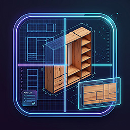
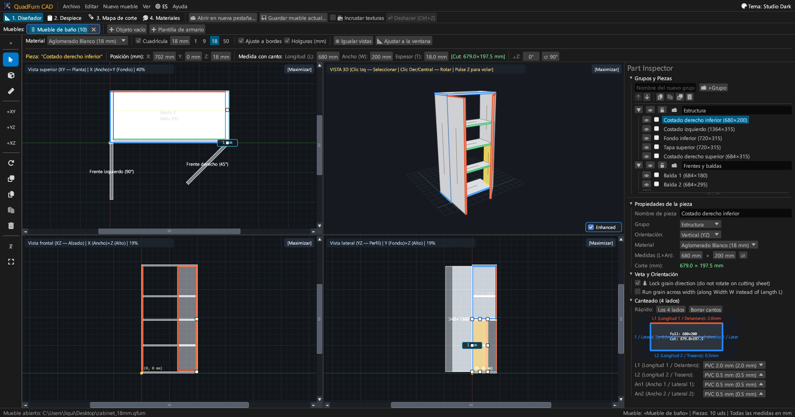
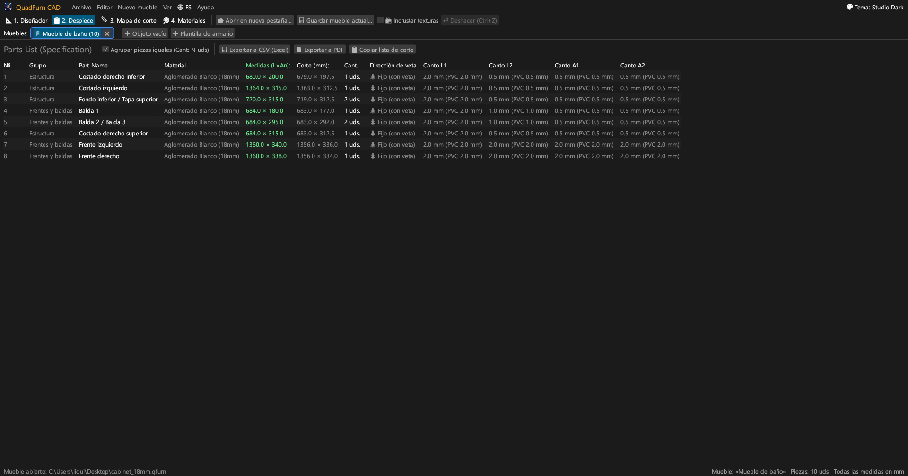
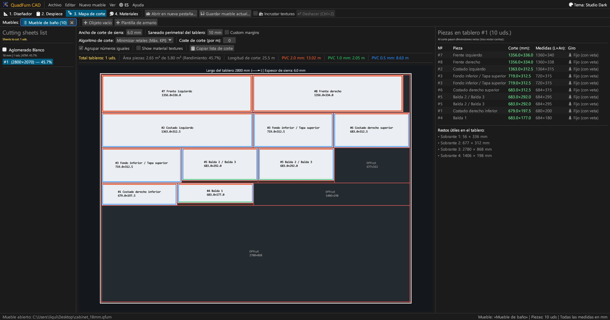
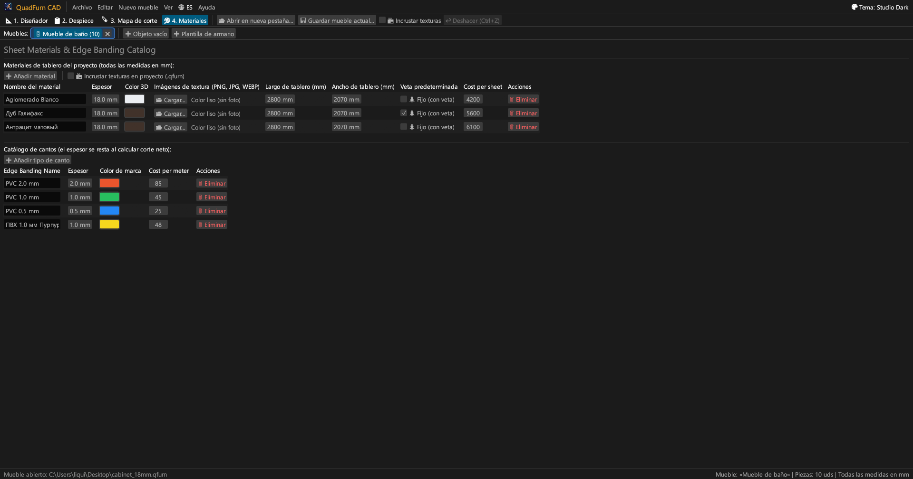
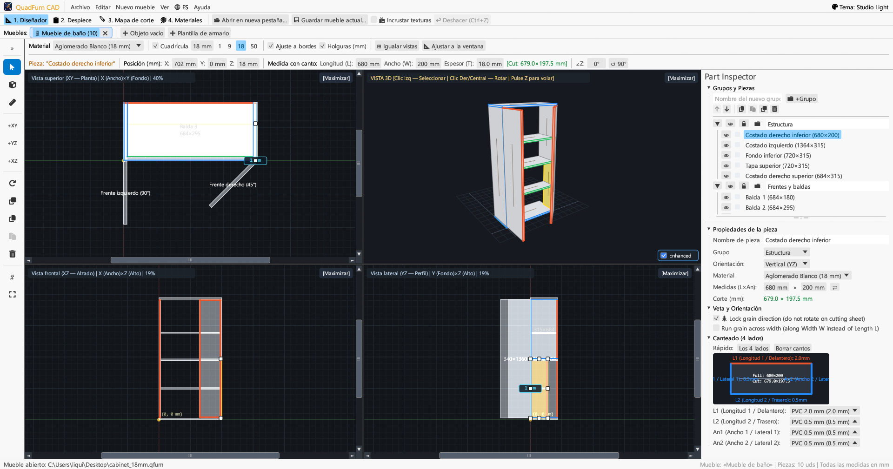
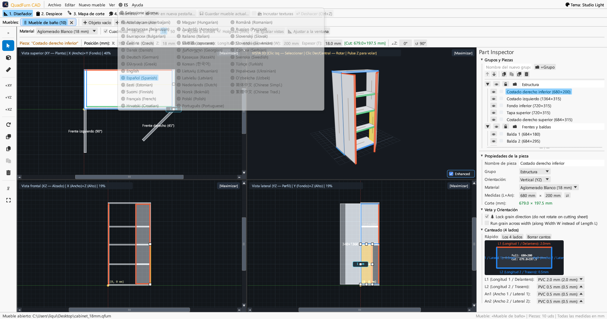

<div align="center">



# QuadFurn CAD

**CAD de muebles de paneles y aglomerado � Disenador espacial de 4 vistas + Optimizador de corte de tableros por guillotina**

[](https://github.com/rbm13s/QuadFurn/actions/workflows/build.yml)
[](https://github.com/rbm13s/QuadFurn/releases)
[](https://www.rust-lang.org/)
[](https://github.com/emilk/egui)
[](https://wgpu.rs/)
[](#8-temas-visuales-y-localizacion-en-22-idiomas)
[](#primeros-pasos)
[](../LICENSE)

<br/>

**Languages / ����� / ���� / Sprachen:**<br/>
[English](../README.md) �
[�������](README-ru.md) �
[���������](README-uk.md) �
[����������](README-be.md) �
[?���?��](README-kk.md) �
[???????](README-ka.md) �
[???????](README-hy.md) �
[Az?rbaycan](README-az.md) �
[O?zbekcha](README-uz.md) �
[Deutsch](README-de.md) �
[Francais](README-fr.md) �
**Espanol** �
[Italiano](README-it.md) �
[Portugues](README-pt.md) �
[Polski](README-pl.md) �
[Cestina](README-cs.md) �
[Slovencina](README-sk.md) �
[Slovenscina](README-sl.md) �
[���������](README-bg.md) �
[������](README-sr.md) �
[Hrvatski](README-hr.md) �
[Nederlands](README-nl.md) �
[Dansk](README-da.md) �
[Norsk](README-no.md) �
[Svenska](README-sv.md) �
[Suomi](README-fi.md) �
[Eesti](README-et.md) �
[Latviesu](README-lv.md) �
[Lietuviu](README-lt.md) �
[Magyar](README-hu.md) �
[Romana](README-ro.md) �
[Turkce](README-tr.md) �
[????????](README-el.md) �
[????](README-zh-cn.md) �
[????](README-zh-tw.md) �
[???](README-ja.md) �
[???](README-ko.md)

</div>

---

## Contenido

- [Introduccion](#introduccion)
- [Capturas de pantalla y recorrido visual](#capturas-de-pantalla-y-recorrido-visual)
- [Caracteristicas principales](#caracteristicas-principales)
- [Documentacion funcional](#documentacion-funcional)
  - [1. Disenador CAD de 4 vistas y controles de precision](#1-disenador-cad-de-4-vistas-y-controles-de-precision)
  - [2. Expresiones aritmeticas en campos numericos](#2-expresiones-aritmeticas-en-campos-numericos)
  - [3. Canto y deduccion automatica del tamano de corte neto](#3-canto-y-deduccion-automatica-del-tamano-de-corte-neto)
  - [4. Optimizacion de corte 2D por guillotina](#4-optimizacion-de-corte-2d-por-guillotina)
  - [5. Pestanas de proyectos y portapapeles entre proyectos](#5-pestanas-de-proyectos-y-portapapeles-entre-proyectos)
  - [6. Exportacion del pasaporte de produccion (PDF vectorial, CSV, portapapeles)](#6-exportacion-del-pasaporte-de-produccion-pdf-vectorial-csv-portapapeles)
  - [7. Catalogo de tableros, texturas y cantos](#7-catalogo-de-tableros-texturas-y-cantos)
  - [8. Temas visuales y localizacion en 37 idiomas](#8-temas-visuales-y-localizacion-en-22-idiomas)
- [Controles y atajos de teclado](#controles-y-atajos-de-teclado)
- [Primeros pasos](#primeros-pasos)
- [Configuracion y formatos de archivo](#configuracion-y-formatos-de-archivo)
- [Arquitectura del proyecto](#arquitectura-del-proyecto)
- [Licencia](#licencia)

---

## Introduccion

**QuadFurn CAD** es una aplicacion CAD multiplataforma de alto rendimiento desarrollada en Rust, disponible tanto como aplicacion de escritorio nativa rapida (Windows, Linux, macOS) como version en linea WebAssembly (WASM) sin instalacion que se ejecuta directamente en navegadores web modernos. Esta disenada para el diseno de muebles de paneles y gabinetes en tableros aglomerados laminados (melamina), MDF, HDF y contrachapado, con calculo automatizado de especificaciones y optimizador de corte en guillotina 2D.

QuadFurn combina la mejor ergonomia de tres herramientas clasicas:
1. **Modelado espacial en 4 vistas**: Edicion simultanea en tres proyecciones ortogonales (**Planta Superior XY**, **Alzado Frontal XZ**, **Seccion Lateral YZ**) con barras de desplazamiento, ajuste magnetico, boton de ecualizacion de vistas (`? Igualar vistas`), proteccion inteligente de espesor para piezas de canto y una vista **3D con orbita y vuelo libre en primera persona (`Z` Noclip)**.
2. **Barra de transformacion de precision**: Entrada numerica directa de coordenadas (`X`, `Y`, `Z`), dimensiones (`L ? An ? Gr`) y angulo de rotacion (`?Z`) con calculadora integrada (por ejemplo, `600-4` o `720+18`).
3. **Optimizacion de corte y deduccion de cantos**: Resta automatica del grosor de canto PVC/ABS de las dimensiones de las piezas para obtener los **tamanos netos de corte de sierra**, junto con anidado guillotina 2D que respeta la veta de la madera, el grosor de corte de la sierra y los margenes de refilado.

---

## Capturas de pantalla y recorrido visual

### 1. Disenador de 4 vistas (Tema Oscuro)
Vistas ortogonales simultaneas (**Superior XY**, **Frontal XZ**, **Lateral YZ**) y ventana **3D texturizada** con mapeo UV, 8 manejadores de redimensionado e **Inspector de piezas**.



### 2. Lista de piezas (Especificacion) y exportacion
Tabla agrupada con dimensiones terminadas y **medidas netas de corte** tras descontar el grosor del canto en los cuatro lados (`L1`, `L2`, `An1`, `An2`).



### 3. Diagramas de corte por guillotina
Distribucion optimizada en tableros estandar (`2800 ? 2070 mm`, etc.) con cortes continuos, sangria de sierra, marcas de color de cantos y lista de retales utiles.



### 4. Catalogo de tableros y cantos
Gestion de espesores de tableros, colores 3D, texturas de acabado (`PNG`, `JPG`, `WEBP`), dimensiones de tablero y tipos de canto PVC/ABS.



### 5. Compatibilidad con tema claro
Tema claro de alto contraste junto con tema oscuro y sincronizacion con el sistema operativo.



### 6. 37 idiomas integrados
Cambio de idioma instantaneo desde la barra superior mediante el boton **`??`** y exportacion de PDF multilingue.



---

## Caracteristicas principales

- **Espacio de trabajo sincronizado de 4 vistas**: Edite en Superior (`XY`), Frontal (`XZ`), Lateral (`YZ`) o maximice cualquier vista con un solo clic (`[Maximizar]` / `[4 Vistas]`).
- **Vista 3D acelerada por hardware**: Camara orbital (`BDR`/`BMR`) y modo de vuelo en primera persona (`Z` + `WASD`/`Espacio`/`Ctrl`).
- **Ajuste magnetico y cotas de holgura en vivo**: Ajuste a la cuadricula (`1`, `9`, `18`, `50 mm`) y a los bordes de piezas vecinas a tope (`0 mm`).
- **Seleccion por recuadro y transformacion grupal**: Recuadro de seleccion en 2D, traslacion coordinada, duplicacion (`Ctrl+D`) y copiado/pegado entre proyectos (`Ctrl+C` / `Ctrl+V`).
- **Calculadora en campos numericos**: Los campos aceptan formulas como `600+100`, `800-36`, `720/2` o `45+15`.
- **Deduccion automatica de cantos**:
  $$\text{Longitud de corte} = L_{\text{total}} - C_{L1} - C_{L2}, \quad \text{Ancho de corte} = An_{\text{total}} - C_{An1} - C_{An2}$$
- **Pasaporte de produccion en PDF vectorial de 4 secciones**: Exportacion en A4 Horizontal en el idioma activo:
  1. Tabla de especificaciones de piezas
  2. 4 vistas proyectadas del disenador
  3. Planos de corte de cada tablero
  4. Resumen de tableros y cantos con margen de desperdicio del `+15%`

---

## Documentacion funcional

### 1. Disenador CAD de 4 vistas y controles de precision

La pestana **Disenador** (`?? 1. Disenador`) se divide en tres areas principales:

1. **Barra de herramientas superior**:
   - `? Seleccionar / Mover (V)`: Seleccionar piezas, mover arrastrando, o modificar tamano con los tiradores (8 tiradores en cara y 2 en cantos). Arrastrar en espacio vacio crea un **recuadro de seleccion**. Al arrastrar en 2D: mantenga presionado **`Shift`** para restringir el movimiento al eje horizontal o vertical, **`Ctrl` (`Command ⌘`)** para desactivar el ajuste magnetico a bordes y **`Alt`** para duplicar la pieza en la posicion de destino.
   - `? Crear pieza mediante recuadro (B)`: Dibujar un rectangulo en cualquier vista 2D crea una pieza orientada a ese plano (`Balda XY`, `Lateral YZ`, `Frontal/Trasera XZ`).
   - `?? Cinta metrica (M)`: Medicion milimetrica precisa en vistas 2D.
   - **Insercion rapida**: Botones de un clic (`+ Balda (XY)`, `+ Lateral (YZ)`, `+ Frontal (XZ)`).
   - **Rejilla y atraccion magnetica**: Pasos de rejilla (`1`, `9`, `18`, `50 mm`), atraccion a bordes y visualizacion de cotas de holgura (`Holguras (mm)`).
   - **Barra de transformacion de precision**: Coordenadas `X`, `Y`, `Z`, dimensiones `L`, `An`, `Gr`, medidor de corte `[Corte: L ? An mm]` y rotacion `?Z`.

2. **4 vistas de trabajo**:
   - Vistas ortogonales con barras de desplazamiento, reglas y marcas de color de cantos.
   - Vista 3D con orbita y **Modo de vuelo libre** (pulsar **`Z`** sobre el visor 3D).

3. **Inspector de piezas lateral derecho**:
   - Agrupacion (*Casco*, *Puertas y Frentes*, *Cajones*).
   - Visibilidad (`??`) y bloqueo (`??`).
   - Material, dimensiones (`L ? An` con inversion rapida `?`), fijacion de veta (`?? Bloquear veta`) y esquema de 4 lados de canto.

---

### 2. Expresiones aritmeticas en campos numericos

Todos los campos numericos admiten formulas matematicas directas:
- **Sumas y restas**: Haga clic en un campo con `600`, escriba `600+100` (o `600-4`) y presione `Enter` � el valor se calcula al instante en `700` (o `596`).
- **Multiplicacion, division y parentesis**: Formulas como `(800-36)/2` o `18*2` se calculan automaticamente.
- Admite tanto punto `.` como coma `,`, y las unidades (`mm`, `�`) se omiten automaticamente.

---

### 3. Canto y deduccion automatica del tamano de corte neto

En la fabricacion de muebles, el espesor del canto debe descontarse del tamano acabado antes del corte:
- Cada pieza tiene 4 bordes: **`L1`** (Largo 1), **`L2`** (Largo 2), **`An1`** (Ancho 1), **`An2`** (Ancho 2).
- Para una pieza de `680 ? 200 mm` con canto de `2.0 mm` en `L1` y `0.4 mm` en los otros 3 lados:
  - $\text{Corte } L = 680 - 2.0 - 0.4 = 677.6\text{ mm}$
  - $\text{Corte } An = 200 - 0.4 - 0.4 = 199.2\text{ mm}$

---

### 4. Optimizacion de corte 2D por guillotina

La pestana **Corte** (`?? 3. Corte`) anida las piezas en tableros de sus materiales:
- **Parametros de corte**: Grosor de sierra (por defecto `6.0 mm`), margenes de refilado en los 4 bordes (por defecto `10 mm`).
- **Respeto de la veta**: Las piezas con veta fija (`??`) no se rotan transversalmente.
- **Planos de corte y retales**: Planos con lineas de corte continuo, numeros de piezas y retales reutilizables etiquetados.

---

### 5. Pestanas de proyectos y portapapeles entre proyectos

- **Pagina de inicio**: Acceso a proyectos vacios, plantillas de muebles y **10 proyectos recientes**.
- **Multiples pestanas**: Trabajo simultaneo en varios muebles (doble clic para renombrar).
- **Copiado inter-proyectos (`Ctrl+C` / `Ctrl+V`)**: Copie piezas entre pestanas � los materiales y cantos se sincronizan automaticamente.

---

### 6. Exportacion del pasaporte de produccion (PDF vectorial, CSV, portapapeles)

En la pestana **Especificacion** (`?? 2. Especificacion`):
1. **`?? Exportar a PDF` (Pasaporte de produccion en A4 Horizontal)**:
   - Tabla completa de especificaciones con medidas de corte y cantos.
   - Pagina de 4 vistas proyectadas del disenador.
   - Planos de corte detallados por tablero.
   - Resumen de materiales y cantos en metros lineales con `+15%` de desperdicio.
2. **`?? Exportar a CSV (Excel)`**: Hoja de calculo separada por punto y coma con UTF-8 BOM.
3. **`?? Copiar lista de corte`**: Texto tabulado para optimizadores externos o hojas de calculo.

---

### 7. Catalogo de tableros, texturas y cantos

En la pestana **Materiales** (`?? 4. Materiales`):
- Tableros (`Aglomerado 18 mm`, `MDF 16 mm`, `HDF 3 mm`, etc.) con colores 3D y medidas de chapa.
- Carga de texturas (`PNG`, `JPG`, `WEBP`) para render 3D realista.
- **Rutas relativas**: Busqueda automatica junto al archivo `.qfurn` o en la carpeta `./textures/`.
- **Empaquetado de texturas (`?? Empaquetar texturas en el archivo de proyecto`)**: Guarda las imagenes directamente en Base64 en el archivo JSON `.qfurn`.
- **Proteccion de GPU**: Se bloquean archivos de mas de 60 MB y se reescalan automaticamente imagenes gigantes.

---

### 8. Temas visuales y localizacion en 37 idiomas

- **Temas**: **?? Oscuro**, **? Claro** y **?? Sistema**.
- **37 idiomas integrados**: Localizacion completa de la interfaz y los documentos PDF.
- **Deteccion de idioma del SO**: Inicio automatico en el idioma de su sistema operativo.

---

## Controles y atajos de teclado

| Entrada / Atajo | Accion |
| :--- | :--- |
| **`V`** | Herramienta **Seleccionar y Mover** (8 tiradores de cambio de tamano en cara y 2 en cantos, mas seleccion por recuadro) |
| **`B`** | Herramienta **Crear pieza mediante recuadro** en 2D |
| **`M`** | Herramienta **Cinta metrica** en 2D |
| **Arrastrar `Click Izq` (2D)** | Mover piezas, arrastrar manejadores o recuadro de seleccion |
| **`Shift + Clic izq.` Arrastrar (2D)** | Restringir el movimiento estrictamente al eje horizontal o vertical |
| **`Ctrl / Command (⌘) + Clic izq.` Arrastrar (2D)** | Desactivar el ajuste magnetico a los bordes durante el arrastre |
| **`Alt + Clic izq.` Arrastrar (2D)** | Duplicar la(s) pieza(s) en la posicion de destino al soltar |
| **`Shift / Ctrl (Command ⌘) + Click Izq` (2D)** | Anadir o quitar pieza de la seleccion multiple |
| **Arrastrar `Click Der` / `Medio` (2D)** | Encuadre (Pan) de la camara 2D |
| **`Rueda del raton` (2D / 3D)** | Zoom de la camara |
| **Arrastrar `Click Der` / `Medio` (3D)** | Rotacion orbital 3D |
| **`Z` (sobre ventana 3D)** | Alternar **Modo de vuelo libre 3D (Noclip)** |
| **`W` `A` `S` `D` / `Espacio` / `Ctrl (Command ⌘)`** | Movimiento en modo vuelo (`Shift` acelera) |
| **`Ctrl + S` / `Command (⌘) + S`** | Guardar proyecto actual (`.qfurn` / `.json`) |
| **`Ctrl + Z` / `Command (⌘) + Z`** | Deshacer ultima accion (hasta 40 pasos) |
| **`Ctrl + C` / `Command (⌘) + C`** | Copiar piezas seleccionadas al portapapeles |
| **`Ctrl + V` / `Command (⌘) + V`** | Pegar piezas (funciona entre diferentes pestanas) |
| **`Ctrl + D` / `Command (⌘) + D`** | Duplicar piezas seleccionadas |
| **`Delete` / `Backspace`** | Eliminar piezas seleccionadas |
| **`<` `>` `^` `v` (vistas 2D)** | Desplazar las piezas seleccionadas segun el paso de cuadricula (`Shift` para duplicar) |

---

## Primeros pasos

### Paquetes precompilados (GitHub Releases)
- **Windows (`x86_64`)**: `QuadFurn-windows-x86_64.zip` � ejecutable portatil `QuadFurn.exe`.
- **Linux (`Debian / Ubuntu x86_64`)**: `quadfurn_<version>_amd64.deb` o archivo tar.gz.
- **macOS (`Universal`)**: `QuadFurn-macos-universal.zip` � paquete `QuadFurn.app`.

---

### Compilacion desde el codigo fuente

```bash
# Ejecutar en modo desarrollo
cargo run

# Compilar binario de produccion optimizado
cargo build --release

# Ejecutar pruebas unitarias
cargo test
```

---

## Configuracion y formatos de archivo

- **Configuracion de usuario (`settings.json`)**:
  - **Windows**: `%APPDATA%\QuadFurn\settings.json`
  - **Linux**: `$XDG_CONFIG_HOME/QuadFurn/settings.json`
  - **macOS**: `~/Library/Application Support/QuadFurn/settings.json`
- **Archivos de proyecto (`.qfurn` / `.json`)**:
  Archivos JSON legibles en UTF-8 con todas las piezas, materiales y configuraciones de corte.

---

## Arquitectura del proyecto

```text
QuadFurn/
+-- .github/
�   L-- workflows/
�       L-- build.yml          # CI/CD GitHub Actions
+-- assets/
�   +-- icon_256.jpg              # Icono del programa
�   L-- screenshots/           # Capturas de pantalla
+-- docs/                      # Documentacion en 37 idiomas
+-- src/
�   +-- main.rs                # Punto de entrada, pestanas, interfaz
�   +-- model.rs               # Estructuras de datos (Project, PartBlock, etc.)
�   +-- viewport.rs            # Controlador 4 vistas, renderizado 2D/3D
�   +-- snapping.rs            # Atraccion magnetica y cotas
�   +-- cutter.rs              # Lista de corte y optimizacion 2D
�   +-- export.rs              # Exportacion PDF, CSV, listas de corte
�   +-- ui_panels.rs           # Barras de herramientas, inspector
�   L-- i18n.rs                # Diccionarios en 37 idiomas
+-- build.rs                   # Integracion de iconos en Windows
+-- Cargo.toml                 # Manifiesto de Rust
L-- LICENSE                    # Licencia MIT
```

---

## Licencia

Distribuido bajo la [Licencia MIT](../LICENSE) � libre para uso comercial y personal.


