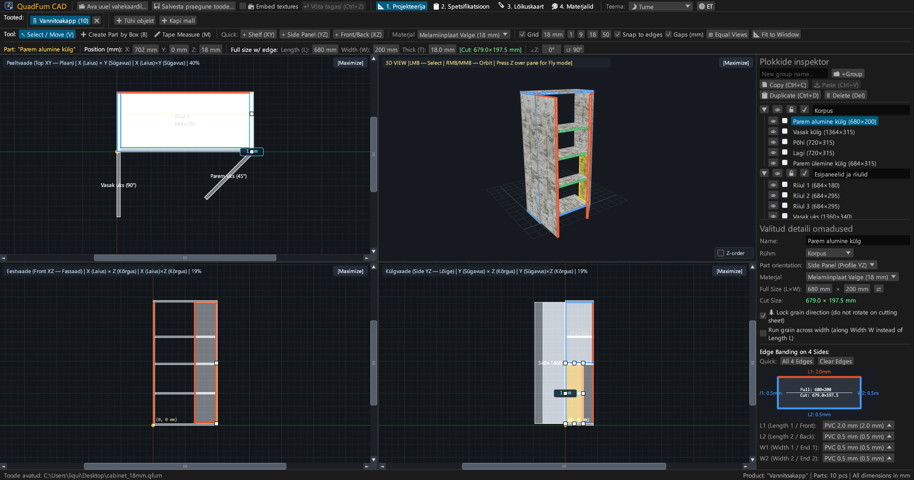
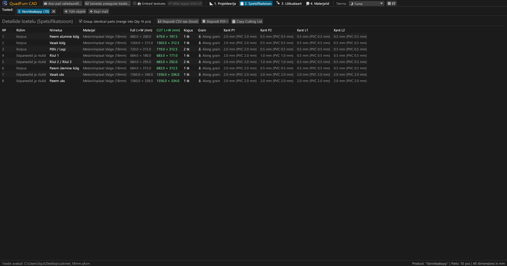
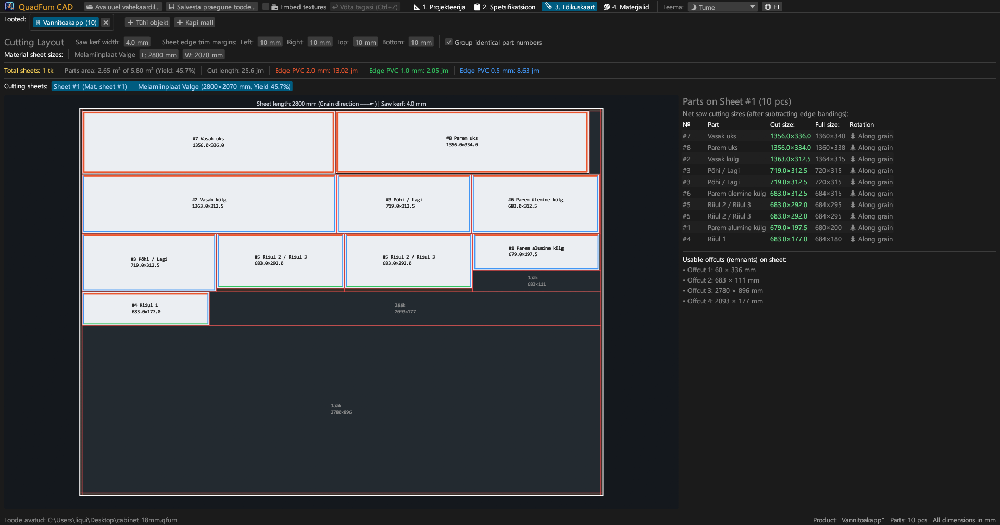
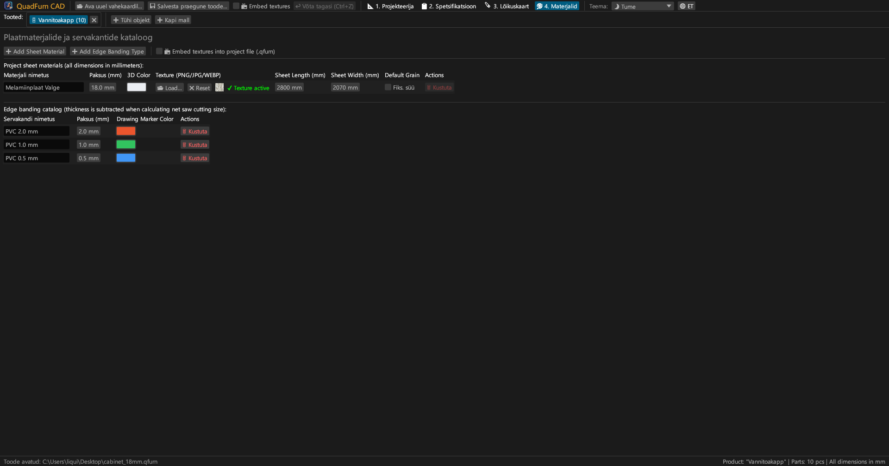
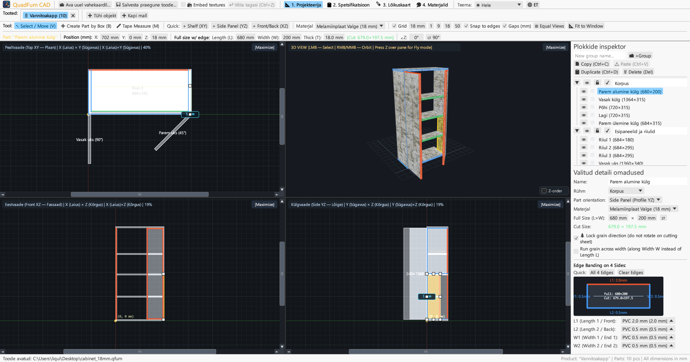
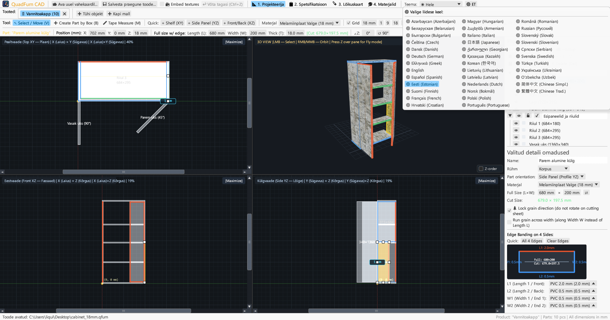

# QuadFurn CAD

**Mööbli-CAD puitlaastplaadist ja korpusmööblile — 4 vaatega ruumiline projekteerija + giljotiinlõikuse optimeerija**

 

👉 **[🚀 Proovi QuadFurn CADi brauseris (WebAssembly)](https://rbm13s.github.io/QuadFurn/app/)** • **[🌐 Ametlik veebileht](https://rbm13s.github.io/QuadFurn/et.html)**

 

**Languages / Языки / Мови / Sprachen:** 
[English](../README.md) •
[Русский](README-ru.md) •
[Українська](README-uk.md) •
[Беларуская](README-be.md) •
[Қазақша](README-kk.md) •
[ქართული](README-ka.md) •
[Հայերեն](README-hy.md) •
[Azərbaycan](README-az.md) •
[Oʻzbekcha](README-uz.md) •
[Deutsch](README-de.md) •
[Français](README-fr.md) •
[Español](README-es.md) •
[Italiano](README-it.md) •
[Português](README-pt.md) •
[Polski](README-pl.md) •
[Čeština](README-cs.md) •
[Slovenčina](README-sk.md) •
[Slovenščina](README-sl.md) •
[Български](README-bg.md) •
[Српски](README-sr.md) •
[Hrvatski](README-hr.md) •
[Nederlands](README-nl.md) •
[Dansk](README-da.md) •
[Norsk](README-no.md) •
[Svenska](README-sv.md) •
[Suomi](README-fi.md) •
**Eesti** •
[Latviešu](README-lv.md) •
[Lietuvių](README-lt.md) •
[Magyar](README-hu.md) •
[Română](README-ro.md) •
[Türkçe](README-tr.md) •
[Ελληνικά](README-el.md) •
[简体中文](README-zh-cn.md) •
[繁體中文](README-zh-tw.md) •
[日本語](README-ja.md) •
[한국어](README-ko.md)

---

## Sisukord

- [Sissejuhatus](#sissejuhatus)
- [Ekraanipildid ja ülevaade](#ekraanipildid-ja-ülevaade)
- [Põhifunktsioonid](#põhifunktsioonid)
- [Funktsionaalne dokumentatsioon](#funktsionaalne-dokumentatsioon)
- [Juhtimine ja kiirklahvid](#juhtimine-ja-kiirklahvid)
- [Litsents](#litsents)

---

## Sissejuhatus

**QuadFurn CAD** on kiire ja platvormiülene Rust-põhine CAD-tarkvara puitlaastplaadist (PLP), MDF-ist ja vineerist korpusmööbli projekteerimiseks, servakandi automaatse mahaarvamise ja 2D giljotiinlõikuse optimeerimisega.

---

## Ekraanipildid ja ülevaade

### 1. 4 vaatega CAD-projekteerija (Tume teema)
Sünkroonsed 2D-projektsioonid (**Plaan XY**, **Vaade XZ**, **Lõige YZ**) ja **3D-aken**:

### 2. Detailide spetsifikatsioon
Tabel saagimismõõtudega pärast servakandi mahaarvamist:

### 3. Lõikekaardid
Optimaalne paigutus standardsetele plaatidele:

### 4. Materjalid ja servakandid
Plaadipaksuste, värvide ja tekstuuride (`PNG`, `JPG`, `WEBP`) haldamine:

### 5. Hele teema
Kontrastne hele teema:

### 6. 37 sisseehitatud keelt
Mugav keelte vahetamine 37 keele vahel:

---

## Litsents

Tarkvara levitatakse vaba [MIT License](../LICENSE) litsentsi alusel.
