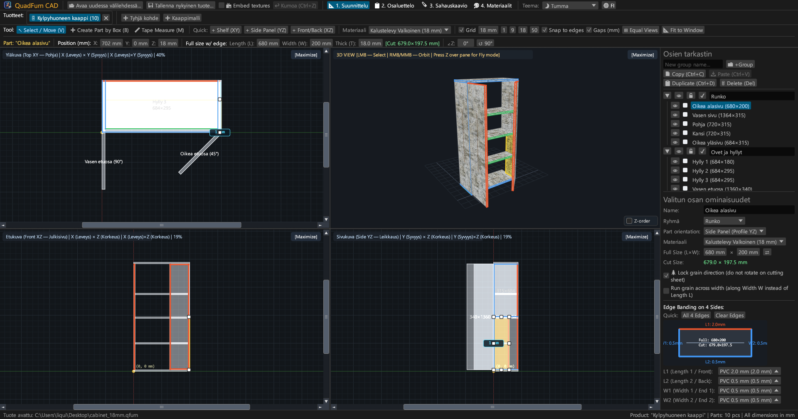
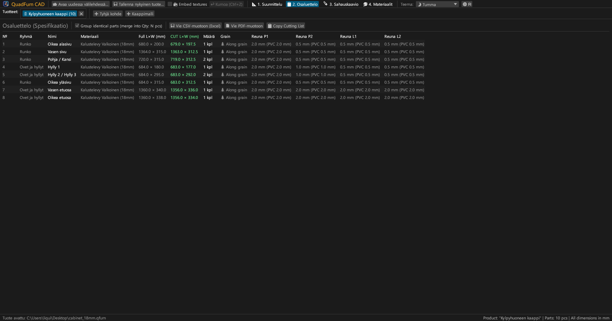
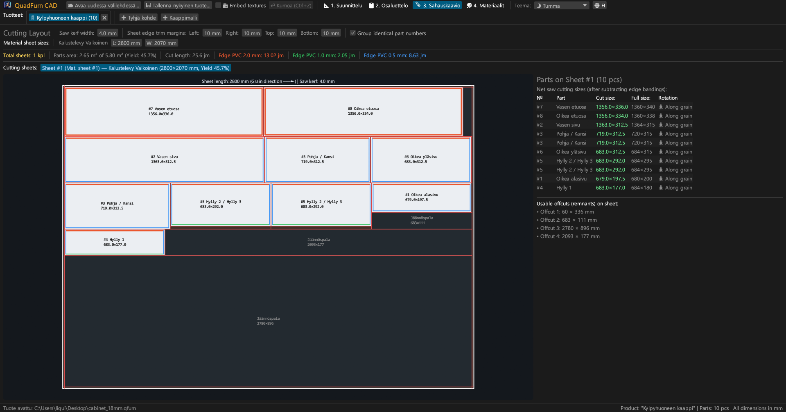
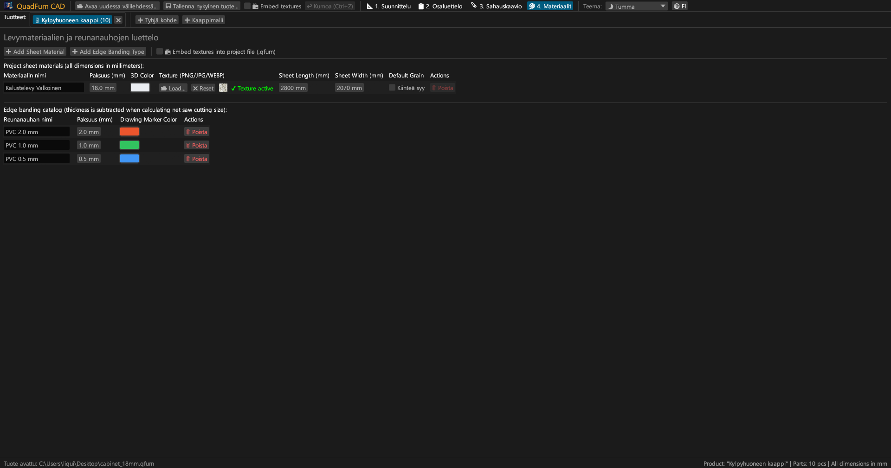
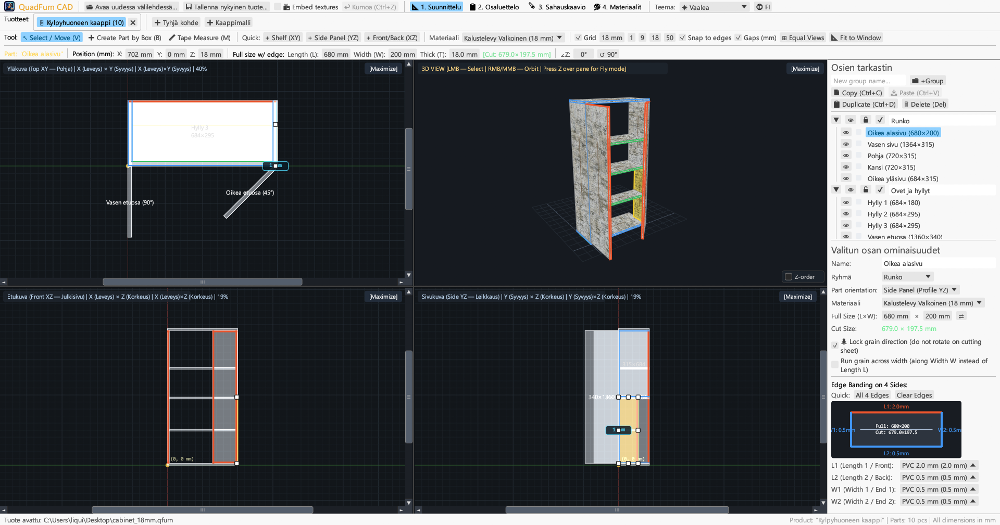
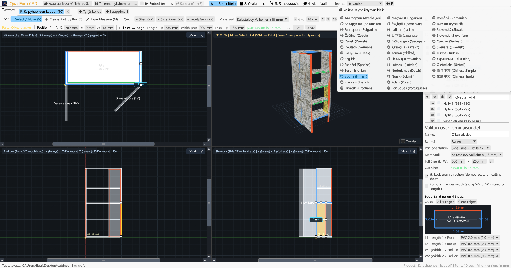

# QuadFurn CAD

**Kaluste-CAD lastulevy- ja runkokalusteille — 4-näkymäinen tilaratkaisu + giljotiinileikkauksen optimointi**

 

👉 **[🚀 Kokeile QuadFurn CADia suoraan selaimessa (WebAssembly)](https://rbm13s.github.io/QuadFurn/app/)** • **[🌐 Virallinen verkkosivusto](https://rbm13s.github.io/QuadFurn/fi.html)**

 

**Languages / Языки / Мови / Sprachen:** 
[English](../README.md) •
[Русский](README-ru.md) •
[Українська](README-uk.md) •
[Беларуская](README-be.md) •
[Қазақша](README-kk.md) •
[ქართული](README-ka.md) •
[Հայերեն](README-hy.md) •
[Azərbaycan](README-az.md) •
[Oʻzbekcha](README-uz.md) •
[Deutsch](README-de.md) •
[Français](README-fr.md) •
[Español](README-es.md) •
[Italiano](README-it.md) •
[Português](README-pt.md) •
[Polski](README-pl.md) •
[Čeština](README-cs.md) •
[Slovenčina](README-sk.md) •
[Slovenščina](README-sl.md) •
[Български](README-bg.md) •
[Српски](README-sr.md) •
[Hrvatski](README-hr.md) •
[Nederlands](README-nl.md) •
[Dansk](README-da.md) •
[Norsk](README-no.md) •
[Svenska](README-sv.md) •
**Suomi** •
[Eesti](README-et.md) •
[Latviešu](README-lv.md) •
[Lietuvių](README-lt.md) •
[Magyar](README-hu.md) •
[Română](README-ro.md) •
[Türkçe](README-tr.md) •
[Ελληνικά](README-el.md) •
[简体中文](README-zh-cn.md) •
[繁體中文](README-zh-tw.md) •
[日本語](README-ja.md) •
[한국어](README-ko.md)

---

## Sisällysluettelo

- [Esittely](#esittely)
- [Kuvakaappaukset ja visuaalinen katsaus](#kuvakaappaukset-ja-visuaalinen-katsaus)
- [Tärkeimmät ominaisuudet](#tärkeimmät-ominaisuudet)
- [Toiminnallinen dokumentaatio](#toiminnallinen-dokumentaatio)
- [Ohjaimet ja pikanäppäimet](#ohjaimet-ja-pikanäppäimet)
- [Lisenssi](#lisenssi)

---

## Esittely

**QuadFurn CAD** on nopea ja tehokas monialustainen CAD-sovellus Rust-kielellä kalusteiden, lastulevyjen (LDSP), MDF- ja vanerilevyjen suunnitteluun, automaattisella reunanauhojen vähennyksellä ja 2D-giljotiinisahausoptimoinnilla.

---

## Kuvakaappaukset ja visuaalinen katsaus

### 1. 4-näkymäinen CAD-suunnittelija (Tumma teema)
Samanaikaiset 2D-ortografiset näkymät (**Pohja XY**, **Julkisivu XZ**, **Leikkaus YZ**) ja **3D-näkymä**:

### 2. Osaluettelo ja sahausmitat
Osaluettelo reunanauhojen vähennyksen jälkeen:

### 3. Sahauskartat
Optimaalinen sijoittelu vakiokokoisille levyille:

### 4. Materiaalit ja reunanauhat
Levypaksuuksien, värien ja tekstuurien (`PNG`, `JPG`, `WEBP`) hallinta:

### 5. Vaalea teema
Kontrastikas vaalea teema:

### 6. 37 sisäänrakennettua kieltä
Välitön kielenvaihto 37 kielen välillä:

---

## Lisenssi

Ohjelmisto on lisensoitu vapaalla [MIT License](../LICENSE) -lisenssillä.
