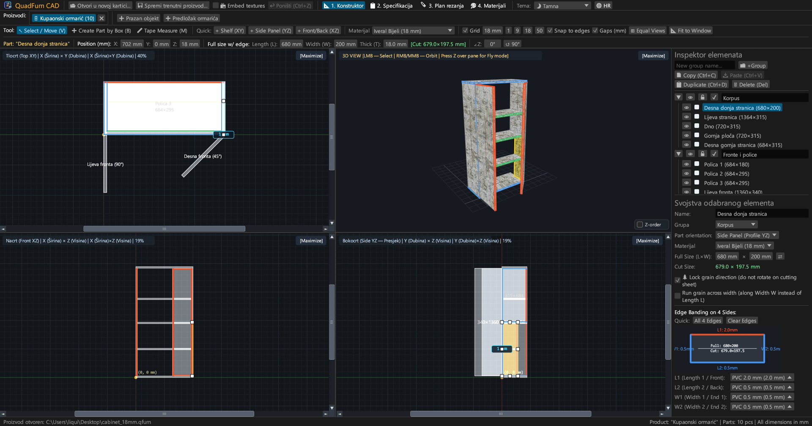
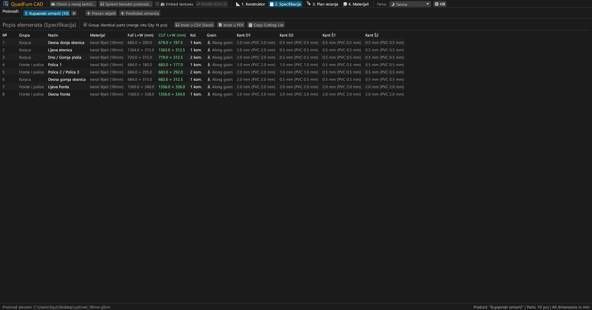
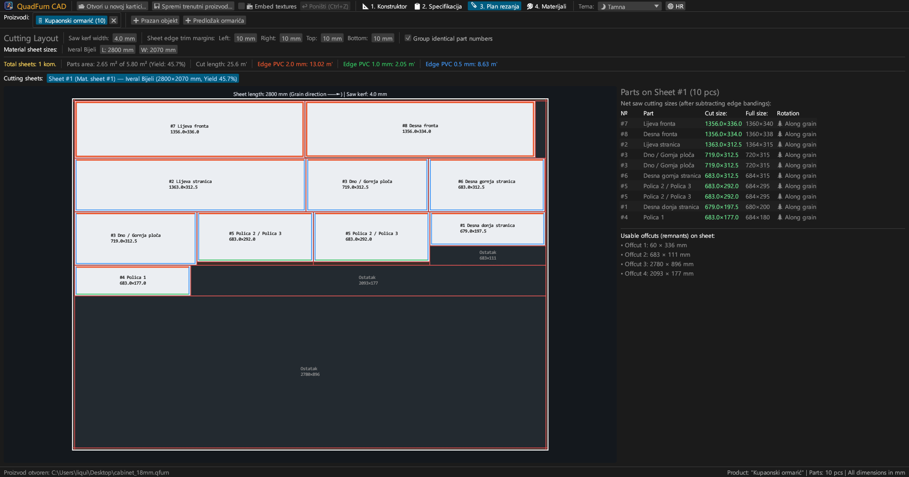
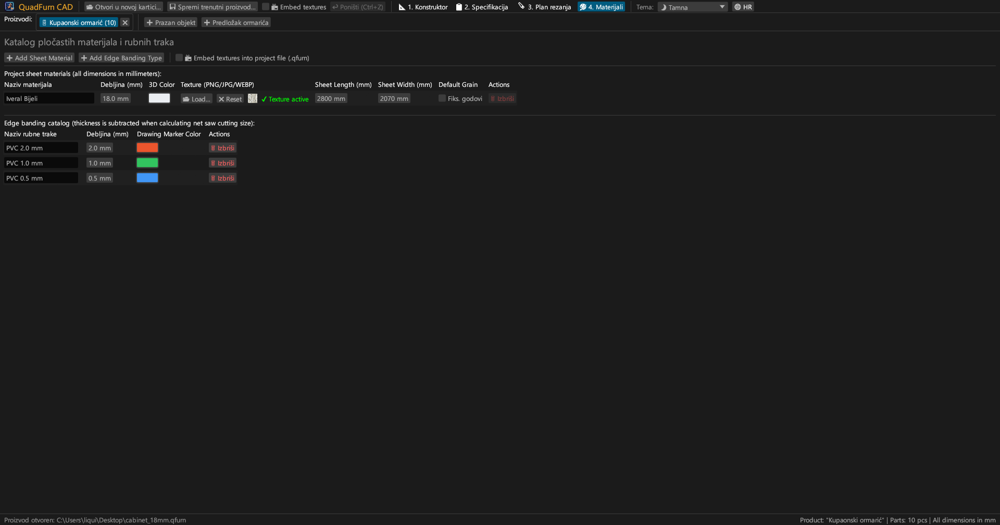
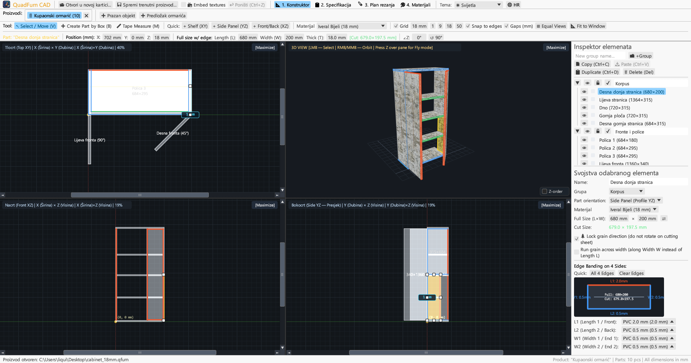
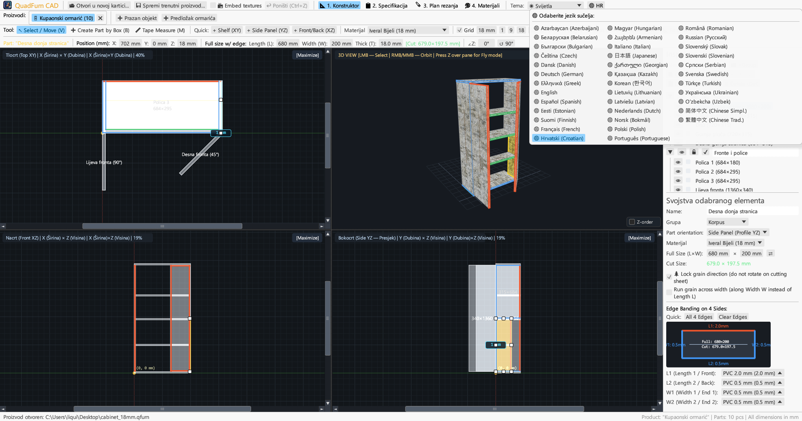

# QuadFurn CAD

**CAD za pločasti namještaj od iverala — 4-projekcijski prostorni dizajner + giljotinsko optimiranje krojenja ploča**

 

👉 **[🚀 Pokrenite QuadFurn CAD u pregledniku (WebAssembly)](https://rbm13s.github.io/QuadFurn/app/)** • **[🌐 Službena stranica](https://rbm13s.github.io/QuadFurn/hr.html)**

 

**Languages / Языки / Мови / Sprachen:** 
[English](../README.md) •
[Русский](README-ru.md) •
[Українська](README-uk.md) •
[Беларуская](README-be.md) •
[Қазақша](README-kk.md) •
[ქართული](README-ka.md) •
[Հայերեն](README-hy.md) •
[Azərbaycan](README-az.md) •
[Oʻzbekcha](README-uz.md) •
[Deutsch](README-de.md) •
[Français](README-fr.md) •
[Español](README-es.md) •
[Italiano](README-it.md) •
[Português](README-pt.md) •
[Polski](README-pl.md) •
[Čeština](README-cs.md) •
[Slovenčina](README-sk.md) •
[Slovenščina](README-sl.md) •
[Български](README-bg.md) •
[Српски](README-sr.md) •
**Hrvatski** •
[Nederlands](README-nl.md) •
[Dansk](README-da.md) •
[Norsk](README-no.md) •
[Svenska](README-sv.md) •
[Suomi](README-fi.md) •
[Eesti](README-et.md) •
[Latviešu](README-lv.md) •
[Lietuvių](README-lt.md) •
[Magyar](README-hu.md) •
[Română](README-ro.md) •
[Türkçe](README-tr.md) •
[Ελληνικά](README-el.md) •
[简体中文](README-zh-cn.md) •
[繁體中文](README-zh-tw.md) •
[日本語](README-ja.md) •
[한국어](README-ko.md)

---

## Sadržaj

- [Uvod](#uvod)
- [Snimke zaslona i vizualni pregled](#snimke-zaslona-i-vizualni-pregled)
- [Ključne značajke](#ključne-značajke)
- [Funkcionalna dokumentacija](#funkcionalna-dokumentacija)
- [Kontrole i prečaci](#kontrole-i-prečaci)
- [Licenca](#licenca)

---

## Uvod

**QuadFurn CAD** je CAD aplikacija visokih performansi napisana u Rustu za projektiranje namještaja od iverala, MDF-a i šperploče, s automatskim odbitkom rubne trake (kantiranja) i 2D giljotinskim krojenjem ploča.

---

## Snimke zaslona i vizualni pregled

### 1. 4-projekcijski CAD dizajner (Tamna tema)
Sinkroni 2D prikazi (**Tlocrt XY**, **Nacrt XZ**, **Bokocrt YZ**) i **3D prozor**:

### 2. Specifikacija dijelova
Tablica dimenzija nakon odbitka rubne trake:

### 3. Krojne liste
Optimalno raspoređivanje na pločama:

### 4. Materijali i rubne trake
Upravljanje debljinama, bojama i dekorima (`PNG`, `JPG`, `WEBP`):

### 5. Svijetla tema
Kontrastna svijetla tema:

### 6. 37 ugrađenih jezika
Trenutno prebacivanje između 37 jezika:

---

## Licenca

Projekt se distribuira pod slobodnom [MIT License](../LICENSE) licencom.
