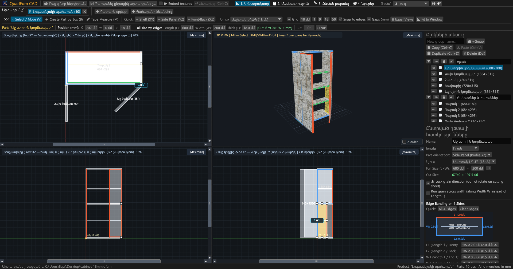
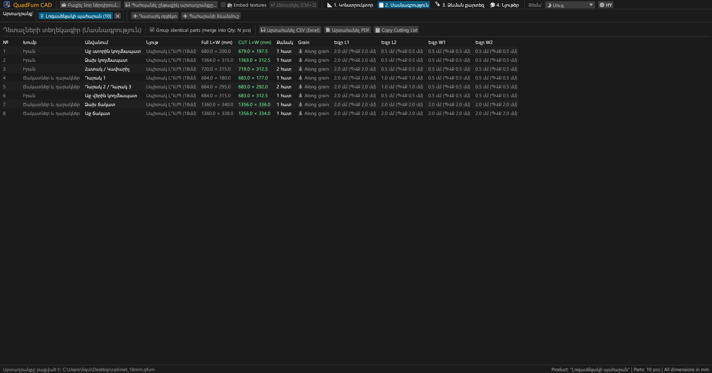
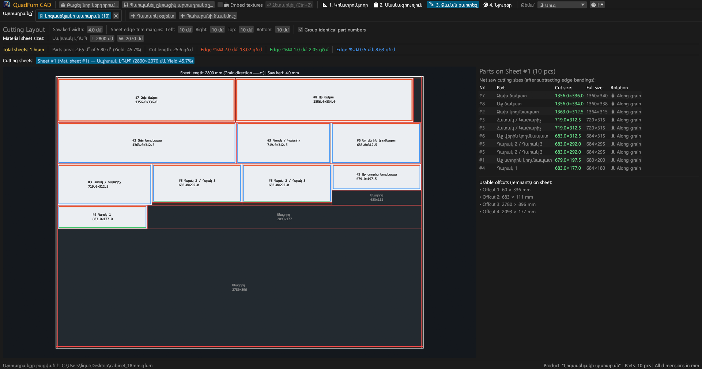
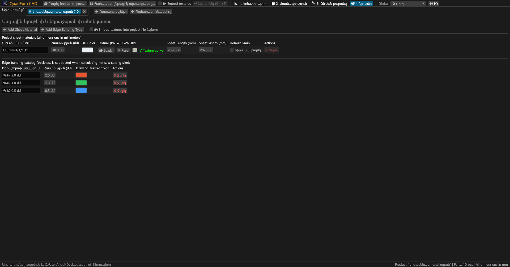
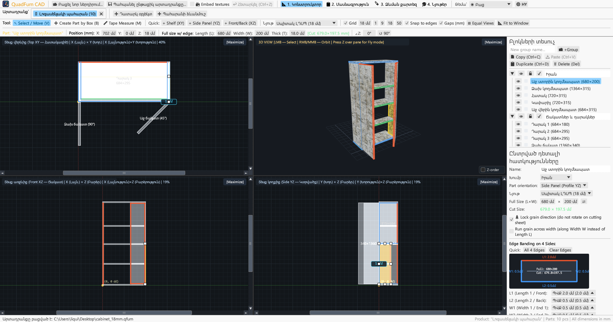
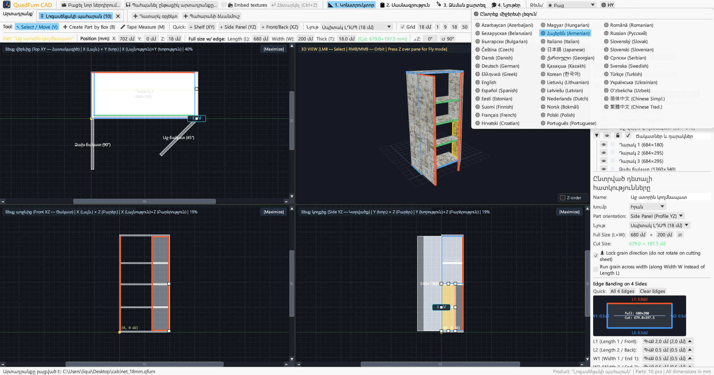

# QuadFurn CAD

**Կորպուսային կահույքի CAD ԼԴՍՊ-ի համար — 4-տեսադաշտային տարածական նախագծիչ + թերթային նյութերի գիլյոտինային կտրում**

 

👉 **[🚀 Գործարկել QuadFurn CAD-ը բրաուզերում (WebAssembly)](https://rbm13s.github.io/QuadFurn/app/)** • **[🌐 Պաշտոնական կայք](https://rbm13s.github.io/QuadFurn/hy.html)**

 

**Languages / Языки / Мови / Sprachen:** 
[English](../README.md) •
[Русский](README-ru.md) •
[Українська](README-uk.md) •
[Беларуская](README-be.md) •
[Қазақша](README-kk.md) •
[ქართული](README-ka.md) •
**Հայերեն** •
[Azərbaycan](README-az.md) •
[Oʻzbekcha](README-uz.md) •
[Deutsch](README-de.md) •
[Français](README-fr.md) •
[Español](README-es.md) •
[Italiano](README-it.md) •
[Português](README-pt.md) •
[Polski](README-pl.md) •
[Čeština](README-cs.md) •
[Slovenčina](README-sk.md) •
[Slovenščina](README-sl.md) •
[Български](README-bg.md) •
[Српски](README-sr.md) •
[Hrvatski](README-hr.md) •
[Nederlands](README-nl.md) •
[Dansk](README-da.md) •
[Norsk](README-no.md) •
[Svenska](README-sv.md) •
[Suomi](README-fi.md) •
[Eesti](README-et.md) •
[Latviešu](README-lv.md) •
[Lietuvių](README-lt.md) •
[Magyar](README-hu.md) •
[Română](README-ro.md) •
[Türkçe](README-tr.md) •
[Ελληνικά](README-el.md) •
[简体中文](README-zh-cn.md) •
[繁體中文](README-zh-tw.md) •
[日本語](README-ja.md) •
[한국어](README-ko.md)

---

## Բովանդակություն

- [Ներածություն](#ներածություն)
- [Սքրինշոթեր և տեսողական ակնարկ](#սքրինշոթեր-և-տեսողական-ակնարկ)
- [Հիմնական հնարավորություններ](#հիմնական-հնարավորություններ)
- [Ֆունկցիոնալ փաստաթղթավորում](#ֆունկցիոնալ-փաստաթղթավորում)
- [Կառավարում և ստեղների համադրություններ](#կառավարում-և-ստեղների-համադրություններ)
- [Լիցենզիա](#լիցենզիա)

---

## Ներածություն

**QuadFurn CAD** — բարձր արտադրողականությամբ բազմապլատֆորմային CAD ծրագիր Rust-ով, որը հասանելի է ինչպես արագ աշխատասեղանի հավելված (Windows, Linux, macOS), այնպես էլ առանց տեղադրման WebAssembly (WASM) օնլայն տարբերակ անմիջապես ժամանակակից բրաուզերներում: Նախատեսված է ԼԴՍՊ-ից, ՄԴՖ-ից և նրբատախտակից կորպուսային կահույքի նախագծման, ավտոմատ մասնագրերի ստեղծման և 2D գիլյոտինային կտրման օպտիմալացման համար:

---

## Սքրինշոթեր և տեսողական ակնարկ

### 1. 4-տեսադաշտային CAD նախագծիչ (Մուգ թեմա)
Համաժամանակյա 2D պրոյեկցիաներ (**Վերևից XY**, **Առջևից XZ**, **Կողքից YZ**) և ապարատային **3D պատուհան**:

### 2. Դետալների մասնագիր
Խմբավորված աղյուսակ՝ եզրաշերտի հաստության նվազեցումից հետո չափսերով:

### 3. Կտրման քարտեր
Օպտիմալ դասավորություն ստանդարտ թերթերի վրա:

### 4. Նյութեր և եզրաշերտեր
Հաստությունների, գույների և տեքստուրաների (`PNG`, `JPG`, `WEBP`) կառավարում:

### 5. Բաց թեմա
Կոնտրաստային բաց թեմա:

### 6. 37 ներկառուցված լեզու
Արագ փոխարկում 37 լեզուների միջև **`🌐`** կոճակով:

---

## Լիցենզիա

Ծրագիրը տարածվում է ազատ [MIT License](../LICENSE) արտոնագրով:
