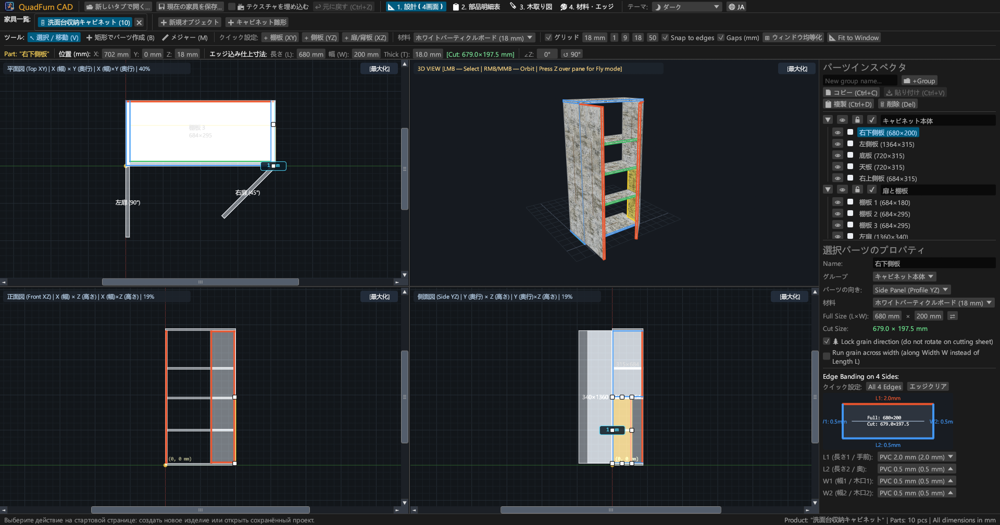
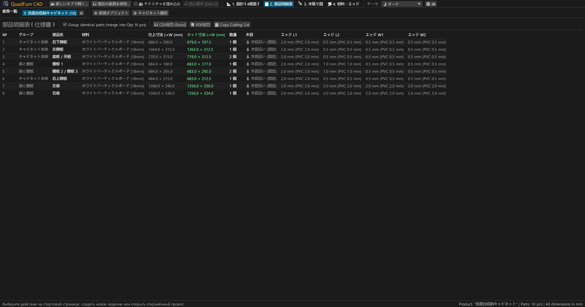
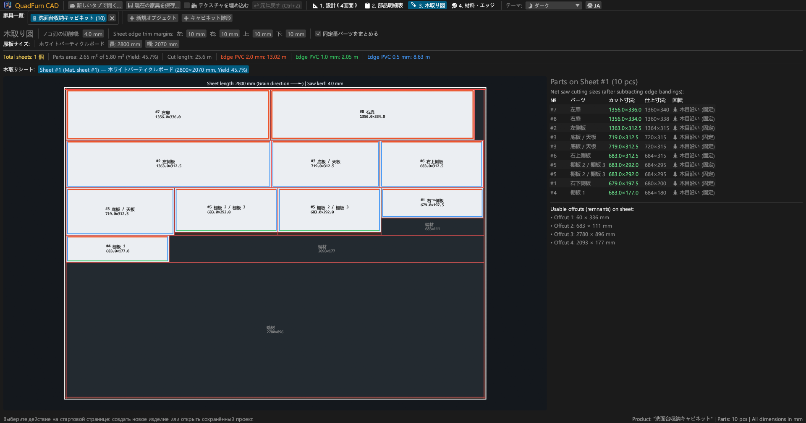
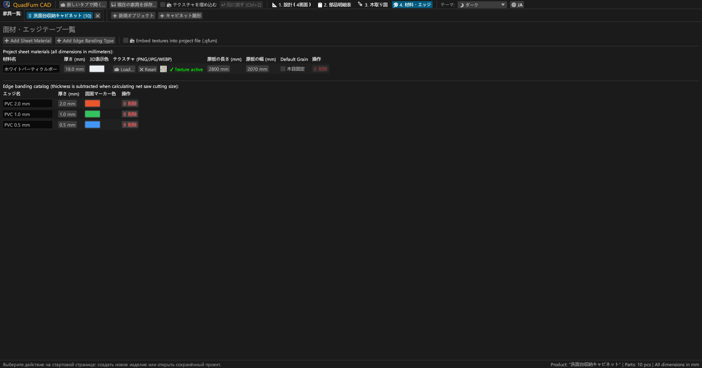
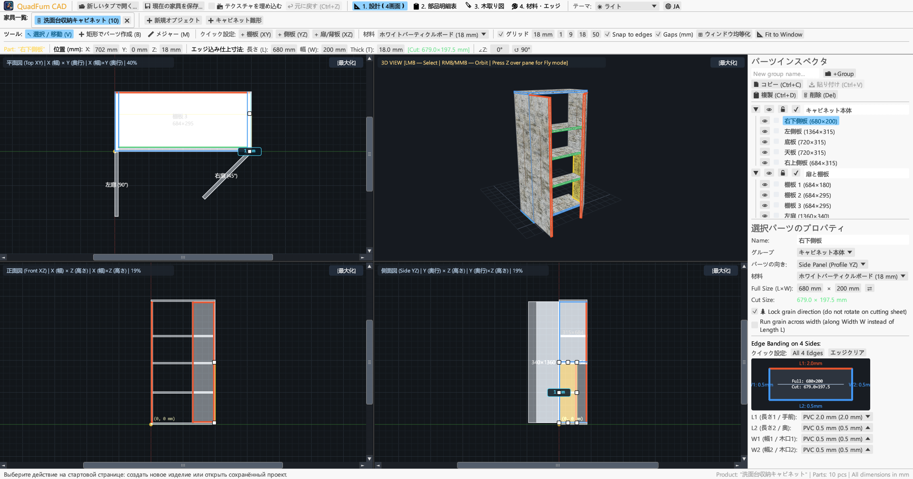
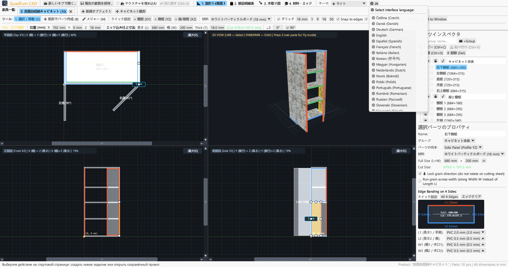

<div align="center">


# QuadFurn CAD

**パネル・合板・パーティクルボード家具専用 CAD — 4画面空間モデラー ＋ ギロチン式パネル木取り最適化エンジン**

[](https://github.com/rbm13s/QuadFurn/actions/workflows/build.yml)
[](https://github.com/rbm13s/QuadFurn/releases)
[](https://www.rust-lang.org/)
[](https://github.com/emilk/egui)
[](https://wgpu.rs/)
[](#8-テーマ設定と-22-言語の多言語対応)
[](#はじめに)
[](../LICENSE)

<br/>

**Languages / Языки / Мови / Sprachen:**<br/>
[English](../README.md) •
[Русский](README-ru.md) •
[Українська](README-uk.md) •
[Deutsch](README-de.md) •
[Polski](README-pl.md) •
[Español](README-es.md) •
[Français](README-fr.md) •
[Italiano](README-it.md) •
[Português](README-pt.md) •
[Čeština](README-cs.md) •
[Slovenčina](README-sk.md) •
[Slovenščina](README-sl.md) •
[Nederlands](README-nl.md) •
[Dansk](README-da.md) •
[Norsk](README-no.md) •
[Svenska](README-sv.md) •
[Magyar](README-hu.md) •
[Română](README-ro.md) •
[Türkçe](README-tr.md) •
[简体中文](README-zh-cn.md) •
**日本語** •
[한국어](README-ko.md)

</div>

---

## 目次

- [概要](#概要)
- [スクリーンショットと機能ツアー](#スクリーンショットと機能ツアー)
- [主な機能](#主な機能)
- [機能詳細ドキュメント](#機能詳細ドキュメント)
  - [1. 4画面 CAD デザイナーと高精度コントロール](#1-4画面-cad-デザイナーと高精度コントロール)
  - [2. 数値入力欄でのインライン計算式入力](#2-数値入力欄でのインライン計算式入力)
  - [3. 木口テープ（エッジバンド）厚の自動減算と正味切断寸法](#3-木口テープエッジバンド厚の自動減算と正味切断寸法)
  - [4. ギロチン式 2D パネル木取り最適化](#4-ギロチン式-2d-パネル木取り最適化)
  - [5. マルチプロジェクトタブとプロジェクト間コピー＆ペースト](#5-マルチプロジェクトタブとプロジェクト間コピーペースト)
  - [6. 製造指示書（加工パスポート）のエクスポート（ベクター PDF、CSV、クリップボード）](#6-製造指示書加工パスポートのエクスポートベクター-pdfcsvクリップボード)
  - [7. 原板・テクスチャ・木口テープカタログ](#7-原板テクスチャ木口テープカタログ)
  - [8. テーマ設定と 22 言語の多言語対応](#8-テーマ設定と-22-言語の多言語対応)
- [操作方法とキーボードショートカット](#操作方法とキーボードショートカット)
- [はじめに](#はじめに)
- [設定とファイル形式](#設定とファイル形式)
- [プロジェクト構成](#プロジェクト構成)
- [ライセンス](#ライセンス)

---

## 概要

**QuadFurn CAD** は、Rust で開発された高性能なクロスプラットフォーム CAD アプリケーションであり、高速なネイティブデスクトップ版（Windows、Linux、macOS）と、最新ブラウザで直接動作するインストール不要の WebAssembly (WASM) オンライン版の両方を提供しています。パーティクルボード（低圧メラミン化粧板）、MDF、HDF、合板などの板材を用いたキャビネット・箱物家具の設計、部材拾い出し表の自動生成、およびギロチン式 2D 木取り最適化（板割り）のために設計されています。

定評ある 3 つのツールの優れた操作性を 1 つに統合しています：
1. **4画面空間モデリング**：3 つの同期された 2D 正射影図（**上面図 XY — 平面図**、**正面図 XZ — 立面図**、**側面図 YZ — 断面図**）による直感的な図面作成、スクロールバー、マグネット式スナップ、画面均等化ボタン（`⊞ 画面を均等化`）、木口（木端）視点での板厚誤操作防止保護、およびリアルタイム **3D オービット / 一人称自由飛行カメラ（`Z` キー Noclip）**。
2. **高精度トランスフォームバー**：部品の 3 次元座標（`X`, `Y`, `Z`）、寸法（`L × W × T`）、水平回転角度（`∠Z`）を直接入力可能。すべての数値ボックスは `600-4` や `720+18` といった計算式の入力をサポート。
3. **パネル木取りとエッジ厚自動控除**：部品の 4 辺に貼る PVC/ABS 木口テープ厚を自動で差し引いて**パネルソー用の正味切断寸法**を算出し、木目方向、鋸刃厚（アサリ幅）、および原板の外周トリミング幅を考慮した 2D 貫通切断最適化エンジンを搭載。

---

## スクリーンショットと機能ツアー

### 1. 4画面 CAD デザイナー（ダークテーマ）
同期された 2D 正投影ビュー（**上面図 XY**、**正面図 XZ**、**側面図 YZ**）と、パースペクティブ補正 UV マッピングを施した **3D ビュー**、8 点の拡大縮小ハンドル、および右側の**部品プロパティインスペクタ**。



### 2. 部品一覧（仕様表）と切断寸法
**仕上がり完成寸法（`L × W`）**と、4 辺（`L1`, `L2`, `W1`, `W2`）のエッジ厚を控除した**正味切断寸法（`CUT L × W`）**を一覧表示する詳細なパーツリスト。



### 3. ギロチン式原板木取り図（板割りレイアウト）
定尺板（`2800 × 2070 mm` など）上での貫通切断ライン、刃物幅、外周余白、エッジカラー表示、および寸法付きの再利用可能端材（残材）の自動算出。



### 4. 原板材料および木口テープカタログ
板材の厚み、3D カラー、表面テクスチャ画像（`PNG`, `JPG`, `WEBP`）、木目方向ロック、各種 ABS/PVC 木口テープの自由な登録と管理。



### 5. ライトテーマ（明色モード）対応
視認性に優れたモダンなライトテーマを搭載し、OS の外観モードと自動同期することも可能です。



### 6. 22 言語のインターフェースと PDF 出力
上部ツールバーの **`🌐`** アイコンから再起動なしで即座に言語を変更可能。初回起動時に OS の言語を自動検出し、多言語ベクター PDF を出力できます。



---

## 主な機能

- **完全同期 4 画面ワークスペース**：上面（`XY`）、正面（`XZ`）、側面（`YZ`）で自由に作図でき、ワンクリックで任意の画面を最大化表示（`[最大化]` / `[4画面に戻す]`）。
- **GPU アクセラレーション 3D 表示**：オービット回転（`右ドラッグ`/`中ドラッグ`）＋ 一人称フライトモード（3D 画面上で **`Z`** キー ＋ `WASD`/`スペース`/`Ctrl`）。OBB レイキャストによる高精度クリック選択。
- **マグネットスナップと動的すきま寸法表示**：グリッドへの自動スナップ（`1`, `9`, `18`, `50 mm` または任意値）、隣接部材の面や角への磁気吸着（`0 mm` 面一接合）、隣接部品とのすきま間隔のリアルタイム寸法表示。
- **矩形枠選択とグループ変形**：2D 画面上でドラッグして複数部品を一括選択し、まとめて移動、複製（`Ctrl+D`）、別プロジェクトタブへのコピー＆ペースト（`Ctrl+C` / `Ctrl+V`）。
- **内蔵数式計算機能**：すべての数値入力ボックスで `600+100`、`800-36`、`720/2`、`45+15` などの四則演算を直接評価。
- **エッジテープ厚の自動控除**：部品の 4 辺（`L1`, `L2`, `W1`, `W2`）に PVC/ABS エッジ（`0.4 mm`, `0.5 mm`, `1.0 mm`, `2.0 mm` など）を指定すると、自動で正味の鋸切断寸法を算出：
  $$\text{切断長さ} = L_{\text{仕上がり}} - E_{L1} - E_{L2}, \quad \text{切断幅} = W_{\text{仕上がり}} - E_{W1} - E_{W2}$$
- **2D ギロチン木取り最適化**：木目方向の固定、鋸刃厚の切削シロ、原板 4 辺のトリミング（耳落とし）を正確に計算するマルチシートネスティング。
- **ベクター PDF A4 横向き製造加工パスポート**：選択中の言語でワンクリック出力：
  1. 正味切断寸法・エッジ・木目情報を含む完全な部品仕様表
  2. 外形総寸法を記載した 4 画面テクニカル図面（`上面 XY`、`3D 等角投影`、`正面 XZ`、`側面 YZ`）
  3. 各原板ごとのギロチン木取り図
  4. 原板所要枚数および `+15%` のロスを見込んだ木口テープ総メーター数集計表

---

## 機能詳細ドキュメント

### 1. 4画面 CAD デザイナーと高精度コントロール

**デザイナー** タブ（`📐 1. デザイナー`）は 3 つの主要エリアで構成されています：

1. **上部ツールバー**:
   - **作図ツール**:
     - `↖ 選択・移動 (V)`: 部品をクリックして選択、ドラッグで移動、変形ハンドル（正面から見える部品は 8 つのハンドル、木口視点の部品は 2 つの辺ハンドル）でサイズ変更。余白ドラッグで範囲枠選択。2Dでのドラッグ中：**`Shift`** を長押しすると移動が水平または垂直軸に固定され、**`Ctrl` (`Cmd`)** を長押しするとエッジスナップが無効化され、**`Alt`** を長押しするとドロップ時に部品が複製されます。
     - `➕ 枠指定で部品作成 (B)`: 2D ビュー（`上面 XY`、`正面 XZ`、`側面 YZ`）上で矩形をドラッグして、その平面に対応する板材（棚板、側板、前板/背板）を即座に作成。
     - `📏 メジャー (M)`: 2D ビュー上の 2 点間の距離（`ΔX`, `ΔY`, `L` mm）を高精度測定。
   - **クイック部品配置**: 棚板（`+ 棚板 (XY)`）、側板（`+ 側板 (YZ)`）、前板/背板（`+ 前板/背板 (XZ)`）のワンクリック配置。
   - **グリッドとスナップ**: グリッド間隔設定（`1`, `9`, `18`, `50 mm`）、エッジへの磁気吸着、すきま間隔寸法の表示切り替え。
   - **カメラセンタリング**:
     - `🔍 ビューを中央に配置`: カメラを中心または原点にリセット。
     - `📐 ウィンドウに合わせる`: 家具の外形バウンディングボックスを自動計算し、4 つの画面すべてにピッタリ収まるよう自動ズーム。
   - **高精度トランスフォームバー**: 選択部品の座標 `X`, `Y`, `Z`、寸法 `L`, `W`, `T`、緑色の切断寸法バッジ `[切断: L × W mm]`、回転角度 `∠Z` の直接編集。

2. **4 画面ビューポート**:
   - **2D 正射影図（`上面 XY`、`正面 XZ`、`側面 YZ`）**: スムーズなスクロールバー、ミリメートル目盛定規、エッジテープのカラーライン表示。
   - **3D ビュー**: マウス右/中ボタンドラッグによるオービット回転、ホイールズーム、3D ピッキング、および**一人称フライトモード（Noclip）**（3D 画面上で **`Z`** キーを押し、`WASD`、`スペース`、`Ctrl`/`Shift` で自由に飛行巡航）。

3. **右側 部品プロパティインスペクタ**:
   - 部品の**グループ**分類（*本体箱*、*扉・前板*、*引出し* など）。
   - グループおよび個別部品の**表示/非表示（`👁`）**と**編集ロック（`🔒`）**。
   - 使用材料、配置方向、寸法（`L × W` 入替ボタン `⇄`）、木目方向固定（`🌲 木目方向を固定`）、横木目（`🔄 幅方向に木目を流す`）、4 辺エッジ選択ダイアグラム。

---

### 2. 数値入力欄でのインライン計算式入力

すべての数値入力ボックスで計算式の直接入力が可能です：
- **加算と減算**: `600` と入っている入力欄に `600+100` または `600-4` と入力して `Enter` を押すと、即座に `700` または `596` が入力されます。
- **乗算・除算と括弧**: `(800-36)/2` や `18*2` などの複合式もそのまま計算されます。
- 小数点としてピリオド `.` とカンマ `,` の双方が使用でき、末尾の単位記号（`mm`, `°`）は自動で除去されます。

---

### 3. 木口テープ（エッジバンド）厚の自動減算と正味切断寸法

- 長方形の板材には 4 つの辺があります：**`L1`**（長さ 1 / 手前）、**`L2`**（長さ 2 / 奥）、**`W1`**（幅 1 / 木口 1）、**`W2`**（幅 2 / 木口 2）。
- `680 × 200 mm` の部材に対し、`L1` に `2.0 mm`、`L2`、`W1`、`W2` に `0.5 mm` の PVC テープを指定した場合、ソフトウェアは自動的に**正味切断寸法**を導き出します：
  - $\text{切断長さ } L = 680 - 2.0 - 0.5 = 677.5\text{ mm}$
  - $\text{切断幅 } W = 200 - 0.5 - 0.5 = 199.0\text{ mm}$
- エッジの貼られた辺は、2D/3D 図面上および木取りレイアウト上でカラーの帯で明瞭に図示されます。

---

### 4. ギロチン式 2D パネル木取り最適化

**木取りレイアウト** タブ（`🪚 3. 木取りレイアウト`）では、すべての部品を原板へ最適にネスティング配置します：
- **設定可能な加工パラメータ**:
  - **鋸刃厚（アサリ幅）**（デフォルト `4.0 mm`）。
  - **原板外周トリミング（耳落とし）幅**（`左`、`右`、`上`、`下`、デフォルト `10 mm`）。
- **木目方向の厳密な管理**:
  - **木目固定（`🌲`）の部品**: 原板の長さ方向（`原板長さ L`）に対して絶対に直角回転させません。
  - **フリー木目の部品**: 歩留まりを向上させるため、アルゴリズムが必要に応じて 90° 回転させて配置します。
- **視覚的な木取り図と端材管理**:
  - 赤いギロチン貫通切断線、部品番号、切断寸法、エッジカラー、および寸法が明記された再利用可能端材（残材）の表示。
  - 必要原板枚数、面積歩留まり率（%）、総直線切断距離、エッジテープの消費メーター数などの完全な統計。

---

### 5. マルチプロジェクトタブとプロジェクト間コピー＆ペースト

- **スタート画面と履歴**: 空の家具の新規作成、2 枚扉キャビネットのテンプレート、既存の `.qfurn`/`.json` ファイルの読み込み、および**最近開いた 10 件のプロジェクト**へのクイックアクセス。
- **複数家具の同時編集**: タブバーで複数の家具ユニットを並行して設計可能（タブ名をダブルクリックして名称変更）。
- **プロジェクト間の部品コピー＆ペースト**: 部品を選択して `Ctrl+C`、別の家具タブ（または別起動の QuadFurn ウィンドウ）で `Ctrl+V`。不足している板材やエッジ設定は自動で新規作成されます。
- **保存確認ダイアログ**: 未保存のタブを閉じたりアプリを終了する際には、必ず保存確認ダイアログが表示されます（`保存して終了`、`保存せずに終了`、`キャンセル`）。

---

### 6. 製造指示書（加工パスポート）のエクスポート（ベクター PDF、CSV、クリップボード）

**仕様表** タブ（`📋 2. 仕様表`）から：
1. **`📄 PDF にエクスポート`（A4 横向きベクター製造加工指示書）**:
   - **第 1 章**: 完成寸法、切断寸法、エッジ、木目を含む全パーツリスト。
   - **第 2 章**: 外形総寸法を記載した 4 画面テクニカル図面（`上面 XY`、`3D 等角投影`、`正面 XZ`、`側面 YZ`）。
   - **第 3 章**: 原板ごとの詳細なギロチン木取り図。
   - **第 4 章**: 板材集計表およびエッジテープ消費量（正味メーター数および `+15%` のロス含む）。
   - 文書は**現在選択されている言語**で作成され、TrueType/CID ベクターフォントが内包されます（日本語・漢字も完全サポート）。
2. **`💾 CSV (Excel) にエクスポート`**: BOM 付き UTF-8、セミコロン `;` 区切りのスプレッドシート（Excel や LibreOffice で即座に展開可能）。
3. **`📋 切断リストをコピー`**: タブ区切り形式で切断寸法をクリップボードにコピー（外部の木取りソフトや表計算ソフトへ貼り付け可能）。

---

### 7. 原板・テクスチャ・木口テープカタログ

**材料** タブ（`🎨 4. 材料`）にて：
- RGB カラー、原板定尺寸法（`L × W`）、木目固定の初期設定を持つ**板材**の登録（`18mm パーティクルボード`、`16mm MDF`、`3mm HDF` など）。
- リアルな 3D 表示のための **`PNG`**、**`JPG`/`JPEG`**、**`WEBP`** 表面テクスチャの登録。
- **ポータブルなテクスチャ自動探索**: 別の PC で `.qfurn` ファイルを開く際、以下の順序で自動検索します：
  1. プロジェクトファイル内部に埋め込まれた Base64 データ
  2. `.qfurn` プロジェクトファイルと同じフォルダ内
  3. プロジェクトフォルダ直下の `./textures/` サブフォルダ内
  4. 相対パスおよび元の絶対パス
- **テクスチャの内包保存（`📦 テクスチャをプロジェクトファイルに埋め込む`）**: 上部バーまたは材料マネージャーでこのチェックを有効にすると、テクスチャ画像が Base64 形式で `.qfurn` ファイル内に直接書き込まれます。単一ファイルで完結し、どこへ移動しても画像リンク切れが起きません。
- **GPU 保護機能**: 60MB を超える画像は安全のためにブロックされ、解像度が高すぎる画像（> 4096px）は滑らかな動作を維持するために自動縮小されます。
- 厚み（mm）と識別カラーを指定する**木口テープ（エッジバンド）**の登録。使用中の素材の削除時には安全確認と再割り当てが行われます。

---

### 8. テーマ設定と 22 言語の多言語対応

- **カラーテーマ**: ツールバー右側から **🌙 ダーク**、**☀ ライト**、**🖥 システム** を自由に切り替え。
- **22 言語内蔵**:
  `日本語`、`English`、`Русский`、`Українська`、`Deutsch`、`Polski`、`Español`、`Français`、`Italiano`、`Português`、`Čeština`、`Slovenčina`、`Slovenščina`、`Nederlands`、`Dansk`、`Norsk`、`Svenska`、`Magyar`、`Română`、`Türkçe`、`简体中文`、および `한국어`。
- **初回起動時の OS 言語自動検出**: お使いのオペレーティングシステムの言語を自動認識し、その言語で起動します。設定は `%APPDATA%\QuadFurn\settings.json` に保存されます。

---

## 操作方法とキーボードショートカット

| ショートカット | 機能 |
| :--- | :--- |
| **`V`** | **選択・移動** ツール（正面から見える部品は 8 つのハンドル、木口視点の部品は 2 つの辺ハンドルに制限、矩形枠選択対応） |
| **`B`** | 2D ビューで **枠指定で部品作成** ツール |
| **`M`** | 2D ビューで **メジャー** ツール |
| **`左ドラッグ` (2D)** | 部品の移動、ハンドルによる変形、余白ドラッグによる枠選択 |
| **`Shift + 左ドラッグ` (2D)** | 部品の移動を水平または垂直の単一軸に固定 |
| **`Ctrl / Cmd + 左ドラッグ` (2D)** | 移動中の部材エッジへの磁気スナップを一時的に無効化 |
| **`Alt + 左ドラッグ` (2D)** | ドロップ位置に選択中の部品を素早く複製（コピー） |
| **`Shift / Ctrl (Cmd) + 左クリック` (2D)** | 部品を複数選択グループへ追加または解除 |
| **`右` / `中ボタンドラッグ` (2D)** | 2D 画面のパン（平行移動） |
| **`マウスホイール` (2D / 3D)** | カーソル位置を中心としたズームイン・ズームアウト |
| **`右` / `中ボタンドラッグ` (3D)** | 3D カメラのオービット回転 |
| **`Z` (3D ビュー上)** | **一人称自由フライトモード (Noclip)** の切り替え |
| **`W` `A` `S` `D` / `スペース` / `Ctrl (Cmd)`** | 3D フライト時の前進/左/後退/右/上昇/下降（`Shift` で加速） |
| **`Ctrl + S` / `Cmd (⌘) + S`** | 現在の家具プロジェクトを保存（`.qfurn` / `.json`） |
| **`Ctrl + Z` / `Cmd (⌘) + Z`** | 操作を元に戻す（アンドゥ、最大 40 段階） |
| **`Ctrl + C` / `Cmd (⌘) + C`** | 選択したパーツをクリップボードにコピー |
| **`Ctrl + V` / `Cmd (⌘) + V`** | パーツを貼り付け（別タブ間でも動作） |
| **`Ctrl + D` / `Cmd (⌘) + D`** | 選択部品の複製（デュプリケート） |
| **`Delete` / `Backspace`** | 選択部品の削除 |
| **`←` `→` `↑` `↓` (2D ビュー)** | 選択したパーツを選択したグリッド刻みで微小移動（`Shift` で 2 倍） |

---

## はじめに

### ビルド済みバイナリのダウンロード（GitHub Releases）
コミットやリリースのたびに、[GitHub Actions](https://github.com/rbm13s/QuadFurn/actions) により自動でパッケージが生成されます：
- **Windows (`x86_64`)**: `QuadFurn-windows-x86_64.zip` — 高解像度アイコン内蔵のポータブル `QuadFurn.exe`。
- **Linux (`Debian 12+ / Ubuntu 22.04+ x86_64`)**:
  - `quadfurn_<version>_amd64.deb` — Debian/Ubuntu 公式インストーラー（バイナリ、メニュー項目、アイコンを自動登録）：
    ```bash
    sudo apt install ./quadfurn_0.2.3_amd64.deb
    ```
  - `QuadFurn-linux-x86_64.tar.gz` — ポータブル Linux アーカイブ。
- **macOS (`Universal: Apple Silicon M1–M4 + Intel x86_64`)**: `QuadFurn-macos-universal.zip` — Retina アイコンを内蔵したネイティブ `QuadFurn.app`。

---

### ソースコードからのビルド

#### 必須環境
- [Rust ツールチェーン](https://rustup.rs/)（`stable`、Rust 2021 エディション）
- **Linux (Debian / Ubuntu)** システムライブラリ：
  ```bash
  sudo apt-get update && sudo apt-get install -y \
    build-essential pkg-config libxcb-render0-dev libxcb-shape0-dev \
    libxcb-xfixes0-dev libxkbcommon-dev libxkbcommon-x11-dev libssl-dev \
    libgtk-3-dev libglib2.0-dev libatk1.0-dev libgdk-pixbuf-2.0-dev \
    libcairo2-dev libpango1.0-dev libgl1-mesa-dev fonts-dejavu-core fonts-noto-cjk
  ```
- **macOS**: Xcode Command Line Tools（`xcode-select --install`）
- **Windows**: Windows 10 / 11 および MSVC C++ Build Tools

#### ビルドおよび実行コマンド
```bash
# 開発モードで実行
cargo run

# 最適化されたリリース用バイナリのビルド
cargo build --release

# 単体テストの実行
cargo test
```

---

## 設定とファイル形式

- **ユーザー設定ファイル (`settings.json`)**:
  各 OS の標準設定フォルダに自動保存されます：
  - **Windows**: `%APPDATA%\QuadFurn\settings.json`
  - **Linux**: `~/.config/QuadFurn/settings.json`
  - **macOS**: `~/Library/Application Support/QuadFurn/settings.json`
  
  保存内容：
  - `theme_choice`（`Dark`, `Light`, `System`）
  - `language`（`Ja`, `En`, `Ru` など）
  - `recent_projects`（最近開いた 10 件のパス）
- **プロジェクトファイル (`.qfurn` / `.json`)**:
  UTF-8 準拠の標準 JSON テキストファイルであり、すべての部品形状、グループ構造、素材、テクスチャ、エッジバンド、木取り設定が含まれます。テクスチャの埋め込みが有効な場合、画像データは Base64 形式で直接ファイル内に記録されます。

---

## プロジェクト構成

```text
QuadFurn/
├── .github/
│   └── workflows/
│       └── build.yml          # GitHub Actions CI/CD（Linux .deb/.tar.gz、macOS .app、Windows .zip）
├── assets/
│   ├── icon.jpeg              # アプリケーションロゴおよびアイコン元画像
│   └── screenshots/           # ドキュメント用スクリーンショット画像
├── docs/                      # 22 言語の完全なローカライズドキュメント
├── src/
│   ├── main.rs                # メインエントリポイント、タブ管理、スタート画面、ショートカット
│   ├── model.rs               # データモデル（Project, PartBlock, SheetMaterial, EdgeBanding, OBB）
│   ├── viewport.rs            # 4画面ワークスペースコントローラー、2D および 3D wgpu/painter 描画
│   ├── snapping.rs            # グリッドおよびエッジへのマグネットスナップ、正投影軸
│   ├── cutter.rs              # 2D ギロチン木取り最適化エンジン、エッジ厚控除
│   ├── export.rs              # 多言語ベクター PDF 生成、CSV および木取りリストエクスポート
│   ├── ui_panels.rs           # トランスフォームバー、プロパティインスペクタ、仕様表、木取り、材料 UI
│   └── i18n.rs                # 22 言語対応翻訳辞書および OS 言語自動検出
├── build.rs                   # Windows 用 ICO アイコン変換および PE リソース埋め込み
├── Cargo.toml                 # パッケージ構成および依存ライブラリ
└── LICENSE                    # MIT ライセンス
```

---

## ライセンス

本プロジェクトは [MIT ライセンス](../LICENSE) のもとで公開されており、商用・非商用を問わず自由に使用、改変、再配布が可能です。


