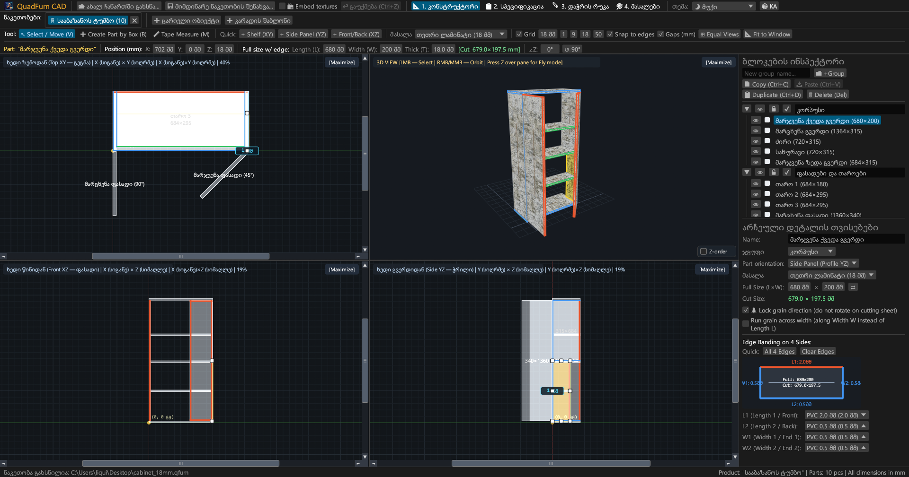
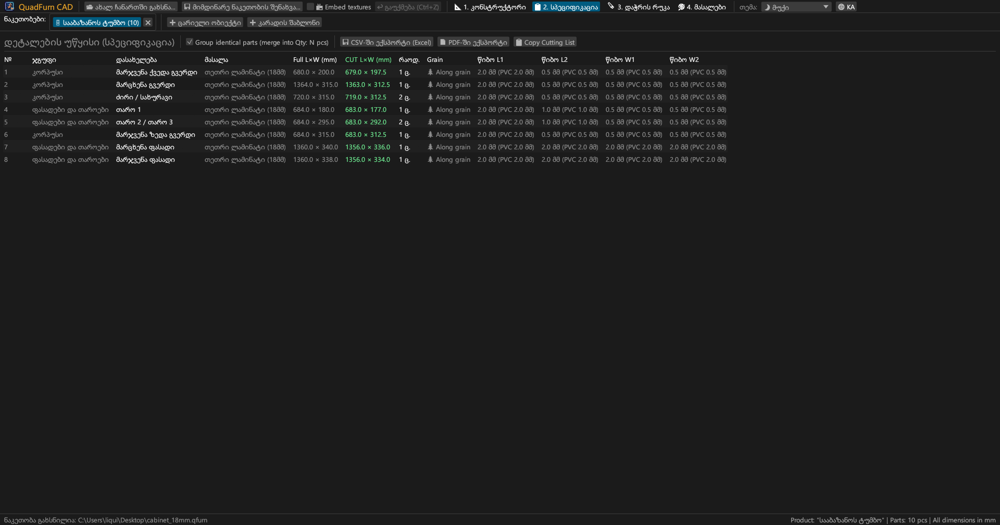
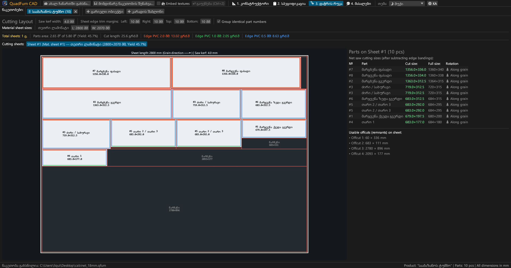
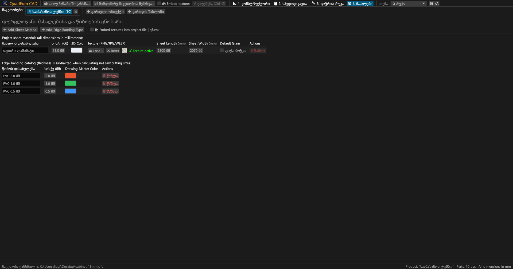
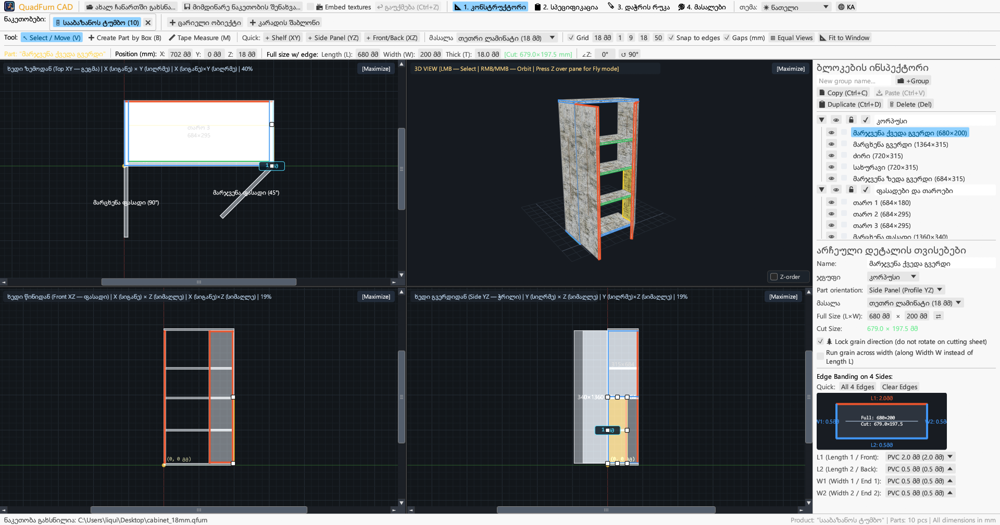
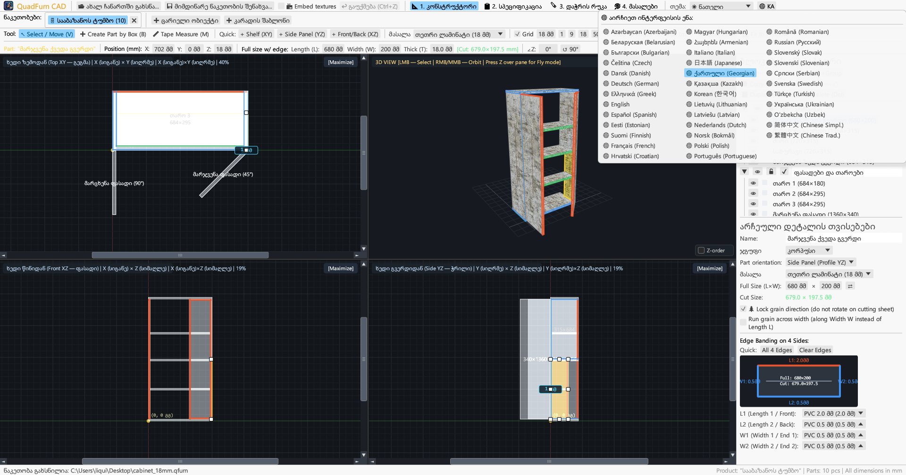

# QuadFurn CAD

**კორპუსული ავეჯის CAD ლამინირებული დსპ-სთვის — 4-ხედიანი სივრცითი კონსტრუქტორი + ფურცლოვანი მასალების გილიოტინური გაჭრა**

 

👉 **[🚀 QuadFurn CAD-ის გაშვება პირდაპირ ბრაუზერში (WebAssembly)](https://rbm13s.github.io/QuadFurn/app/)** • **[🌐 ოფიციალური საიტი](https://rbm13s.github.io/QuadFurn/ka.html)**

 

**Languages / Языки / Мови / Sprachen:** 
[English](../README.md) •
[Русский](README-ru.md) •
[Українська](README-uk.md) •
[Беларуская](README-be.md) •
[Қазақша](README-kk.md) •
**ქართული** •
[Հայերեն](README-hy.md) •
[Azərbaycan](README-az.md) •
[Oʻzbekcha](README-uz.md) •
[Deutsch](README-de.md) •
[Français](README-fr.md) •
[Español](README-es.md) •
[Italiano](README-it.md) •
[Português](README-pt.md) •
[Polski](README-pl.md) •
[Čeština](README-cs.md) •
[Slovenčina](README-sk.md) •
[Slovenščina](README-sl.md) •
[Български](README-bg.md) •
[Српски](README-sr.md) •
[Hrvatski](README-hr.md) •
[Nederlands](README-nl.md) •
[Dansk](README-da.md) •
[Norsk](README-no.md) •
[Svenska](README-sv.md) •
[Suomi](README-fi.md) •
[Eesti](README-et.md) •
[Latviešu](README-lv.md) •
[Lietuvių](README-lt.md) •
[Magyar](README-hu.md) •
[Română](README-ro.md) •
[Türkçe](README-tr.md) •
[Ελληνικά](README-el.md) •
[简体中文](README-zh-cn.md) •
[繁體中文](README-zh-tw.md) •
[日本語](README-ja.md) •
[한국어](README-ko.md)

---

## შინაარსი

- [შესავალი](#შესავალი)
- [სკრინშოტები და ვიზუალური მიმოხილვა](#სკრინშოტები-და-ვიზუალური-მიმოხილვა)
- [ძირითადი შესაძლებლობები](#ძირითადი-შესაძლებლობები)
- [ფუნქციონალური დოკუმენტაცია](#ფუნქციონალური-დოკუმენტაცია)
  - [1. 4-ხედიანი CAD-კონსტრუქტორი და ზუსტი პოზიციონირება](#1-4-ხედიანი-cad-კონსტრუქტორი-და-ზუსტი-პოზიციონირება)
  - [2. მათემატიკური გამოსახულებები რიცხვით ველებში](#2-მათემატიკური-გამოსახულებები-რიცხვით-ველებში)
  - [3. წიბოს დადება და წიბოს სისქის ავტომატური გამოკლება](#3-წიბოს-დადება-და-წიბოს-სისქის-ავტომატური-გამოკლება)
  - [4. გილიოტინური 2D-გაჭრის ოპტიმიზაცია](#4-გილიოტინური-2d-გაჭრის-ოპტიმიზაცია)
  - [5. ნაკეთობების ჩანართები და ბუფერი პროექტებს შორის](#5-ნაკეთობების-ჩანართები-და-ბუფერი-პროექტებს-შორის)
  - [6. საწარმოო პასპორტის ექსპორტი (ვექტორული PDF, CSV Excel, ბუფერი)](#6-საწარმოო-პასპორტის-ექსპორტი-ვექტორული-pdf-csv-excel-ბუფერი)
  - [7. ფურცლოვანი მასალების, ტექსტურების და წიბოების კატალოგი](#7-ფურცლოვანი-მასალების-ტექსტურების-და-წიბოების-კატალოგი)
  - [8. გაფორმების თემები და ლოკალიზაცია 37 ენაზე](#8-გაფორმების-თემები-და-ლოკალიზაცია-37-ენაზე)
- [მართვა და ცხელი კლავიშები](#მართვა-და-ცხელი-კლავიშები)
- [სწრაფი დაწყება](#სწრაფი-დაწყება)
- [პარამეტრები და ფაილის ფორმატები](#პარამეტრები-და-ფაილის-ფორმატები)
- [პროექტის არქიტექტურა](#პროექტის-არქიტექტურა)
- [ლიცენზია](#ლიცენზია)

---

## შესავალი

**QuadFurn CAD** — მაღალმწარმოებლური კროსპლატფორმული CAD აპლიკაცია Rust-ზე, ხელმისაწვდომი როგორც სწრაფი დესკტოპ აპლიკაცია (Windows, Linux, macOS), ასევე ინსტალაციის გარეშე მომუშავე WebAssembly (WASM) ონლაინ ვერსია პირდაპირ ბრაუზერში. განკუთვნილია კორპუსული ავეჯის დასაპროექტებლად ლამინირებული დსპ-სგან, მდფ-სგან და ფანერისგან, სპეციფიკაციების ავტომატური გენერაციით და ფურცლების გილიოტინური გაჭრის ოპტიმიზატორით.

---

## სკრინშოტები და ვიზუალური მიმოხილვა

### 1. 4-ხედიანი CAD-კონსტრუქტორი (მუქი თემა)
სინქრონული 2D-პროექციები (**ზემოდან XY**, **წინიდან XZ**, **გვერდიდან YZ**) და აპარატურული **3D-ხედი** ტექსტურებით, 8 ზომის შეცვლის მარკერით და მარჯვენა **დეტალების ინსპექტორით**.

### 2. დეტალების სპეციფიკაცია და ექსპორტი
დაჯგუფებული სპეციფიკაციის ცხრილი გაბარიტული და გაჭრის ზომებით 4 მხრიდან წიბოს სისქის ავტომატური გამოკლების შემდეგ.

### 3. გილიოტინური გაჭრის რუკები
დეტალების ოპტიმალური განლაგება სტანდარტულ ფურცლებზე, ხერხის ჭრის სიგანით, წიბოებით და გამოსადეგი ნარჩენების აღრიცხვით.

### 4. მასალების და წიბოების კატალოგი
ლამინირებული დსპ/მდფ სისქეების, ფერების, ტექსტურების (`PNG`, `JPG`, `WEBP`) და წიბოების ტიპების მართვა.

### 5. ღია თემა
კონტრასტული ღია თემა მუქ თემასთან ერთად და Windows-ის სისტემურ თემასთან ავტომატური სინქრონიზაცია.

### 6. 37 ჩაშენებული ენა (ინტერფეისი და PDF)
მყისიერი გადართვა 37 ჩაშენებულ ენას შორის ზედა მენიუს **`🌐`** ღილაკით, ოპერაციული სისტემის ენის ავტოამოცნობა და ლოკალიზებული PDF ექსპორტი.

---

## მართვა და ცხელი კლავიშები

| კლავიში / კომბინაცია | მოქმედება |
| :--- | :--- |
| **`V`** | ინსტრუმენტი **არჩევა და გადაადგილება** (8 მარკერი და მონიშვნის ჩარჩო) |
| **`B`** | ინსტრუმენტი **დეტალის შექმნა ჩარჩოთი** 2D-ფანჯრებში |
| **`M`** | ინსტრუმენტი **სახაზავი** 2D-ფანჯრებში |
| **`მაუსის მარცხენა ღილაკი` (2D)** | დეტალების გადაადგილება, ზომის მარკერების გაწევა ან ჩარჩოთი მონიშვნა |
| **`Shift + მარცხენა ღილაკი` (2D)** | გადაადგილება მკაცრად ჰორიზონტალურად ან ვერტიკალურად |
| **`Ctrl / Cmd + მარცხენა ღილაკი` (2D)** | წიბოებთან მიმაგნიტების გამორთვა |
| **`Alt + მარცხენა ღილაკი` (2D)** | დეტალის სწრაფი დუბლირება გადათრევისას |
| **`Shift / Ctrl + მარცხენა ღილაკი` (2D)** | დეტალის დამატება / ამოღება მონიშნულთა ჯგუფიდან |
| **`მაუსის მარჯვენა / შუა ღილაკი` (2D)** | 2D-კამერის პანორამირება |
| **`მაუსის ბორბალი` (2D / 3D)** | კამერის ზუმი |
| **`მარჯვენა / შუა ღილაკი` (3D)** | 3D ორბიტის ბრუნვა მოდელის გარშემო |
| **`Z` (3D ფანჯრის თავზე)** | პირველი პირის ფრენის რეჟიმი (Noclip, WASD + მაუსით მართვა) |
| **`W` `A` `S` `D` / `Space` / `Ctrl`** | ფრენა წინ/მარცხნივ/უკან/მარჯვნივ/ზემოთ/ქვემოთ 3D-ში (`Shift` — აჩქარება) |
| **`Ctrl + S` / `Cmd + S`** | ნაკეთობის შენახვა `.qfurn` / `.json` ფაილში |
| **`Ctrl + Z` / `Cmd + Z`** | ბოლო მოქმედების გაუქმება (40 ნაბიჯამდე) |
| **`Ctrl + C` / `Ctrl + V`** | დეტალების კოპირება / ჩასმა (მუშაობს ჩანართებს შორის) |
| **`Ctrl + D`** | დეტალების დუბლირება წანაცვლებით |
| **`Delete` / `Backspace`** | მონიშნული დეტალების წაშლა |
| **`←` `→` `↑` `↓` (2D)** | დეტალების წანაცვლება ბადის ბიჯით (`Shift` — გაორმაგებული ბიჯი) |

---

## ლიცენზია

პროექტი ვრცელდება თავისუფალი [MIT License](../LICENSE) ლიცენზიით.
