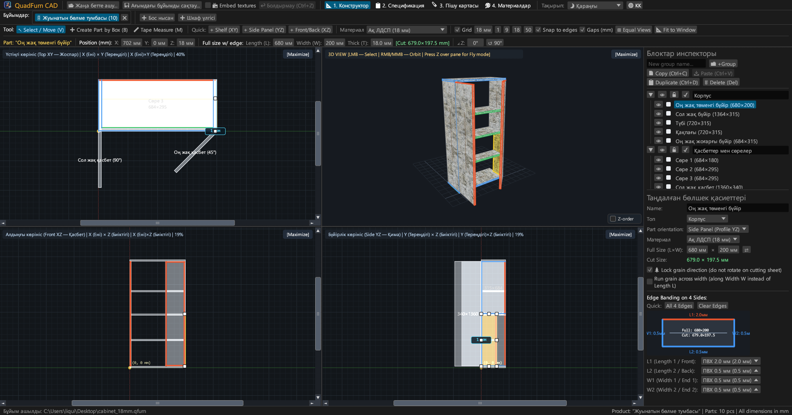
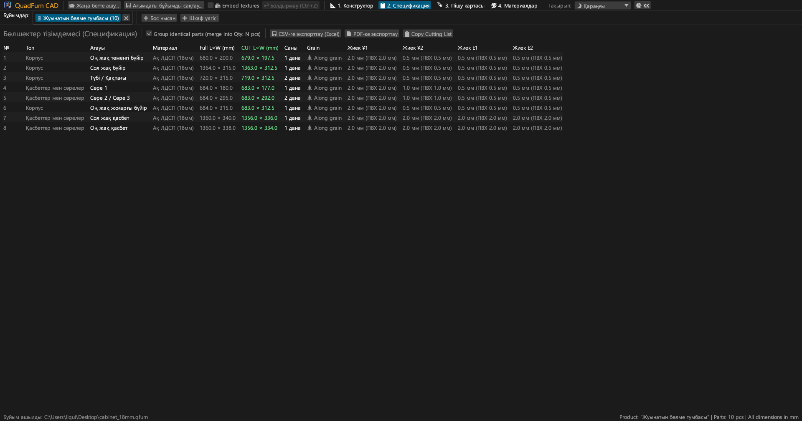
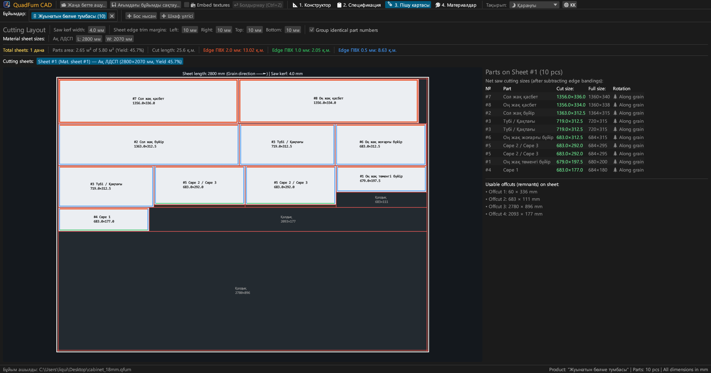
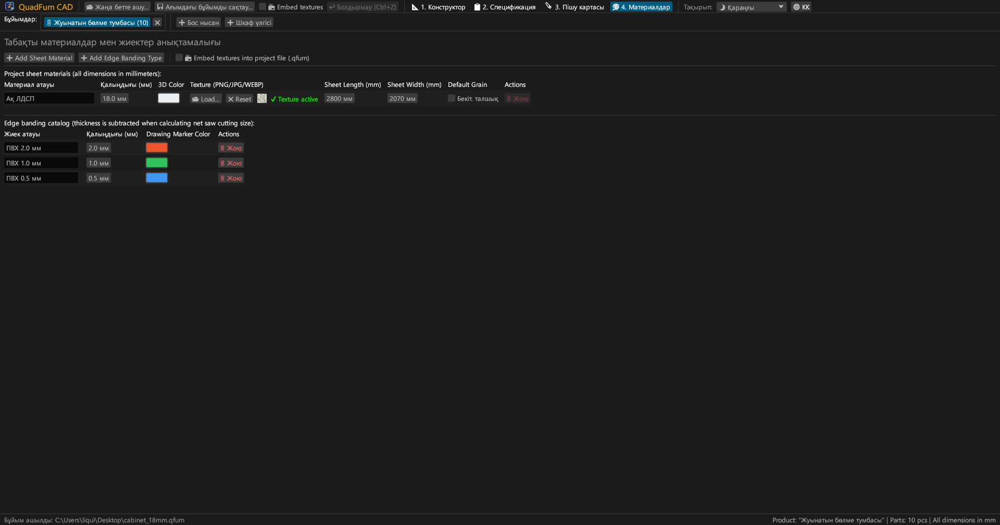
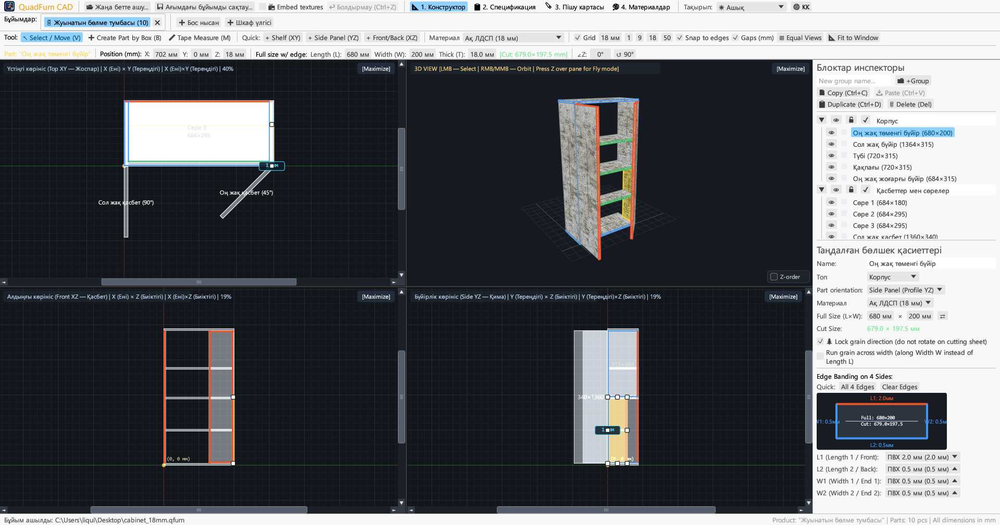
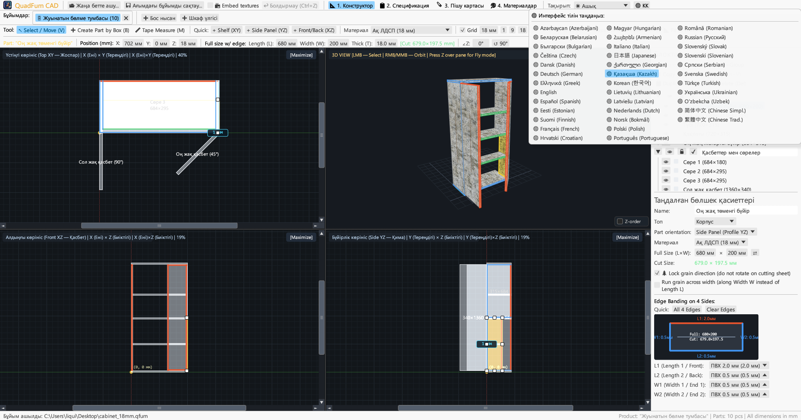

# QuadFurn CAD

**ЛДСП корпустық жиһаз САПР-ы — 4 көріністі кеңістіктік жобалаушы + парақтық материалдарды гильотиналық пішу**

 

👉 **[🚀 QuadFurn CAD бағдарламасын браузерде іске қосу (WebAssembly)](https://rbm13s.github.io/QuadFurn/app/)** • **[🌐 Ресми сайт](https://rbm13s.github.io/QuadFurn/kk.html)**

 

**Languages / Языки / Мови / Sprachen:** 
[English](../README.md) •
[Русский](README-ru.md) •
[Українська](README-uk.md) •
[Беларуская](README-be.md) •
**Қазақша** •
[ქართული](README-ka.md) •
[Հայերեն](README-hy.md) •
[Azərbaycan](README-az.md) •
[Oʻzbekcha](README-uz.md) •
[Deutsch](README-de.md) •
[Français](README-fr.md) •
[Español](README-es.md) •
[Italiano](README-it.md) •
[Português](README-pt.md) •
[Polski](README-pl.md) •
[Čeština](README-cs.md) •
[Slovenčina](README-sk.md) •
[Slovenščina](README-sl.md) •
[Български](README-bg.md) •
[Српски](README-sr.md) •
[Hrvatski](README-hr.md) •
[Nederlands](README-nl.md) •
[Dansk](README-da.md) •
[Norsk](README-no.md) •
[Svenska](README-sv.md) •
[Suomi](README-fi.md) •
[Eesti](README-et.md) •
[Latviešu](README-lv.md) •
[Lietuvių](README-lt.md) •
[Magyar](README-hu.md) •
[Română](README-ro.md) •
[Türkçe](README-tr.md) •
[Ελληνικά](README-el.md) •
[简体中文](README-zh-cn.md) •
[繁體中文](README-zh-tw.md) •
[日本語](README-ja.md) •
[한국어](README-ko.md)

---

## Мазмұны

- [Кіріспе](#кіріспе)
- [Скриншоттар және визуалды шолу](#скриншоттар-және-визуалды-шолу)
- [Негізгі мүмкіндіктер](#негізгі-мүмкіндіктер)
- [Функционалдық құжаттама](#функционалдық-құжаттама)
  - [1. 4 көріністі CAD-конструктор және дәл орналастыру](#1-4-көріністі-cad-конструктор-және-дәл-орналастыру)
  - [2. Сандық өрістердегі математикалық өрнектер](#2-сандық-өрістердегі-математикалық-өрнектер)
  - [3. Жиектеу және жиек қалыңдығын автоматты шегеру](#3-жиектеу-және-жиек-қалыңдығын-автоматты-шегеру)
  - [4. Гильотиналық 2D-пішуді оңтайландыру](#4-гильотиналық-2d-пішуді-оңтайландыру)
  - [5. Бұйым қойындылары және жобалар арасындағы алмасу буфері](#5-бұйым-қойындылары-және-жобалар-арасындағы-алмасу-буфері)
  - [6. Өндірістік төлқұжатты экспорттау (векторлық PDF, CSV Excel, буфер)](#6-өндірістік-төлқұжатты-экспорттау-векторлық-pdf-csv-excel-буфер)
  - [7. Парақтық материалдар, текстуралар және жиектер анықтамалығы](#7-парақтық-материалдар-текстуралар-және-жиектер-анықтамалығы)
  - [8. Безендіру тақырыптары және 37 тілге бейімдеу](#8-безендіру-тақырыптары-және-37-тілге-бейімдеу)
- [Басқару және пернелер тіркесімдері](#басқару-және-пернелер-тіркесімдері)
- [Жылдам бастау](#жылдам-бастау)
- [Баптаулар және файл форматтары](#баптаулар-және-файл-форматтары)
- [Жоба архитектурасы](#жоба-архитектурасы)
- [Лицензия](#лицензия)

---

## Кіріспе

**QuadFurn CAD** — бұл заманауи веб-браузерлерде тікелей жұмыс істейтін орнатусыз WebAssembly (WASM) онлайн нұсқасы ретінде де, жылдам нативті жұмыс үстелі қолданбасы (Windows, Linux, macOS) ретінде де қолжетімді Rust тілінде жазылған жоғары өнімді кроссплатформалық CAD бағдарламасы. Ол ламинатталған ДСП (ЛДСП), МДФ, ХДФ және фанерадан жасалған корпустық жиһаздарды жобалауға, спецификацияларды автоматты түрде құруға және парақтарды 2D гильотиналық пішуді оңтайландыруға арналған.

---

## Скриншоттар және визуалды шолу

### 1. 4 көріністі CAD-конструктор (Күңгірт тақырып)
Синхронды 2D-проекциялар (**Үстінен XY**, **Алдынан XZ**, **Бүйірінен YZ**) және аппараттық **3D-терезе**, өлшемді өзгертудің 8 маркері және оң жақтағы **Бөлшектер инспекторы**.

### 2. Бөлшектер спецификациясы және экспорт
4 жағынан жиек қалыңдығын шегергеннен кейінгі **Габариттік өлшемдерді (`Ұ × Е`)** және **Аралау өлшемдерін (`Арал Ұ × Е`)** көрсететін топтастырылған бөлшектер кестесі.

### 3. Гильотиналық пішу карталары
Стандартты парақтардағы бөлшектердің оңтайлы орналасуы, ара кесіндісінің ені, жиектер және пайдалы қалдықтарды бақылау.

### 4. Материалдар мен жиектер анықтамалығы
ЛДСП/МДФ қалыңдықтарын, еркін түстерді, декорлар текстураларын (`PNG`, `JPG`, `WEBP`), парақ өлшемдерін және ПВХ/АБС жиектерін басқару.

### 5. Ашық безендіру тақырыбы
Күңгірт тақырыппен қатар контрастты ашық тақырып және Windows жүйелік тақырыбымен автоматты үйлесімділік.

### 6. 37 кірістірілген тіл (интерфейс және PDF)
Жоғарғы мәзірдегі **`🌐`** түймесі арқылы 37 кірістірілген тіл арасында лезде ауысу, ЖЖ тілін автоматты анықтау және PDF-ке локализацияланған экспорт.

---

## Негізгі мүмкіндіктер

- **Синхрондалған 4 проекция терезесі**: Үстінен (`XY`), Алдынан (`XZ`), Бүйірінен (`YZ`) көріністерінде өңдеу немесе кез келген терезені бір басу арқылы кеңейту (`[Үлкейту]` / `[4 Көрініс]`).
- **Аппараттық жеделдетілген 3D-көрініс**: Орбитамен айналдыру (`ТТБ`/`ОТБ`) + бірінші жақтан еркін ұшу (`Z` + `WASD`/`Бос орын`/`Ctrl`) текстуралармен және OBB-сәулелеумен.
- **Магниттік жабысу және саңылауларды жылдам өлшеу**: Тор қадамына (`1`, `9`, `18`, `50 мм`) және көрші бөлшектердің қырларына автоматты жабысу (`0 мм`).
- **Жақтаумен таңдау және топтық түрлендіру**: Бірнеше бөлшекті жақтаумен таңдау, оларды бірге жылжыту, қайталау (`Ctrl+D`) және жобалар арасында көшіру/қою (`Ctrl+C` / `Ctrl+V`).
- **Кірістірілген калькулятор**: Барлық сандық өрістер `600+100`, `800-36`, `720/2` сияқты математикалық өрнектерді қабылдайды.
- **Жиекті автоматты шегеру**: ПВХ/АБС жиегін бөлшектің 4 қырының кез келгеніне тағайындау арқылы нақты аралау өлшемін есептеу:
  $$\text{Арал Ұзындығы} = L_{\text{габ}} - E_{L1} - E_{L2}, \quad \text{Арал Ені} = W_{\text{габ}} - E_{W1} - E_{W2}$$
- **Гильотиналық пішу қозғалтқышы**: Ағаш талшықтарының бағытын, ара енін және шеттерді қырқу шегіністерін ескере отырып бірнеше параққа пішу.
- **4 бөлімнен тұратын векторлық PDF бұйым паспорты**: Таңдалған тілде A4 Альбомдық форматтағы толық құжаттаманы экспорттау: спецификация, 4 проекциялық сызбалар, пішу карталары және материалдар ведомосі (+15% қормен).

---

## Басқару және пернелер тіркесімдері

| Перне / Тіркесім | Әрекет |
| :--- | :--- |
| **`V`** | **Таңдау және жылжыту** құралы (8 өлшем маркері және таңдау жақтауы) |
| **`B`** | 2D терезелерде **Бөлшекті жақтаумен құру** құралы |
| **`M`** | 2D терезелерде **Сызғыш** құралы |
| **`СКБ` ұстап тұру (2D)** | Бөлшектерді жылжыту, өлшем маркерлерін тарту немесе жақтаумен таңдау |
| **`Shift + СКБ` (2D)** | Бөлшекті тек көлденең немесе тігінен жылжыту |
| **`Ctrl / Cmd + СКБ` (2D)** | Қырларға жабысуды уақытша өшіру |
| **`Alt + СКБ` (2D)** | Сүйреу кезінде бөлшекті жылдам көшіру (дубликаттау) |
| **`Shift / Ctrl + СКБ` (2D)** | Бөлшекті таңдау тобына қосу / топтан шығару |
| **`ОКБ` / `ОТБ` ұстап тұру (2D)** | 2D камераны жылжыту (панорамалау) |
| **`Тінтуір дөңгелегі` (2D / 3D)** | Камера масштабын өзгерту (зум) |
| **`ОКБ` / `ОТБ` ұстап тұру (3D)** | 3D орбитаны модель айналасында айналдыру |
| **`Z` (3D терезесі үстінде)** | Бірінші жақтан ұшу режимі (Noclip, WASD + тінтуірмен басқару) |
| **`W` `A` `S` `D` / `Бос орын` / `Ctrl`** | 3D ішінде алға/солға/артқа/оңға/жоғары/төмен ұшу (`Shift` — үдету) |
| **`Ctrl + S` / `Cmd + S`** | Бұйымды `.qfurn` / `.json` файлына сақтау |
| **`Ctrl + Z` / `Cmd + Z`** | Соңғы әрекетті болдырмау (40 қадамға дейін) |
| **`Ctrl + C` / `Ctrl + V`** | Бөлшектерді көшіру / қою (қойындылар арасында жұмыс істейді) |
| **`Ctrl + D`** | Бөлшектерді жылжытумен қайталау |
| **`Delete` / `Backspace`** | Таңдалған бөлшектерді жою |
| **`←` `→` `↑` `↓` (2D)** | Бөлшектерді тор қадамына жылжыту (`Shift` — екі есе қадам) |

---

## Лицензия

Жоба еркін [MIT License](../LICENSE) лицензиясы бойынша таратылады.
