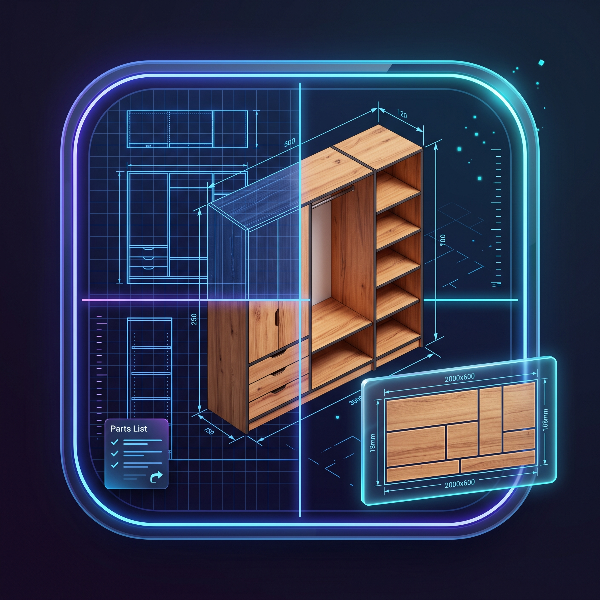
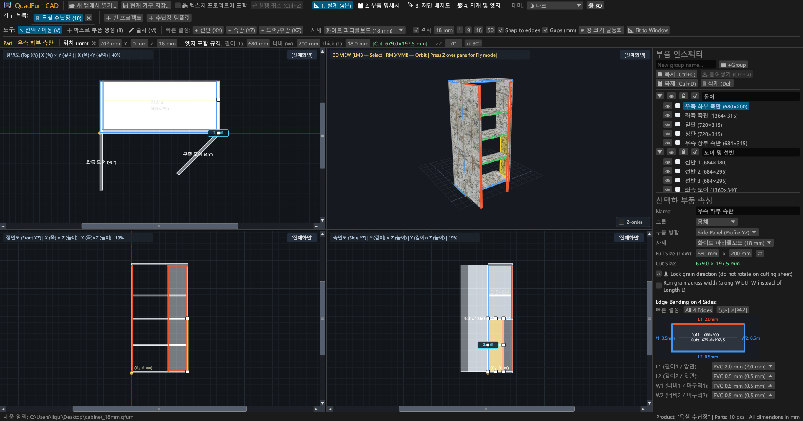
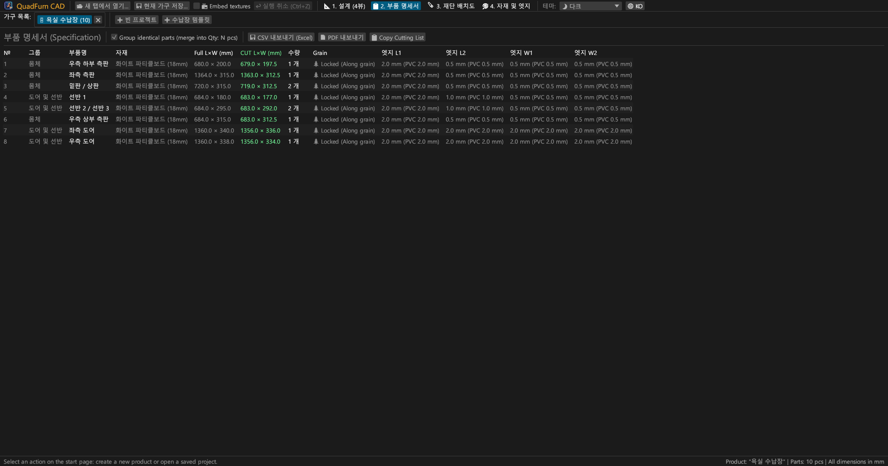
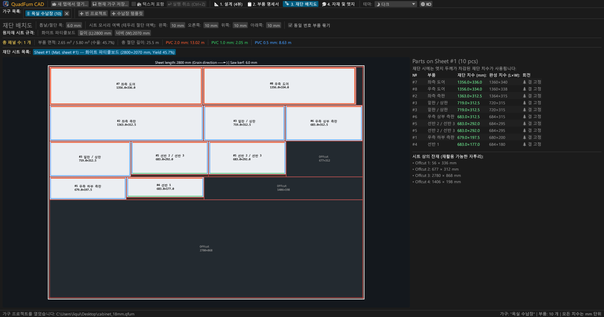
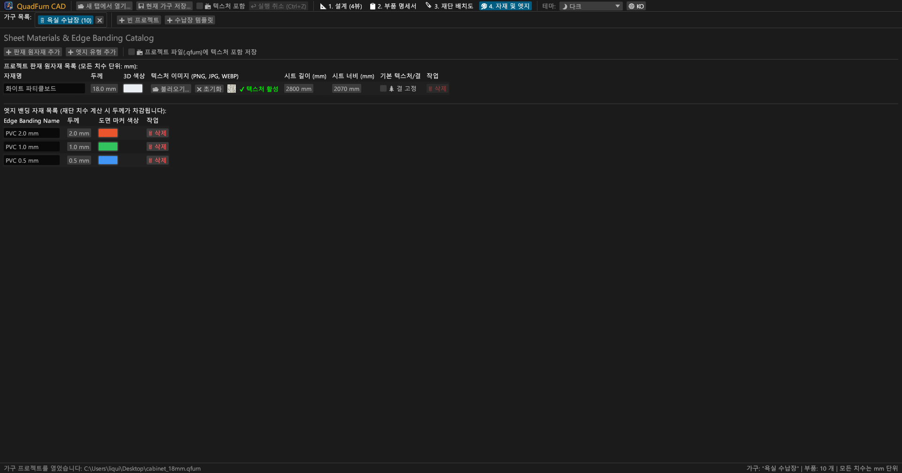
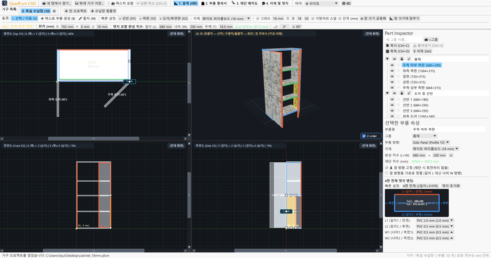
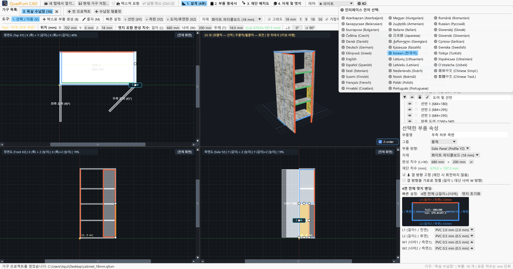

<div align="center">



# QuadFurn CAD

**패널 및 PB 가구 전용 CAD — 4-뷰포트 공간 디자이너 + 길로틴 방식 판재 재단 최적화 엔진**

[](https://github.com/rbm13s/QuadFurn/actions/workflows/build.yml)
[](https://github.com/rbm13s/QuadFurn/releases)
[](https://www.rust-lang.org/)
[](https://github.com/emilk/egui)
[](https://wgpu.rs/)
[](#8-테마-설정-및-22개-언어-다국어-지원)
[](#시작하기)
[](../LICENSE)

<br/>

**Languages / Языки / Мови / Sprachen:**<br/>
[English](../README.md) •
[Русский](README-ru.md) •
[Українська](README-uk.md) •
[Беларуская](README-be.md) •
[Қазақша](README-kk.md) •
[ქართული](README-ka.md) •
[Հայերեն](README-hy.md) •
[Azərbaycan](README-az.md) •
[Oʻzbekcha](README-uz.md) •
[Deutsch](README-de.md) •
[Français](README-fr.md) •
[Español](README-es.md) •
[Italiano](README-it.md) •
[Português](README-pt.md) •
[Polski](README-pl.md) •
[Čeština](README-cs.md) •
[Slovenčina](README-sk.md) •
[Slovenščina](README-sl.md) •
[Български](README-bg.md) •
[Српски](README-sr.md) •
[Hrvatski](README-hr.md) •
[Nederlands](README-nl.md) •
[Dansk](README-da.md) •
[Norsk](README-no.md) •
[Svenska](README-sv.md) •
[Suomi](README-fi.md) •
[Eesti](README-et.md) •
[Latviešu](README-lv.md) •
[Lietuvių](README-lt.md) •
[Magyar](README-hu.md) •
[Română](README-ro.md) •
[Türkçe](README-tr.md) •
[Ελληνικά](README-el.md) •
[简体中文](README-zh-cn.md) •
[繁體中文](README-zh-tw.md) •
[日本語](README-ja.md) •
**한국어**

</div>

---

## 목차

- [소개](#소개)
- [스크린샷 및 기능 둘러보기](#스크린샷-및-기능-둘러보기)
- [주요 특징](#주요-특징)
- [상세 기능 가이드](#상세-기능-가이드)
  - [1. 4-뷰포트 CAD 디자이너 및 정밀 제어](#1-4-뷰포트-cad-디자이너-및-정밀-제어)
  - [2. 숫자 입력란 인라인 수식 자동 계산](#2-숫자-입력란-인라인-수식-자동-계산)
  - [3. 에지 밴딩(엣지) 두께 자동 공제 및 순수 재단 치수 산출](#3-에지-밴딩엣지-두께-자동-공제-및-순수-재단-치수-산출)
  - [4. 2D 길로틴 방식 판재 재단 최적화](#4-2d-길로틴-방식-판재-재단-최적화)
  - [5. 멀티 프로젝트 탭 및 프로젝트 간 복사/붙여넣기](#5-멀티-프로젝트-탭-및-프로젝트-간-복사붙여넣기)
  - [6. 생산 공정서 내보내기 (벡터 PDF, Excel CSV, 클립보드)](#6-생산-공정서-내보내기-벡터-pdf-excel-csv-클립보드)
  - [7. 판재 원자재, 텍스처 및 에지 밴딩 카탈로그](#7-판재-원자재-텍스처-및-에지-밴딩-카탈로그)
  - [8. 테마 설정 및 37개 언어 다국어 지원](#8-테마-설정-및-22개-언어-다국어-지원)
- [조작 방법 및 키보드 단축키](#조작-방법-및-키보드-단축키)
- [시작하기](#시작하기)
- [설정 및 파일 형식](#설정-및-파일-형식)
- [프로젝트 아키텍처](#프로젝트-아키텍처)
- [라이선스](#라이선스)

---

## 소개

**QuadFurn CAD**는 Rust로 개발된 고성능 크로스 플랫폼 CAD 애플리케이션으로, 빠른 네이티브 데스크톱 앱(Windows, Linux, macOS)과 최신 웹 브라우저에서 설치 없이 바로 실행되는 WebAssembly (WASM) 온라인 버전을 모두 지원합니다. 파티클보드(PB/멜라민 보드), MDF, HDF, 합판 등의 판재를 사용하는 수납장 및 패널 가구 설계를 위해 개발되었으며, 자동 부품 명세서(BOM) 작성 및 2D 길로틴 관통 절단 방식의 판재 재단 최적화(네스팅) 기능을 완벽하게 지원합니다.

QuadFurn은 널리 검증된 3가지 전문 도구의 장점을 결합하여 설계 효율성을 극대화했습니다:
1. **4-뷰포트 공간 모델링**: 3개의 동기화된 2D 직교 투영 뷰(**평면도 XY**, **정면도 XZ**, **측단면도 YZ**)에서 스크롤바와 자석 스냅 기능, 뷰포트 균등 분할 버튼(`⊞ 뷰포트 균등 분할`), 마구리면 시점 두께 보호 기능을 통해 정밀하게 작업하며, 실시간 **3D 궤도 회전 / 1인칭 자유 비행 모드(`Z` 키 Noclip)**를 제공합니다.
2. **정밀 변환 툴바**: 부품의 3차원 좌표(`X`, `Y`, `Z`), 완제품 크기(`L × W × T`), 회전 각도(`∠Z`)를 즉시 입력 및 수정할 수 있으며, 모든 숫자 입력란에 사칙연산 수식(예: `600-4` 또는 `720+18`)을 직접 입력하여 계산할 수 있습니다.
3. **판재 재단 및 엣지 두께 자동 공제**: 완제품 규격에서 사방 4면에 부착할 PVC/ABS 에지 밴딩 두께를 자동으로 차감하여 **재단기용 순수 재단 치수**를 실시간으로 계산하며, 나뭇결 방향, 톱날 두께(절삭 손실폭), 원판 테두리 재단 여유를 철저히 반영하는 2D 길로틴 최적화 알고리즘을 탑재했습니다.

---

## 스크린샷 및 기능 둘러보기

### 1. 4-뷰포트 CAD 디자이너 (다크 테마)
동기화된 2D 직교 투영 도면(**평면도 XY**, **정면도 XZ**, **측면도 YZ**)과 원근 보정 UV 매핑이 적용된 **3D 뷰**, 8점 크기 조절 핸들 및 우측 **부품 속성 인스펙터**.



### 2. 부품 규격 명세서 (BOM) 및 재단 치수
완제품 기준의 **완성 치수(`L × W`)**와 사방 4면(`L1`, `L2`, `W1`, `W2`)의 엣지 두께를 공제한 **순수 톱질 재단 치수(`CUT L × W`)**를 한눈에 보여주는 부품 목록표.



### 3. 길로틴 판재 재단 최적화 배치도
표준 규격 원판(`2800 × 2070 mm` 등) 위에 관통 절단 선, 톱날 폭, 테두리 여백, 에지 밴딩 색상 표시 및 치수가 표기된 재활용 가능 잔재(자투리 판재)를 보여주는 배치도.



### 4. 자재 및 에지 밴딩 카탈로그
판재 두께, 3D 색상, 사용자 지정 표면 텍스처(`PNG`, `JPG`, `WEBP`), 나뭇결 잠금 여부 및 다양한 ABS/PVC 에지 밴딩 종류를 손쉽게 관리.



### 5. 라이트 테마 (밝은 모드) 지원
다크 테마와 완벽하게 대비되는 모던한 라이트 테마를 탑재하여 운영체제(Windows/macOS/Linux) 설정에 맞게 자동 전환 가능.



### 6. 37개 언어 다국어 지원 (UI 및 PDF 내보내기)
상단 툴바의 **`🌐`** 아이콘을 클릭하여 재시작 없이 즉시 언어를 변경할 수 있으며, 첫 실행 시 OS 언어를 자동 감지하고 다국어 벡터 PDF 공정서를 생성합니다.



---

## 주요 특징

- **동기화된 4-뷰포트 작업 공간**: 평면(`XY`), 정면(`XZ`), 측면(`YZ`)에서 자유롭게 드로잉하고, 원하는 뷰포트를 원클릭으로 최대화(`[최대화]` / `[4-뷰포트 복원]`).
- **하드웨어 가속 3D 실시간 렌더링**: 궤도 카메라(`우클릭`/`중앙 클릭` 드래그) + 1인칭 자유 비행(3D 뷰 위에 커서를 올리고 **`Z`** 키 + `WASD`/`스페이스바`/`Ctrl`), 정밀한 OBB 바운딩 박스 레이캐스팅 광선 선택.
- **자석 스냅 및 실시간 간격 치수 표시**: 격자 그리드 단위(`1`, `9`, `18`, `50 mm` 또는 사용자 지정) 자동 스냅, 인접 부품의 면 및 모서리에 자석 흡착(`0 mm` 밀착 조립), 인접 부품과의 실제 이격 거리를 밀리미터 단위로 실시간 표시.
- **박스 영역 선택 및 그룹 변형**: 2D 뷰에서 마우스로 영역을 드래그하여 여러 부품을 한 번에 선택하고 이동, 복제(`Ctrl+D`), 서로 다른 프로젝트 탭 간 복사/붙여넣기(`Ctrl+C` / `Ctrl+V`).
- **인라인 수식 계산기**: 모든 수치 입력 상자에 `600+100`, `800-36`, `720/2`, `45+15` 등 사칙연산 수식을 직접 입력 가능.
- **에지 밴딩 두께 자동 공제**: 부품의 4변(`L1`, `L2`, `W1`, `W2`)에 PVC/ABS 엣지(`0.4 mm`, `0.5 mm`, `1.0 mm`, `2.0 mm` 등)를 지정하면 순수 재단 치수가 즉시 계산됨:
  $$\text{재단 길이} = L_{\text{완성}} - E_{L1} - E_{L2}, \quad \text{재단 너비} = W_{\text{완성}} - E_{W1} - E_{W2}$$
- **2D 길로틴 네스팅 최적화 엔진**: 나뭇결 방향 잠금, 톱날 절삭 손실폭, 원판 사방 테두리 트리밍 마진을 빈틈없이 반영하는 다중 원판 최적화.
- **A4 가로 벡터 PDF 생산 공정서 출력**: 활성화된 언어로 원클릭 내보내기 지원:
  1. 완성 및 순수 재단 치수, 엣지, 나뭇결 정보가 담긴 완전한 부품 명세서
  2. 가구의 전체 외곽 치수가 명기된 4-뷰포트 테크니컬 도면(`평면 XY`, `3D 아이소메트릭`, `정면 XZ`, `측면 YZ`)
  3. 사용된 모든 원판별 정밀 길로틴 재단 배치도
  4. 원판 소요 장수 및 `+15%` 공정 손실을 반영한 에지 밴딩 총 미터수 집계표

---

## 상세 기능 가이드

### 1. 4-뷰포트 CAD 디자이너 및 정밀 제어

**디자이너** 탭(`📐 1. 디자이너`)은 세 가지 핵심 영역으로 구분됩니다:

1. **상단 툴바 및 변환 바**:
   - **도면 도구**:
     - `↖ 선택 및 이동 (V)`: 클릭하여 부품 선택, 드래그하여 이동, 조절 핸들(정면 부재는 8개 조절점, 마구리면 부재는 2개 모서리 조절점)을 이용한 크기 조절. 빈 공간 드래그 시 사각 영역 다중 선택. 2D 뷰에서 드래그 시: **`Shift`** 를 누르고 있으면 이동이 수평 또는 수직 단일 축으로 고정되고, **`Ctrl` (`Cmd`)** 를 누르고 있으면 가장자리 자석 스냅이 비활성화되며, **`Alt`** 를 누르고 있으면 마우스를 놓을 때 부품이 즉시 복제됩니다.
     - `➕ 영역 드래그 부품 생성 (B)`: 2D 뷰(`평면 XY`, `정면 XZ`, `측면 YZ`)에서 직사각형을 드래그하여 해당 평면에 맞는 부품을 즉시 생성.
     - `📏 줄자 (M)`: 2D 뷰에서 임의의 두 점 사이의 거리 및 좌표차(`ΔX`, `ΔY`, `L`, 단위 mm)를 정밀 측정.
   - **빠른 부품 추가**: 선반(`+ 선반 (XY)`), 측판(`+ 측판 (YZ)`), 도어/뒷판(`+ 도어/뒷판 (XZ)`) 원클릭 배치.
   - **그리드 및 스냅**: 그리드 스냅 단위 설정(`1`, `9`, `18`, `50 mm`), 모서리 자석 스냅 및 간격 치수 표시.
   - **카메라 뷰 정렬**:
     - `🔍 뷰 가운데 정렬`: 카메라를 원점 또는 가구 중심에 맞춤.
     - `📐 창에 맞춤`: 가구 전체 외곽 경계를 계산하여 4개 뷰포트 전체에 꼭 맞도록 자동 확대/축소.
   - **정밀 변환 바**: 선택된 부품의 `X`, `Y`, `Z` 좌표, 치수 `L`, `W`, `T`, 녹색 순수 재단 치수 배지 `[재단: L × W mm]`, 수평 회전 각도 `∠Z`를 직접 입력 및 수정.

2. **4-뷰포트 메인 작업 영역**:
   - **2D 직교 투영 뷰(`평면 XY`, `정면 XZ`, `측면 YZ`)**: 스크롤바, 밀리미터 눈금자, 에지 밴딩이 부착된 모서리의 컬러 라인 표시.
   - **3D 뷰**: 우클릭/휠클릭 드래그로 궤도 회전, 마우스 휠 줌, 3D 부품 직접 클릭 선택, **1인칭 자유 비행 모드 (Noclip)**(3D 창 위에 마우스를 두고 **`Z`** 키를 눌러 마우스를 잠그고 `WASD`, `스페이스바`, `Ctrl`/`Shift`로 자유롭게 비행).

3. **우측 부품 속성 인스펙터**:
   - 부품의 사용자 지정 **그룹** 관리(*몸체 구조*, *도어 및 전면*, *서랍* 등).
   - 그룹 및 개별 부품의 **표시/숨김(`👁`)** 및 **편집 잠금(`🔒`)**.
   - 사용 판재 자재, 공간 배치 방향, 규격 크기(`L × W` 반전 교환 `⇄`), 나뭇결 방향 잠금(`🌲 나뭇결 방향 잠금`), 가로결 방향(`🔄 가로 방향 나뭇결`), 사방 4면 에지 밴딩 선택 다이어그램.

---

### 2. 숫자 입력란 인라인 수식 자동 계산

소프트웨어 내의 모든 숫자 입력란은 수학 연산자 수식 입력을 기본 지원합니다:
- **덧셈과 뺄셈**: `600`이 입력된 칸에 `600+100` 또는 `600-4`를 입력하고 `Enter`를 누르면 즉시 `700` 또는 `596`으로 자동 계산됩니다.
- **곱셈, 나눗셈 및 괄호**: `(800-36)/2` 또는 `18*2`와 같은 복합 수식도 즉시 평가됩니다.
- 마침표 `.`와 쉼표 `,`를 모두 소수점으로 인식하며, 뒤에 붙은 단위 기호(`mm`, `°`)는 자동으로 필터링됩니다.

---

### 3. 에지 밴딩(엣지) 두께 자동 공제 및 순수 재단 치수 산출

- 각 직사각형 부품은 4개의 변을 가집니다: **`L1`**(길이 1 / 전면), **`L2`**(길이 2 / 후면), **`W1`**(너비 1 / 측면 1), **`W2`**(너비 2 / 측면 2).
- 완성 크기가 `680 × 200 mm`인 선반에서 `L1`에 `2.0 mm`, `L2`, `W1`, `W2`에 `0.5 mm` 두께의 PVC 엣지를 지정하면, 프로그램이 재단기용 **순수 재단 치수**를 자동으로 계산합니다:
  - $\text{재단 길이 } L = 680 - 2.0 - 0.5 = 677.5\text{ mm}$
  - $\text{재단 너비 } W = 200 - 0.5 - 0.5 = 199.0\text{ mm}$
- 엣지가 적용된 모서리는 2D/3D 도면 및 재단 배치도 상에서 직관적인 색상 띠로 강조 표시됩니다.

---

### 4. 2D 길로틴 방식 판재 재단 최적화

**재단 배치도** 탭(`🪚 3. 재단 배치도`)에서는 모든 부품을 원판 위에 가장 알맞게 네스팅 배치합니다:
- **조정 가능한 가공 파라미터**:
  - **톱날 두께(절삭폭)**(기본값 `6.0 mm`).
  - **원판 사방 테두리 다듬기(트리밍) 여백**(`좌`, `우`, `상`, `하`, 기본값 `10 mm`).
- **나뭇결 방향 엄격 관리**:
  - **결 방향 잠금(`🌲`) 부품**: 원판의 길이 방향(`원판 길이 L`)에 대해 절대로 90° 회전되지 않습니다.
  - **자유 결 부품**: 수율을 높이기 위해 최적화 알고리즘이 자동으로 90° 회전 배치할 수 있습니다.
- **시각적 재단 맵 및 자투리 잔재 관리**:
  - 빨간색 길로틴 관통 절단선, 부품 번호, 재단 치수, 에지 색상 띠 및 치수가 명기된 재활용 가능 잔재 사각형 표시.
  - 필요한 원판 총 수량, 면적 수율 백분율(%), 총 직선 절단 길이, 에지 밴딩 소요 미터수 등의 상세 통계 제공.

---

### 5. 멀티 프로젝트 탭 및 프로젝트 간 복사/붙여넣기

- **시작 페이지 및 최근 파일**: 새 빈 가구 프로젝트 생성, 2도어 캐비닛 템플릿으로 시작, `.qfurn`/`.json` 파일 열기, 또는 **최근에 열어본 10개 프로젝트**에 원클릭 접근.
- **다중 가구 탭 동시 작업**: 상단 탭 바에서 여러 가구 모듈을 동시에 설계 가능(탭 이름을 더블클릭하여 이름 변경).
- **프로젝트 간 부품 복사 및 붙여넣기**: 한 탭에서 부품을 선택하고 `Ctrl+C`를 누른 후, 다른 탭(또는 다른 QuadFurn 창)으로 이동하여 `Ctrl+V`를 누르면 부품이 복사됩니다. 복사된 부품이 참조하는 자재와 엣지는 대상 프로젝트에 자동으로 생성됩니다.
- **데이터 유실 방지 알림**: 변경 사항이 있는 탭을 닫거나 프로그램을 종료할 때 확인 창이 표시됩니다(`저장하고 종료`, `저장하지 않고 종료`, `취소`).

---

### 6. 생산 공정서 내보내기 (벡터 PDF, Excel CSV, 클립보드)

**명세서** 탭(`📋 2. 명세서`)에서:
1. **`📄 PDF로 내보내기` (A4 가로 벡터 생산 공정서)**:
   - **섹션 1**: 완성 및 재단 치수, 엣지, 나뭇결이 포함된 전체 부품 명세서.
   - **섹션 2**: 가구 외곽 치수가 표기된 4-뷰포트 설계 도면(`평면 XY`, `3D 아이소메트릭`, `정면 XZ`, `측면 YZ`).
   - **섹션 3**: 각 원판별 정밀 길로틴 재단 배치도.
   - **섹션 4**: 판재 자재 요약표 및 에지 밴딩 소요량(순수 길이 및 `+15%` 공정 손실 포함).
   - 문서는 **현재 활성화된 언어**로 생성되며, TrueType/CID 벡터 폰트가 내장되어 한글이 깨짐 없이 깔끔하게 인쇄됩니다.
2. **`💾 CSV(Excel)로 내보내기`**: Microsoft Excel 또는 한셀에서 바로 열 수 있는 BOM 포함 UTF-8 세미콜론 `;` 구분 스프레드시트.
3. **`📋 재단 목록 복사`**: 외부 전문 재단 프로그램이나 스프레드시트에 붙여넣을 수 있도록 탭 구분 텍스트 형식으로 클립보드에 복사.

---

### 7. 판재 원자재, 텍스처 및 에지 밴딩 카탈로그

**자재** 탭(`🎨 4. 자재`)에서:
- RGB 색상, 원판 규격 치수(`L × W`), 기본 결 방향 설정을 갖춘 **판재 원자재** 추가 및 수정(`18mm PB`, `16mm MDF`, `3mm HDF` 등).
- 실감 나는 3D 표현을 위한 **`PNG`**, **`JPG`/`JPEG`**, **`WEBP`** 표면 텍스처 이미지 등록.
- **휴대성 높은 텍스처 자동 검색**: 다른 PC에서 `.qfurn` 프로젝트를 열 때 프로그램이 다음 순서로 텍스처를 자동으로 찾습니다:
  1. 프로젝트 파일 내부에 직접 내장된 데이터 (Base64)
  2. `.qfurn` 프로젝트 파일과 동일한 폴더
  3. 프로젝트 옆의 `./textures/` 하위 폴더
  4. 상대 경로 및 기존 절대 경로
- **프로젝트 파일에 텍스처 내장 패키징 (`📦 텍스처를 프로젝트 파일에 내장`)**: 상단 메뉴 또는 자재 관리자에서 이 옵션을 켜면 저장 시 텍스처 이미지가 Base64 형태로 `.qfurn` 파일 내부에 직접 저장됩니다. 파일 하나만 전달하면 어느 PC에서든 텍스처 누락 없이 온전히 열립니다.
- **GPU 안정성 보호**: 60MB를 초과하는 대용량 파일은 경고와 함께 차단되며, 해상도가 너무 높은 텍스처(4096px 초과)는 부드러운 성능을 위해 자동으로 최적화 리사이징됩니다.
- 두께(mm)와 표시 색상을 지정하는 **에지 밴딩 종류** 관리. 사용 중인 자재를 삭제할 때는 안전한 재할당 확인 창이 표시됩니다.

---

### 8. 테마 설정 및 37개 언어 다국어 지원

- **시각 테마**: 상단 바에서 **🌙 다크**, **☀ 라이트**, **🖥 시스템** 테마를 자유롭게 전환.
- **37개 언어 기본 탑재**:
  `한국어`, `English`, `Русский`, `Українська`, `Deutsch`, `Polski`, `Español`, `Français`, `Italiano`, `Português`, `Čeština`, `Slovenčina`, `Slovenščina`, `Nederlands`, `Dansk`, `Norsk`, `Svenska`, `Magyar`, `Română`, `Türkçe`, `简体中文` 및 `日本語`.
- **첫 실행 시 OS 언어 자동 감지**: 운영체제의 언어를 자동으로 인식하여 기본값으로 설정합니다. 사용자 환경설정은 `%APPDATA%\QuadFurn\settings.json`에 영구 보관됩니다.

---

## 조작 방법 및 키보드 단축키

| 단축키 | 동작 |
| :--- | :--- |
| **`V`** | **선택 및 이동** 도구 활성화 (정면 부재는 8개 조절점, 마구리면 부재는 2개 모서리 조절점으로 제한, 드래그 영역 선택) |
| **`B`** | 2D 뷰에서 **영역 드래그 부품 생성** 도구 활성화 |
| **`M`** | 2D 뷰에서 **줄자** 도구 활성화 |
| **`좌클릭` 드래그 (2D)** | 부품 이동, 핸들로 크기 변경, 또는 빈 공간에서 영역 선택 상자 드래그 |
| **`Shift + 마우스 좌클릭` 드래그 (2D)** | 부품 이동을 수평 또는 수직 축으로만 엄격히 제한 |
| **`Ctrl / Cmd + 마우스 좌클릭` 드래그 (2D)** | 드래그 중 인접 부품 모서리로의 자석 스냅 일시 해제 |
| **`Alt + 마우스 좌클릭` 드래그 (2D)** | 마우스를 놓는 위치에 선택한 부품 즉시 복제(복사본 생성) |
| **`Shift / Ctrl (Cmd) + 좌클릭` (2D)** | 부품을 다중 선택 그룹에 추가하거나 제외 |
| **`우클릭` / `휠클릭` 드래그 (2D)** | 2D 화면 이동 (팬) |
| **`마우스 휠` (2D / 3D)** | 마우스 커서 위치 중심 확대 / 축소 |
| **`우클릭` / `휠클릭` 드래그 (3D)** | 3D 카메라 궤도 회전 |
| **`Z` (3D 뷰 위에서)** | **1인칭 자유 비행 모드 (Noclip)** 켜기 / 끄기 |
| **`W` `A` `S` `D` / `스페이스바` / `Ctrl (Cmd)`** | 3D 비행 중 전진/좌/후진/우/상승/하강 (`Shift` 누르면 고속 비행) |
| **`Ctrl + S` / `Cmd (⌘) + S`** | 현재 가구 프로젝트 저장 (`.qfurn` / `.json`) |
| **`Ctrl + Z` / `Cmd (⌘) + Z`** | 마지막 작업 실행 취소 (최대 40단계 히스토리) |
| **`Ctrl + C` / `Cmd (⌘) + C`** | 선택된 부재를 클립보드로 복사 |
| **`Ctrl + V` / `Cmd (⌘) + V`** | 부재 붙여넣기 (다른 제품 탭 간 복사/붙여넣기 지원) |
| **`Ctrl + D` / `Cmd (⌘) + D`** | 선택된 부품 제자리 복제 |
| **`Delete` / `Backspace`** | 선택된 부품 삭제 |
| **`←` `→` `↑` `↓` (2D 뷰)** | 선택된 부품을 선택한 그리드 간격만큼 이동 (`Shift` 누르면 2배) |

---

## 시작하기

### 사전 빌드된 설치 파일 (GitHub Releases)
커밋 및 릴리스마다 [GitHub Actions](https://github.com/rbm13s/QuadFurn/actions)를 통해 실행 파일 패키지가 자동 빌드됩니다:
- **Windows (`x86_64`)**: `QuadFurn-windows-x86_64.zip` — 아이콘이 내장된 포터블 무설치 `QuadFurn.exe`.
- **Linux (`Debian 12+ / Ubuntu 22.04+ x86_64`)**:
  - `quadfurn_<버전>_amd64.deb` — 공식 Debian/Ubuntu 설치 패키지 (실행 바이너리, 메뉴 등록 및 시스템 아이콘 자동 구성):
    ```bash
    sudo apt install ./quadfurn_0.2.6_amd64.deb
    ```
  - `QuadFurn-linux-x86_64.tar.gz` — 독립 실행형 포터블 Linux 압축 파일.
- **macOS (`Universal 통합 아키텍처: Apple Silicon M1–M4 + Intel x86_64`)**: `QuadFurn-macos-universal.zip` — Retina 아이콘이 포함된 네이티브 `QuadFurn.app`.

---

### 소스 코드에서 직접 빌드하기

#### 사전 요구 사항
- [Rust 툴체인](https://rustup.rs/) (`stable`, Rust 2021 에디션)
- **Linux (Debian / Ubuntu)** 시스템 라이브러리:
  ```bash
  sudo apt-get update && sudo apt-get install -y \
    build-essential pkg-config libxcb-render0-dev libxcb-shape0-dev \
    libxcb-xfixes0-dev libxkbcommon-dev libxkbcommon-x11-dev libssl-dev \
    libgtk-3-dev libglib2.0-dev libatk1.0-dev libgdk-pixbuf-2.0-dev \
    libcairo2-dev libpango1.0-dev libgl1-mesa-dev fonts-dejavu-core fonts-noto-cjk
  ```
- **macOS**: Xcode Command Line Tools (`xcode-select --install`)
- **Windows**: Visual C++ 빌드 도구가 설치된 Windows 10 / 11

#### 빌드 및 실행 명령어
```bash
# 개발 모드로 실행
cargo run

# 최적화된 릴리스 바이너리 빌드
cargo build --release

# 단위 테스트 실행
cargo test
```

---

## 설정 및 파일 형식

- **사용자 전역 설정 (`settings.json`)**:
  각 운영체제의 표준 설정 경로에 자동 보관됩니다:
  - **Windows**: `%APPDATA%\QuadFurn\settings.json`
  - **Linux**: `~/.config/QuadFurn/settings.json`
  - **macOS**: `~/Library/Application Support/QuadFurn/settings.json`
  
  저장 항목:
  - `theme_choice` (`Dark`, `Light`, `System`)
  - `language` (`Ko`, `En`, `Ru` 등)
  - `recent_projects` (최근 열어본 최대 10개 파일 경로)
- **프로젝트 데이터 파일 (`.qfurn` / `.json`)**:
  UTF-8 표준 JSON 텍스트 파일로 모든 부품, 그룹, 자재, 텍스처, 엣지 및 재단 설정이 포함됩니다. 텍스처 내장 옵션 활성화 시 이미지 데이터는 Base64 문자열로 본문 내에 직접 기록됩니다.

---

## 프로젝트 아키텍처

```text
QuadFurn/
├── .github/
│   └── workflows/
│       └── build.yml          # GitHub Actions CI/CD (Linux .deb/.tar.gz, macOS .app, Windows .zip)
├── assets/
│   ├── icon.jpeg              # 애플리케이션 로고 및 원본 아이콘 이미지
│   └── screenshots/           # 문서용 공식 스크린샷 이미지
├── docs/                      # 37개 언어 완역 로컬라이제이션 문서
├── src/
│   ├── main.rs                # 진입점, 프로젝트 탭 관리, 시작 페이지, 글로벌 단축키 및 설정
│   ├── model.rs               # 핵심 데이터 모델 (Project, PartBlock, SheetMaterial, EdgeBanding, OBB 바운딩 박스)
│   ├── viewport.rs            # 4-뷰포트 작업 공간 컨트롤러, 2D 및 3D wgpu/painter 렌더링 파이프라인
│   ├── snapping.rs            # 격자 및 모서리 자석 스냅 시스템, 직교 투영 축
│   ├── cutter.rs              # 2D 길로틴 재단 최적화 엔진, 엣지 두께 공제 및 목록 그룹화
│   ├── export.rs              # 다국어 벡터 PDF 생산 도면 생성기, Excel CSV 및 재단 목록 형식 내보내기
│   ├── ui_panels.rs           # 상단 변환 바, 부품 인스펙터, 명세서, 재단 배치도, 자재 UI
│   └── i18n.rs                # 37개 언어 번역 사전 및 운영체제 로캘 자동 감지
├── build.rs                   # Windows ICO 다중 해상도 아이콘 생성 및 PE 리소스 링크
├── Cargo.toml                 # Cargo 패키지 매니페스트 및 의존성 라이브러리 목록
└── LICENSE                    # MIT 오픈소스 라이선스
```

---

## 라이선스

이 프로젝트는 [MIT 라이선스](../LICENSE)에 따라 배포됩니다 — 상업적 또는 개인적 목적을 불문하고 자유롭게 사용, 수정 및 재배포할 수 있습니다.


