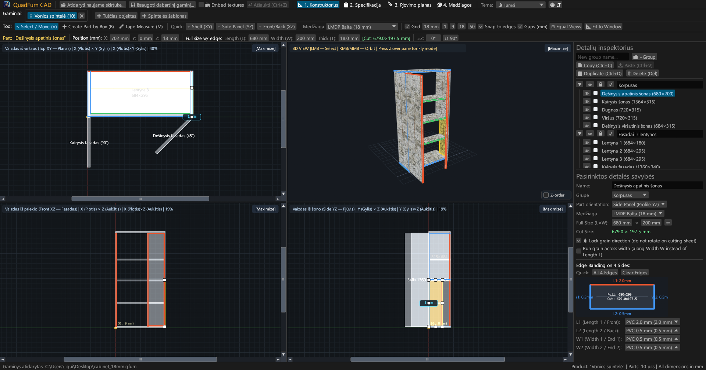
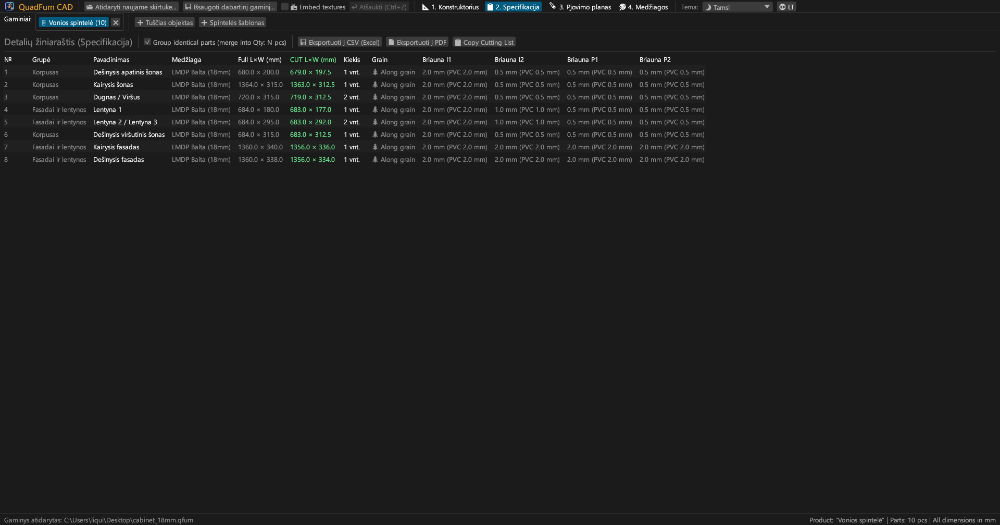
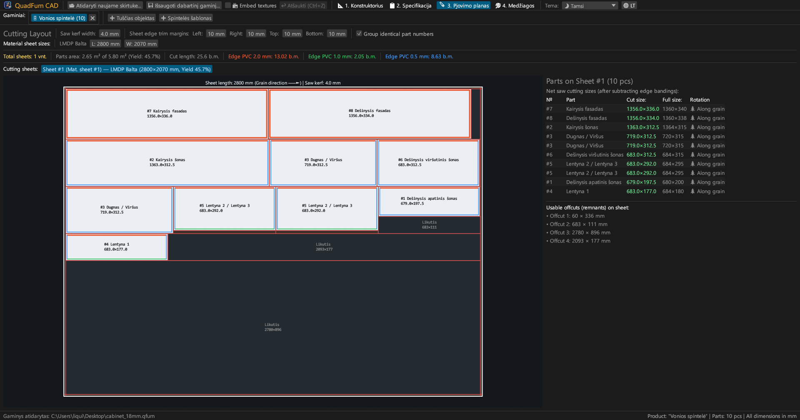
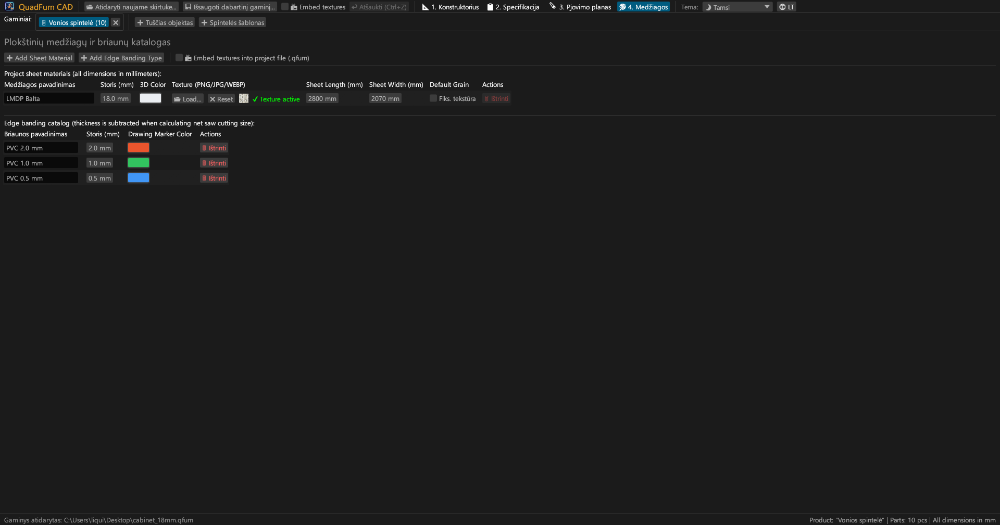
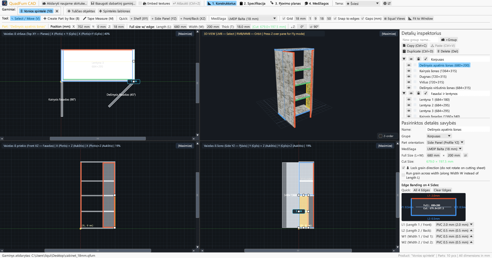
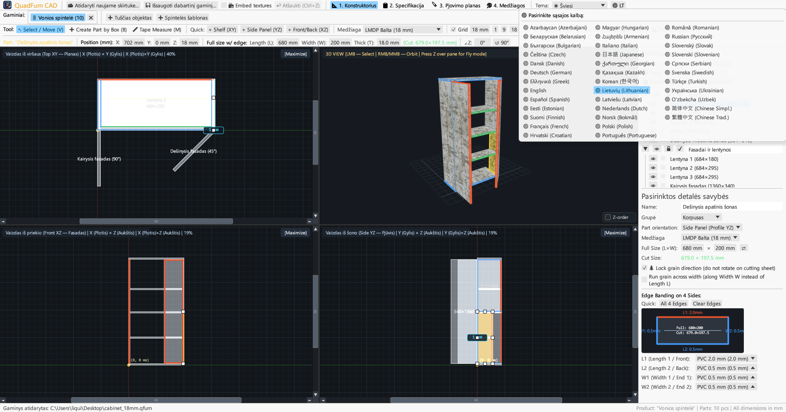

# QuadFurn CAD

**Korpusinių baldų CAD laminuotoms medienos drožlių plokštėms — 4 vaizdų erdvinis projektavimas + giljotininis plokščių pjovimo optimizavimas**

 

👉 **[🚀 Paleiskite QuadFurn CAD naršyklėje (WebAssembly)](https://rbm13s.github.io/QuadFurn/app/)** • **[🌐 Oficiali svetainė](https://rbm13s.github.io/QuadFurn/lt.html)**

 

**Languages / Языки / Мови / Sprachen:** 
[English](../README.md) •
[Русский](README-ru.md) •
[Українська](README-uk.md) •
[Беларуская](README-be.md) •
[Қазақша](README-kk.md) •
[ქართული](README-ka.md) •
[Հայերեն](README-hy.md) •
[Azərbaycan](README-az.md) •
[Oʻzbekcha](README-uz.md) •
[Deutsch](README-de.md) •
[Français](README-fr.md) •
[Español](README-es.md) •
[Italiano](README-it.md) •
[Português](README-pt.md) •
[Polski](README-pl.md) •
[Čeština](README-cs.md) •
[Slovenčina](README-sk.md) •
[Slovenščina](README-sl.md) •
[Български](README-bg.md) •
[Српски](README-sr.md) •
[Hrvatski](README-hr.md) •
[Nederlands](README-nl.md) •
[Dansk](README-da.md) •
[Norsk](README-no.md) •
[Svenska](README-sv.md) •
[Suomi](README-fi.md) •
[Eesti](README-et.md) •
[Latviešu](README-lv.md) •
**Lietuvių** •
[Magyar](README-hu.md) •
[Română](README-ro.md) •
[Türkçe](README-tr.md) •
[Ελληνικά](README-el.md) •
[简体中文](README-zh-cn.md) •
[繁體中文](README-zh-tw.md) •
[日本語](README-ja.md) •
[한국어](README-ko.md)

---

## Turinys

- [Įvadas](#įvadas)
- [Ekrano nuotraukos ir apžvalga](#ekrano-nuotraukos-ir-apžvalga)
- [Pagrindinės funkcijos](#pagrindinės-funkcijos)
- [Funkcinė dokumentacija](#funkcinė-dokumentacija)
- [Valdymas ir spartieji klavišai](#valdymas-ir-spartieji-klavišai)
- [Licencija](#licencija)

---

## Įvadas

**QuadFurn CAD** yra didelio našumo kelių platformų CAD programa, parašyta Rust kalba, skirta korpusinių baldų iš laminuotų medienos drožlių plokščių (LMDP), MDF ir faneros projektavimui, automatiniam briaunų juostos atėmimui ir 2D giljotininio pjovimo optimizavimui.

---

## Ekrano nuotraukos ir apžvalga

### 1. 4 vaizdų CAD konstruktorius (Tamsi tema)
Sinchroninės 2D projekcijos (**Planas XY**, **Fasadinis vaizdas XZ**, **Pjūvis YZ**) ir **3D langas**:

### 2. Detalių specifikacija
Specifikacija su pjovimo matmenimis atėmus briaunų juostas:

### 3. Pjovimo schemos
Optimalus išdėstymas standartiniuose lakštuose:

### 4. Medžiagos ir briaunos
Plokščių storių, spalvų ir tekstūrų (`PNG`, `JPG`, `WEBP`) valdymas:

### 5. Šviesi tema
Kontrastinga šviesi tema:

### 6. 37 integruotos kalbos
Greitas perjungimas tarp 37 kalbų:

---

## Licencija

Projektas platinamas pagal laisvąją [MIT License](../LICENSE) licenciją.
