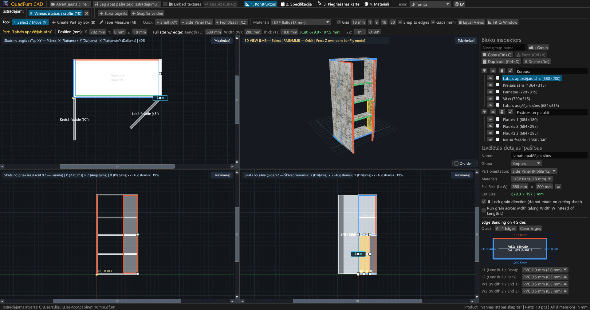
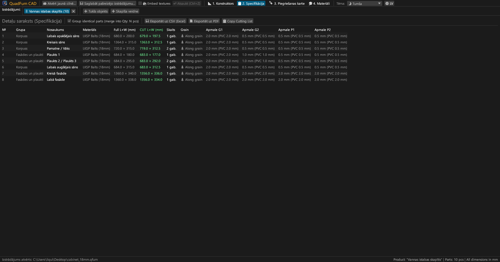
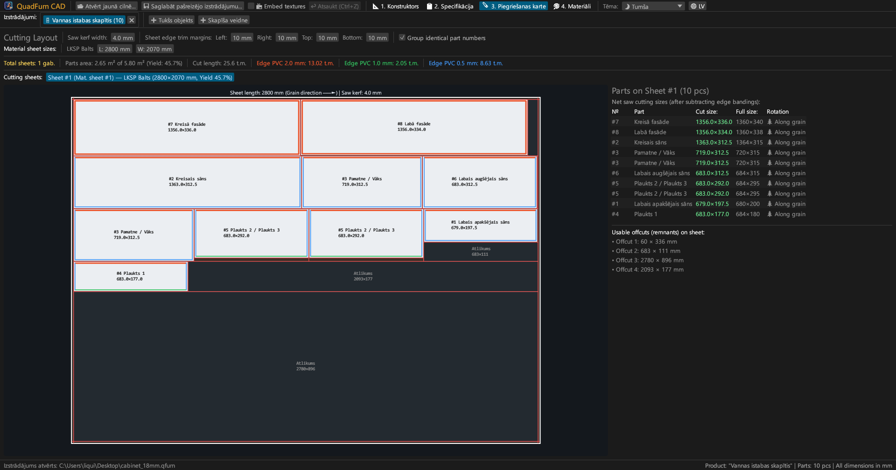
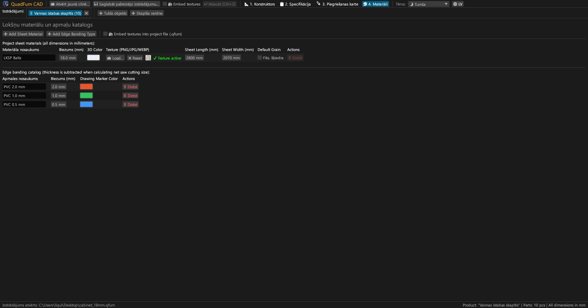
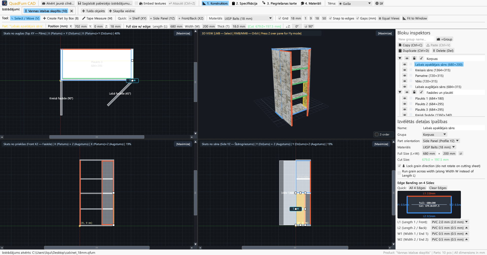
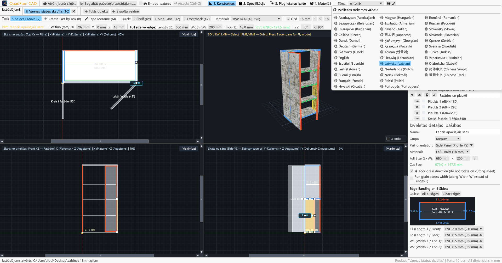

# QuadFurn CAD

**Korpusa mēbeļu CAD laminētām skaidu plātnēm — 4 skatu telpiskais projektētājs + giljotīnas zāģēšanas optimizētājs**

 

👉 **[🚀 Palaidiet QuadFurn CAD pārlūkā (WebAssembly)](https://rbm13s.github.io/QuadFurn/app/)** • **[🌐 Oficiālā vietne](https://rbm13s.github.io/QuadFurn/lv.html)**

 

**Languages / Языки / Мови / Sprachen:** 
[English](../README.md) •
[Русский](README-ru.md) •
[Українська](README-uk.md) •
[Беларуская](README-be.md) •
[Қазақша](README-kk.md) •
[ქართული](README-ka.md) •
[Հայերեն](README-hy.md) •
[Azərbaycan](README-az.md) •
[Oʻzbekcha](README-uz.md) •
[Deutsch](README-de.md) •
[Français](README-fr.md) •
[Español](README-es.md) •
[Italiano](README-it.md) •
[Português](README-pt.md) •
[Polski](README-pl.md) •
[Čeština](README-cs.md) •
[Slovenčina](README-sk.md) •
[Slovenščina](README-sl.md) •
[Български](README-bg.md) •
[Српски](README-sr.md) •
[Hrvatski](README-hr.md) •
[Nederlands](README-nl.md) •
[Dansk](README-da.md) •
[Norsk](README-no.md) •
[Svenska](README-sv.md) •
[Suomi](README-fi.md) •
[Eesti](README-et.md) •
**Latviešu** •
[Lietuvių](README-lt.md) •
[Magyar](README-hu.md) •
[Română](README-ro.md) •
[Türkçe](README-tr.md) •
[Ελληνικά](README-el.md) •
[简体中文](README-zh-cn.md) •
[繁體中文](README-zh-tw.md) •
[日本語](README-ja.md) •
[한국어](README-ko.md)

---

## Saturs

- [Ievads](#ievads)
- [Ekrānuzņēmumi un vizuālais pārskats](#ekrānuzņēmumi-un-vizuālais-pārskats)
- [Galvenās iezīmes](#galvenās-iezīmes)
- [Funkcionālā dokumentācija](#funkcionālā-dokumentācija)
- [Vadība un īsinājumtaustiņi](#vadība-un-īsinājumtaustiņi)
- [Licence](#licence)

---

## Ievads

**QuadFurn CAD** ir augstas veiktspējas daudzplatformu CAD lietotne Rust valodā, kas paredzēta korpusa mēbeļu projektēšanai no laminētām kokskaidu plātnēm (LKSP), MDF un saplākšņa ar automātisku malu apdares atskaitīšanu un 2D giljotīnas zāģēšanas optimizāciju.

---

## Ekrānuzņēmumi un vizuālais pārskats

### 1. 4 skatu CAD projektētājs (Tumšā tēma)
Sinhronizētas 2D ortogrāfiskās projekcijas (**Plāns XY**, **Fasāde XZ**, **Šķērsgriezums YZ**) un **3D skats**:

### 2. Detaļu specifikācija
Specifikācija ar zāģēšanas izmēriem pēc malu biezuma atskaitīšanas:

### 3. Zāģēšanas kartes
Optimāls izkārtojums standarta plātnēs:

### 4. Materiāli un malas
Plātņu biezumu, krāsu un tekstūru (`PNG`, `JPG`, `WEBP`) pārvaldība:

### 5. Gaišā tēma
Kontrasta gaišā tēma:

### 6. 37 iebūvētās valodas
Ātra pārslēgšanās starp 37 valodām:

---

## Licence

Programmatūra tiek izplatīta saskaņā ar bezmaksas [MIT License](../LICENSE) licenci.
