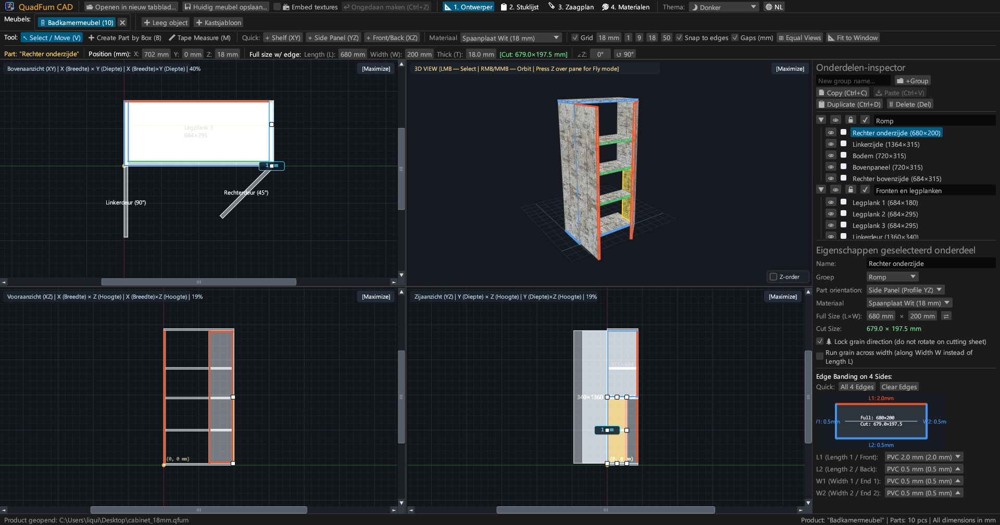
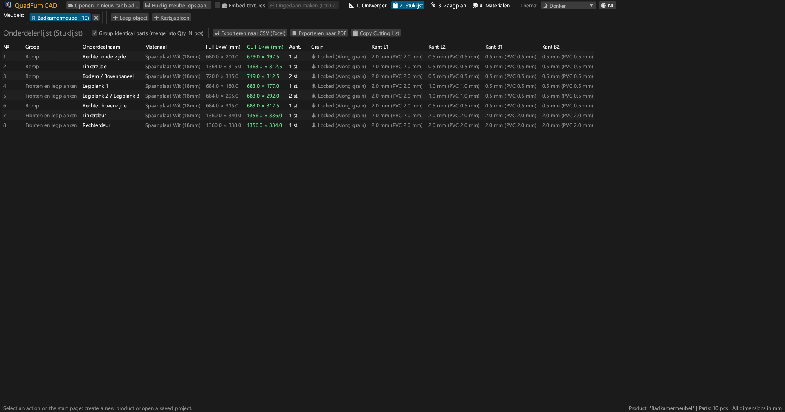
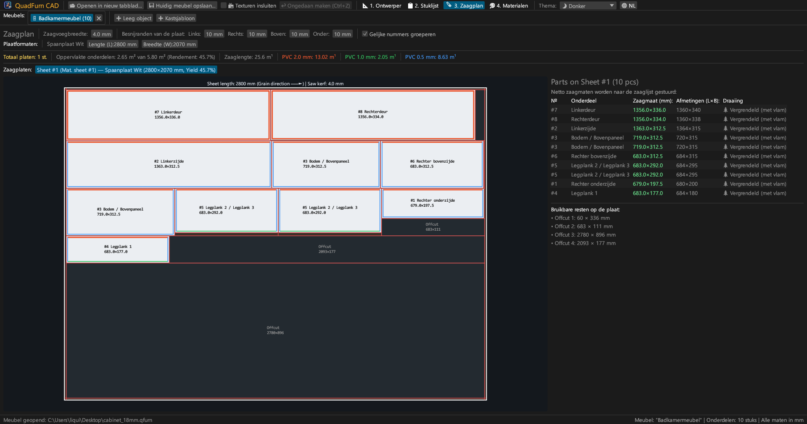
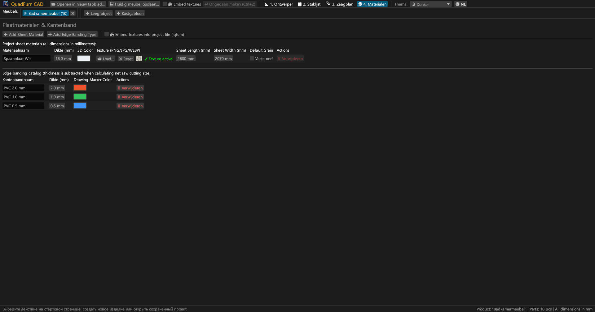
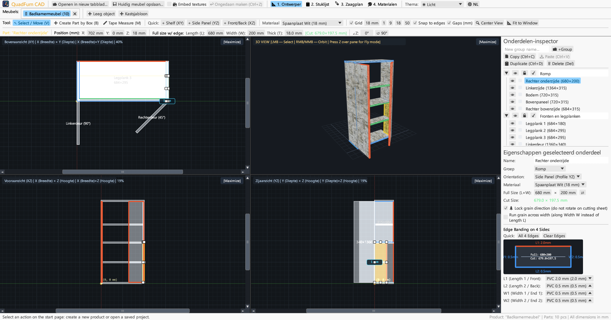
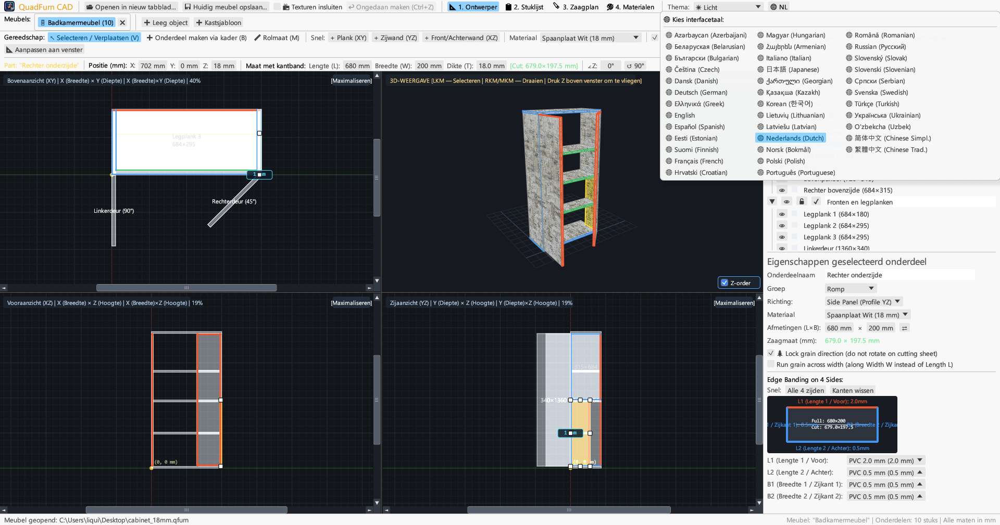

<div align="center">


# QuadFurn CAD

**CAD voor plaat- en spaanplaatmeubels — Ruimtelijke 4-weergaven ontwerper + Guillotine zaagplan-optimizer**

[](https://github.com/rbm13s/QuadFurn/actions/workflows/build.yml)
[](https://github.com/rbm13s/QuadFurn/releases)
[](https://www.rust-lang.org/)
[](https://github.com/emilk/egui)
[](https://wgpu.rs/)
[](#8-visuele-themas-en-lokalisatie-in-22-talen)
[](#aan-de-slag)
[](../LICENSE)

<br/>

**Languages / Языки / Мови / Sprachen:**<br/>
[English](../README.md) •
[Русский](README-ru.md) •
[Українська](README-uk.md) •
[Deutsch](README-de.md) •
[Polski](README-pl.md) •
[Español](README-es.md) •
[Français](README-fr.md) •
[Italiano](README-it.md) •
[Português](README-pt.md) •
[Čeština](README-cs.md) •
[Slovenčina](README-sk.md) •
[Slovenščina](README-sl.md) •
**Nederlands** •
[Dansk](README-da.md) •
[Norsk](README-no.md) •
[Svenska](README-sv.md) •
[Magyar](README-hu.md) •
[Română](README-ro.md) •
[Türkçe](README-tr.md) •
[简体中文](README-zh-cn.md) •
[日本語](README-ja.md) •
[한국어](README-ko.md)

</div>

---

## Inhoudsopgave

- [Introductie](#introductie)
- [Schermafbeeldingen en visuele rondleiding](#schermafbeeldingen-en-visuele-rondleiding)
- [Belangrijkste kenmerken](#belangrijkste-kenmerken)
- [Functionele documentatie](#functionele-documentatie)
  - [1. 4-weergaven CAD-ontwerper & precisiebediening](#1-4-weergaven-cad-ontwerper--precisiebediening)
  - [2. Rekenkundige formules in invoervelden](#2-rekenkundige-formules-in-invoervelden)
  - [3. Kantenband en automatische aftrek van netto zaagmaten](#3-kantenband-en-automatische-aftrek-van-netto-zaagmaten)
  - [4. 2D guillotine zaagoptimalisatie](#4-2d-guillotine-zaagoptimalisatie)
  - [5. Projecttabbladen en klembord tussen projecten](#5-projecttabbladen-en-klembord-tussen-projecten)
  - [6. Export van productiepaspoort (vector-PDF, CSV, klembord)](#6-export-van-productiepaspoort-vector-pdf-csv-klembord)
  - [7. Platen-, texturen- en kantenbandcatalogus](#7-platen--texturen--en-kantenbandcatalogus)
  - [8. Visuele thema's en lokalisatie in 22 talen](#8-visuele-themas-en-lokalisatie-in-22-talen)
- [Bediening en sneltoetsen](#bediening-en-sneltoetsen)
- [Aan de slag](#aan-de-slag)
- [Instellingen en bestandsformaten](#instellingen-en-bestandsformaten)
- [Projectarchitectuur](#projectarchitectuur)
- [Licentie](#licentie)

---

## Introductie

**QuadFurn CAD** is een snelle, native desktop CAD-toepassing geschreven in Rust, ontworpen voor het construeren van kasten en paneelmeubels van gelamineerd spaanplaat (melamine), MDF, HDF en multiplex, compleet met automatische stuklijstberekening en 2D guillotine-zaagoptimalisatie.

QuadFurn brengt de ergonomie van drie beproefde gereedschappen samen:
1. **4-weergaven ruimtelijke modellering**: Gelijktijdig werken in drie gesynchroniseerde 2D orthogonale aanzichten (**Bovenaanzicht XY — Plattegrond**, **Vooraanzicht XZ — Aanzicht**, **Zijaanzicht YZ — Doorsnede**) met schuifbalken, magnetische hoek- en randvergrendeling en een realtime **3D Orbit / Eerstepersoons Vlucht (`Z` Noclip)** weergave.
2. **Precisie-transformatiebalk**: Direct numerieke invoer van coördinaten (`X`, `Y`, `Z`), paneelafmetingen (`L × W × T`) en rotatiehoek (`∠Z`) met ingebouwde rekenmachine in elk invoerveld (bijv. typ `600-4` of `720+18`).
3. **Plaatzagen en automatische kantenbandaftrek**: Automatische aftrek van de dikte van PVC/ABS-kantenband aan alle 4 de zijden om exacte **netto zaagmaten voor de paneelzaag** te berekenen, gekoppeld aan een 2D guillotine-nestingalgoritme dat rekening houdt met nerfrichting, zaagsnede en voorrandsnede.

---

## Schermafbeeldingen en visuele rondleiding

### 1. 4-weergaven CAD-ontwerper (Donker thema)
Gesynchroniseerde orthogonale projecties (**Bovenaanzicht XY**, **Vooraanzicht XZ**, **Zijaanzicht YZ**) en getextureerde **3D-weergave** met perspectiefcorrecte UV-mapping, 8-punts formaatgrepen en de rechter **Onderdeleninspecteur**.



### 2. Onderdelenlijst (Stuklijst) en specificaties
Overzichtelijke tabel met zowel de **Eindmaten van het paneel (`L × W`)** als de **Netto zaagmaten (`CUT L × W`)** na aftrek van de kantenband aan elke zijde (`L1`, `L2`, `W1`, `W2`).



### 3. Guillotine zaagoptimalisatie van platen
Nesting op standaard plaatformaten (`2800 × 2070 mm`, etc.) met doorlopende guillotinezaagsneden, zaagbreedte, kantafrandingen, visuele kantenbandmarkeringen en overzicht van bruikbare reststukken.



### 4. Platen- en kantenbandcatalogus
Beheer van plaatdiktes, 3D-kleuren, aangepaste oppervlaktetexturen (`PNG`, `JPG`, `WEBP`), nerfvergrendelingen en ABS/PVC-kantenbandtypes.



### 5. Ondersteuning voor Licht thema
Modern licht thema met hoog contrast naast het donkere thema, inclusief automatische synchronisatie met het besturingssysteem.



### 6. 22 ingebouwde talen (Interface & PDF-export)
Direct wisselen van taal zonder herstart via de knop **`🌐`** in de bovenbalk, automatische taaldetectie van het besturingssysteem bij de eerste start en gelokaliseerde PDF-exports.



---

## Belangrijkste kenmerken

- **Gesynchroniseerde 4-weergaven werkruimte**: Bewerk in Boven (`XY`), Voor (`XZ`), Zij (`YZ`), of maximaliseer elk aanzicht met één klik (`[Maximaliseren]` / `[4 weergaven herstellen]`).
- **Hardware-versnelde 3D-weergave**: Orbit-camera (`Rechtermuisknop`/`Middelste knop`) + vrije vluchtcamera in eerstepersoonsperspectief (`Z-toets` + `WASD`/`Spatie`/`Ctrl`) met UV-texturen en precieze OBB-raycasting.
- **Magnetisch snappen en dynamische tussenruimtematen**: Automatisch snappen op het raster (`1`, `9`, `18`, `50 mm` of aangepast), magnetisch vastklikken op aangrenzende vlakken en randen (`0 mm`) en dynamische afstandsmetingen in millimeters naar naburige panelen.
- **Kaderselectie en groepstransformatie**: Sleep een selectiekader in een willekeurig 2D-aanzicht om meerdere panelen tegelijk te selecteren, verplaatsen, dupliceren (`Ctrl+D`) of tussen verschillende meubels te kopiëren (`Ctrl+C` / `Ctrl+V`).
- **Ingebouwde rekenmachine**: Elk invoerveld accepteert formules zoals `600+100`, `800-36`, `720/2` of `45+15`.
- **Automatische zaagmaataftrek voor kantenband**: Wijs kantenband toe (`0.4 mm`, `0.5 mm`, `1.0 mm`, `2.0 mm`, enz.) aan de 4 zijden (`L1`, `L2`, `W1`, `W2`) en zie direct de zaagmaat:
  $$\text{Zaaglengte} = L_{\text{eind}} - E_{L1} - E_{L2}, \quad \text{Zaagbreedte} = W_{\text{eind}} - E_{W1} - E_{W2}$$
- **2D guillotine-nestingmotor**: Berekening over meerdere platen met behoud van nerfrichting, zaagsnedeverlies en kantafkanting aan alle 4 de zijden.
- **Volledig productiepaspoort in vector-PDF A4 Liggend**: Exporteer met één klik in de actieve taal:
  1. Complete onderdelenlijst en stuklijst
  2. Technische 4-weergaven werktekeningen (`Boven XY`, `3D Isometrisch`, `Voor XZ`, `Zij YZ`)
  3. Zaagplannen per individuele plaat
  4. Materiaaloverzicht en strekkende meters kantenband met `+15%` reserve

---

## Functionele documentatie

### 1. 4-weergaven CAD-ontwerper & precisiebediening

Het tabblad **Ontwerper** (`📐 1. Ontwerper`) bestaat uit drie hoofdgebieden:

1. **Bovenste werkbalken**:
   - **Teken- en bewerkgereedschappen**:
     - `↖ Selecteren / Verplaatsen (V)`: Klik op een onderdeel om het te selecteren, sleep om te verplaatsen, of gebruik de 8 formaatgrepen in 2D. Sleep in de lege ruimte voor een selectiekader.
     - `➕ Onderdeel maken via kader (B)`: Sleep een rechthoek in een 2D-aanzicht (`Boven XY`, `Voor XZ` of `Zij YZ`) om direct een paneel in dat vlak te plaatsen.
     - `📏 Rolmaat (M)`: Meet afstanden van punt tot punt (`ΔX`, `ΔY`, `L`) in millimeters.
   - **Snelle invoeging**: Knoppen voor het snel toevoegen van legplanken (`+ Legplank (XY)`), zijwanden (`+ Zijwand (YZ)`) of deuren/achterwanden (`+ Deur/Achterwand (XZ)`).
   - **Raster en snappen**: Rasterstap instellen (`1`, `9`, `18`, `50 mm`), magnetisch snappen aan randen en dynamische weergave van tussenruimtes.
   - **Camerakadrering**:
     - `🔍 Weergave centreren`: Centreert de camera op het nulpunt of het midden van het meubel.
     - `📐 Passend maken`: Berekent de totale afmetingen van het meubel en past de schaal in alle 4 de vensters aan.
   - **Precisie-transformatiebalk**: Directe invoer en bewerking van coördinaten `X`, `Y`, `Z`, paneelafmetingen `L`, `W`, `T`, groen zaagmaatlabel `[Zaag: L × W mm]` en rotatiehoek `∠Z`.

2. **Vier aanzichtsvensters**:
   - **2D orthogonale aanzichten (`Boven XY`, `Voor XZ`, `Zij YZ`)** met schuifbalken, millimeterlinialen en gekleurde markeringen van kantenband.
   - **3D-weergave**: Orbit-rotatie (`Rechter` of `Middelste muisknop`), zoomen met het muiswiel, 3D-selectie en **Eerstepersoons Vrije Vlucht (Noclip)** (druk op **`Z`** boven het 3D-venster en vlieg met `WASD`, `Spatie`, `Ctrl`/`Shift`).

3. **Rechter Onderdeleninspecteur**:
   - Indeling van onderdelen in **Groepen** (*Kastombouw*, *Deuren*, *Laden*).
   - Schakelaars voor zichtbaarheid (`👁`) en vergrendeling tegen bewerken (`🔒`).
   - Materiaalkeuze, oriëntatie, afmetingen (`L × W` met wisselknop `⇄`), nerfvergrendeling (`🌲 Nerf vergrendelen`), dwarse nerf (`🔄 Nerf over dwarsrichting`) en interactief 4-zijdig kantenbandschema.

---

### 2. Rekenkundige formules in invoervelden

Alle numerieke velden ondersteunen wiskundige bewerkingen:
- **Optellen en aftrekken**: Typ in een veld met `600` bijvoorbeeld `600+100` of `600-4` en druk op `Enter` — de waarde wordt direct `700` of `596`.
- **Vermenigvuldigen, delen en haakjes**: Formules zoals `(800-36)/2` of `18*2` worden automatisch berekend.
- Zowel punt `.` als komma `,` worden geaccepteerd als decimaalscheidingsteken, en eenheden (`mm`, `°`) worden automatisch genegeerd.

---

### 3. Kantenband en automatische aftrek van netto zaagmaten

- Elk paneel heeft 4 kanten: **`L1`** (Lengte 1 / Voor), **`L2`** (Lengte 2 / Achter), **`W1`** (Breedte 1 / Zijde 1) en **`W2`** (Breedte 2 / Zijde 2).
- Als u op een paneel van `680 × 200 mm` een kantenband van `2.0 mm` toewijst aan `L1` en `0.5 mm` aan `L2`, `W1`, `W2`, berekent QuadFurn direct de **Netto zaagmaat**:
  - $\text{Zaaglengte } L = 680 - 2.0 - 0.5 = 677.5\text{ mm}$
  - $\text{Zaagbreedte } W = 200 - 0.5 - 0.5 = 199.0\text{ mm}$
- Kantenbanden worden met duidelijke gekleurde lijnen weergegeven op de 2D/3D aanzichten en op het zaagplan.

---

### 4. 2D guillotine zaagoptimalisatie

Het tabblad **Zaagplan** (`🪚 3. Zaagplan`) berekent de optimale verdeling van alle panelen over de beschikbare platen:
- **Instelbare zaagparameters**:
  - **Zaagsnededikte van het zaagblad** (standaard `4.0 mm`).
  - **Afkantsneden van de plaat** (`Links`, `Rechts`, `Boven`, `Onder`, standaard `10 mm`) om fabrieksranden zuiver te zagen.
- **Behoud van nerfrichting**:
  - Panelen met **Vergrendelde nerf (`🌲`)**: blijven strikt evenwijdig aan de lengterichting van de plaat (`Plaatlengte L`).
  - Panelen met **Vrije nerf**: mogen $90^\circ$ geroteerd worden als dat het rendement verhoogt.
- **Visuele zaagkaart en bruikbare reststukken**:
  - Weergave van elke plaat met rode doorlopende zaaglijnen, onderdeelnummers, zaagmaten, kantenbandstroken en bemaatde herbruikbare reststukken.
  - Uitgebreide statistieken: benodigd aantal platen, materiaalrendement in procenten (%), totale zaaglengte en kantenbandverbruik in meters.

---

### 5. Projecttabbladen en klembord tussen projecten

- **Startpagina en recente bestanden**: Maak een leeg meubel aan, start vanuit een 2-deurs kastsjabloon, open `.qfurn`/`.json`-bestanden of kies uit de **10 recent geopende projecten**.
- **Meerdere meubels gelijktijdig**: Werk aan verschillende modules in parallelle tabbladen (dubbelklik op een tabblad om de naam te wijzigen).
- **Kopiëren en plakken tussen projecten**: Selecteer panelen in het ene meubel, druk op `Ctrl+C`, wissel naar een ander tabblad (of een tweede geopend QuadFurn-venster) en druk op `Ctrl+V`. Ontbrekende materialen en kantenbanden worden automatisch overgenomen in het doelproject.
- **Beveiliging tegen dataverlies**: Bij het sluiten van een gewijzigd tabblad of het afsluiten van de software verschijnt een bevestigingsvenster (`Opslaan en afsluiten`, `Afsluiten zonder opslaan`, `Annuleren`).

---

### 6. Export van productiepaspoort (vector-PDF, CSV, klembord)

In het tabblad **Stuklijst** (`📋 2. Stuklijst`):
1. **`📄 Exporteren naar PDF` (Vectorieel A4 Liggend productiepaspoort)**:
   - **Sectie 1**: Volledige stuklijst met eind- en zaagmaten, kantenband en nerfrichting.
   - **Sectie 2**: Technische 4-weergaven tekeningen (`Boven XY`, `3D Isometrisch`, `Voor XZ`, `Zij YZ`) met buitenmaten.
   - **Sectie 3**: Gedetailleerde zaagplannen per individuele plaat.
   - **Sectie 4**: Platen- en kantenbandoverzicht (netto meters en $+15\%$ zaagverlies).
   - Het document wordt gegenereerd in de **actieve taal** met ingebedde TrueType/CID-vectorlettertypen.
2. **`💾 Exporteren naar CSV (Excel)`**: Spreadsheet in UTF-8 met BOM en `;`-scheidingsteken voor direct gebruik in Microsoft Excel of LibreOffice Calc.
3. **`📋 Zaaglijst kopiëren`**: Kopieert de zaagmaten naar het klembord met tab-scheidingstekens voor import in externe zaagsoftware of spreadsheets.

---

### 7. Platen-, texturen- en kantenbandcatalogus

In het tabblad **Materialen** (`🎨 4. Materialen`):
- Voeg **Plaatmateriaal** toe (`Spaanplaat 18 mm`, `MDF 16 mm`, `HDF 3 mm`, enz.) met RGB-kleuren, bruto plaatafmetingen (`L × W`) en standaard nerfinstellingen.
- Laad oppervlaktetexturen in **`PNG`**, **`JPG`/`JPEG`** of **`WEBP`** formaat voor fotorealistische 3D-weergave.
- **Draagbaarheid en automatisch terugvinden van texturen**: Bij het heropenen van een `.qfurn`-bestand zoekt QuadFurn automatisch naar afbeeldingen:
  1. Direct ingesloten in het projectbestand (Base64)
  2. In dezelfde map als het `.qfurn`-bestand
  3. In een submap `./textures/` naast het projectbestand
  4. Via het relatieve pad of het oorspronkelijke absolute pad
- **Texturen in het project insluiten (`📦 Texturen insluiten in projectbestand`)**: Schakel deze optie in de bovenbalk of in het materialenbeheer in om de texturen als Base64 rechtstreeks in het `.qfurn`-bestand op te slaan. Hierdoor ontstaat een volledig autonoom bestand dat overal kan worden geopend zonder ontbrekende texturen.
- **GPU-beveiliging**: Afbeeldingen groter dan 60 MB worden geweigerd met een duidelijke waarschuwing, en extreem hoge resoluties (> 4096 px) worden automatisch geschaald om de prestaties optimaal te houden.
- Beheer van **Kantenbandtypes** met diktes in millimeters en markeringskleuren. Het verwijderen van materialen of kantenbanden die in gebruik zijn, toont een veilige herverdeling.

---

### 8. Visuele thema's en lokalisatie in 22 talen

- **Thema's**: Wissel eenvoudig tussen **🌙 Donker**, **☀ Licht** en **🖥 Systeemthema** in de bovenste menubalk.
- **22 ingebouwde talen**:
  `Nederlands`, `English`, `Русский`, `Українська`, `Deutsch`, `Polski`, `Español`, `Français`, `Italiano`, `Português`, `Čeština`, `Slovenčina`, `Slovenščina`, `Dansk`, `Norsk`, `Svenska`, `Magyar`, `Română`, `Türkçe`, `简体中文`, `日本語` en `한국어`.
- **Automatische taaldetectie**: Detecteert bij de eerste start automatisch de taal van uw besturingssysteem. Instellingen worden bewaard in `%APPDATA%\QuadFurn\settings.json`.

---

## Bediening en sneltoetsen

| Sneltoets | Actie |
| :--- | :--- |
| **`V`** | Activeer gereedschap **Selecteren en verplaatsen** (met 8 formaatgrepen en kaderselectie) |
| **`B`** | Activeer gereedschap **Onderdeel maken via kader** in 2D-aanzichten |
| **`M`** | Activeer **Rolmaat** in 2D-aanzichten |
| **Slepen `Linkermuisknop` (2D)** | Panelen verplaatsen, afmetingen aanpassen via greep of kaderselectie in de vrije ruimte |
| **`Shift + Linkermuisknop` (2D)** | Onderdeel toevoegen aan of verwijderen uit meervoudige selectie |
| **Slepen `Rechter` / `Middelste muisknop` (2D)** | Weergave verschuiven (Pan 2D) |
| **`Muiswiel` (2D / 3D)** | In- en uitzoomen gecentreerd op de cursor |
| **Slepen `Rechter` / `Middelste muisknop` (3D)** | Orbitale rotatie van de 3D-camera |
| **`Z` (boven het 3D-venster)** | In-/uitschakelen van **Eerstepersoons Vrije Vlucht (Noclip)** |
| **`W` `A` `S` `D` / `Spatie` / `Ctrl`** | Vliegen naar voor/links/achter/rechts/omhoog/omlaag in 3D (`Shift` versnelt) |
| **`Ctrl + S`** | Huidig meubel opslaan (`.qfurn` / `.json`) |
| **`Ctrl + Z`** | Laatste bewerking ongedaan maken (geschiedenis tot 40 stappen) |
| **`Ctrl + C` / `Ctrl + V`** | Kopiëren / Plakken van geselecteerde onderdelen (werkt tussen tabbladen) |
| **`Ctrl + D`** | Geselecteerde onderdelen dupliceren |
| **`Delete` / `Backspace`** | Geselecteerde onderdelen verwijderen |
| **`←` `→` `↑` `↓` (2D-weergaven)** | Geselecteerde onderdelen verplaatsen met geselecteerde rasterstap (`Shift` voor dubbele stap) |

---

## Aan de slag

### Voorgecompileerde installatiebestanden (GitHub Releases)
Elke release bouwt automatisch direct te gebruiken pakketten via [GitHub Actions](https://github.com/rbm13s/QuadFurn/actions):
- **Windows (`x86_64`)**: `QuadFurn-windows-x86_64.zip` — draagbare `QuadFurn.exe` met ingesloten pictogram.
- **Linux (`Debian 12+ / Ubuntu 22.04+ x86_64`)**:
  - `quadfurn_<versie>_amd64.deb` — officieel installatiepakket voor Debian/Ubuntu (installeert het programma, menukoppeling en systeemiconen):
    ```bash
    sudo apt install ./quadfurn_0.2.3_amd64.deb
    ```
  - `QuadFurn-linux-x86_64.tar.gz` — draagbaar Linux-archief.
- **macOS (`Universeel: Apple Silicon M1–M4 + Intel x86_64`)**: `QuadFurn-macos-universal.zip` — native `QuadFurn.app` met Retina-pictogram.

---

### Bouwen vanuit broncode

#### Vereisten
- [Rust Toolchain](https://rustup.rs/) (`stable`, Rust 2021 editie)
- Systeembibliotheken voor **Linux (Debian / Ubuntu)**:
  ```bash
  sudo apt-get update && sudo apt-get install -y \
    build-essential pkg-config libxcb-render0-dev libxcb-shape0-dev \
    libxcb-xfixes0-dev libxkbcommon-dev libxkbcommon-x11-dev libssl-dev \
    libgtk-3-dev libglib2.0-dev libatk1.0-dev libgdk-pixbuf-2.0-dev \
    libcairo2-dev libpango1.0-dev libgl1-mesa-dev fonts-dejavu-core fonts-noto-cjk
  ```
- **macOS**: Xcode Command Line Tools (`xcode-select --install`)
- **Windows**: Windows 10 / 11 met Visual C++ Build Tools

#### Compilatieopdrachten
```bash
# Uitvoeren in ontwikkelmodus
cargo run

# Geoptimaliseerde releaseversie bouwen
cargo build --release

# Unittests uitvoeren
cargo test
```

---

## Instellingen en bestandsformaten

- **Gebruikersinstellingen (`settings.json`)**:
  Automatisch opgeslagen in de standaardconfiguratiemap van het besturingssysteem:
  - **Windows**: `%APPDATA%\QuadFurn\settings.json`
  - **Linux**: `~/.config/QuadFurn/settings.json`
  - **macOS**: `~/Library/Application Support/QuadFurn/settings.json`
  
  Bewaart:
  - `theme_choice` (`Dark`, `Light`, `System`)
  - `language` (`Nl`, `En`, `Ru`, enz.)
  - `recent_projects` (tot 10 recent geopende bestanden)
- **Projectbestanden (`.qfurn` / `.json`)**:
  Leesbare JSON-bestanden in UTF-8 met alle onderdelen, groepen, materialen, texturen, kantenbanden en zaaginstellingen. Wanneer insluiten is ingeschakeld, worden afbeeldingen opgeslagen als Base64-tekenreeksen.

---

## Projectarchitectuur

```text
QuadFurn/
├── .github/
│   └── workflows/
│       └── build.yml          # CI/CD-pijplijn GitHub Actions (Linux .deb/.tar.gz, macOS .app, Windows .zip)
├── assets/
│   ├── icon.jpeg              # Toepassingslogo en bronpictogram
│   └── screenshots/           # Schermafbeeldingen voor documentatie
├── docs/                      # Gelokaliseerde documentatie in 22 talen
├── src/
│   ├── main.rs                # Startpunt, beheer van projecttabbladen, startpagina en sneltoetsen
│   ├── model.rs               # Datamodel (Project, PartBlock, SheetMaterial, EdgeBanding, OBB)
│   ├── viewport.rs            # 4-weergaven controller, 2D en 3D rendering wgpu/painter
│   ├── snapping.rs            # Magnetisch snappen aan raster en randen, projectie-assen
│   ├── cutter.rs              # 2D guillotine zaagoptimalisatie en kantenbandaftrek
│   ├── export.rs              # Gelokaliseerde vector-PDF A4 Liggend exporteur en CSV-exporteur
│   ├── ui_panels.rs           # Transformatiebalk, Onderdeleninspecteur, Stuklijst, Zaagplan en Materialen
│   └── i18n.rs                # Vertaalwoordenboeken voor 22 talen en OS-taaldetectie
├── build.rs                   # Automatische conversie van ICO-pictogram voor Windows en PE-bron
├── Cargo.toml                 # Pakketconfiguratie en afhankelijkheden
└── LICENSE                    # Open-source MIT-licentie
```

---

## Licentie

Dit project is vrijgegeven onder de [MIT-licentie](../LICENSE) — vrij te gebruiken, aan te passen en te verspreiden voor zowel commerciële als persoonlijke projecten.


