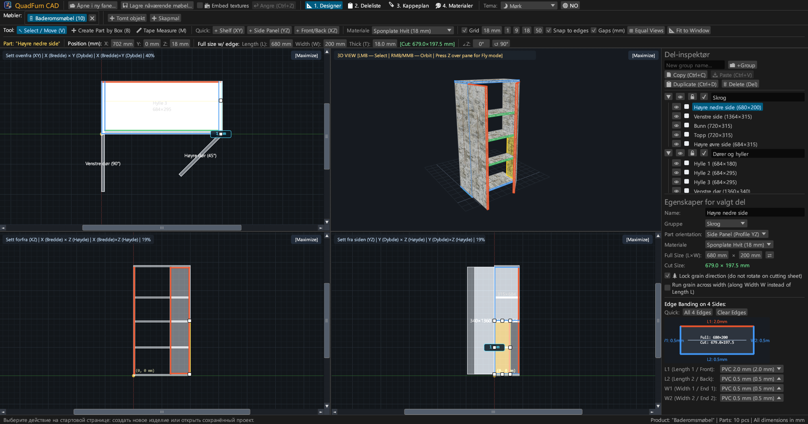
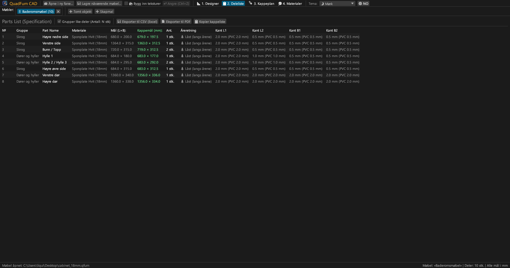
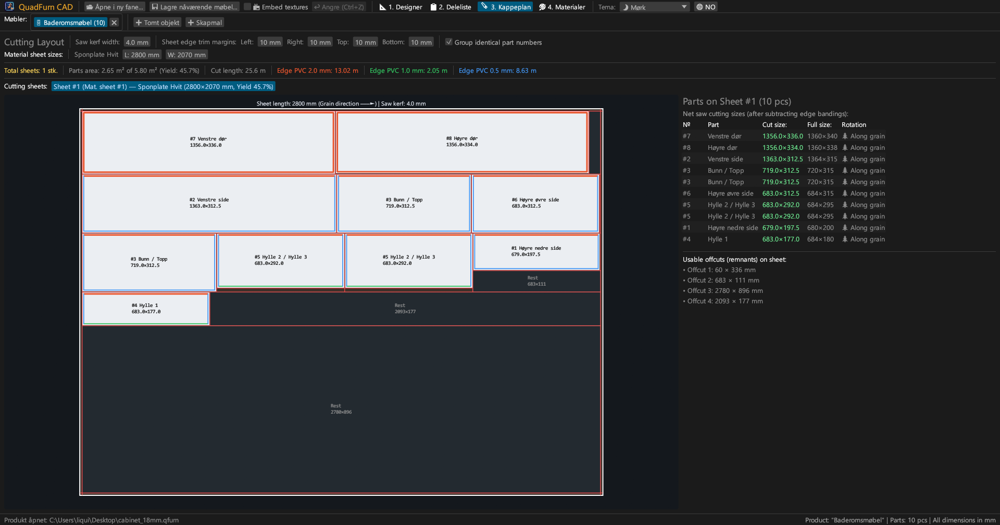
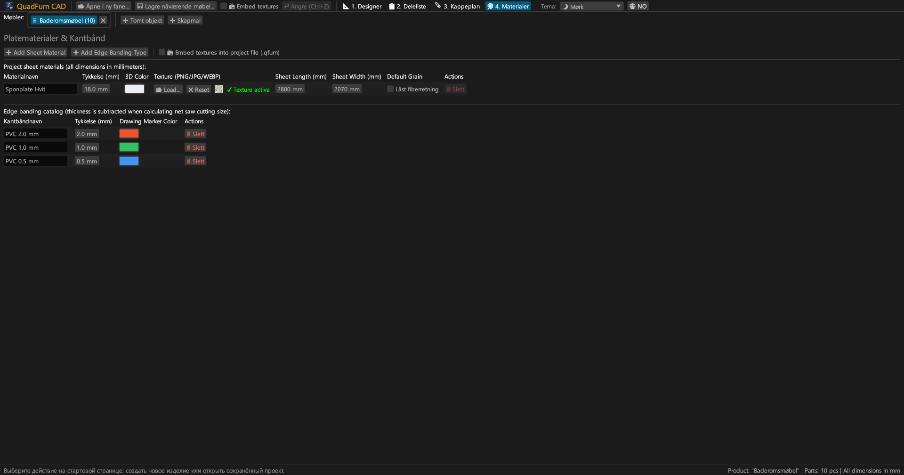
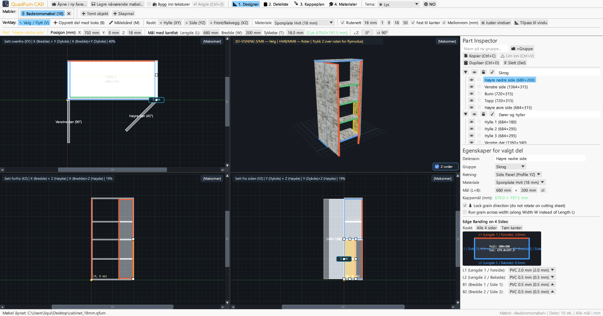
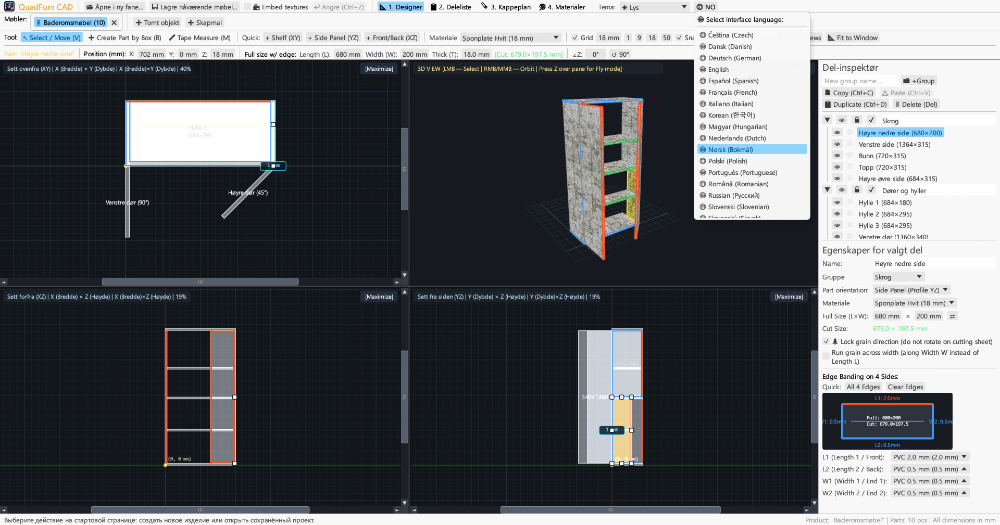

<div align="center">


# QuadFurn CAD

**CAD for plate- og sponplatamøbler — Romlig 4-visnings designer + Giljotin platekappingsoptimalisator**

[](https://github.com/rbm13s/QuadFurn/actions/workflows/build.yml)
[](https://github.com/rbm13s/QuadFurn/releases)
[](https://www.rust-lang.org/)
[](https://github.com/emilk/egui)
[](https://wgpu.rs/)
[](#8-visuelle-temaer-og-lokalisering-på-22-språk)
[](#komme-i-gang)
[](../LICENSE)

<br/>

**Languages / Языки / Мови / Sprachen:**<br/>
[English](../README.md) •
[Русский](README-ru.md) •
[Українська](README-uk.md) •
[Deutsch](README-de.md) •
[Polski](README-pl.md) •
[Español](README-es.md) •
[Français](README-fr.md) •
[Italiano](README-it.md) •
[Português](README-pt.md) •
[Čeština](README-cs.md) •
[Slovenčina](README-sk.md) •
[Slovenščina](README-sl.md) •
[Nederlands](README-nl.md) •
[Dansk](README-da.md) •
**Norsk** •
[Svenska](README-sv.md) •
[Magyar](README-hu.md) •
[Română](README-ro.md) •
[Türkçe](README-tr.md) •
[简体中文](README-zh-cn.md) •
[日本語](README-ja.md) •
[한국어](README-ko.md)

</div>

---

## Innholdsfortegnelse

- [Introduksjon](#introduksjon)
- [Skjermbilder og visuell oversikt](#skjermbilder-og-visuell-oversikt)
- [Hovedfunksjoner](#hovedfunksjoner)
- [Funksjonell dokumentasjon](#funksjonell-dokumentasjon)
  - [1. 4-visnings CAD-designer & presisjonskontroll](#1-4-visnings-cad-designer--presisjonskontroll)
  - [2. Matematiske uttrykk i tallfelt](#2-matematiske-uttrykk-i-tallfelt)
  - [3. Kantlister og automatisk fradrag for renskåret kuttmål](#3-kantlister-og-automatisk-fradrag-for-renskåret-kuttmål)
  - [4. 2D giljotin kappeoptimalisering](#4-2d-giljotin-kappeoptimalisering)
  - [5. Prosjektfaner og utklippstavle på tvers av prosjekter](#5-prosjektfaner-og-utklippstavle-på-tvers-av-prosjekter)
  - [6. Eksport av produksjonspass (vektor-PDF, CSV, utklippstavle)](#6-eksport-av-produksjonspass-vektor-pdf-csv-utklippstavle)
  - [7. Plate-, tekstur- og kantlistkatalog](#7-plate--tekstur--og-kantlistkatalog)
  - [8. Visuelle temaer og lokalisering på 22 språk](#8-visuelle-temaer-og-lokalisering-på-22-språk)
- [Styring og hurtigtaster](#styring-og-hurtigtaster)
- [Komme i gang](#komme-i-gang)
- [Innstillinger og filformater](#innstillinger-og-filformater)
- [Prosjektarkitektur](#prosjektarkitektur)
- [Lisens](#lisens)

---

## Introduksjon

**QuadFurn CAD** er et lynraskt, fleroppsett CAD-program skrevet i Rust, tilgjengelig både som et raskt integrert skrivebordsprogram (Windows, Linux, macOS) og som en installasjonsfri WebAssembly (WASM) nettversjon som kjører direkte i moderne nettlesere. Det er utviklet for konstruksjon av skap- og platemøbler av laminert sponplate (melamin), MDF, HDF og kryssfiner, komplett med automatisk stykkelistegenerering og 2D giljotin kappeoptimalisering.

QuadFurn forener ergonomien fra tre velkjente verktøy i én sømløs arbeidsflyt:
1. **Romlig modellering i 4 visninger**: Samtidig redigering i tre synkroniserte 2D-projeksjoner (**Ovenfra XY — Plan**, **Front XZ — Oppriss**, **Side YZ — Snitt**) med rullefelt, magnetisk snapping, knapp for utjevning av vindusstørrelser (`⊞ Likestill vinduer`), intelligent tykkelsesbeskyttelse for deler sett fra kant og en sanntids **3D Bane / Førstepersons flymodus (`Z` Noclip)** visning.
2. **Presisjonstransformeringslinje**: Umiddelbar numerisk inntasting av koordinater (`X`, `Y`, `Z`), platestørrelse (`L × W × T`) og rotasjonsvinkel (`∠Z`) med innebygd beregning i alle tekstbokser (f.eks. `600-4` eller `720+18`).
3. **Platekapping og automatisk kantlistfradrag**: Automatisk fradrag for PVC/ABS-kantlistetykkelse på alle 4 kanter for å beregne det nøyaktige **netto sagmålet for formatsagen**, sammen med en 2D giljotin-nestingmotor som ivaretar treretning, bladbredde og kantavretting på råplatene.

---

## Skjermbilder og visuell oversikt

### 1. 4-visnings CAD-designer (Mørkt tema)
Synkroniserte ortogonale projeksjoner (**Plan XY**, **Front XZ**, **Side YZ**) og teksturert **3D-visning** med perspektivkorrigert UV-kartlegging, 8-punkts størrelseshåndtak og høyre **Elementinspektør**.



### 2. Komponentliste (Stykkliste) og spesifikasjoner
Oversiktlig tabell som viser både **Ferdigmål (`L × W`)** og **Netto kuttmål for sag (`CUT L × W`)** etter fradrag for kantlister på hver side (`L1`, `L2`, `W1`, `W2`).



### 3. Giljotin kappeoptimalisering av plater
Nesting på standard platestørrelser (`2800 × 2070 mm` osv.) med gjennomgående giljotinkutt, sagbladbredde, renskjæringsmarginer, fargede kantlistmarkeringer og oversikt over nyttbart kapp.



### 4. Plate- og kantlistkatalog
Administrasjon av platetykkelser, 3D-farger, egendefinerte overflateteksturer (`PNG`, `JPG`, `WEBP`), treretningslås og typer av ABS/PVC-kantlister.



### 5. Støtte for Lyst tema
Moderne lyst tema med høy kontrast side om side med det mørke temaet, inkludert automatisk synkronisering med operativsystemets utseende.



### 6. 22 innebygde språk (Brukergrensesnitt og PDF-eksport)
Umiddelbart språkbytte uten omstart via **`🌐`**-knappen i verktøylinjen, automatisk gjenkjenning av systemspråk ved første oppstart og flerspråklige PDF-rapporter.



---

## Hovedfunksjoner

- **Synkronisert 4-visnings arbeidsflate**: Arbeid i Plan (`XY`), Front (`XZ`), Side (`YZ`), eller maksimer en hvilken som helst rute med ett klikk (`[Maksimer]` / `[Gjenopprett 4 visninger]`).
- **Maskinvareakselerert 3D-forhåndsvisning**: Orbit-kamera (`Høyre museknapp`/`Midtknapp`) + frifluktkamera i førsteperson (`tast Z` + `WASD`/`Mellomrom`/`Ctrl`) med UV-teksturer og presis OBB-strålekasting.
- **Magnetisk festefunksjon og dynamiske avstandsmål**: Automatisk snapping til rutenett (`1`, `9`, `18`, `50 mm` eller egendefinert), magnetisk låsing mot tilstøtende flater og kanter (`0 mm`) og visning av faktiske avstander i millimeter til naboplater.
- **Rammemarkering og gruppetransformasjon**: Dra en markeringsramme i en 2D-visning for å flytte flere plater samlet, duplisere (`Ctrl+D`) eller kopiere dem på tvers av åpne møbelprosjekter (`Ctrl+C` / `Ctrl+V`).
- **Innebygd formelregner**: Alle numeriske felt godtar matematiske uttrykk som `600+100`, `800-36`, `720/2` eller `45+15`.
- **Automatisk fradrag for kantlister ved saging**: Tildel kantlist (`0.4 mm`, `0.5 mm`, `1.0 mm`, `2.0 mm` osv.) til de 4 sidene (`L1`, `L2`, `W1`, `W2`), og systemet regner straks ut kuttmålet:
  $$\text{Kuttlengde} = L_{\text{ferdig}} - E_{L1} - E_{L2}, \quad \text{Kuttbredde} = W_{\text{ferdig}} - E_{W1} - E_{W2}$$
- **2D giljotin-nestingmotor**: Flerplate-algoritme som overholder treretningen, sagbladets snittbredde og renskjæringsmarginer på alle 4 kanter.
- **Komplett produksjonspass i vektor-PDF A4 Liggende**: Eksporter med ett klikk på det aktive språket:
  1. Komplett stykkliste over alle elementer
  2. Tekniske 4-visnings arbeidstegninger (`Plan XY`, `3D Isometrisk`, `Front XZ`, `Side YZ`)
  3. Detaljerte kappeskjemaer for hver enkelt plate
  4. Materialoversikt og løpemeter kantlister med `+15 %` svinntillegg

---

## Funksjonell dokumentasjon

### 1. 4-visnings CAD-designer & presisjonskontroll

Fanen **Designer** (`📐 1. Designer`) består av tre hovedområder:

1. **Øvre verktøylinjer**:
   - **Tegneverktøy**:
     - `↖ Velg / Flytt (V)`: Klikk for å velge et element, dra for å flytte, eller bruk de 8 håndtakene i 2D for å endre størrelse. Dra i tomt rom for å åpne en markeringsramme.
     - `➕ Opprett element med ramme (B)`: Dra et rektangel i en 2D-visning (`Plan XY`, `Front XZ` eller `Side YZ`) for å sette inn en plate i det planet.
     - `📏 Målebånd (M)`: Mål nøyaktige avstander punkt til punkt (`ΔX`, `ΔY`, `L`) i millimeter.
   - **Hurtiginnsetting**: Knapper for rask innsetting av hyller (`+ Hylle (XY)`), sider (`+ Side (YZ)`) eller dører/bakplater (`+ Dør/Bakplate (XZ)`).
   - **Rutenett og snapping**: Velg rutenett-trinn (`1`, `9`, `18`, `50 mm`), magnetisk snapping til tilstøtende kanter og dynamiske avstander.
   - **Kamerajustering**:
     - `🔍 Sentrer visning`: Sentrerer kameraet på nullpunktet eller møbelets midtpunkt.
     - `📐 Tilpass til vindu`: Beregner automatisk møbelets ytre mål og tilpasser skalaen i alle 4 vinduer samtidig.
   - **Presisjonstransformeringslinje**: Direkte inntasting og redigering av koordinater `X`, `Y`, `Z`, elementstørrelse `L`, `W`, `T`, grønn kuttetikett `[Kutt: L × W mm]` og rotasjonsvinkel `∠Z`.

2. **Fire visningsruter**:
   - **2D ortogonale visninger (`Plan XY`, `Front XZ`, `Side YZ`)** med rullefelt, millimeterlinjaler og fargede kantlistmarkeringer.
   - **3D-visning**: Bane-rotasjon (`Høyre` eller `Midtre museknapp`), zoom med rullehjul, 3D-valg og **Førstepersons Flymodus (Noclip)** (trykk **`Z`** over 3D-ruten og fly med `WASD`, `Mellomrom`, `Ctrl`/`Shift`).

3. **Høyre Elementinspektør**:
   - Gruppering av elementer i **Grupper** (*Skrog*, *Dører*, *Skuffer*).
   - Synlighetskontroll (`👁`) og låsing mot redigering (`🔒`).
   - Materialvalg, orientering, dimensjoner (`L × W` med bytteknapp `⇄`), treretningslås (`🌲 Lås treretning`), tverrgående treretning (`🔄 Tverrgående trestruktur`) og interaktivt 4-sidig kantlistskjema.

---

### 2. Matematiske uttrykk i tallfelt

Alle numeriske inndatafelt støtter matematiske formler:
- **Addisjon og subtraksjon**: Skriv f.eks. `600+100` eller `600-4` i et felt med `600` og trykk på `Enter` — verdien regnes straks om til `700` eller `596`.
- **Multiplikasjon, divisjon og parenteser**: Uttrykk som `(800-36)/2` eller `18*2` regnes ut automatisk.
- Både punktum `.` og komma `,` godtas som desimalskilletegn, og måleenheter (`mm`, `°`) filtreres automatisk bort.

---

### 3. Kantlister og automatisk fradrag for renskåret kuttmål

- Hvert plateelement har 4 kanter: **`L1`** (Lengde 1 / Foran), **`L2`** (Lengde 2 / Bak), **`W1`** (Bredde 1 / Side 1) og **`W2`** (Bredde 2 / Side 2).
- Hvis du tildeler en PVC-kantlist på `2.0 mm` til `L1` og `0.5 mm` til `L2`, `W1`, `W2` på et element på `680 × 200 mm`, regner QuadFurn automatisk ut det **Nettomålet som skal sages**:
  - $\text{Kuttlengde } L = 680 - 2.0 - 0.5 = 677.5\text{ mm}$
  - $\text{Kuttbredde } W = 200 - 0.5 - 0.5 = 199.0\text{ mm}$
- Kantlistene markeres med tydelige fargestriper i både 2D/3D-visningene og på kappeskjemaet.

---

### 4. 2D giljotin kappeoptimalisering

Fanen **Kappeskjema** (`🪚 3. Kappeskjema`) beregner den mest optimale fordelingen av plateelementer på råplatene:
- **Justerbare sagparametere**:
  - **Sagbladets kuttbredde** (standard `4.0 mm`).
  - **Renskjæring av råplatekanter** (`Venstre`, `Høyre`, `Topp`, `Bunn`, standard `10 mm`) for å fjerne transportskader.
- **Overholdelse av treretning**:
  - Elementer med **Låst treretning (`🌲`)**: holdes strengt parallelle med platens lengderetning (`Platelengde L`).
  - Elementer med **Fri treretning**: kan roteres $90^\circ$ av optimeringsmotoren hvis det gir bedre utnyttelse.
- **Visuelt kappekart og nyttbart kapp**:
  - Visning av hver plate med røde gjennomgående giljotinkutt, elementnummer, kuttmål, kantlistangivelser og oppmålte gjenbrukbare rester.
  - Omfattende statistikk: antall nødvendige plater, materialutnyttelse i prosent (%), samlet saglengde og kantlistforbruk i meter.

---

### 5. Prosjektfaner og utklippstavle på tvers av prosjekter

- **Startside og nylige prosjekter**: Opprett et tomt møbel, start ut fra en 2-dørs mal, åpne `.qfurn`/`.json`-filer eller velg blant de **10 sist åpnede prosjektene**.
- **Flere møbelfaner samtidig**: Konstruer flere moduler parallelt (dobbeltklikk på fanenavnet for å endre navn).
- **Kopier og lim inn mellom prosjekter**: Merk elementer i én fane, trykk `Ctrl+C`, bytt til en annen fane (eller en annen åpen instans av QuadFurn), og trykk `Ctrl+V`. Manglende materialer og kantlister opprettes automatisk i målprosjektet.
- **Sikkerhet mot datatap**: Ved lukking av en endret fane eller avslutning av programmet vises en bekreftelsesdialog (`Lagre og avslutt`, `Avslutt uten å lagre`, `Avbryt`).

---

### 6. Eksport av produksjonspass (vektor-PDF, CSV, utklippstavle)

I fanen **Stykkliste** (`📋 2. Stykkliste`):
1. **`📄 Eksporter til PDF` (Vektorielt A4 Liggende produksjonspass)**:
   - **Seksjon 1**: Full stykkliste med ferdigmål, sagmål, kantlister og treretning.
   - **Seksjon 2**: Tekniske 4-visnings arbeidstegninger (`Plan XY`, `3D Isometrisk`, `Front XZ`, `Side YZ`) med utvendige mål.
   - **Seksjon 3**: Detaljerte giljotin-kappeskjemaer for hver enkelt plate.
   - **Seksjon 4**: Plateoversikt og forbruk av kantlister (netto meter og $+15 \%$ sikkerhetstillegg).
   - Dokumentet genereres på det **aktive språket** med innebygde TrueType/CID-vektorskrifttyper.
2. **`💾 Eksporter til CSV (Excel)`**: Regneark i UTF-8 med BOM og semikolon `;`, klart til bruk i Microsoft Excel eller LibreOffice Calc.
3. **`📋 Kopier kuttliste`**: Kopierer kuttmålene til utklippstavlen med tabulatorer for enkel overføring til eksterne kappeprogrammer eller regneark.

---

### 7. Plate-, tekstur- og kantlistkatalog

I fanen **Materialer** (`🎨 4. Materialer`):
- Opprett og rediger **Platematerialer** (`Sponplate 18 mm`, `MDF 16 mm`, `HDF 3 mm` osv.) med RGB-farger, råplatemål (`L × W`) og standard treretningslås.
- Last inn overflateteksturer i formatene **`PNG`**, **`JPG`/`JPEG`** eller **`WEBP`** for fotorealistisk 3D-visning.
- **Portabilitet og automatisk tekstursøk**: Ved gjenåpning av en `.qfurn`-fil leter QuadFurn automatisk etter bildene:
  1. Integrert direkte i prosjektfilen (Base64)
  2. I samme mappe som `.qfurn`-prosjektfilen
  3. I en undermappe `./textures/` ved siden av prosjektfilen
  4. Via den relative banen eller den opprinnelige absolutte banen
- **Baking av teksturer inn i filen (`📦 Bygg inn teksturer i prosjektfilen`)**: Slå på denne innstillingen i topplinjen eller under Materialer for å lagre bildene direkte som Base64 i `.qfurn`-filen. Prosjektet blir da fullstendig uavhengig og kan flyttes fritt uten risiko for manglende teksturer.
- **Grafikkortbeskyttelse**: Filer over 60 MB avvises med en klar advarsel, og svært høye oppløsninger (> 4096 px) nedskaleres automatisk for jevn ytelse.
- Administrasjon av **Kantlisttyper** med tykkelse i millimeter og fargekoder. Sletting av materialer eller kantlister i bruk krever sikkerhetsbekreftelse.

---

### 8. Visuelle temaer og lokalisering på 22 språk

- **Visuelle temaer**: Bytt enkelt mellom **🌙 Mørkt**, **☀ Lyst** og **🖥 Systemtema** i den øvre verktøylinjen.
- **22 innebygde språk**:
  `Norsk`, `English`, `Русский`, `Українська`, `Deutsch`, `Polski`, `Español`, `Français`, `Italiano`, `Português`, `Čeština`, `Slovenčina`, `Slovenščina`, `Nederlands`, `Dansk`, `Svenska`, `Magyar`, `Română`, `Türkçe`, `简体中文`, `日本語` og `한국어`.
- **Automatisk registrering ved første oppstart**: Registrerer automatisk operativsystemets språk og tar det i bruk. Valget lagres i `%APPDATA%\QuadFurn\settings.json`.

---

## Styring og hurtigtaster

| Snarvei | Handling |
| :--- | :--- |
| **`V`** | Aktiver verktøyet **Velg og flytt** (8 størrelseshåndtak på flaten og 2 kanthåndtak fra siden, pluss rammeutvalg) |
| **`B`** | Aktiver verktøyet **Opprett element med ramme** i 2D-visninger |
| **`M`** | Aktiver **Målebånd** i 2D-visninger |
| **Dra med `Venstre museknapp` (2D)** | Flytt elementer, juster håndtak eller dra markeringsramme i tomt rom |
| **`Skift / Ctrl (Cmd) + Venstre museknapp` (2D)** | Legg til eller fjern element fra flervalg |
| **Dra med `Høyre` / `Midtre museknap` (2D)** | Panorer visningen (2D pan) |
| **`Rullehjul på mus` (2D / 3D)** | Zoom inn/ut sentrert rundt markøren |
| **Dra med `Høyre` / `Midtre museknap` (3D)** | Bane-rotasjon av 3D-kameraet |
| **`Z` (over 3D-ruten)** | Slå av/på **Førstepersons Flymodus (Noclip)** |
| **`W` `A` `S` `D` / `Mellomrom` / `Ctrl (Cmd)`** | Fly frem/venstre/tilbake/høyre/opp/ned i 3D (`Skift` for høyere fart) |
| **`Ctrl + S` / `Cmd (⌘) + S`** | Lagre det aktive møbelet (`.qfurn` / `.json`) |
| **`Ctrl + Z` / `Cmd (⌘) + Z`** | Angre siste handling (historikk på inntil 40 trinn) |
| **`Ctrl + C` / `Cmd (⌘) + C`** | Kopier valgte deler til utklippstavlen |
| **`Ctrl + V` / `Cmd (⌘) + V`** | Lim inn deler (fungerer på tvers av faner) |
| **`Ctrl + D` / `Cmd (⌘) + D`** | Dupliser merkede elementer |
| **`Delete` / `Backspace`** | Slett merkede elementer |
| **`←` `→` `↑` `↓` (2D-visninger)** | Flytt valgte deler med valgt rutenettstrinn (`Shift` for dobbelt trinn) |

---

## Komme i gang

### Ferdigbygde installasjonspakker (GitHub Releases)
Hver utgivelse genererer automatisk installasjonspakker via [GitHub Actions](https://github.com/rbm13s/QuadFurn/actions):
- **Windows (`x86_64`)**: `QuadFurn-windows-x86_64.zip` — bærbar `QuadFurn.exe` med integrert ikon.
- **Linux (`Debian 12+ / Ubuntu 22.04+ x86_64`)**:
  - `quadfurn_<versjon>_amd64.deb` — offisiell installasjonspakke for Debian/Ubuntu (installerer programfil, menyoppføring og systemikoner):
    ```bash
    sudo apt install ./quadfurn_0.2.3_amd64.deb
    ```
  - `QuadFurn-linux-x86_64.tar.gz` — bærbar Linux-arkivfil.
- **macOS (`Universell: Apple Silicon M1–M4 + Intel x86_64`)**: `QuadFurn-macos-universal.zip` — nativ `QuadFurn.app` med Retina-ikon.

---

### Kompilering fra kildekode

#### Forutsetninger
- [Rust Toolchain](https://rustup.rs/) (`stable`, utgave Rust 2021)
- Systembiblioteker på **Linux (Debian / Ubuntu)**:
  ```bash
  sudo apt-get update && sudo apt-get install -y \
    build-essential pkg-config libxcb-render0-dev libxcb-shape0-dev \
    libxcb-xfixes0-dev libxkbcommon-dev libxkbcommon-x11-dev libssl-dev \
    libgtk-3-dev libglib2.0-dev libatk1.0-dev libgdk-pixbuf-2.0-dev \
    libcairo2-dev libpango1.0-dev libgl1-mesa-dev fonts-dejavu-core fonts-noto-cjk
  ```
- **macOS**: Xcode Command Line Tools (`xcode-select --install`)
- **Windows**: Windows 10 / 11 med Visual C++ Build Tools

#### Kompileringskommandoer
```bash
# Kjør i utviklingsmodus
cargo run

# Kompiler optimalisert versjon for utgivelse
cargo build --release

# Kjør enhetstester
cargo test
```

---

## Innstillinger og filformater

- **Brukerinnstillinger (`settings.json`)**:
  Lagres automatisk i operativsystemets standard konfigurasjonsmappe:
  - **Windows**: `%APPDATA%\QuadFurn\settings.json`
  - **Linux**: `~/.config/QuadFurn/settings.json`
  - **macOS**: `~/Library/Application Support/QuadFurn/settings.json`
  
  Husker:
  - `theme_choice` (`Dark`, `Light`, `System`)
  - `language` (`No`, `En`, `Ru` osv.)
  - `recent_projects` (opptil 10 sist åpnede filer)
- **Prosjektfiler (`.qfurn` / `.json`)**:
  Lesbare JSON-tekstfiler i UTF-8 med alle elementer, grupper, materialer, teksturer, kantlister og saginnstillinger. Når integrering av teksturer er aktivert, lagres bildene som Base64-strenger inne i filen.

---

## Prosjektarkitektur

```text
QuadFurn/
├── .github/
│   └── workflows/
│       └── build.yml          # CI/CD-arbeidsflyter på GitHub Actions (Linux .deb/.tar.gz, macOS .app, Windows .zip)
├── assets/
│   ├── icon.jpeg              # Programikon og kildebilde
│   └── screenshots/           # Skjermbilder til dokumentasjonen
├── docs/                      # Dokumentasjon oversatt til 22 språk
├── src/
│   ├── main.rs                # Inngangspunkt, håndtering av prosjektfaner, startside og hurtigtaster
│   ├── model.rs               # Datamodell (Project, PartBlock, SheetMaterial, EdgeBanding, OBB)
│   ├── viewport.rs            # 4-visnings kontroller, 2D og 3D rendering wgpu/painter
│   ├── snapping.rs            # Magnetisk festefunksjon til rutenett og kanter, projeksjonsakser
│   ├── cutter.rs              # 2D giljotin kappeoptimalisering og fradrag for kantlister
│   ├── export.rs              # Vektoriell PDF A4 Liggende eksportør og CSV-eksportør
│   ├── ui_panels.rs           # Transformeringslinje, Elementinspektør, Stykkliste, Kappeskjema og Materialer
│   └── i18n.rs                # Oversettelsesordbøker for 22 språk og automatisk gjenkjenning av OS-språk
├── build.rs                   # Automatisk konvertering av ICO-ikon for Windows og PE-ressurs
├── Cargo.toml                 # Pakkekonfigurasjon og avhengigheter
└── LICENSE                    # MIT-lisens
```

---

## Lisens

Dette prosjektet er utgitt under [MIT-lisensen](../LICENSE) — fritt tilgjengelig for privat og kommersiell bruk, endring og videredistribusjon.


