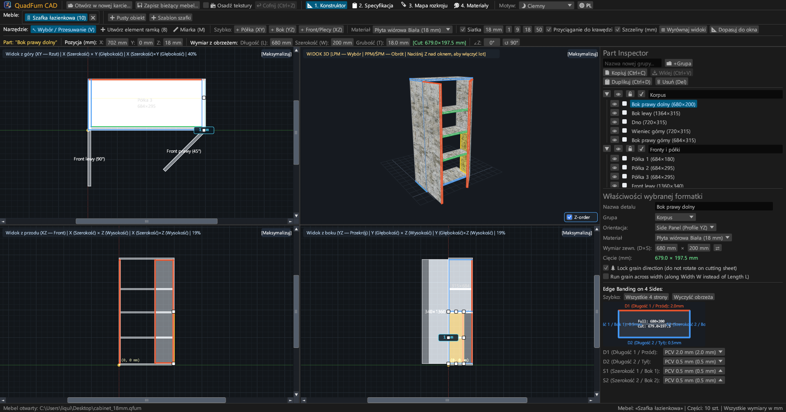
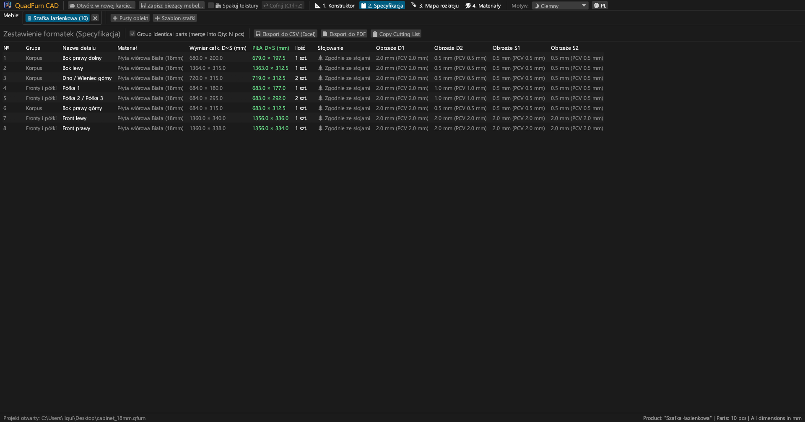
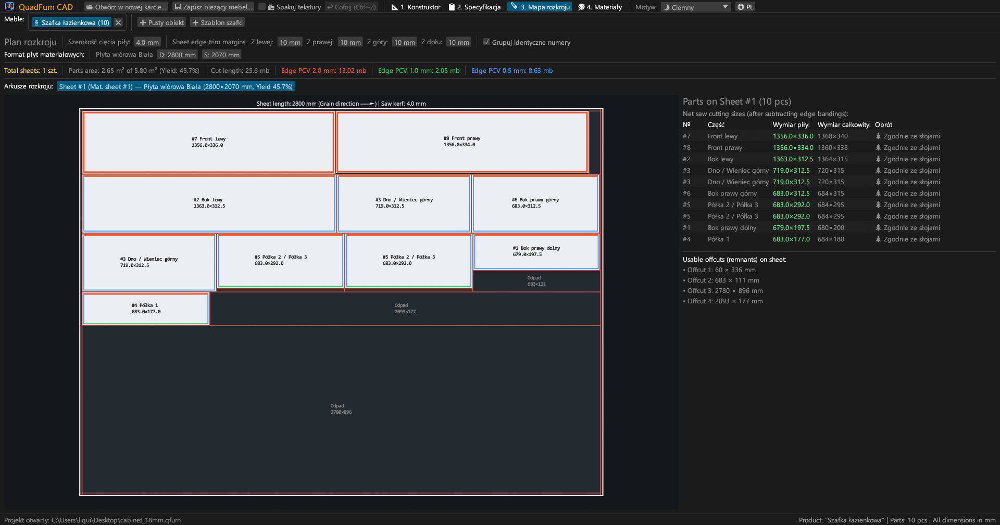
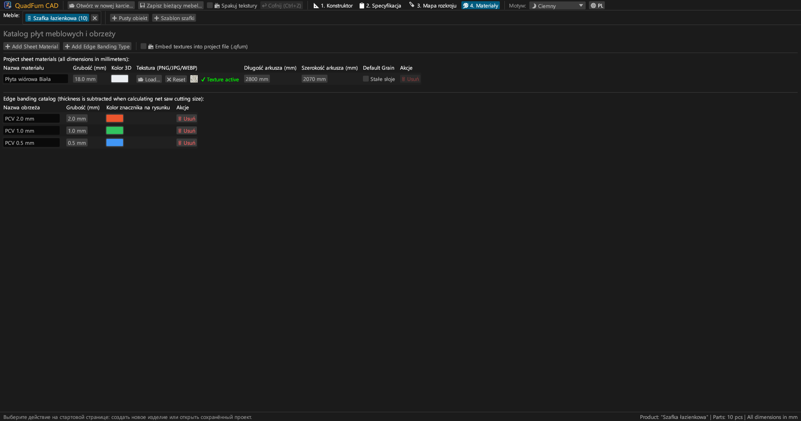
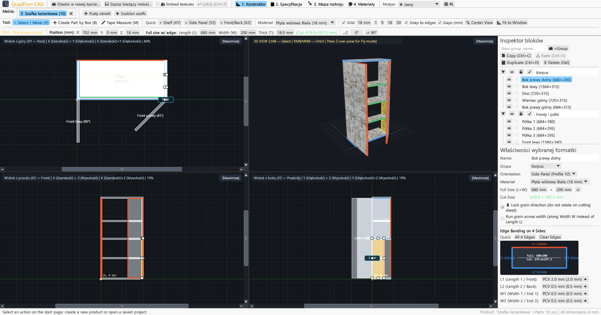
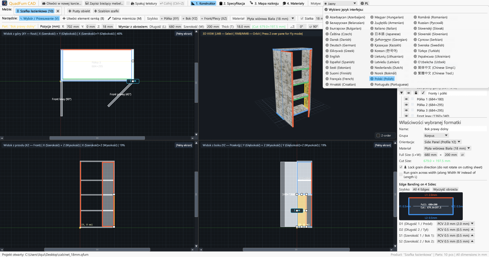

<div align="center">


# QuadFurn CAD

**CAD mebli skrzyniowych z płyt wiórowych — 4-rzutowy projektant przestrzenny + optymalizator rozkroju gilotynowego płyt**

[](https://github.com/rbm13s/QuadFurn/actions/workflows/build.yml)
[](https://github.com/rbm13s/QuadFurn/releases)
[](https://www.rust-lang.org/)
[](https://github.com/emilk/egui)
[](https://wgpu.rs/)
[](#8-motywy-graficzne-i-lokalizacja-na-22-języki)
[](#pierwsze-kroki)
[](../LICENSE)

<br/>

**Languages / Языки / Мови / Sprachen:**<br/>
[English](../README.md) •
[Русский](README-ru.md) •
[Українська](README-uk.md) •
[Беларуская](README-be.md) •
[Қазақша](README-kk.md) •
[ქართული](README-ka.md) •
[Հայերեն](README-hy.md) •
[Azərbaycan](README-az.md) •
[Oʻzbekcha](README-uz.md) •
[Deutsch](README-de.md) •
[Français](README-fr.md) •
[Español](README-es.md) •
[Italiano](README-it.md) •
[Português](README-pt.md) •
**Polski** •
[Čeština](README-cs.md) •
[Slovenčina](README-sk.md) •
[Slovenščina](README-sl.md) •
[Български](README-bg.md) •
[Српски](README-sr.md) •
[Hrvatski](README-hr.md) •
[Nederlands](README-nl.md) •
[Dansk](README-da.md) •
[Norsk](README-no.md) •
[Svenska](README-sv.md) •
[Suomi](README-fi.md) •
[Eesti](README-et.md) •
[Latviešu](README-lv.md) •
[Lietuvių](README-lt.md) •
[Magyar](README-hu.md) •
[Română](README-ro.md) •
[Türkçe](README-tr.md) •
[Ελληνικά](README-el.md) •
[简体中文](README-zh-cn.md) •
[繁體中文](README-zh-tw.md) •
[日本語](README-ja.md) •
[한국어](README-ko.md)

</div>

---

## Spis treści

- [Wprowadzenie](#wprowadzenie)
- [Zrzuty ekranu i prezentacja](#zrzuty-ekranu-i-prezentacja)
- [Główne funkcje](#główne-funkcje)
- [Dokumentacja funkcjonalna](#dokumentacja-funkcjonalna)
  - [1. 4-rzutowy projektant CAD i precyzyjne pozycjonowanie](#1-4-rzutowy-projektant-cad-i-precyzyjne-pozycjonowanie)
  - [2. Wyrażenia arytmetyczne w polach liczbowych](#2-wyrażenia-arytmetyczne-w-polach-liczbowych)
  - [3. Okleinowanie i automatyczne odliczanie grubości obrzeża](#3-okleinowanie-i-automatyczne-odliczanie-grubości-obrzeża)
  - [4. Optymalizacja rozkroju gilotynowego 2D](#4-optymalizacja-rozkroju-gilotynowego-2d)
  - [5. Zakładki projektów i schowek między projektami](#5-zakładki-projektów-i-schowek-między-projektami)
  - [6. Eksport paszportu produkcyjnego (wektorowy PDF, CSV Excel, schowek)](#6-eksport-paszportu-produkcyjnego-wektorowy-pdf-csv-excel-schowek)
  - [7. Katalog materiałów płytowych, tekstur i obrzeży](#7-katalog-materiałów-płytowych-tekstur-i-obrzeży)
  - [8. Motywy graficzne i lokalizacja na 37 języków](#8-motywy-graficzne-i-lokalizacja-na-22-języki)
- [Sterowanie i skróty klawiszowe](#sterowanie-i-skróty-klawiszowe)
- [Pierwsze kroki](#pierwsze-kroki)
- [Ustawienia i formaty plików](#ustawienia-i-formaty-plików)
- [Architektura projektu](#architektura-projektu)
- [Licencja](#licencja)

---

## Wprowadzenie

**QuadFurn CAD** to wysokowydajna wieloplatformowa aplikacja CAD napisana w języku Rust, dostępna zarówno jako szybka natywna aplikacja desktopowa (Windows, Linux, macOS), jak i bezinstalacyjna wersja online WebAssembly (WASM) działająca bezpośrednio w nowoczesnych przeglądarkach internetowych. Jest przeznaczona do projektowania mebli skrzyniowych i panelowych z płyt wiórowych laminowanych, MDF, HDF i sklejki, wyposażona w automatyczne generowanie specyfikacji oraz optymalizator rozkroju gilotynowego 2D.

QuadFurn łączy zalety trzech klasycznych narzędzi:
1. **4-rzutowe modelowanie przestrzenne**: Jednoczesna praca w trzech rzutach ortogonalnych (**Góra XY — Rzut z góry**, **Przód XZ — Elewacja**, **Bok YZ — Przekrój**) z suwakami, magnetycznym przyciąganiem, przyciskiem wyrównywania rzutni (`⊞ Wyrównaj okna`), inteligentną ochroną grubości formatek z krawędzi i interaktywnym oknem **3D Orbit / Lot swobodny (`Z` Noclip)**.
2. **Pasek precyzyjnej transformacji**: Błyskawiczne wprowadzanie współrzędnych (`X`, `Y`, `Z`), wymiarów (`Dł × Szer × Grub`) i kąta obrotu (`∠Z`) z wbudowanym kalkulatorem (np. `600-4` lub `720+18`).
3. **Rozkrój płyt i automatyczne odliczanie obrzeży**: Automatyczne odejmowanie grubości obrzeża PCV/ABS od wymiarów formatek meblowych w celu uzyskania dokładnych **wymiarów cięcia**, połączone z gilotynowym rozkrojem uwzględniającym usłojenie, grubość rzazu piły i marginesy obrzynania płyty.

---

## Zrzuty ekranu i prezentacja

### 1. 4-rzutowy projektant CAD (Ciemny motyw)
Jednoczesne widoki 2D (**Góra XY**, **Przód XZ**, **Bok YZ**) oraz teksturowane okno **3D** z poprawnym mapowaniem UV, 8 uchwytami zmiany rozmiaru i prawym **Inspektorem elementów**.



### 2. Wykaz elementów (Specyfikacja) i eksport
Zgrupowana tabela elementów z prezentacją **wymiarów gabarytowych (`Dł × Szer`)** oraz **wymiarów cięcia (`Cięcie Dł × Szer`)** po odliczeniu obrzeża z 4 stron (`D1`, `D2`, `S1`, `S2`).



### 3. Mapy rozkroju płyt
Optymalny układ elementów na standardowych arkuszach (`2800 × 2070 mm` itp.) z cięciami gilotynowymi, rzazem piły, obrzeżami i listą użytecznych odpadów użytkowych.



### 4. Katalog materiałów i obrzeży
Zarządzanie grubościami płyt, kolorami w 3D, teksturami dekorów (`PNG`, `JPG`, `WEBP`), wymiarami arkuszy, blokadą usłojenia i typami obrzeży PCV/ABS.



### 5. Jasny motyw
Czytelny, kontrastowy jasny motyw obok ciemnego oraz automatyczna synchronizacja z motywem systemu operacyjnego.



### 6. 37 wbudowanych języków
Przełączanie języka w czasie rzeczywistym przyciskiem **`🌐`**, automatyczne wykrywanie języka systemu oraz zlokalizowany eksport do PDF.



---

## Główne funkcje

- **Zsynchronizowana przestrzeń 4 rzutów**: Edycja w rzutach Góra (`XY`), Przód (`XZ`), Bok (`YZ`) lub powiększenie dowolnego widoku jednym kliknięciem (`[Maksymalizuj]` / `[4 widoki]`).
- **Podgląd 3D ze sprzętową akceleracją**: Obrót wokół modelu (`PPM`/`ŚPM`) + swobodny lot pierwszoosobowy (`Z` + `WASD`/`Spacja`/`Ctrl`) z teksturami i rzutowaniem promieni OBB.
- **Magnetyczne przyciąganie i wymiary szczelin na żywo**: Przyciąganie do siatki (`1`, `9`, `18`, `50 mm`) oraz do krawędzi sąsiednich formatek na styk (`0 mm`), a także dynamiczne linie wymiarowe do sąsiednich elementów.
- **Zaznaczanie ramką i transformacja grupowa**: Rysowanie ramki zaznaczenia w 2D, jednoczesne przesuwanie, duplikowanie (`Ctrl+D`) i kopiowanie między projektami (`Ctrl+C` / `Ctrl+V`).
- **Wbudowany kalkulator**: Wszystkie pola liczbowe przyjmują wyrażenia takie jak `600+100`, `800-36`, `720/2` czy `45+15`.
- **Automatyczne odliczanie obrzeża**: Przypisanie obrzeża PCV/ABS (`0.4 mm`, `0.8 mm`, `1.0 mm`, `2.0 mm` itd.) na dowolną z 4 krawędzi formatek:
  $$\text{Długość cięcia} = L_{\text{gab}} - O_{L1} - O_{L2}, \quad \text{Szerokość cięcia} = W_{\text{gab}} - O_{W1} - O_{W2}$$
- **Silnik rozkroju gilotynowego**: Pakowanie na wiele arkuszy z uwzględnieniem usłojenia, rzazu piły i marginesów obrzynania.
- **Wektorowy paszport produkcyjny PDF z 4 rozdziałów**: Eksport gotowego do druku dokumentu A4 w orientacji poziomej:
  1. Tabela specyfikacji elementów
  2. 4 rzuty projektowe (`Góra XY`, `3D Izometria`, `Przód XZ`, `Bok YZ`)
  3. Schematy rozkroju dla każdego arkusza
  4. Zestawienie płyt i obrzeży w metrach bieżących z zapasem `+15%`

---

## Dokumentacja funkcjonalna

### 1. 4-rzutowy projektant CAD i precyzyjne pozycjonowanie

Zakładka **Projektant** (`📐 1. Projektant`) składa się z trzech głównych stref:

1. **Górny pasek narzędzi**:
   - **Narzędzia edytora**:
     - `↖ Zaznacz / Przesuń (V)`: Kliknięcie zaznacza formatkę, przeciąganie wewnątrz przesuwa ją, przeciąganie uchwytów (8 uchwytów dla formatek na płasko i 2 uchwyty z krawędzi) zmienia jej wymiary. Przeciąganie po pustym tle rozwija **ramkę zaznaczenia**. Podczas przeciągania w 2D: przytrzymanie **`Shift`** blokuje ruch do jednej osi (tylko poziom lub pion), **`Ctrl` (`Cmd`)** wyłącza przyciąganie do krawędzi, a **`Alt`** tworzy duplikat elementu w miejscu upuszczenia.
     - `➕ Utwórz element ramką (B)`: Rozciągnięcie prostokąta w oknie 2D tworzy formatkę zorientowaną w płaszczyźnie tego rzutu (`Półka XY`, `Bok YZ`, `Front/Tył XZ`).
     - `📏 Miarka (M)`: Pomiar dokładnych odległości (`ΔX`, `ΔY`, `L`) w milimetrach w rzutach 2D.
   - **Szybkie wstawianie elementów**: Przyciski jednoetapowe (`+ Półka (XY)`, `+ Bok (YZ)`, `+ Front (XZ)`).
   - **Siatka i przyciąganie**: Włączanie siatki, skoki (`1`, `9`, `18`, `50 mm`), przyciąganie do krawędzi i podgląd szczelin (`Szczeliny (mm)`).
   - **Kadrowanie widoków**:
     - `🔍 Do środka`: Centruje widoki na środku modelu.
     - `📐 Dopasuj do okna`: Oblicza gabaryt i powiększa rzuty tak, aby cały mebel mieścił się w oknach.
   - **Pasek precyzyjnej transformacji**: Precyzyjne wartości `X`, `Y`, `Z`, wymiary `Długość (L)`, `Szerokość (W)`, `Grubość (T)`, zielony wskaźnik wymiaru cięcia `[Cięcie: D × S mm]` oraz kąt obrotu `∠Z`.

2. **4 okna rzutów**:
   - **Rzut z góry (`Góra XY`)**, **Rzut z przodu (`Przód XZ`)** i **Rzut z boku (`Bok YZ`)** z paskami przewijania, linijkami milimetrowymi i kolorami obrzeży na krawędziach.
   - **Widok 3D**: Obracanie orbitą (`PPM` lub `ŚPM`), powiększanie kółkiem myszy i **Tryb swobodnego lotu pierwszoosobowego** (klawisz **`Z`** nad oknem 3D).

3. **Prawy inspektor (`Inspektor bloków` i `Właściwości elementu`)**:
   - Grupowanie formatek (*Korpus*, *Fronty*, *Szuflady*).
   - Przełączanie **Widoczności (`👁`)** i **Blokady (`🔒`)**.
   - Wybór materiału, wymiary (`Dł × Szer` z szybką zamianą `⇄`), blokada usłojenia (`🌲 Zablokuj kierunek usłojenia`) oraz interaktywny diagram 4 krawędzi obrzeża.

---

### 2. Wyrażenia arytmetyczne w polach liczbowych

Wszystkie pola numeryczne w QuadFurn CAD obsługują wyrażenia matematyczne:
- **Dodawanie i odejmowanie**: Kliknij pole z wartością `600`, wpisz `600+100` (lub `600-4`) i naciśnij `Enter` — wartość natychmiast przeliczy się na `700` (lub `596`).
- **Mnożenie, dzielenie i nawiasy**: Obsługiwane są formuły typu `(800-36)/2` lub `18*2`.
- Zarówno kropka `.`, jak i przecinek `,` są akceptowane jako separatory dziesiętne, a jednostki (`mm`, `°`) są automatycznie pomijane.

---

### 3. Okleinowanie i automatyczne odliczanie grubości obrzeża

W produkcji mebli grubość obrzeża musi zostać odliczona od gotowego wymiaru formatki przed jej rozkrojem na pilarce panelowej:
- Każdy element posiada 4 krawędzie: **`D1`** (Długość 1 / Przód), **`D2`** (Długość 2 / Tył), **`S1`** (Szerokość 1 / Bok 1) i **`S2`** (Szerokość 2 / Bok 2).
- Przypisanie obrzeża PCV `2.0 mm` do `D1` oraz PCV `0.4 mm` do `D2`, `S1`, `S2` dla formatki `680 × 200 mm` daje **czysty wymiar cięcia**:
  - $\text{Cięcie } L = 680 - 2.0 - 0.4 = 677.6\text{ mm}$
  - $\text{Cięcie } W = 200 - 0.4 - 0.4 = 199.2\text{ mm}$
- Kolorowe oznaczenia są widoczne na rysunkach 2D, w 3D oraz na mapach rozkroju.

---

### 4. Optymalizacja rozkroju gilotynowego 2D

Zakładka **Rozkrój** (`🪚 3. Rozkrój`) automatycznie rozmieszcza wszystkie widoczne elementy na arkuszach:
- **Parametry cięcia**: Rzaz piły (domyślnie `4.0 mm`), marginesy obrzynania arkusza (domyślnie `10 mm` z 4 stron).
- **Usłojenie**: Formatki ze stałym usłojeniem (`🌲`) nigdy nie są obracane w poprzek włókien arkusza. Formatki ze swobodnym usłojeniem mogą być obracane w celu maksymalizacji wykorzystania płyty.
- **Mapy rozkroju i odpady użytkowe**: Linie cięć gilotynowych, numery formatek `#1..#N`, wymiary cięcia i oznaczone użyteczne resztki płyt.

---

### 5. Zakładki projektów i schowek między projektami

- **Strona startowa**: Dostęp do pustych projektów, szablonów szafek lub **10 ostatnio otwieranych plików**.
- **Wiele zakładek**: Równoległa praca nad wieloma meblami (dwuklik zmienia nazwę).
- **Kopiowanie między projektami (`Ctrl+C` / `Ctrl+V`)**: Kopiuj elementy między zakładkami — brakujące materiały i obrzeża zostaną zaimportowane automatycznie.
- **Ochrona przed utratą danych**: Okno potwierdzenia przy zamykaniu niezapisanych kart.

---

### 6. Eksport paszportu produkcyjnego (wektorowy PDF, CSV Excel, schowek)

W zakładce **Specyfikacja** (`📋 2. Specyfikacja`):
1. **`📄 Eksportuj do PDF` (Wielostronicowy paszport produkcyjny A4 Poziomo)**:
   - Pełna specyfikacja z wymiarami cięcia i obrzeżami.
   - Strona 4 rzutów projektanta z wymiarami gabarytowymi.
   - Szczegółowe mapy rozkroju dla każdego arkusza.
   - Zestawienie materiałów i obrzeży w metrach bieżących z zapasem $+15\%$.
2. **`💾 Eksportuj do CSV (Excel)`**: Tabela rozdzielana średnikami z kodowaniem UTF-8 BOM dla Excela.
3. **`📋 Kopiuj tabelę cięcia`**: Tekst rozdzielany tabulatorami do wklejania do zewnętrznych programów do rozkroju lub arkuszy kalkulacyjnych.

---

### 7. Katalog materiałów płytowych, tekstur i obrzeży

W zakładce **Materiały** (`🎨 4. Materiały`):
- Zarządzanie materiałami płytowymi (`Płyta 18 mm`, `MDF 16 mm`, `HDF 3 mm` itd.) z kolorami 3D i wymiarami arkuszy.
- Wczytywanie tekstur dekorów (`PNG`, `JPG`, `WEBP`) do fotorealistycznego renderowania.
- **Względne ścieżki i przenośność**: Automatyczne wyszukiwanie tekstur obok pliku `.qfurn` lub w folderze `./textures/`.
- **Pakowanie tekstur (`📦 Pakuj tekstury do pliku projektu`)**: Zapisuje pliki graficzne jako Base64 wewnątrz pliku `.qfurn`.
- **Ochrona GPU**: Blokowanie plików powyżej 60 MB i automatyczne skalowanie zbyt dużych grafik.

---

### 8. Motywy graficzne i lokalizacja na 37 języków

- **Motywy**: Przełączanie między **🌙 Ciemnym**, **☀ Jasnym** a **🖥 Systemowym**.
- **37 języków**: Kompletna lokalizacja interfejsu i generowania plików PDF.
- **Automatyczne wykrywanie języka systemu**: Program uruchamia się w języku Twojego systemu operacyjnego.

---

## Sterowanie i skróty klawiszowe

| Skrót / Klawisz | Akcja |
| :--- | :--- |
| **`V`** | Narzędzie **Wybór i przesuwanie** (8 uchwytów dla formatek na płasko i 2 uchwyty z krawędzi, plus zaznaczanie ramką) |
| **`B`** | Narzędzie **Tworzenie elementu ramką** w oknach 2D |
| **`M`** | Narzędzie **Miarka** w oknach 2D |
| **Przeciąganie `LPM` (2D)** | Przesuwanie elementów, zmiana rozmiaru lub ramka zaznaczenia |
| **`Shift + LPM` Przeciąganie (2D)** | Ograniczenie ruchu elementu ściśle do osi poziomej lub pionowej |
| **`Ctrl / Cmd + LPM` Przeciąganie (2D)** | Wyłączenie magnetycznego przyciągania do krawędzi podczas przeciągania |
| **`Alt + LPM` Przeciąganie (2D)** | Duplikowanie (szybkie kopiowanie) elementu w miejsce upuszczenia |
| **`Shift / Ctrl (Cmd) + LPM` (2D)** | Dodanie / usunięcie elementu z zaznaczenia |
| **Przeciąganie `PPM` / `ŚPM` (2D)** | Przesuwanie kamery (Pan) |
| **`Kółko myszy` (2D / 3D)** | Przybliżanie / oddalanie kamery |
| **Przeciąganie `PPM` / `ŚPM` (3D)** | Obrót orbity 3D wokół modelu |
| **`Z` (nad oknem 3D)** | Włączenie / wyłączenie **Trybu swobodnego lotu 3D (Noclip)** |
| **`W` `A` `S` `D` / `Spacja` / `Ctrl (Cmd)`** | Poruszanie się w trybie 3D (`Shift` przyspiesza) |
| **`Ctrl + S` / `Cmd (⌘) + S`** | Zapisanie bieżącego projektu mebla (`.qfurn` / `.json`) |
| **`Ctrl + Z` / `Cmd (⌘) + Z`** | Cofnięcie ostatniej operacji (do 40 kroków) |
| **`Ctrl + C` / `Cmd (⌘) + C`** | Kopiowanie zaznaczonych elementów do schowka |
| **`Ctrl + V` / `Cmd (⌘) + V`** | Wklejanie elementów (działa także między różnymi zakładkami) |
| **`Ctrl + D` / `Cmd (⌘) + D`** | Duplikowanie zaznaczonych elementów |
| **`Delete` / `Backspace`** | Usunięcie zaznaczonych elementów |
| **`←` `→` `↑` `↓` (widoki 2D)** | Przesunięcie zaznaczonych części o krok wybranej siatki (`Shift` — podwójny krok) |

---

## Pierwsze kroki

### Gotowe pakiety (GitHub Releases)
Automatyczne kompilacje przy każdym wydaniu na [GitHub Actions](https://github.com/rbm13s/QuadFurn/actions):
- **Windows (`x86_64`)**: `QuadFurn-windows-x86_64.zip` — przenośny plik `QuadFurn.exe` z ikoną.
- **Linux (`Debian 12+ / Ubuntu 22.04+ x86_64`)**:
  - `quadfurn_<version>_amd64.deb` — pakiet instalacyjny Debian/Ubuntu:
    ```bash
    sudo apt install ./quadfurn_0.2.6_amd64.deb
    ```
  - `QuadFurn-linux-x86_64.tar.gz` — archiwum przenośne.
- **macOS (`Universal: Apple Silicon + Intel x86_64`)**: `QuadFurn-macos-universal.zip` — aplikacja `QuadFurn.app`.

---

### Budowanie ze źródeł

#### Wymagania wstępne
- [Rust Toolchain](https://rustup.rs/) (`stable`, edycja Rust 2021)
- Biblioteki systemowe dla **Linux (Debian / Ubuntu)**:
  ```bash
  sudo apt-get update && sudo apt-get install -y \
    build-essential pkg-config libxcb-render0-dev libxcb-shape0-dev \
    libxcb-xfixes0-dev libxkbcommon-dev libxkbcommon-x11-dev libssl-dev \
    libgtk-3-dev libglib2.0-dev libatk1.0-dev libgdk-pixbuf-2.0-dev \
    libcairo2-dev libpango1.0-dev libgl1-mesa-dev fonts-dejavu-core fonts-noto-cjk
  ```
- **macOS**: Narzędzia wiersza poleceń Xcode (`xcode-select --install`)
- **Windows**: Windows 10 / 11 z MSVC Build Tools

```bash
# Uruchomienie w trybie deweloperskim
cargo run

# Budowanie zoptymalizowanego pliku wykonywalnego
cargo build --release

# Uruchomienie testów
cargo test
```

---

## Ustawienia i formaty plików

- **Ustawienia użytkownika (`settings.json`)**:
  Zapisywane w katalogu konfiguracyjnym:
  - **Windows**: `%APPDATA%\QuadFurn\settings.json`
  - **Linux**: `$XDG_CONFIG_HOME/QuadFurn/settings.json`
  - **macOS**: `~/Library/Application Support/QuadFurn/settings.json`
- **Pliki projektów (`.qfurn` / `.json`)**:
  Czytelne pliki JSON w formacie UTF-8 ze wszystkimi elementami, materiałami i parametrami rozkroju.

---

## Architektura projektu

```text
QuadFurn/
├── .github/
│   └── workflows/
│       └── build.yml          # CI/CD GitHub Actions
├── assets/
│   ├── icon.jpeg              # Ikona programu
│   └── screenshots/           # Zrzuty ekranu
├── docs/                      # Dokumentacja w 22 językach
├── src/
│   ├── main.rs                # Punkt wejściowy, okna, zakładki
│   ├── model.rs               # Modele danych (Project, PartBlock, Material, Edge)
│   ├── viewport.rs            # Kontroler 4 rzutów, render 2D/3D
│   ├── snapping.rs            # Przyciąganie magnetyczne i pomiary
│   ├── cutter.rs              # Zestawienia i rozkrój gilotynowy 2D
│   ├── export.rs              # Eksport PDF, CSV, list rozkroju
│   ├── ui_panels.rs           # Paski narzędzi, inspektor, dialogi
│   └── i18n.rs                # Słowniki 37 języków
├── build.rs                   # Osadzanie ikony w systemie Windows
├── Cargo.toml                 # Manifest pakietu
└── LICENSE                    # Licencja MIT
```

---

## Licencja

Projekt jest udostępniany na licencji [MIT License](../LICENSE) — dozwolone bezpłatne użycie w celach prywatnych i komercyjnych.


