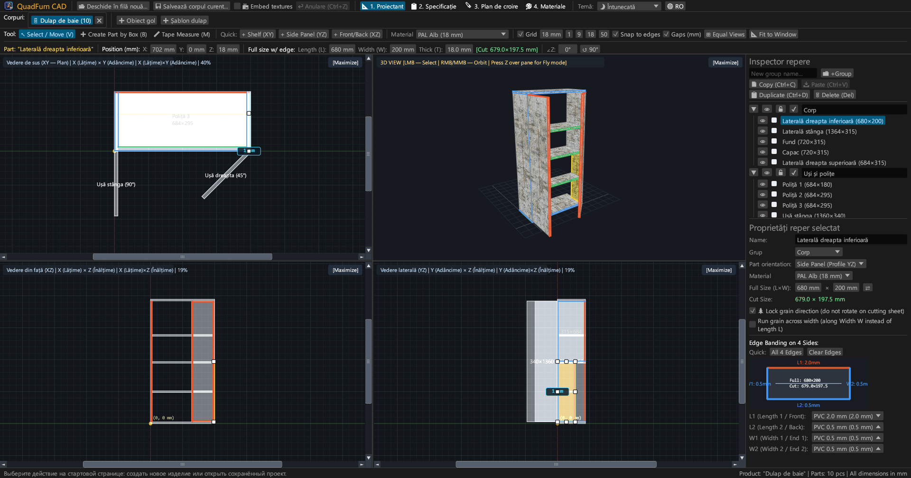
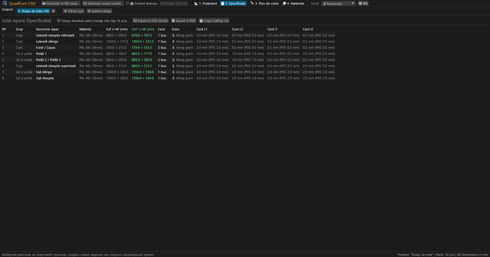
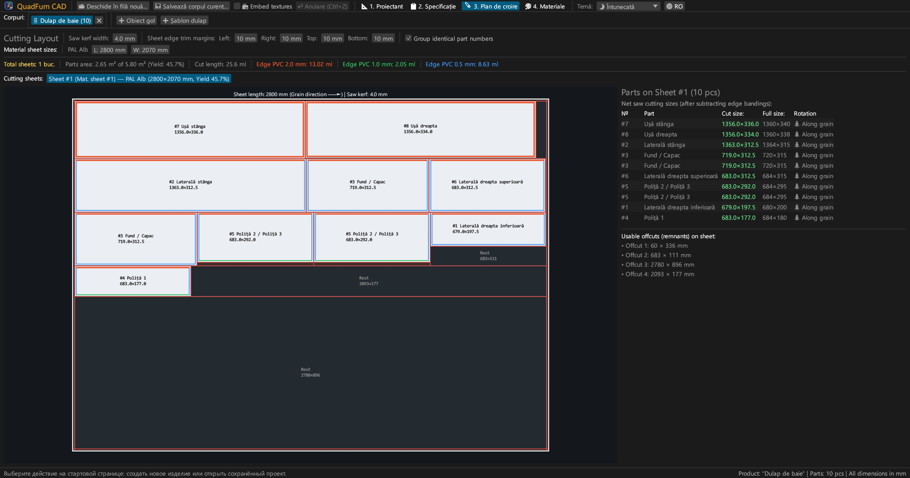
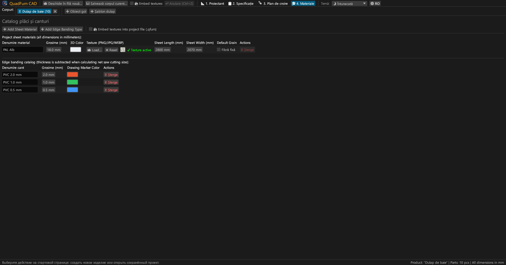
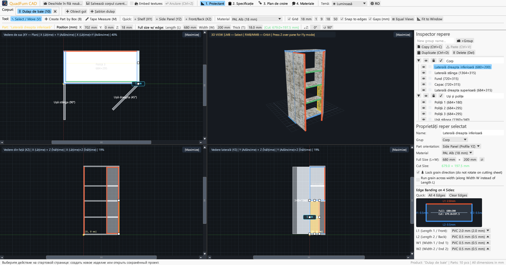
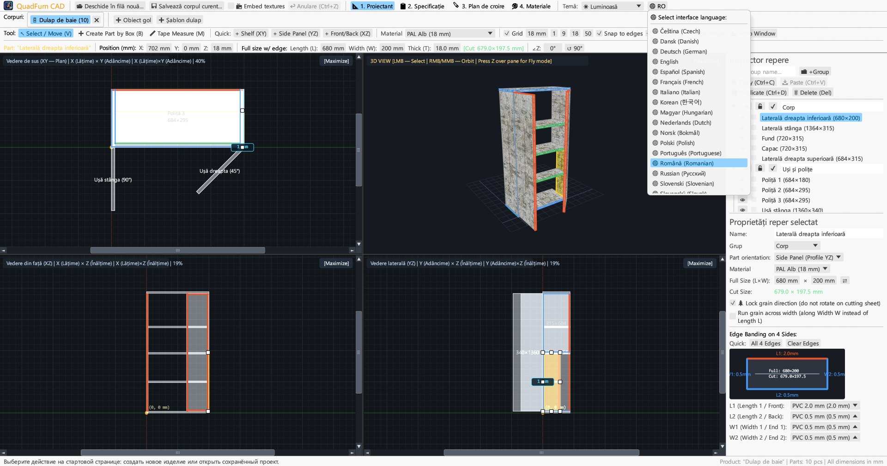

<div align="center">


# QuadFurn CAD

**CAD pentru mobilier din panouri și PAL melaminat — Proiectant spațial cu 4 vederi + Optimizator de debitare ghilotină**

[](https://github.com/rbm13s/QuadFurn/actions/workflows/build.yml)
[](https://github.com/rbm13s/QuadFurn/releases)
[](https://www.rust-lang.org/)
[](https://github.com/emilk/egui)
[](https://wgpu.rs/)
[](#8-teme-vizuale-și-localizare-în-22-de-limbi)
[](#primii-pași)
[](../LICENSE)

<br/>

**Languages / Языки / Мови / Sprachen:**<br/>
[English](../README.md) •
[Русский](README-ru.md) •
[Українська](README-uk.md) •
[Deutsch](README-de.md) •
[Polski](README-pl.md) •
[Español](README-es.md) •
[Français](README-fr.md) •
[Italiano](README-it.md) •
[Português](README-pt.md) •
[Čeština](README-cs.md) •
[Slovenčina](README-sk.md) •
[Slovenščina](README-sl.md) •
[Nederlands](README-nl.md) •
[Dansk](README-da.md) •
[Norsk](README-no.md) •
[Svenska](README-sv.md) •
[Magyar](README-hu.md) •
**Română** •
[Türkçe](README-tr.md) •
[简体中文](README-zh-cn.md) •
[日本語](README-ja.md) •
[한국어](README-ko.md)

</div>

---

## Cuprins

- [Introducere](#introducere)
- [Capturi de ecran și tur vizual](#capturi-de-ecran-și-tur-vizual)
- [Funcționalități principale](#funcționalități-principale)
- [Documentație funcțională](#documentație-funcțională)
  - [1. Proiectant CAD cu 4 vederi și comenzi de precizie](#1-proiectant-cad-cu-4-vederi-și-comenzi-de-precizie)
  - [2. Expresii aritmetice în câmpurile numerice](#2-expresii-aritmetice-în-câmpurile-numerice)
  - [3. Aplicare cant și scăderea automată a cotei de debitare](#3-aplicare-cant-și-scăderea-automată-a-cotei-de-debitare)
  - [4. Optimizare 2D a debitării prin ghilotină](#4-optimizare-2d-a-debitării-prin-ghilotină)
  - [5. File de proiecte multiple și clipboard între proiecte](#5-file-de-proiecte-multiple-și-clipboard-între-proiecte)
  - [6. Exportul pașaportului de producție (PDF vectorial, CSV, clipboard)](#6-exportul-pașaportului-de-producție-pdf-vectorial-csv-clipboard)
  - [7. Catalog de plăci, texturi și canturi](#7-catalog-de-plăci-texturi-și-canturi)
  - [8. Teme vizuale și localizare în 22 de limbi](#8-teme-vizuale-și-localizare-în-22-de-limbi)
- [Comenzi și scurtături de tastatură](#comenzi-și-scurtături-de-tastatură)
- [Primii pași](#primii-pași)
- [Setări și formate de fișiere](#setări-și-formate-de-fișiere)
- [Arhitectura proiectului](#arhitectura-proiectului)
- [Licență](#licență)

---

## Introducere

**QuadFurn CAD** este o aplicație CAD multiplatformă de înaltă performanță scrisă în Rust, disponibilă atât ca aplicație desktop nativă rapidă (Windows, Linux, macOS), cât și ca versiune online WebAssembly (WASM) fără instalare, direct în browserele web moderne. Este special creată pentru proiectarea mobilierului din panouri (PAL melaminat, MDF, HDF, placaj), cu generare automată a listei de piese și optimizare 2D a debitării prin tăieri drepte de tip ghilotină.

QuadFurn reunește ergonomia a trei instrumente de referință într-un singur flux de lucru:
1. **Modelare spațială în 4 vederi**: Editare sincronă în trei proiecții ortogonale 2D (**Vedere de sus XY — Plan**, **Vedere frontală XZ — Fațadă**, **Vedere laterală YZ — Secțiune**) cu bare de derulare, aliniere magnetică la muchii, buton de egalizare a ferestrelor (`⊞ Egalizează ferestrele`), protecție inteligentă a grosimii pentru piese din cant și o fereastră **3D Orbit / Zbor liber persoana întâi (`Z` Noclip)** în timp real.
2. **Bară de transformare de precizie**: Introducere numerică instantanee a coordonatelor (`X`, `Y`, `Z`), dimensiunilor piesei (`L × W × T`) și unghiului de rotație (`∠Z`), cu calculator matematic integrat direct în câmpuri (de ex. `600-4` sau `720+18`).
3. **Debitarea plăcilor și deducerea automată a cantului**: Scăderea automată a grosimii cantului PVC/ABS de pe toate cele 4 laturi pentru a calcula **dimensiunile exacte de tăiere la circular**, corelată cu un optimizator 2D de tip ghilotină care respectă fibra lemnului, lățimea pânzei de circular și tăierile de îndreptare a marginilor.

---

## Capturi de ecran și tur vizual

### 1. Proiectant CAD cu 4 vederi (Temă Întunecată)
Proiecții ortogonale sincronizate (**Sus XY**, **Față XZ**, **Lateral YZ**) și **Vedere 3D** texturată cu mapare UV corectată în perspectivă, puncte de redimensionare în 8 puncte și **Inspectorul de piese** în dreapta.



### 2. Lista de piese (Specificație) și cote
Tabel detaliat ce afișează atât **Dimensiunile finale (`L × W`)**, cât și **Cotele nete de tăiere la circular (`CUT L × W`)** după scăderea cantului pe fiecare latură (`L1`, `L2`, `W1`, `W2`).



### 3. Diagramă de debitare ghilotină a plăcilor
Îmbinare pe plăci de format standard (`2800 × 2070 mm` etc.) cu tăieturi ghilotină cap-la-cap, toleranță pânză, margini de tivire, benzi colorate de cant și evidența resturilor utile refolosibile.



### 4. Catalog de plăci și canturi
Administrarea grosimilor de panouri, culori 3D, texturi de suprafață personalizate (`PNG`, `JPG`, `WEBP`), blocare a fibrei și tipuri de cant PVC/ABS.



### 5. Suport pentru Temă Luminoasă
Temă luminoasă modernă cu contrast ridicat alături de tema întunecată, cu sincronizare automată după setările sistemului de operare.



### 6. 22 de limbi integrate (Interfață și export PDF)
Schimbare instantanee a limbii fără repornire prin butonul **`🌐`** din bara superioară, detectare automată a limbii sistemului la prima pornire și exporturi PDF traduse.



---

## Funcționalități principale

- **Spațiu de lucru sincronizat cu 4 vederi**: Proiectați în Sus (`XY`), Față (`XZ`), Lateral (`YZ`), sau măriți orice fereastră pe tot ecranul cu un clic (`[Maximizează]` / `[Restaurează cele 4 vederi]`).
- **Previzualizare 3D accelerată grafic**: Cameră orbitală (`Click dreapta`/`Click mijloc`) + mod zbor liber la persoana întâi la persoana întâi (`tasta Z` + `WASD`/`Spațiu`/`Ctrl`) cu texturi UV și selecție precisă prin raze OBB.
- **Atragere magnetică și cote dinamice de distanță**: Fixare automată la grilă (`1`, `9`, `18`, `50 mm` sau personalizat), atragere magnetică la fețe și muchii învecinate (`0 mm`) și afișarea cotelor reale în milimetri până la piesele adiacente.
- **Selecție cadru și transformare de grup**: Trageți un cadru de selecție în orice vedere 2D pentru a muta mai multe piese deodată, a le duplica (`Ctrl+D`) sau a le copia între diferite corpuri de mobilier deschise (`Ctrl+C` / `Ctrl+V`).
- **Calculator integrat**: Toate câmpurile numerice acceptă formule matematice precum `600+100`, `800-36`, `720/2` sau `45+15`.
- **Scădere automată a cantului la tăiere**: Asociați canturi PVC/ABS (`0.4 mm`, `0.5 mm`, `1.0 mm`, `2.0 mm` etc.) pe oricare din cele 4 muchii (`L1`, `L2`, `W1`, `W2`), iar aplicația determină instant cota brută de debitare:
  $$\text{Lungime tăiere} = L_{\text{final}} - E_{L1} - E_{L2}, \quad \text{Lățime tăiere} = W_{\text{final}} - E_{W1} - E_{W2}$$
- **Motor de croire 2D prin ghilotină**: Optimizare multi-placă ce respectă orientarea fibrei lemnului, lățimea pânzei de circular și tăierile de îndreptare pe toate cele 4 laturi.
- **Pașaport de producție complet în PDF vectorial A4 Vedere (Landscape)**: Exportare cu un singur clic în limba activă conținând:
  1. Tabelul complet de specificație al pieselor
  2. Planșe tehnice cu 4 vederi (`Sus XY`, `Izometrie 3D`, `Față XZ`, `Lateral YZ`) cu cote de gabarit
  3. Diagrame detaliate de debitare ghilotină pentru fiecare placă în parte
  4. Centralizator de plăci și necesar de metri liniari de cant cu rezervă de `+15 %`

---

## Documentație funcțională

### 1. Proiectant CAD cu 4 vederi și comenzi de precizie

Fila **Proiectant** (`📐 1. Proiectant`) este compusă din trei zone principale:

1. **Bare de instrumente superioare**:
   - **Instrumente de desen**:
     - `↖ Selectare / Mutare (V)`: Click pe o piesă pentru selectare, trageți pentru mutare sau folosiți mânerele (8 mânere pentru piesele din față și 2 pe cant). Trageți pe fundal liber pentru a deschide un dreptunghi de selecție multiplă. În timpul tragerii 2D: țineți apăsat **`Shift`** pentru a bloca deplasarea pe axa orizontală sau verticală, **`Ctrl` (`Cmd`)** pentru a dezactiva alinierea la muchii și **`Alt`** pentru a duplica piesa la eliberare.
     - `➕ Creare piesă prin cadru (B)`: Trageți un dreptunghi într-o vedere 2D (`Sus XY`, `Față XZ` sau `Lateral YZ`) pentru a crea un panou orientat în planul respectiv.
     - `📏 Ruletă de măsurare (M)`: Măsurați distanțe exacte punct la punct (`ΔX`, `ΔY`, `L`) în milimetri.
   - **Inserare rapidă**: Butoane pentru adăugarea unei polițe (`+ Poliță (XY)`), a unui perete lateral (`+ Perete lateral (YZ)`) sau a unei uși/spate (`+ Ușă/Spate (XZ)`).
   - **Grilă și aliniere**: Selectarea pasului grilei (`1`, `9`, `18`, `50 mm`), prindere magnetică la muchii și vizualizarea distanțelor dintre panouri.
   - **Încadrare cameră**:
     - `🔍 Centrează vederea`: Readuce camera în centrul mobilierului sau în origine.
     - `📐 Potrivește în fereastră`: Calculează dimensiunile exterioare ale mobilierului și ajustează scara în toate cele 4 ferestre simultan.
   - **Bara de transformare de precizie**: Introducere și editare directă a coordonatelor `X`, `Y`, `Z`, dimensiunilor `L`, `W`, `T`, etichetei verzi de tăiere `[Tăiere: L × W mm]` și unghiului `∠Z`.

2. **Cele patru ferestre de vizualizare**:
   - **Vederi ortogonale 2D (`Sus XY`, `Față XZ`, `Lateral YZ`)** prevăzute cu bare de derulare, rigle gradate în milimetri și benzi colorate ce indică muchiile cantuite.
   - **Vedere 3D**: Rotație orbitală (`Click dreapta` sau `Click mijloc`), zoom cu rotița, selecție 3D și **Mod de zbor liber la persoana întâi (Noclip)** (apăsați **`Z`** deasupra ferestrei 3D și zburați cu `WASD`, `Spațiu`, `Ctrl`/`Shift`).

3. **Inspectorul de piese din dreapta**:
   - Organizare pe **Grupuri** (*Carcasă*, *Uși*, *Sertare*).
   - Comutatoare de vizibilitate (`👁`) și blocare la modificări (`🔒`).
   - Alegerea materialului, orientare, dimensiuni (`L × W` cu inversare `⇄`), blocare a fibrei (`🌲 Blochează fibra`), fibră transversală (`🔄 Fibră pe lățime`) și schema interactivă a celor 4 laturi de cant.

---

### 2. Expresii aritmetice în câmpurile numerice

Toate casetele de introducere numerică permit utilizarea formulelor:
- **Adunări și scăderi**: Într-un câmp ce conține `600`, tastați `600+100` sau `600-4` și apăsați `Enter` — valoarea devine instant `700` sau `596`.
- **Înmulțiri, împărțiri și paranteze**: Formule precum `(800-36)/2` sau `18*2` sunt calculate automat.
- Se acceptă atât punctul `.` cât și virgula `,` ca separator zecimal, iar unitățile de măsură (`mm`, `°`) sunt ignorate fără eroare.

---

### 3. Aplicare cant și scăderea automată a cotei de debitare

- Fiecare piesă dreptunghiulară are 4 canturi: **`L1`** (Lungime 1 / Față), **`L2`** (Lungime 2 / Spate), **`W1`** (Lățime 1 / Capăt 1) și **`W2`** (Lățime 2 / Capăt 2).
- Dacă aplicați un cant PVC de `2.0 mm` pe `L1` și `0.5 mm` pe `L2`, `W1`, `W2` unei piese de `680 × 200 mm`, softul calculează automat **Cota netă de tăiere**:
  - $\text{Tăiere } L = 680 - 2.0 - 0.5 = 677.5\text{ mm}$
  - $\text{Tăiere } W = 200 - 0.5 - 0.5 = 199.0\text{ mm}$
- Canturile sunt indicate prin benzi de culori distincte atât pe desenele 2D/3D, cât și pe planul de debitare.

---

### 4. Optimizare 2D a debitării prin ghilotină

Fila **Plan de debitare** (`🪚 3. Plan de debitare`) calculează așezarea ideală a pieselor pe plăci:
- **Parametri de tăiere ajustabili**:
  - **Lățimea pânzei de circular** (implicit `4.0 mm`).
  - **Margini de îndreptare a plăcii** (`Stânga`, `Dreapta`, `Sus`, `Jos`, implicit `10 mm`) pentru eliminarea defectelor de fabrică.
- **Respectarea orientării fibrei**:
  - Piese cu **Fibră blocată (`🌲`)**: rămân obligatoriu paralele cu lungimea plăcii (`Lungime L`).
  - Piese cu **Fibră liberă**: pot fi rotite la $90^\circ$ de motorul de optimizare dacă acest lucru sporește randamentul.
- **Harta vizuală a tăierilor și resturi utile**:
  - Reprezentarea fiecărei plăci cu tăieturi ghilotină roșii, numere de piese, cote de debitare, canturi și resturi refolosibile cotate.
  - Statistici complete: număr de plăci necesare, randament procentual (%), lungime totală de tăiere și consum de cant în metri liniari.

---

### 5. File de proiecte multiple și clipboard între proiecte

- **Pagină de start și proiecte recente**: Crearea unui corp nou, pornire din șablonul de corp cu 2 uși, deschiderea fișierelor `.qfurn`/`.json` sau acces rapid la **ultimele 10 proiecte deschise**.
- **Lucru în file multiple simultan**: Proiectați mai multe corpuri în paralel (dublu-click pe titlul unei file pentru redenumire).
- **Copiere și lipire între proiecte**: Selectați piese dintr-o filă, apăsați `Ctrl+C`, treceți în altă filă (sau altă fereastră QuadFurn) și apăsați `Ctrl+V`. Materialele și canturile inexistente sunt create automat în proiectul destinație.
- **Protecție împotriva pierderii datelor**: La închiderea unei file modificate sau la ieșirea din program se afișează o fereastră de confirmare (`Salvează și ieși`, `Ieși fără salvare`, `Anulează`).

---

### 6. Exportul pașaportului de producție (PDF vectorial, CSV, clipboard)

În fila **Specificație** (`📋 2. Specificație`):
1. **`📄 Exportă în PDF` (Pașaport complet de producție A4 Landscape vectorial)**:
   - **Secțiunea 1**: Tabelul complet de piese cu cote finale, cote de tăiere, canturi și fibră.
   - **Secțiunea 2**: Desene tehnice cu 4 vederi (`Sus XY`, `3D Izometric`, `Față XZ`, `Lateral YZ`) cu gabarite exterioare.
   - **Secțiunea 3**: Planuri detaliate de debitare ghilotină pentru fiecare placă.
   - **Secțiunea 4**: Centralizator de materiale și consum de cant (metri utili și $+15 \%$ rezervă tehnologică).
   - Documentul este redactat în **limba curentă a interfeței** cu fonturi vectoriale TrueType/CID integrate.
2. **`💾 Exportă în CSV (Excel)`**: Fișier tabelar UTF-8 cu BOM și delimitator `;`, direct compatibil cu Microsoft Excel sau LibreOffice Calc.
3. **`📋 Copiază lista de debitare`**: Copiază cotele de tăiere în clipboard cu separatori de tip tab pentru import în programe externe de debitare sau foi de calcul.

---

### 7. Catalog de plăci, texturi și canturi

În fila **Materiale** (`🎨 4. Materiale`):
- Adăugați și modificați **Materiale de plăci** (`PAL 18 mm`, `MDF 16 mm`, `HDF 3 mm` etc.) cu culori RGB, dimensiuni brute ale plăcii (`L × W`) și setare implicită a fibrei.
- Încărcați texturi de suprafață în format **`PNG`**, **`JPG`/`JPEG`** sau **`WEBP`** pentru o redare 3D realistă.
- **Portabilitate și căutare automată a texturilor**: La redeschiderea unui fișier `.qfurn` programul caută imaginile:
  1. Încorporate direct în fișierul de proiect (Base64)
  2. În același dosar cu fișierul de proiect `.qfurn`
  3. Într-un subdosar `./textures/` alăturat proiectului
  4. Prin calea relativă sau calea absolută de origine
- **Încorporarea texturilor în proiect (`📦 Încorporează texturile în fișierul de proiect`)**: Activați această opțiune din bara de sus sau din panoul de Materiale pentru a salva imaginile direct în format Base64 în fișierul `.qfurn`. Proiectul devine complet independent și poate fi mutat oriunde fără riscul de a pierde texturi.
- **Protecția plăcii video**: Imaginile de peste 60 MB sunt refuzate cu avertisment, iar rezoluțiile excesiv de mari (> 4096 px) sunt redimensionate automat.
- Gestionarea **Tipurilor de cant** cu grosimi în milimetri și culori de marcare. Ștergerea materialelor sau a canturilor în uz necesită confirmare de siguranță.

---

### 8. Teme vizuale și localizare în 22 de limbi

- **Teme vizuale**: Comutați ușor între **🌙 Întunecat**, **☀ Luminos** și **🖥 Sistem** din bara superioară.
- **22 de limbi disponibile**:
  `Română`, `English`, `Русский`, `Українська`, `Deutsch`, `Polski`, `Español`, `Français`, `Italiano`, `Português`, `Čeština`, `Slovenčina`, `Slovenščina`, `Nederlands`, `Dansk`, `Norsk`, `Svenska`, `Magyar`, `Türkçe`, `简体中文`, `日本語` și `한국어`.
- **Detectare automată la prima pornire**: Identifică limba sistemului dvs. de operare și o configurează automat. Opțiunea se salvează în `%APPDATA%\QuadFurn\settings.json`.

---

## Comenzi și scurtături de tastatură

| Scurtătură | Acțiune |
| :--- | :--- |
| **`V`** | Activează instrumentul **Selectare și mutare** (8 mânere pentru piesele din față și 2 pe cant, plus cadru de selecție) |
| **`B`** | Activează instrumentul **Creare piesă prin cadru** în vederile 2D |
| **`M`** | Activează **Ruleta de măsurare** în vederile 2D |
| **Trage cu `Click stânga` (2D)** | Mută piesele, ajustează dimensiunea de un punct sau deschide cadru pe spațiul liber |
| **`Shift + Clic stânga` Trage (2D)** | Restrânge deplasarea piesei strict pe axa orizontală sau verticală |
| **`Ctrl / Cmd + Clic stânga` Trage (2D)** | Dezactivează alinierea magnetică la muchii în timpul tragerii |
| **`Alt + Clic stânga` Trage (2D)** | Duplică piesa/piesele selectate la poziția țintă la eliberarea mouse-ului |
| **`Shift / Ctrl (Cmd) + Click stânga` (2D)** | Adaugă sau elimină piesa din selecția multiplă |
| **Trage cu `Click dreapta` / `Click mijloc` (2D)** | Deplasează vederea (Panoramare 2D) |
| **`Rotiță mouse` (2D / 3D)** | Mărire / micșorare centrată pe cursor |
| **Trage cu `Click dreapta` / `Click mijloc` (3D)** | Rotație orbitală a camerei 3D |
| **`Z` (deasupra ferestrei 3D)** | Activează / dezactivează **Modul de zbor liber (Noclip)** |
| **`W` `A` `S` `D` / `Spațiu` / `Ctrl (Cmd)`** | Zbor înainte/stânga/înapoi/dreapta/sus/jos în 3D (`Shift` mărește viteza) |
| **`Ctrl + S` / `Cmd (⌘) + S`** | Salvează corpul curent (`.qfurn` / `.json`) |
| **`Ctrl + Z` / `Cmd (⌘) + Z`** | Anulează ultima acțiune (istoric de până la 40 de pași) |
| **`Ctrl + C` / `Cmd (⌘) + C`** | Copiază piesele selectate în clipboard |
| **`Ctrl + V` / `Cmd (⌘) + V`** | Lipește piesele (funcționează între file) |
| **`Ctrl + D` / `Cmd (⌘) + D`** | Duplică piesele selectate |
| **`Delete` / `Backspace`** | Șterge piesele selectate |
| **`←` `→` `↑` `↓` (vederi 2D)** | Deplasare piese selectate cu pasul grilei selectate (`Shift` pentru pas dublu) |

---

## Primii pași

### Pachete de instalare gata compilate (GitHub Releases)
Fiecare versiune generează automat pachete executabile prin [GitHub Actions](https://github.com/rbm13s/QuadFurn/actions):
- **Windows (`x86_64`)**: `QuadFurn-windows-x86_64.zip` — aplicație portabilă `QuadFurn.exe` cu pictogramă integrată.
- **Linux (`Debian 12+ / Ubuntu 22.04+ x86_64`)**:
  - `quadfurn_<versiune>_amd64.deb` — pachet oficial pentru Debian/Ubuntu (instalează executabilul, intrarea în meniu și pictogramele de sistem):
    ```bash
    sudo apt install ./quadfurn_0.2.3_amd64.deb
    ```
  - `QuadFurn-linux-x86_64.tar.gz` — arhivă portabilă pentru Linux.
- **macOS (`Universal: Apple Silicon M1–M4 + Intel x86_64`)**: `QuadFurn-macos-universal.zip` — aplicație nativă `QuadFurn.app` cu pictogramă Retina.

---

### Compilare din codul sursă

#### Cerințe prealabile
- [Rust Toolchain](https://rustup.rs/) (`stable`, ediția Rust 2021)
- Biblioteci de sistem pe **Linux (Debian / Ubuntu)**:
  ```bash
  sudo apt-get update && sudo apt-get install -y \
    build-essential pkg-config libxcb-render0-dev libxcb-shape0-dev \
    libxcb-xfixes0-dev libxkbcommon-dev libxkbcommon-x11-dev libssl-dev \
    libgtk-3-dev libglib2.0-dev libatk1.0-dev libgdk-pixbuf-2.0-dev \
    libcairo2-dev libpango1.0-dev libgl1-mesa-dev fonts-dejavu-core fonts-noto-cjk
  ```
- **macOS**: Instrumente de linie de comandă Xcode (`xcode-select --install`)
- **Windows**: Windows 10 / 11 cu instrumente de compilare Visual C++ MSVC

#### Comenzi de compilare
```bash
# Rulare în mod de dezvoltare
cargo run

# Compilare pentru distribuție optimizată
cargo build --release

# Rulare teste unitare
cargo test
```

---

## Setări și formate de fișiere

- **Configurația utilizatorului (`settings.json`)**:
  Se salvează automat în dosarul standard al sistemului de operare:
  - **Windows**: `%APPDATA%\QuadFurn\settings.json`
  - **Linux**: `~/.config/QuadFurn/settings.json`
  - **macOS**: `~/Library/Application Support/QuadFurn/settings.json`
  
  Memorează:
  - `theme_choice` (`Dark`, `Light`, `System`)
  - `language` (`Ro`, `En`, `Ru` etc.)
  - `recent_projects` (până la 10 fișiere deschise recent)
- **Fișiere de proiect (`.qfurn` / `.json`)**:
  Fișiere text JSON lizibile în format UTF-8 conținând toate piesele, grupurile, materialele, texturile, canturile și setările de debitare. La activarea opțiunii de încorporare, texturile sunt salvate ca șiruri Base64 în interiorul fișierului.

---

## Arhitectura proiectului

```text
QuadFurn/
├── .github/
│   └── workflows/
│       └── build.yml          # CI/CD automatizat prin GitHub Actions (Linux .deb/.tar.gz, macOS .app, Windows .zip)
├── assets/
│   ├── icon.jpeg              # Sigla aplicației și pictograma sursă
│   └── screenshots/           # Capturi de ecran pentru documentație
├── docs/                      # Documentație tradusă în 22 de limbi
├── src/
│   ├── main.rs                # Punct de intrare, gestionare file de proiecte, ecran de start și scurtături
│   ├── model.rs               # Model de date (Project, PartBlock, SheetMaterial, EdgeBanding, OBB)
│   ├── viewport.rs            # Controler cu 4 vederi, grafică 2D și 3D wgpu/painter
│   ├── snapping.rs            # Atragere magnetică la grilă și muchii, axe de proiecție
│   ├── cutter.rs              # Optimizator 2D de croire ghilotină și deducere canturi
│   ├── export.rs              # Generator de PDF vectorial A4 Landscape și exportator CSV
│   ├── ui_panels.rs           # Bară de transformare, Inspector de piese, Specificație, Debitarea plăcilor și Materiale
│   └── i18n.rs                # Dicționare de traducere pentru 22 de limbi și detecție automată a limbii
├── build.rs                   # Conversie automată a pictogramei ICO pentru Windows și resursă PE
├── Cargo.toml                 # Configurația pachetului și dependențe
└── LICENSE                    # Licență liberă MIT
```

---

## Licență

Acest proiect este licențiat sub licența [MIT](../LICENSE) — liber pentru utilizare personală sau comercială, modificare și distribuire.


