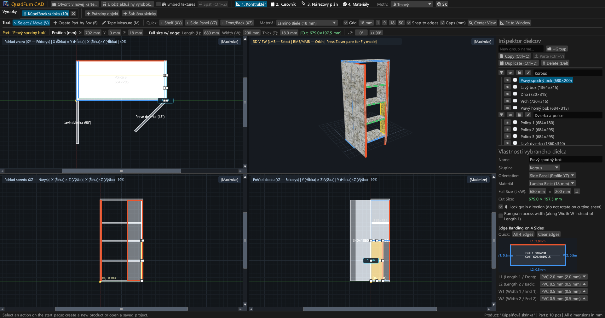
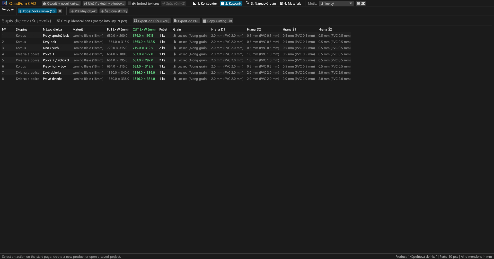
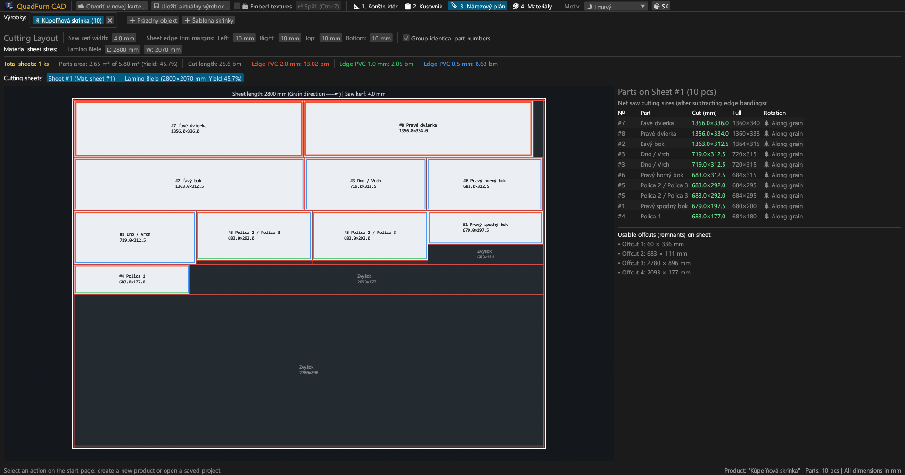
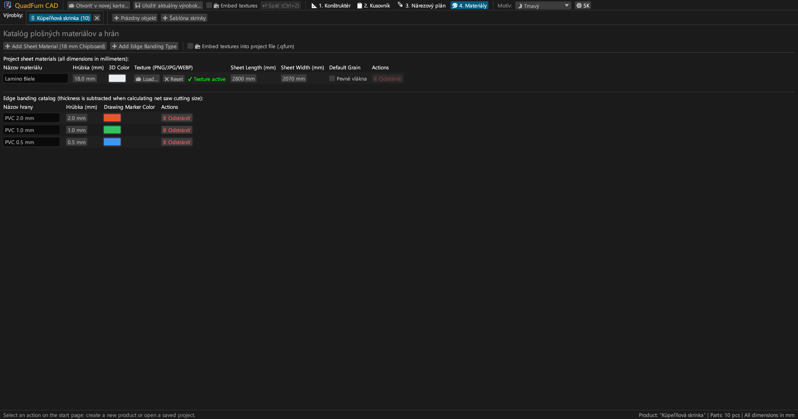
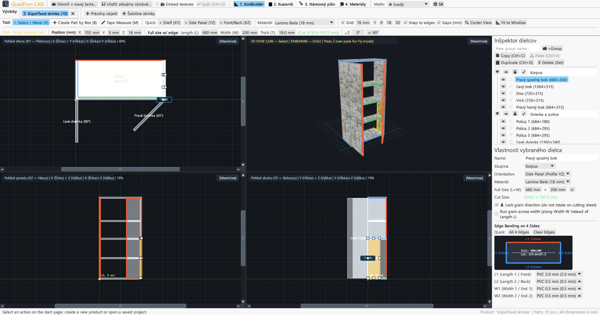
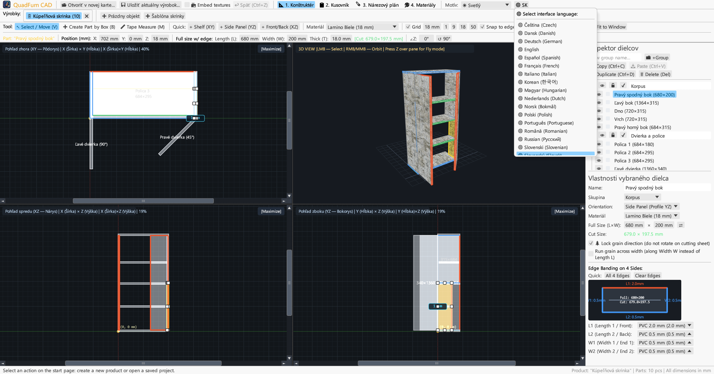

<div align="center">


# QuadFurn CAD

**CAD pre doskový nábytok a lamino — 4-pohľadový priestorový konštruktér + Gilotínový optimalizátor nárezových plánov**

[](https://github.com/rbm13s/QuadFurn/actions/workflows/build.yml)
[](https://github.com/rbm13s/QuadFurn/releases)
[](https://www.rust-lang.org/)
[](https://github.com/emilk/egui)
[](https://wgpu.rs/)
[](#8-grafické-motívy-a-lokalizácia-do-22-jazykov)
[](#začíname)
[](../LICENSE)

<br/>

**Languages / Языки / Мови / Sprachen:**<br/>
[English](../README.md) •
[Русский](README-ru.md) •
[Українська](README-uk.md) •
[Deutsch](README-de.md) •
[Polski](README-pl.md) •
[Español](README-es.md) •
[Français](README-fr.md) •
[Italiano](README-it.md) •
[Português](README-pt.md) •
[Čeština](README-cs.md) •
**Slovenčina** •
[Slovenščina](README-sl.md) •
[Nederlands](README-nl.md) •
[Dansk](README-da.md) •
[Norsk](README-no.md) •
[Svenska](README-sv.md) •
[Magyar](README-hu.md) •
[Română](README-ro.md) •
[Türkçe](README-tr.md) •
[简体中文](README-zh-cn.md) •
[日本語](README-ja.md) •
[한국어](README-ko.md)

</div>

---

## Obsah

- [Úvod](#úvod)
- [Snímky obrazovky a vizuálne predstavenie](#snímky-obrazovky-a-vizuálne-predstavenie)
- [Kľúčové vlastnosti](#kľúčové-vlastnosti)
- [Funkčná dokumentácia](#funkčná-dokumentácia)
  - [1. 4-pohľadový CAD konštruktér a presné polohovanie](#1-4-pohľadový-cad-konštruktér-a-presné-polohovanie)
  - [2. Aritmetické výrazy v číselných poliach](#2-aritmetické-výrazy-v-číselných-poliach)
  - [3. Hranovanie a automatický odpočet hrúbky hrany z rezného rozmeru](#3-hranovanie-a-automatický-odpočet-hrúbky-hrany-z-rezného-rozmeru)
  - [4. 2D gilotínová optimalizácia nárezových plánov](#4-2d-gilotínová-optimalizácia-nárezových-plánov)
  - [5. Záložky projektov a schránka medzi projektmi](#5-záložky-projektov-a-schránka-medzi-projektmi)
  - [6. Export výrobného pasu (vektorové PDF, CSV, schránka)](#6-export-výrobného-pasu-vektorové-pdf-csv-schránka)
  - [7. Katalóg plošných materiálov, textúr a hrán](#7-katalóg-plošných-materiálov-textúr-a-hrán)
  - [8. Grafické motívy a lokalizácia do 22 jazykov](#8-grafické-motívy-a-lokalizácia-do-22-jazykov)
- [Ovládanie a klávesové skratky](#ovládanie-a-klávesové-skratky)
- [Začíname](#začíname)
- [Nastavenia a formáty súborov](#nastavenia-a-formáty-súborov)
- [Architektúra projektu](#architektúra-projektu)
- [Licencia](#licencia)

---

## Úvod

**QuadFurn CAD** je mimoriadne rýchla, natívna desktopová CAD aplikácia napísaná v jazyku Rust, určená na navrhovanie korpusového a doskového nábytku z laminovanej drevotriesky (LDTD), MDF, HDF a preglejky, vrátane automatického generovania kusovníkov a 2D gilotínovej optimalizácie nárezových plánov veľkoplošných materiálov.

QuadFurn spája najlepšiu ergonómiu troch osvedčených nástrojov:
1. **4-pohľadové priestorové modelovanie**: Súčasná práca v troch synchronizovaných 2D pravouhlých priemetoch (**Pôdorys XY**, **Nárys XZ**, **Bokorys YZ**) s posuvníkmi, magnetickým prichytávaním k hranám a interaktívnym **3D pohľadom (Orbit / Voľný let z pohľadu prvej osoby `Z` Noclip)**.
2. **Presný transformačný panel**: Okamžité zadávanie súradníc (`X`, `Y`, `Z`), rozmerov dielca (`L × W × T`) a uhla natočenia (`∠Z`) s integrovaným vyhodnocovaním matematických výrazov (napr. `600-4` alebo `720+18`).
3. **Nárezové plány a automatický odpočet hrán**: Automatický odpočet hrúbky ABS/PVC hrán zo všetkých 4 strán pre zistenie presných **čistých rezných rozmerov pre formátovaciu pílu**, prepojený s gilotínovým 2D algoritmom rešpektujúcim smer štruktúry dreva, prerez pílového kotúča a formátovací orez dosiek.

---

## Snímky obrazovky a vizuálne predstavenie

### 1. 4-pohľadový CAD konštruktér (Tmavý motív)
Synchrónne pravouhlé priemety (**Pôdorys XY**, **Nárys XZ**, **Bokorys YZ**) a perspektívny **3D pohľad** s textúrovaním, 8-bodovými manipulačnými bodmi zmeny rozmerov a pravým **Inšpektorom dielcov**.



### 2. Kusovník dielcov a špecifikácia
Prehľadná tabuľka zobrazujúca ako **Hotové rozmery dielca (`L × W`)**, tak **Čisté rezné rozmery na pílu (`CUT L × W`)** po odpočítaní hrúbky hrán na jednotlivých stranách (`L1`, `L2`, `W1`, `W2`).



### 3. Gilotínový nárezový plán veľkoplošných dosiek
Optimalizované rozvrhnutie dielcov na štandardné formáty dosiek (`2800 × 2070 mm` a pod.) s priebežnými gilotínovými rezmi, prerezom kotúča, orezom okrajov, označením hrán a evidenciou využiteľných zvyškov.



### 4. Katalóg materiálov a hrán
Správa hrúbok plošných materiálov, 3D farieb, vlastných textúr povrchov (`PNG`, `JPG`, `WEBP`), zámkov štruktúry dreva a typov ABS/PVC hrán.



### 5. Podpora svetlého motívu
Moderný svetlý motív s vysokým kontrastom popri tmavom motíve s možnosťou automatickej synchronizácie so systémovým nastavením Windows/macOS/Linux.



### 6. 22 integrovaných jazykov (Rozhranie aj PDF export)
Okamžité prepínanie jazykov bez reštartu tlačidlom **`🌐`** v hornej lište, automatická detekcia jazyka operačného systému pri prvom spustení a lokalizované viacstranové PDF výstupy.



---

## Kľúčové vlastnosti

- **Synchronizovaný 4-pohľadový pracovný priestor**: Navrhujte v Pôdoryse (`XY`), Náryse (`XZ`), Bokoryse (`YZ`), alebo ľubovoľné okno zväčšite na celú plochu (`[Zväčšiť]` / `[Obnoviť 4 pohľady]`).
- **Hardvérovo akcelerovaný 3D náhľad**: Orbitálna kamera (`Pravé`/`Stredné tlačidlo myši`) + voľný let z prvej osoby z pohľadu prvej osoby (`kláves Z` + `WASD`/`Medzerník`/`Ctrl`) s perspektívnym UV textúrovaním a presným OBB lúčovým výberom.
- **Magnetické prichytávanie a dynamické kótovanie medzier**: Automatický úchyt k mriežke (`1`, `9`, `18`, `50 mm` alebo vlastná), prichytenie k plochám a hranám susedných dielcov (`0 mm`) a zobrazenie reálnych vzdialeností v milimetroch k susedným doskám.
- **Rámčekový výber a skupinová transformácia**: Ťahaním myši v 2D pohľadoch vyberte viac dielcov naraz, posúvajte ich spoločne, duplikujte (`Ctrl+D`) alebo kopírujte medzi otvorenými výrobkami (`Ctrl+C` / `Ctrl+V`).
- **Integrovaná kalkulačka**: Všetky číselné polia prijímajú matematické vzorce ako `600+100`, `800-36`, `720/2` alebo `45+15`.
- **Automatický odpočet hrán pri rezaní**: Priraďte ABS hrany (`0.4 mm`, `0.5 mm`, `1.0 mm`, `2.0 mm` atď.) na ktorúkoľvek zo 4 strán dielca (`L1`, `L2`, `W1`, `W2`) a systém okamžite vypočíta rezný rozmer:
  $$\text{Dĺžka rezu} = L_{\text{hotová}} - E_{L1} - E_{L2}, \quad \text{Šírka rezu} = W_{\text{hotová}} - E_{W1} - E_{W2}$$
- **2D gilotínový optimalizačný modul**: Rozvrhnutie dielcov na viac dosiek s rešpektovaním smeru štruktúry dreva, šírky prerezu kotúča a formátovacieho orezu okrajov dosky.
- **Kompletný výrobný pas vo vektorovom PDF formáte A4 na šírku**: Export jedným kliknutím v aktívnom jazyku obsahujúci:
  1. Kompletný kusovník dielcov
  2. 4-pohľadové technické výkresy (`Pôdorys XY`, `3D Izometria`, `Nárys XZ`, `Bokorys YZ`) s vonkajšími kótami
  3. Detailné gilotínové nárezové plány pre každú dosku
  4. Súhrn spotreby veľkoplošných dosiek a bežných metrov hrán s pripočítaním `+15 %` rezervy na prerez

---

## Funkčná dokumentácia

### 1. 4-pohľadový CAD konštruktér a presné polohovanie

Záložka **Konštruktér** (`📐 1. Konštruktér`) sa skladá z troch hlavných častí:

1. **Horné nástrojové lišty**:
   - **Kresliace nástroje**:
     - `↖ Vybrať / Posunúť (V)`: Kliknutím vyberiete dielec, ťahaním posúvate, alebo meníte rozmery pomocou 8 úchopových bodov v 2D. Ťahaním v prázdnom priestore vytvoríte obdĺžnikový výber viacerých dielcov.
     - `➕ Vytvoriť dielec rámčekom (B)`: Ťahaním obdĺžnika v 2D pohľade (`Pôdorys XY`, `Nárys XZ` alebo `Bokorys YZ`) vytvoríte novú dosku zodpovedajúcu danej rovine.
     - `📏 Meracie pásmo (M)`: Meranie presných vzdialeností bod od bodu (`ΔX`, `ΔY`, `L`) v milimetroch.
   - **Rýchle vkladanie dielcov**: Tlačidlá na vloženie police (`+ Polica (XY)`), boku (`+ Bok (YZ)`) alebo dvierok/chrbta (`+ Dvierka/Chrbát (XZ)`).
   - **Mriežka a prichytávanie**: Nastavenie kroku mriežky (`1`, `9`, `18`, `50 mm`), magnetické prichytenie k hranám susedných dielcov a zobrazenie medzier.
   - **Nastavenie kamery**:
     - `🔍 Vycentrovať pohľad`: Vycentruje zobrazenie na počiatok alebo stred nábytku.
     - `📐 Prispôsobiť oknu`: Automaticky spočíta rozmery výrobku a prispôsobí mierku vo všetkých 4 oknách súčasne.
   - **Presná transformačná lišta**: Zobrazenie a priama editácia súradníc `X`, `Y`, `Z`, rozmerov dielca `L`, `W`, `T`, zeleného štítku čistého rezu `[Rez: L × W mm]` a uhla otočenia `∠Z`.

2. **Štyri pracovné okná**:
   - **2D pravouhlé priemety (`Pôdorys XY`, `Nárys XZ`, `Bokorys YZ`)** s posuvníkmi, milimetrovými pravítkami a farebným zvýraznením olepených hrán.
   - **3D pohľad**: Orbitálne otáčanie (`Pravé` alebo `Stredné tlačidlo myši`), približovanie kolieskom, 3D výber a **Režim voľného letu (Noclip)** (stlačte **`Z`** nad 3D oknom a lietajte pomocou klávesov `WASD`, `Medzerník`, `Ctrl`/`Shift`).

3. **Pravý Inšpektor dielcov**:
   - Triedenie dielcov do používateľských **Skupín** (*Korpus*, *Dvierka*, *Zásuvky*).
   - Prepínače viditeľnosti (`👁`) a zamknutia proti nechcenej úprave (`🔒`).
   - Nastavenie materiálu, orientácie dielca, rozmerov (`L × W` s prehodením `⇄`), zámku smeru štruktúry dreva (`🌲 Zamknúť smer štruktúry`), priečnej štruktúry (`🔄 Priečna štruktúra`) a interaktívna schéma 4 hrán.

---

### 2. Aritmetické výrazy v číselných poliach

Všetky číselné polia v programe umožňujú zadávanie matematických výrazov:
- **Sčítanie a odčítanie**: V poli s hodnotou `600` napíšte `600+100` alebo `600-4` a stlačte `Enter` — hodnota sa okamžite prepočíta na `700` alebo `596`.
- **Násobenie, delenie a zátvorky**: Výrazy ako `(800-36)/2` alebo `18*2` sa vyhodnotia automaticky.
- Možno používať bodku `.` aj čiarku `,` ako desatinný oddeľovač a jednotky (`mm`, `°`) sú automaticky odfiltrované.

---

### 3. Hranovanie a automatický odpočet hrúbky hrany z rezného rozmeru

- Každý doskový dielec má 4 strany: **`L1`** (Dĺžka 1 / Predná), **`L2`** (Dĺžka 2 / Zadná), **`W1`** (Šírka 1 / Bočná 1) a **`W2`** (Šírka 2 / Bočná 2).
- Ak zadáte na dielec s rozmerom `680 × 200 mm` ABS hranu `2.0 mm` na stranu `L1` a `0.5 mm` na strany `L2`, `W1`, `W2`, program spočíta **Čistý rezný rozmer na pílu**:
  - $\text{Rez } L = 680 - 2.0 - 0.5 = 677.5\text{ mm}$
  - $\text{Rez } W = 200 - 0.5 - 0.5 = 199.0\text{ mm}$
- Hrany sú farebne zobrazené vo 2D/3D zobrazení dielca aj na nárezovom pláne dosiek.

---

### 4. 2D gilotínová optimalizácia nárezových plánov

Záložka **Nárezový plán** (`🪚 3. Nárezový plán`) vypočíta optimálne rozloženie dielcov na veľkoplošné dosky:
- **Nastaviteľné parametre rezania**:
  - **Šírka prerezu pílového kotúča** (predvolená `4.0 mm`).
  - **Formátovací orez okrajov dosky** (`Vľavo`, `Vpravo`, `Hore`, `Dole`, predvolená `10 mm`) na začistenie hrán z výroby.
- **Rešpektovanie smeru štruktúry dreva**:
  - Dielce so **Zamknutou štruktúrou (`🌲`)**: nesmú byť otočené o $90^\circ$ proti smeru letokruhov dosky (`Dĺžka L`).
  - Dielce s **Voľnou štruktúrou**: môžu byť ľubovoľne otáčané o $90^\circ$ pre dosiahnutie maximálnej výťažnosti.
- **Grafická mapa rezov a evidencia využiteľných zvyškov**:
  - Každá doska zobrazuje červené gilotínové rezy, očíslovanie dielcov, rezné rozmery, farebné pásiky hrán a okótované využiteľné zvyšky.
  - Podrobné štatistiky: počet potrebných dosiek, výťažnosť materiálu v percentách (%), dĺžka rezov a spotreba hrán v bežných metroch.

---

### 5. Záložky projektov a schránka medzi projektmi

- **Úvodná stránka a história**: Vytvorenie nového prázdneho výrobku, štart zo šablóny 2-dverovej skrinky, otvorenie súborov `.qfurn`/`.json` alebo rýchly výber z **10 naposledy otvorených projektov**.
- **Práca vo viacerých záložkách súčasne**: Navrhujte viac skriniek naraz v hornej lište záložiek (dvojitým kliknutím možno výrobok premenovať).
- **Kopírovanie a vkladanie dielcov medzi projektmi**: Vyberte dielce v jednom výrobku, stlačte `Ctrl+C`, prepnite sa do inej záložky (alebo inej spustenej inštancie QuadFurn) a stlačte `Ctrl+V`. Chýbajúce materiály a hrany sa v cieľovom projekte automaticky vytvoria.
- **Ochrana pred stratou údajov**: Pri zatváraní neuloženého výrobku alebo ukončení programu sa zobrazí potvrdzovací dialóg (`Uložiť a odísť`, `Odísť bez uloženia`, `Zrušiť`).

---

### 6. Export výrobného pasu (vektorové PDF, CSV, schránka)

V záložke **Kusovník** (`📋 2. Kusovník`):
1. **`📄 Exportovať do PDF` (Kompletný vektorový výrobný pas A4 na šírku)**:
   - **Časť 1**: Kusovník dielcov s hotovými aj reznými rozmermi, olepením a smerom štruktúry.
   - **Časť 2**: 4-pohľadové technické výkresy (`Pôdorys XY`, `3D Izometria`, `Nárys XZ`, `Bokorys YZ`) s celkovými vonkajšími rozmermi.
   - **Časť 3**: Detailné gilotínové nárezové plány pre každú dosku.
   - **Časť 4**: Prehľad plošných materiálov a spotreby hrán (čistá dĺžka a $+15 \%$ rezerva).
   - Dokument je vygenerovaný v **aktuálne nastavenom jazyku** s vloženými TrueType/CID vektorovými písmami.
2. **`💾 Exportovať do CSV (Excel)`**: Tabuľkový súbor v kódovaní UTF-8 s BOM a oddeľovačom `;`, priamo otvárateľný v Microsoft Excel alebo LibreOffice Calc.
3. **`📋 Skopírovať zoznam pre rezanie`**: Skopíruje tabuľku rezných rozmerov do schránky s tabulátormi pre jednoduché vloženie do externých optimalizačných programov alebo tabuliek.

---

### 7. Katalóg plošných materiálov, textúr a hrán

V záložke **Materiály** (`🎨 4. Materiály`):
- Definujte **Plošné materiály** (`Lamino 18 mm`, `MDF 16 mm`, `Sololit 3 mm` a pod.) s vlastnými RGB farbami, formátom dosky (`Dĺžka × Šírka`) a predvoleným zámkom smeru štruktúry.
- Načítajte realistické textúry povrchov vo formátoch **`PNG`**, **`JPG`/`JPEG`** alebo **`WEBP`**.
- **Prenositeľnosť a automatické dohľadanie textúr**: Pri otvorení súboru `.qfurn` na inom počítači alebo z presunutého priečinka program hľadá obrázky:
  1. Uložené priamo v súbore projektu (Base64)
  2. V rovnakom priečinku ako súbor `.qfurn`
  3. V podpriečinku `./textures/` vedľa súboru projektu
  4. Podľa relatívnej alebo pôvodnej absolútnej cesty
- **Uloženie textúr priamo do projektu (`📦 Zabaliť textúry do súboru projektu`)**: Začiarknite túto voľbu v hornej lište alebo v záložke Materiály pre uloženie obrázkov vo formáte Base64 priamo do súboru `.qfurn`. Súbor sa stane úplne nezávislým a možno ho prenášať kamkoľvek bez obáv zo straty textúr.
- **Ochrana grafickej karty**: Súbory väčšie ako 60 MB sú odmietnuté s varovaním a obrázky s vysokým rozlíšením (> 4096 px) sú automaticky zmenšené pre plynulý chod.
- Správa **Typov hrán** s hrúbkou v milimetroch a farbou zvýraznenia. Odstránenie používaného materiálu či hrany vyžaduje bezpečnostné potvrdenie.

---

### 8. Grafické motívy a lokalizácia do 22 jazykov

- **Grafické motívy**: Jednoduché prepínanie medzi motívmi **🌙 Tmavý**, **☀ Svetlý** a **🖥 Systémový** v hornej lište.
- **22 vstavaných jazykov**:
  `Slovenčina`, `English`, `Русский`, `Українська`, `Deutsch`, `Polski`, `Español`, `Français`, `Italiano`, `Português`, `Čeština`, `Slovenščina`, `Nederlands`, `Dansk`, `Norsk`, `Svenska`, `Magyar`, `Română`, `Türkçe`, `简体中文`, `日本語` a `한국어`.
- **Automatická detekcia jazyka operačného systému**: Pri prvom spustení aplikácia automaticky nastaví jazyk podľa systému. Voľba jazyka a motívu sa ukladá do `%APPDATA%\QuadFurn\settings.json`.

---

## Ovládanie a klávesové skratky

| Klávesová skratka | Akcia |
| :--- | :--- |
| **`V`** | Aktivovať nástroj **Vybrať a posunúť** (s 8 manipulačnými bodmi a rámčekovým výberom) |
| **`B`** | Aktivovať nástroj **Vytvoriť dielec rámčekom** v 2D pohľadoch |
| **`M`** | Aktivovať nástroj **Meracie pásmo** v 2D pohľadoch |
| **Ťahanie `Ľavým tlačidlom` (2D)** | Posunúť vybrané dielce, upraviť rozmer úchopom alebo ťahať výberový rámček v prázdne |
| **`Shift + Ľavým tlačidlom` (2D)** | Pridať alebo odobrať dielec z viacnásobného výberu |
| **Ťahanie `Pravým` / `Stredným tlačidlom` (2D)** | Posun zobrazenia (Panoráma 2D) |
| **`Koliesko myši` (2D / 3D)** | Priblíženie / oddialenie pohľadu na pozíciu kurzora |
| **Ťahanie `Pravým` / `Stredným tlačidlom` (3D)** | Orbitálna rotácia 3D kamery |
| **`Z` (nad 3D oknom)** | Zapnúť / vypnúť **Režim voľného letu (Noclip)** |
| **`W` `A` `S` `D` / `Medzerník` / `Ctrl`** | Pohyb dopredu/doľava/dozadu/doprava/hore/dole v 3D lete (`Shift` zrýchľuje) |
| **`Ctrl + S`** | Uložiť aktuálny výrobok (`.qfurn` / `.json`) |
| **`Ctrl + Z`** | Vrátiť späť posledný krok (história až 40 krokov) |
| **`Ctrl + C` / `Ctrl + V`** | Kopírovať / Vložiť vybrané dielce (funguje aj medzi rôznymi záložkami) |
| **`Ctrl + D`** | Duplikovať vybrané dielce |
| **`Delete` / `Backspace`** | Zmazať vybrané dielce |
| **`←` `→` `↑` `↓` (2D pohľady)** | Posun vybraných dielov o krok zvolenej mriežky (`Shift` pre dvojnásobný krok) |

---

## Začíname

### Predpripravené inštalačné balíčky (GitHub Releases)
Každé zostavenie automaticky generuje hotové balíčky cez [GitHub Actions](https://github.com/rbm13s/QuadFurn/actions):
- **Windows (`x86_64`)**: `QuadFurn-windows-x86_64.zip` — prenosný `QuadFurn.exe` s integrovanou ikonou.
- **Linux (`Debian 12+ / Ubuntu 22.04+ x86_64`)**:
  - `quadfurn_<verzia>_amd64.deb` — inštalačný balíček pre Debian/Ubuntu (nainštaluje spustiteľný súbor, položku v ponuke aj ikony):
    ```bash
    sudo apt install ./quadfurn_0.2.2_amd64.deb
    ```
  - `QuadFurn-linux-x86_64.tar.gz` — prenosný archív pre Linux.
- **macOS (`Univerzálny: Apple Silicon M1–M4 + Intel x86_64`)**: `QuadFurn-macos-universal.zip` — natívna aplikácia `QuadFurn.app` s Retina ikonou.

---

### Zostavenie zo zdrojových kódov

#### Požiadavky
- [Rust Toolchain](https://rustup.rs/) (`stable`, edícia Rust 2021)
- Systémové knižnice pre **Linux (Debian / Ubuntu)**:
  ```bash
  sudo apt-get update && sudo apt-get install -y \
    build-essential pkg-config libxcb-render0-dev libxcb-shape0-dev \
    libxcb-xfixes0-dev libxkbcommon-dev libxkbcommon-x11-dev libssl-dev \
    libgtk-3-dev libglib2.0-dev libatk1.0-dev libgdk-pixbuf-2.0-dev \
    libcairo2-dev libpango1.0-dev libgl1-mesa-dev fonts-dejavu-core fonts-noto-cjk
  ```
- **macOS**: Nástroje príkazového riadka Xcode (`xcode-select --install`)
- **Windows**: Windows 10 / 11 s nástrojmi MSVC C++ Build Tools

#### Príkazy pre kompiláciu
```bash
# Spustenie vo vývojovom režime
cargo run

# Kompilácia optimalizovaného vydania
cargo build --release

# Spustenie sady jednotkových testov
cargo test
```

---

## Nastavenia a formáty súborov

- **Používateľské nastavenia (`settings.json`)**:
  Ukladajú sa automaticky do štandardného konfiguračného adresára:
  - **Windows**: `%APPDATA%\QuadFurn\settings.json`
  - **Linux**: `~/.config/QuadFurn/settings.json`
  - **macOS**: `~/Library/Application Support/QuadFurn/settings.json`
  
  Uchováva:
  - `theme_choice` (`Dark`, `Light`, `System`)
  - `language` (`Sk`, `En`, `Ru` atď.)
  - `recent_projects` (až 10 naposledy otvorených súborov)
- **Projektové súbory (`.qfurn` / `.json`)**:
  Čitateľné súbory vo formáte JSON v kódovaní UTF-8 obsahujúce všetky dielce, skupiny, materiály, textúry, hrany a nastavenia nárezu. Pri zapnutí zabalenia textúr sú obrázky uložené priamo v súbore v kódovaní Base64.

---

## Architektúra projektu

```text
QuadFurn/
├── .github/
│   └── workflows/
│       └── build.yml          # CI/CD automatizácia GitHub Actions (Linux .deb/.tar.gz, macOS .app, Windows .zip)
├── assets/
│   ├── icon.jpeg              # Logo programu a zdrojová ikona
│   └── screenshots/           # Snímky obrazovky pre dokumentáciu
├── docs/                      # Lokalizovaná dokumentácia v 22 jazykoch
├── src/
│   ├── main.rs                # Vstupný bod, správa záložiek projektov, úvodná obrazovka a klávesové skratky
│   ├── model.rs               # Dátový model (Project, PartBlock, SheetMaterial, EdgeBanding, OBB)
│   ├── viewport.rs            # 4-pohľadový vykresľovací modul pracovnej plochy, 2D a 3D zobrazenie wgpu/painter
│   ├── snapping.rs            # Magnetické prichytávanie k mriežke a hranám, priemetové osi
│   ├── cutter.rs              # 2D optimalizátor nárezových plánov a odpočet hrán
│   ├── export.rs              # Generátor vektorového PDF formátu A4 a export do formátu CSV
│   ├── ui_panels.rs           # Transformačný panel, Inšpektor dielcov, Kusovník, Nárezový plán a Materiály
│   └── i18n.rs                # Prekladové slovníky pre 22 jazykov a autodetekcia jazyka systému
├── build.rs                   # Automatická konverzia ikony Windows ICO a PE zdroj
├── Cargo.toml                 # Konfigurácia balíka a závislosti
└── LICENSE                    # Licencia MIT
```

---

## Licencia

Tento projekt je licencovaný pod slobodnou licenciou [MIT](../LICENSE) — voľne použiteľný, modifikovateľný a šíriteľný na komerčné aj osobné projekty.


