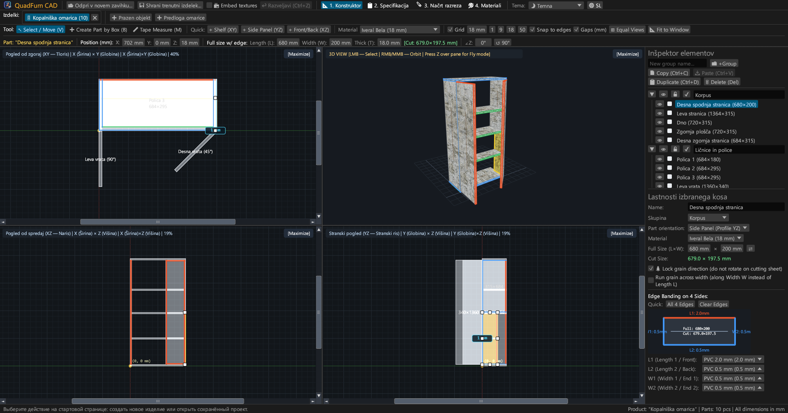
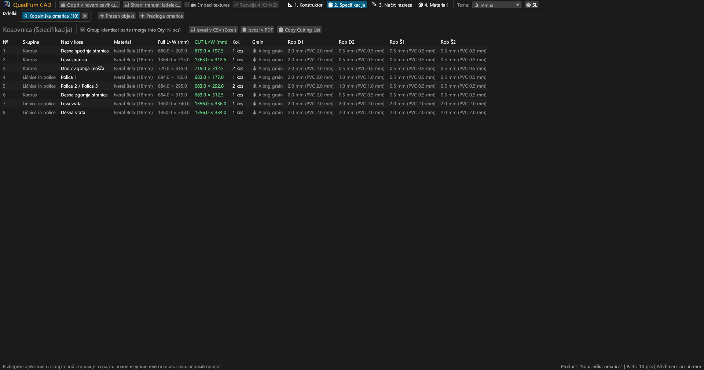
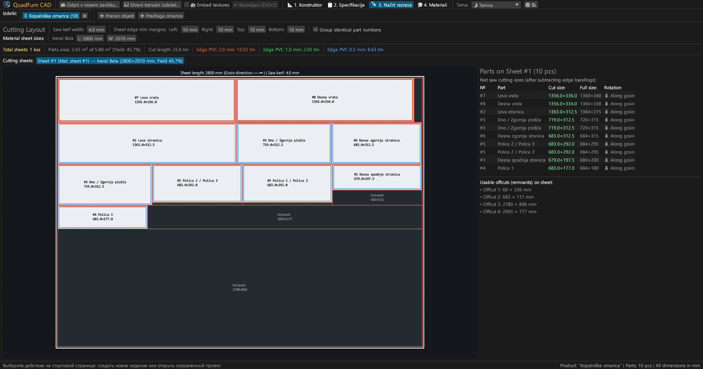
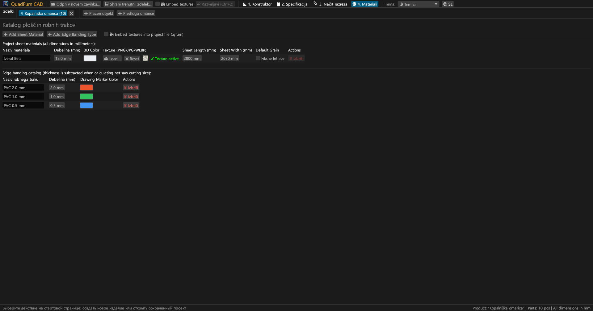
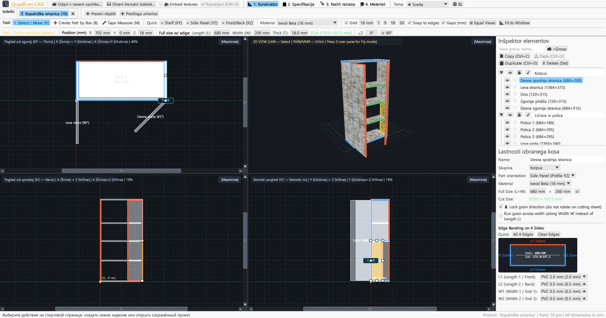
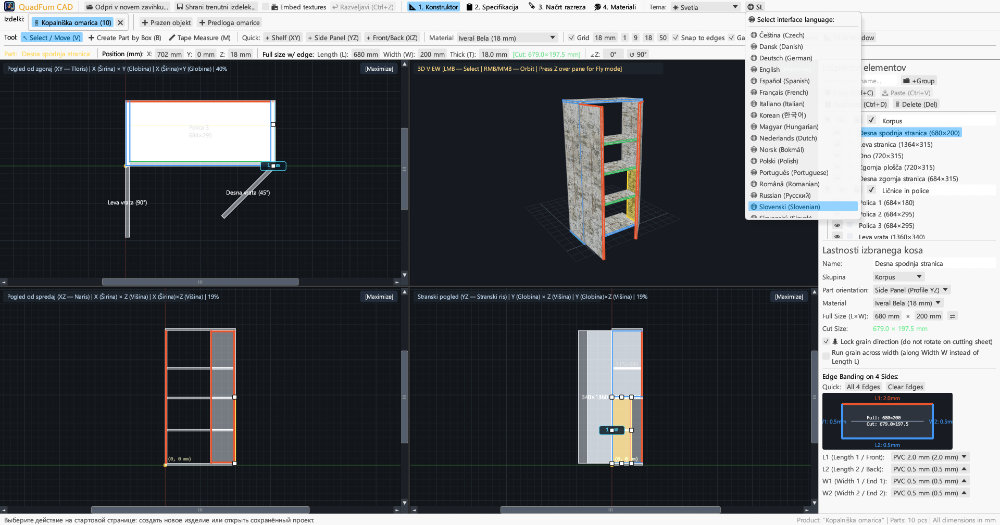

<div align="center">


# QuadFurn CAD

**CAD za pohištvo iz ivernih plošč in panelov — 4-pogledni prostorski načrtovalec + Gilotinski optimizator razreza plošč**

[](https://github.com/rbm13s/QuadFurn/actions/workflows/build.yml)
[](https://github.com/rbm13s/QuadFurn/releases)
[](https://www.rust-lang.org/)
[](https://github.com/emilk/egui)
[](https://wgpu.rs/)
[](#8-vizualne-teme-in-lokalizacija-v-22-jezikov)
[](#prvi-koraki)
[](../LICENSE)

<br/>

**Languages / Языки / Мови / Sprachen:**<br/>
[English](../README.md) •
[Русский](README-ru.md) •
[Українська](README-uk.md) •
[Deutsch](README-de.md) •
[Polski](README-pl.md) •
[Español](README-es.md) •
[Français](README-fr.md) •
[Italiano](README-it.md) •
[Português](README-pt.md) •
[Čeština](README-cs.md) •
[Slovenčina](README-sk.md) •
**Slovenščina** •
[Nederlands](README-nl.md) •
[Dansk](README-da.md) •
[Norsk](README-no.md) •
[Svenska](README-sv.md) •
[Magyar](README-hu.md) •
[Română](README-ro.md) •
[Türkçe](README-tr.md) •
[简体中文](README-zh-cn.md) •
[日本語](README-ja.md) •
[한국어](README-ko.md)

</div>

---

## Kazalo

- [Uvod](#uvod)
- [Posnetki zaslona in vizualni pregled](#posnetki-zaslona-in-vizualni-pregled)
- [Ključne funkcije](#ključne-funkcije)
- [Funkcionalna dokumentacija](#funkcionalna-dokumentacija)
  - [1. 4-pogledni CAD načrtovalec in natančno upravljanje](#1-4-pogledni-cad-načrtovalec-in-natančno-upravljanje)
  - [2. Aritmetični izrazi v številskih poljih](#2-aritmetični-izrazi-v-številskih-poljih)
  - [3. Robni trakovi in samodejni odštevek debeline traku pri razrezu](#3-robni-trakovi-in-samodejni-odštevek-debeline-traku-pri-razrezu)
  - [4. 2D gilotinska optimizacija razreza plošč](#4-2d-gilotinska-optimizacija-razreza-plošč)
  - [5. Zavihki projektov in odložišče med projekti](#5-zavihki-projektov-in-odložišče-med-projekti)
  - [6. Izvoz proizvodnega potnega lista (vektorski PDF, CSV, odložišče)](#6-izvoz-proizvodnega-potnega-lista-vektorski-pdf-csv-odložišče)
  - [7. Katalog ploskovnih materialov, tekstur in robnih trakov](#7-katalog-ploskovnih-materialov-tekstur-in-robnih-trakov)
  - [8. Vizualne teme in lokalizacija v 22 jezikov](#8-vizualne-teme-in-lokalizacija-v-22-jezikov)
- [Krmiljenje in bližnjice na tipkovnici](#krmiljenje-in-bližnjice-na-tipkovnici)
- [Prvi koraki](#prvi-koraki)
- [Nastavitve in formati datotek](#nastavitve-in-formati-datotek)
- [Arhitektura projekta](#arhitektura-projekta)
- [Licenca](#licenca)

---

## Uvod

**QuadFurn CAD** je visoko zmogljiva večplatformna CAD aplikacija, napisana v jeziku Rust, na voljo tako kot hitra domorodna namizna aplikacija (Windows, Linux, macOS) kot tudi kot spletna različica WebAssembly (WASM) brez namestitve neposredno v sodobnih spletnih brskalnikih. Namenjena je načrtovanju omarnega in ploščnega pohištva iz oplemenitene iverne plošče (iveral), MDF, HDF in vezanih plošč, skupaj s samodejnim ustvarjanjem kosovnic in optimizacijo 2D giljotinskega razreza plošč.

QuadFurn združuje najboljšo ergonomijo treh uveljavljenih orodij:
1. **Prostorsko modeliranje v 4 pogledih**: Sočasno urejanje v treh sinhroniziranih 2D pogledih (**Tloris XY**, **Naris XZ**, **Stranski ris YZ**) z drsniki, magnetnim pripenjanjem, gumbom za izravnavo oken (`⊞ Izravnaj okna`), inteligentno zaščito debeline elementov z roba ter oknom **3D Orbit / Prosti let v prvi osebi (`Z` Noclip)** v realnem času.
2. **Natančna vrstica transformacij**: Takojšen vnos koordinat (`X`, `Y`, `Z`), končnih mer elementa (`L × W × T`) in kota zasukovanja (`∠Z`) z neposrednim računanjem matematičnih formul (npr. `600-4` ali `720+18`).
3. **Razrez plošč in samodejno odštevanje robov**: Samodejni odštevek debeline ABS/PVC robnih trakov z vseh 4 strani za izračun natančnih **čistih rezalnih mer za žago**, povezan z gilotinskim 2D algoritmom, ki upošteva smer lesnih vlaken, rezalno režo žaginega lista ter robne obreze surovih plošč.

---

## Posnetki zaslona in vizualni pregled

### 1. 4-pogledni CAD načrtovalec (Temna tema)
Usklajene pravokotne projekcije (**Tloris XY**, **Naris XZ**, **Stranski ris YZ**) in perspektivni **3D pogled** s teksturami, 8-točkovnimi ročicami za spreminjanje velikosti ter desnim **Inšpektorjem elementov**.



### 2. Kosovnica elementov in specifikacije
Pregledna tabela s prikazom tako **Končnih mer elementov (`L × W`)** kot **Čistih rezalnih mer za žago (`CUT L × W`)** po odštetju debelin robnih trakov na posameznih stranicah (`L1`, `L2`, `W1`, `W2`).



### 3. Gilotinski načrt razreza plošč
Optimizirana razporeditev elementov na standardne formate plošč (`2800 × 2070 mm` itd.) s prebojnimi gilotinskimi rezi, rezalno režo žage, robnimi obrezi, oznakami trakov in evidenco uporabnih ostankov.



### 4. Katalog materialov in robnih trakov
Upravljanje debelin plošč, barv 3D, lastnih tekstur površin (`PNG`, `JPG`, `WEBP`), smeri lesnih vlaken in vrst ABS/PVC trakov.



### 5. Podpora za Svetlo temo
Sodobna svetla tema z visokim kontrastom poleg temne teme in možnostjo samodejne uskladitve s sistemskimi nastavitvami.



### 6. 22 vgrajenih jezikov (Vmesnik in izvoz PDF)
Takojšnje preklapljanje med jeziki brez ponovnega zagona prek gumba **`🌐`** v zgornji orodni vrstici, samodejno zaznavanje jezika operacijskega sistema ob prvem zagonu in večstranski prevedeni PDF izvozi.



---

## Ključne funkcije

- **Sinhroniziran 4-pogledni delovni prostor**: Delajte v Tlorisu (`XY`), Narisu (`XZ`), Stranskem risu (`YZ`), ali poljuben pogled povečajte čez celotno okno (`[Povečaj]` / `[Obnovi 4 poglede]`).
- **Strojno pospešen 3D predogled**: Orbitalna kamera (`Desni`/`Srednji gumb miške`) + prosti let iz prve osebe iz prve osebe (`tipka Z` + `WASD`/`Preslednica`/`Ctrl`) s teksturiranjem UV in natančnim žarkovnim zaznavanjem OBB.
- **Magnetno pripenjanje in dinamično kotiranje odmikov**: Samodejni skok na mrežo (`1`, `9`, `18`, `50 mm` ali po meri), magnetni oprijem na robove in ploskve sosednjih kosov (`0 mm`) ter prikaz razdalj v milimetrih do sosednjih elementov.
- **Izbira z okvirjem in skupinsko preoblikovanje**: Z vlečenjem miške v poljubnem 2D pogledu označite več elementov hkrati, jih skupaj premikajte, podvajajte (`Ctrl+D`) ali kopirajte med odprtimi projekti (`Ctrl+C` / `Ctrl+V`).
- **Vgrajen računski modul**: Vsa številska polja omogočajo vnos računskih izrazov, kot so `600+100`, `800-36`, `720/2` ali `45+15`.
- **Samodejni odštevek trakov pri razrezu**: Določite ABS robne trakove (`0.4 mm`, `0.5 mm`, `1.0 mm`, `2.0 mm` itd.) na poljubni od 4 stranic (`L1`, `L2`, `W1`, `W2`) in takoj prejmite mero za razrez:
  $$\text{Dolžina reza} = L_{\text{končna}} - E_{L1} - E_{L2}, \quad \text{Širina reza} = W_{\text{končna}} - E_{W1} - E_{W2}$$
- **2D gilotinski optimizacijski modul**: Razporeditev kosov na več plošč z doslednim upoštevanjem smeri letnic lesa, širine reza žaginega lista ter začetnega obreza robov.
- **Popoln proizvodni potni list v vektorskem formatu PDF A4 ležeče**: Izvoz z enim klikom v trenutno izbranem jeziku:
  1. Popolna tabela kosovnice
  2. 4-pogledni tehnični načrti (`Tloris XY`, `3D Izometrija`, `Naris XZ`, `Stranski ris YZ`) z zunanjimi merami
  3. Podrobni gilotinski načrti razreza za vsako posamezno ploščo
  4. Povzetek porabe surovih plošč in tekočih metrov robnih trakov z dodatkom `+15 %` rezerve

---

## Funkcionalna dokumentacija

### 1. 4-pogledni CAD načrtovalec in natančno upravljanje

Zavihek **Načrtovalec** (`📐 1. Načrtovalec`) obsega tri poglavitna območja:

1. **Zgornje orodne vrstice**:
   - **Orodja za risanje**:
     - `↖ Izberi / Premakni (V)`: Kliknite element za izbiro, povlecite za premik, ali uporabite ročice (8 ročic za elemente plosko in 2 ročici z roba). Vlečenje po praznem prostoru odpre izbirni pravokotnik za več elementov. Med vlečenjem v 2D: držite **`Shift`**, da premikanje zaklenete na vodoravno ali navpično os, **`Ctrl` (`Cmd`)**, da začasno izklopite magnetno pritrjevanje na robove, in **`Alt`**, da ustvarite kopijo kosa ob spustu.
     - `➕ Ustvari element z okvirjem (B)`: Povlecite pravokotnik v 2D pogledu (`Tloris XY`, `Naris XZ` ali `Stranski ris YZ`), da ustvarite ploščo, usmerjeno v tej ravnini.
     - `📏 Merilni trak (M)`: Natančno merjenje razdalj od točke do točke (`ΔX`, `ΔY`, `L`) v milimetrih.
   - **Hitro vstavljanje**: Gumbi za hitro dodajanje polic (`+ Polica (XY)`), stranic (`+ Stranica (YZ)`) ali ličnic/hrbtišč (`+ Ličnica/Hrbet (XZ)`).
   - **Mreža in pripenjanje**: Nastavitev koraka mreže (`1`, `9`, `18`, `50 mm`), magnetno lepljenje na robove sosednjih elementov in prikaz odmikov.
   - **Kadriranje pogleda**:
     - `🔍 Usredini pogled`: Usredini kamero na izhodišče ali središče pohištva.
     - `📐 Prilagodi oknu`: Samodejno izračuna zunanje mere pohištva in optimalno zapolni vsa 4 okna hkrati.
   - **Natančna vrstica transformacij**: Prikaz in neposredno spreminjanje koordinat `X`, `Y`, `Z`, mer `L`, `W`, `T`, zelene značke čistega reza `[Rez: L × W mm]` ter kota zasuka `∠Z`.

2. **Štiri delovna okna**:
   - **2D pravokotne projekcije (`Tloris XY`, `Naris XZ`, `Stranski ris YZ`)** z drsniki, milimetrskimi merili in barvnimi črtami nanesenih robnih trakov.
   - **3D pogled**: Orbitalno vrtenje (`Desni` ali `Srednji gumb miške`), približevanje s kolescem, izbira v 3D in **Način prostega leta iz prve osebe (Noclip)** (pritisnite **`Z`** nad 3D oknom in letite s tipkami `WASD`, `Preslednica`, `Ctrl`/`Shift`).

3. **Desni Inšpektor elementov**:
   - Razvrščanje elementov v poljubne **Skupine** (*Korpus*, *Vrata*, *Predali*).
   - Stikala za vidnost (`👁`) in zaklepanje pred spreminjanjem (`🔒`).
   - Nastavitev materiala, usmerjenosti, dimenzij (`L × W` z zamenjavo `⇄`), zaklepa smeri vlaken (`🌲 Zakleni smer vlaken`), prečne smeri vlaken (`🔄 Prečna vlakna`) ter interaktivna shema 4 robov.

---

### 2. Aritmetični izrazi v številskih poljih

Vsa številska polja v programu podpirajo neposreden vnos matematičnih formul:
- **Seštevanje in odštevanje**: V polje z vrednostjo `600` vpišite `600+100` ali `600-4` in potrdite s tipko `Enter` — vrednost se nemudoma pretvori v `700` ali `596`.
- **Množenje, deljenje in oklepaji**: Izrazi kot `(800-36)/2` ali `18*2` se samodejno izračunajo.
- Podprta sta tako pika `.` kot veja `,` kot decimalno ločilo, merske enote (`mm`, `°`) pa program samodejno prezre.

---

### 3. Robni trakovi in samodejni odštevek debeline traku pri razrezu

- Vsak ploskovni element ima 4 robove: **`L1`** (Dolžina 1 / Spredaj), **`L2`** (Dolžina 2 / Zadaj), **`W1`** (Širina 1 / Bočno 1) in **`W2`** (Širina 2 / Bočno 2).
- Če za element velikosti `680 × 200 mm` določite ABS trak `2.0 mm` na rob `L1` in `0.5 mm` na robove `L2`, `W1`, `W2`, program samodejno izračuna **Čisto mero za žaganje**:
  - $\text{Razrez } L = 680 - 2.0 - 0.5 = 677.5\text{ mm}$
  - $\text{Razrez } W = 200 - 0.5 - 0.5 = 199.0\text{ mm}$
- Robni trakovi so vizualno označeni z barvnimi trakovi na 2D/3D pogledih ter na razreznih načrtih plošč.

---

### 4. 2D gilotinska optimizacija razreza plošč

Zavihek **Načrt razreza** (`🪚 3. Načrt razreza`) izračuna najugodnejšo razporeditev elementov na surove plošče:
- **Nastavljivi parametri razreza**:
  - **Širina reza žaginega lista** (privzeto `4.0 mm`).
  - **Robni obrezi plošče** (`Levo`, `Desno`, `Zgoraj`, `Spodaj`, privzeto `10 mm`) za odstranitev poškodovanih robov.
- **Upoštevanje usmerjenosti lesnih vlaken**:
  - Elementi z **Zaklenjenimi vlakni (`🌲`)**: ostanejo strogo vzporedni z dolžino plošče (`Dolžina L`).
  - Elementi s **Prostimi vlakni**: se lahko poljubno zasukajo za $90^\circ$, če s tem zmanjšajo odpadek.
- **Vizualni zemljevid razreza in uporabni ostanki**:
  - Vsaka plošča prikazuje rdeče gilotinske reze, oštevilčenje kosov, mere razreza, barvne oznake robnih trakov in označene uporabne ostanke z merami.
  - Izčrpna statistika: število potrebnih plošč, izkoristek materiala v odstotkih (%), dolžina rezov in poraba robnih trakov v metrih.

---

### 5. Zavihki projektov in odložišče med projekti

- **Začetna stran in zgodovina**: Ustvarjanje novega praznega pohištva, začetek iz predloge 2-vratne omare, odpiranje datotek `.qfurn`/`.json` ali hiter dostop do **10 zadnjih projektov**.
- **Delo v več zavihkih hkrati**: Načrtujte več omar hkrati v zgornji vrstici zavihkov (z dvoklikom na zavihek ga lahko preimenujete).
- **Kopiranje in lepljenje med projekti**: Izberite elemente v enem zavihku, pritisnite `Ctrl+C`, preklopite v drug zavihek (ali drugo odprto okno programa) in pritisnite `Ctrl+V`. Manjkajoči materiali in robni trakovi se samodejno prenesejo v ciljni projekt.
- **Varstvo pred izgubo podatkov**: Ob zapiranju neshranjenega zavihka ali izhodu iz programa se prikaže potrditveno okno (`Shrani in zapri`, `Zapri brez shranjevanja`, `Prekliči`).

---

### 6. Izvoz proizvodnega potnega lista (vektorski PDF, CSV, odložišče)

V zavihku **Kosovnica** (`📋 2. Kosovnica`):
1. **`📄 Izvozi v PDF` (Vektorski proizvodni potni list A4 ležeče)**:
   - **1. razdelek**: Tabela kosovnice z vsemi merami, robnimi trakovi in smeri vlaken.
   - **2. razdelek**: 4-pogledni tehnični načrti (`Tloris XY`, `3D Izometrija`, `Naris XZ`, `Stranski ris YZ`) z zunanjimi gabariti.
   - **3. razdelek**: Natančni gilotinski načrti razreza za vsako posamezno ploščo.
   - **4. razdelek**: Pregled plošč in porabe robnih trakov (čista dolžina in varnostni pribitek `+15 %`).
   - Dokument je pripravljen v **trenutno izbranem jeziku** z vgrajenimi vektorskimi pisavami TrueType/CID.
2. **`💾 Izvozi v CSV (Excel)`**: Preglednica UTF-8 z BOM in ločilom `;`, pripravljena za Microsoft Excel ali LibreOffice Calc.
3. **`📋 Kopiraj seznam razreza`**: Kopira tabelo mer v odložišče s tabulatorji za enostavno uvažanje v zunanje programe za razrez (kot so namenski programi ali preglednice).

---

### 7. Katalog ploskovnih materialov, tekstur in robnih trakov

V zavihku **Materiali** (`🎨 4. Materiali`):
- Dodajajte in urejajte **Materiale plošč** (`Iveral 18 mm`, `MDF 16 mm`, `HDF 3 mm` itd.) z barvami RGB, dimenzijami surove plošče (`Dolžina × Širina`) ter privzeto smerjo lesnih vlaken.
- Naložite realistične teksture površin v formatih **`PNG`**, **`JPG`/`JPEG`** ali **`WEBP`**.
- **Prenosljivost in samodejno iskanje tekstur**: Ob odpiranju datoteke `.qfurn` na drugem računalniku program samodejno išče slike:
  1. Vgrajene neposredno v datoteko projekta (Base64)
  2. V isti mapi kot je datoteka `.qfurn`
  3. V podmapi `./textures/` poleg projekta
  4. Po relativni ali prvotni absolutni poti
- **Vgrajevanje tekstur v projekt (`📦 Vgradi teksture v datoteko projekta`)**: Vklopite to možnost v zgornji vrstici ali v zavihku Materiali, da se slike shranijo v obliki Base64 neposredno v datoteko `.qfurn`. Datoteka postane povsem samostojna in jo lahko brezskrbno prenašate.
- **Zaščita grafične kartice**: Datoteke nad 60 MB so zavrnjene z opozorilom, zelo visoke ločljivosti (> 4096 px) pa se samodejno zmanjšajo.
- Upravljanje **Vrst robnih trakov** z debelinami v milimetrih in barvnimi oznakami. Brisanje uporabljenih materialov zahteva varnostno potrditev.

---

### 8. Vizualne teme in lokalizacija v 22 jezikov

- **Vizualne teme**: Preklapljanje med temami **🌙 Temna**, **☀ Svetla** in **🖥 Sistemska** v zgornji orodni vrstici.
- **22 vgrajenih jezikov**:
  `Slovenščina`, `English`, `Русский`, `Українська`, `Deutsch`, `Polski`, `Español`, `Français`, `Italiano`, `Português`, `Čeština`, `Slovenčina`, `Nederlands`, `Dansk`, `Norsk`, `Svenska`, `Magyar`, `Română`, `Türkçe`, `简体中文`, `日本語` in `한국어`.
- **Samodejno zaznavanje ob prvem zagonu**: Zazna sistemski jezik vašega operacijskega sistema in ga nemudoma nastavi. Nastavitve se shranijo v `%APPDATA%\QuadFurn\settings.json`.

---

## Krmiljenje in bližnjice na tipkovnici

| Bližnjica | Dejanje |
| :--- | :--- |
| **`V`** | Vključi orodje **Izberi in premakni** (8 ročic za elemente plosko in 2 ročici z roba ter izbirni okvir) |
| **`B`** | Vključi orodje **Ustvari element z okvirjem** v 2D pogledih |
| **`M`** | Vključi orodje **Merilni trak** v 2D pogledih |
| **Vlečenje z `Levim gumbom` (2D)** | Premik elementov, spreminjanje velikosti z ročico ali risanje izbirnega okvirja na praznem |
| **`Shift + Levi klik` Vlečenje (2D)** | Omejitev premikanja kosa strogo na vodoravno ali navpično os |
| **`Ctrl / Cmd + Levi klik` Vlečenje (2D)** | Izklop magnetnega pritrjevanja na robove med vlečenjem |
| **`Alt + Levi klik` Vlečenje (2D)** | Podvajanje izbranega kosa na ciljno mesto ob spustu miške |
| **`Shift / Ctrl (Cmd) + Levi gumb` (2D)** | Dodajanje ali odstranjevanje elementa iz večkratne izbire |
| **Vlečenje z `Desnim` / `Srednjim gumbom` (2D)** | Premik pogleda (Panoramski 2D pomik) |
| **`Kolesce miške` (2D / 3D)** | Približevanje / oddaljevanje pogleda glede na kazalec |
| **Vlečenje z `Desnim` / `Srednjim gumbom` (3D)** | Orbitalno vrtenje 3D kamere |
| **`Z` (nad 3D oknom)** | Vklop / izklop **Načina prostega leta iz prve osebe (Noclip)** |
| **`W` `A` `S` `D` / `Preslednica` / `Ctrl (Cmd)`** | Letenje naprej/levo/nazaj/desno/gor/dol v 3D pogledu (`Shift` pospeši) |
| **`Ctrl + S` / `Cmd (⌘) + S`** | Shrani trenutno pohištvo (`.qfurn` / `.json`) |
| **`Ctrl + Z` / `Cmd (⌘) + Z`** | Razveljavi zadnje dejanje (zgodovina do 40 korakov) |
| **`Ctrl + C` / `Cmd (⌘) + C`** | Kopiraj izbrane elemente v odložišče |
| **`Ctrl + V` / `Cmd (⌘) + V`** | Prilepi elemente (deluje tudi med različnimi zavihki) |
| **`Ctrl + D` / `Cmd (⌘) + D`** | Podvoji izbrane elemente |
| **`Delete` / `Backspace`** | Izbriši izbrane elemente |
| **`←` `→` `↑` `↓` (2D pogledi)** | Premik izbranih delov za korak izbrane mreže (`Shift` za dvojni korak) |

---

## Prvi koraki

### Že prevedeni namestitveni paketi (GitHub Releases)
Vsaka nova različica samodejno ustvari pakete prek storitve [GitHub Actions](https://github.com/rbm13s/QuadFurn/actions):
- **Windows (`x86_64`)**: `QuadFurn-windows-x86_64.zip` — prenosni program `QuadFurn.exe` z vgrajeno ikono.
- **Linux (`Debian 12+ / Ubuntu 22.04+ x86_64`)**:
  - `quadfurn_<različica>_amd64.deb` — uradni paket za Debian/Ubuntu (namesti program, vnos v meni ter ikone):
    ```bash
    sudo apt install ./quadfurn_0.2.3_amd64.deb
    ```
  - `QuadFurn-linux-x86_64.tar.gz` — prenosni arhiv za Linux.
- **macOS (`Univerzalno: Apple Silicon M1–M4 + Intel x86_64`)**: `QuadFurn-macos-universal.zip` — nativna aplikacija `QuadFurn.app` z ikono Retina.

---

### Prevajanje iz izvorne kode

#### Zahteve
- [Rust orodja](https://rustup.rs/) (`stable`, izdaja Rust 2021)
- Sistemske knjižnice za **Linux (Debian / Ubuntu)**:
  ```bash
  sudo apt-get update && sudo apt-get install -y \
    build-essential pkg-config libxcb-render0-dev libxcb-shape0-dev \
    libxcb-xfixes0-dev libxkbcommon-dev libxkbcommon-x11-dev libssl-dev \
    libgtk-3-dev libglib2.0-dev libatk1.0-dev libgdk-pixbuf-2.0-dev \
    libcairo2-dev libpango1.0-dev libgl1-mesa-dev fonts-dejavu-core fonts-noto-cjk
  ```
- **macOS**: Orodja ukazne vrstice Xcode (`xcode-select --install`)
- **Windows**: Windows 10 / 11 z orodji MSVC C++ Build Tools

#### Ukazi za prevajanje
```bash
# Zagon v razvojnem načinu
cargo run

# Prevajanje optimizirane izdaje
cargo build --release

# Zagon enotnih testov
cargo test
```

---

## Nastavitve in formati datotek

- **Uporabniške nastavitve (`settings.json`)**:
  Samodejno shranjene v standardni mapi sistema:
  - **Windows**: `%APPDATA%\QuadFurn\settings.json`
  - **Linux**: `~/.config/QuadFurn/settings.json`
  - **macOS**: `~/Library/Application Support/QuadFurn/settings.json`
  
  Hrani:
  - `theme_choice` (`Dark`, `Light`, `System`)
  - `language` (`Sl`, `En`, `Ru` itd.)
  - `recent_projects` (do 10 zadnjih datotek)
- **Projektne datoteke (`.qfurn` / `.json`)**:
  Čitljive datoteke JSON v zapisu UTF-8 z vsemi elementi, skupinami, materiali, teksturami, trakovi in parametri razreza. Ob vklopu vgrajevanja tekstur se slike shranijo v obliki nizov Base64.

---

## Arhitektura projekta

```text
QuadFurn/
├── .github/
│   └── workflows/
│       └── build.yml          # CI/CD avtomatizacija GitHub Actions (Linux .deb/.tar.gz, macOS .app, Windows .zip)
├── assets/
│   ├── icon.jpeg              # Logotip programa in izvirna ikona visoke ločljivosti
│   └── screenshots/           # Posnetki zaslona za dokumentacijo
├── docs/                      # Lokalizirana dokumentacija v 22 jezikih
├── src/
│   ├── main.rs                # Vstopna točka, upravljanje zavihkov projektov, začetna stran in bližnjice
│   ├── model.rs               # Podatkovni model (Project, PartBlock, SheetMaterial, EdgeBanding, OBB)
│   ├── viewport.rs            # 4-pogledni krmilnik delovnega prostora, 2D in 3D izris wgpu/painter
│   ├── snapping.rs            # Magnetno pripenjanje na mrežo in robove, projekcijske osi
│   ├── cutter.rs              # 2D gilotinski optimizator razreza in odštevanje robnih trakov
│   ├── export.rs              # Izvoznik vektorskega PDF A4 ležeče in izvoznik CSV
│   ├── ui_panels.rs           # Vrstica transformacij, Inšpektor elementov, Kosovnica, Razrez in Materiali
│   └── i18n.rs                # Slovarji prevodov za 22 jezikov in samodejno zaznavanje sistema
├── build.rs                   # Samodejna pretvorba ikone ICO za Windows in vir PE
├── Cargo.toml                 # Konfiguracija paketa in odvisnosti
└── LICENSE                    # Licenca MIT
```

---

## Licenca

Ta projekt je objavljen pod odprtokodno licenco [MIT](../LICENSE) — prost za osebno ali komercialno uporabo, predelavo in deljenje.


