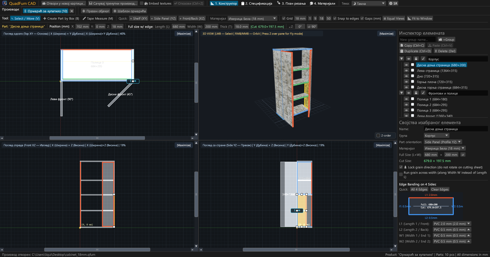
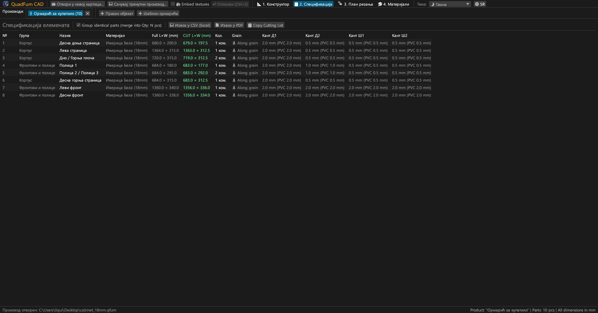
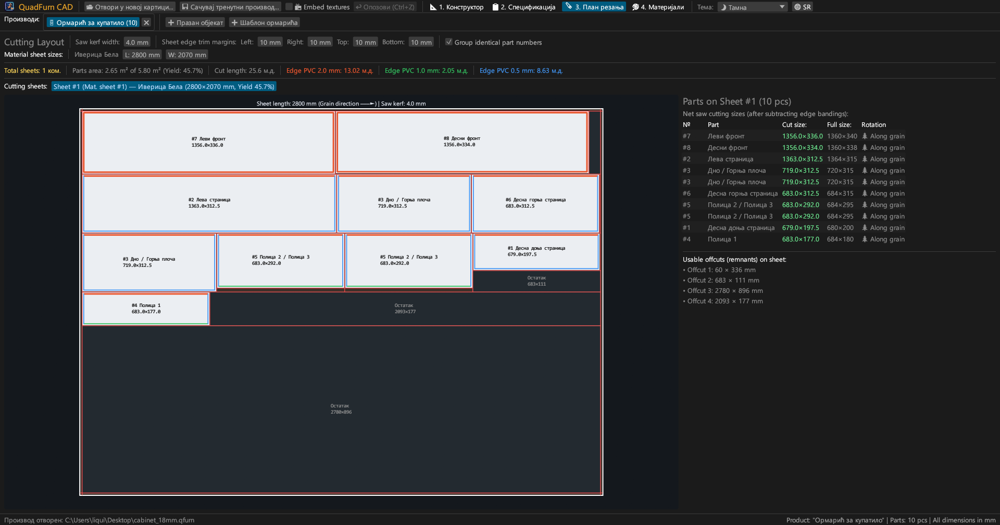
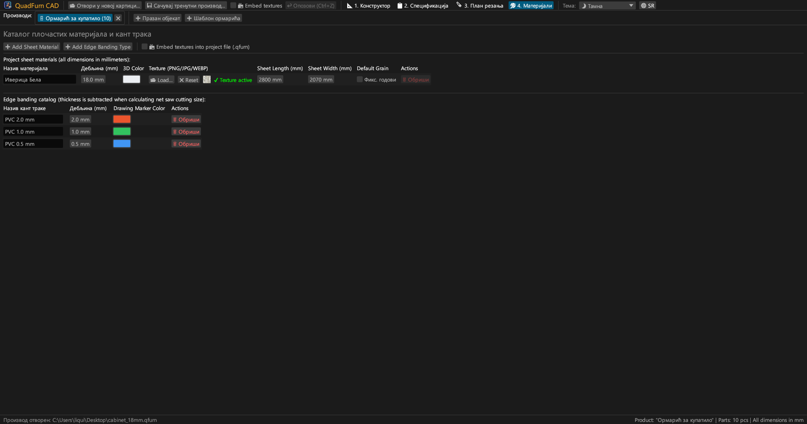
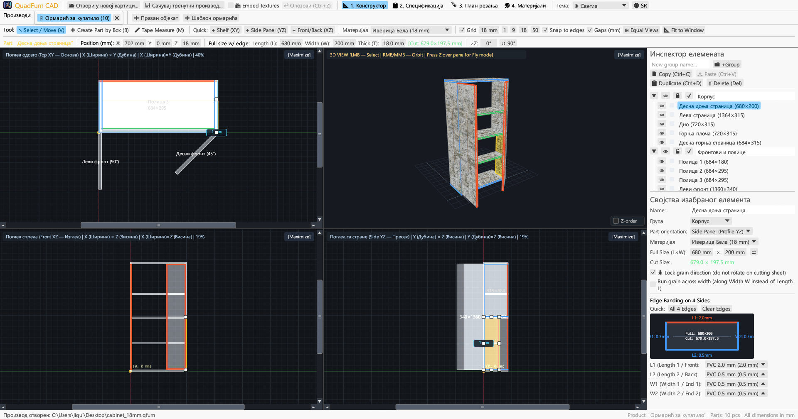
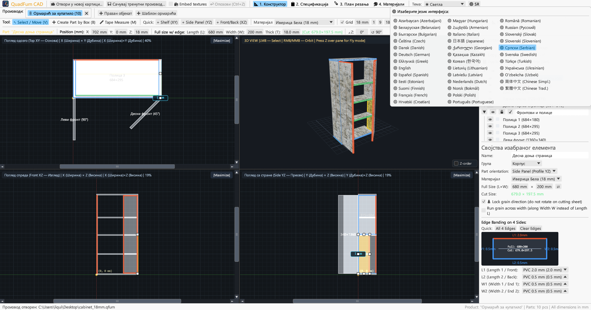

# QuadFurn CAD

**САПР за плочасти намештај од универа (иверице) — 4-пројекциони просторни пројектант + гиљотинско кројење плоча**

 

👉 **[🚀 Покрените QuadFurn CAD директно у прегледачу (WebAssembly)](https://rbm13s.github.io/QuadFurn/app/)** • **[🌐 Званични сајт](https://rbm13s.github.io/QuadFurn/sr.html)**

 

**Languages / Языки / Мови / Sprachen:** 
[English](../README.md) •
[Русский](README-ru.md) •
[Українська](README-uk.md) •
[Беларуская](README-be.md) •
[Қазақша](README-kk.md) •
[ქართული](README-ka.md) •
[Հայերեն](README-hy.md) •
[Azərbaycan](README-az.md) •
[Oʻzbekcha](README-uz.md) •
[Deutsch](README-de.md) •
[Français](README-fr.md) •
[Español](README-es.md) •
[Italiano](README-it.md) •
[Português](README-pt.md) •
[Polski](README-pl.md) •
[Čeština](README-cs.md) •
[Slovenčina](README-sk.md) •
[Slovenščina](README-sl.md) •
[Български](README-bg.md) •
**Српски** •
[Hrvatski](README-hr.md) •
[Nederlands](README-nl.md) •
[Dansk](README-da.md) •
[Norsk](README-no.md) •
[Svenska](README-sv.md) •
[Suomi](README-fi.md) •
[Eesti](README-et.md) •
[Latviešu](README-lv.md) •
[Lietuvių](README-lt.md) •
[Magyar](README-hu.md) •
[Română](README-ro.md) •
[Türkçe](README-tr.md) •
[Ελληνικά](README-el.md) •
[简体中文](README-zh-cn.md) •
[繁體中文](README-zh-tw.md) •
[日本語](README-ja.md) •
[한국어](README-ko.md)

---

## Садржај

- [Увод](#увод)
- [Снимци екрана и визуелни преглед](#снимци-екрана-и-визуелни-преглед)
- [Кључне могућности](#кључне-могућности)
- [Функционална документација](#функционална-документација)
- [Контроле и пречице](#контроле-и-пречице)
- [Лиценца](#лиценца)

---

## Увод

**QuadFurn CAD** је CAD апликација високих перформанси за пројектовање плочастог намештаја од универа (ламиниране иверице), медијапана (МДФ) и шперплоче, са аутоматским одузимањем кантовања и гиљотинским кројењем плоча.

---

## Снимци екрана и визуелни преглед

### 1. 4-пројекциони CAD пројектант (Тамна тема)
Синхроне 2D пројекције (**Одозго XY**, **Спреда XZ**, **Са стране YZ**) и **3D приказ**:

### 2. Спецификација делова
Таблица мера након одузимања кантовања:

### 3. Кројне листе
Оптималан распоред на стандардним плочама:

### 4. Материјали и кантови
Управљање дебљинама, бојама и текстурама (`PNG`, `JPG`, `WEBP`):

### 5. Светла тема
Контрастна светла тема:

### 6. 37 уграђених језика
Брзо пребацивање између 37 језика путем дугмета **`🌐`**:

---

## Лиценца

Пројекат се дистрибуира под слободном [MIT License](../LICENSE) лиценцом.
