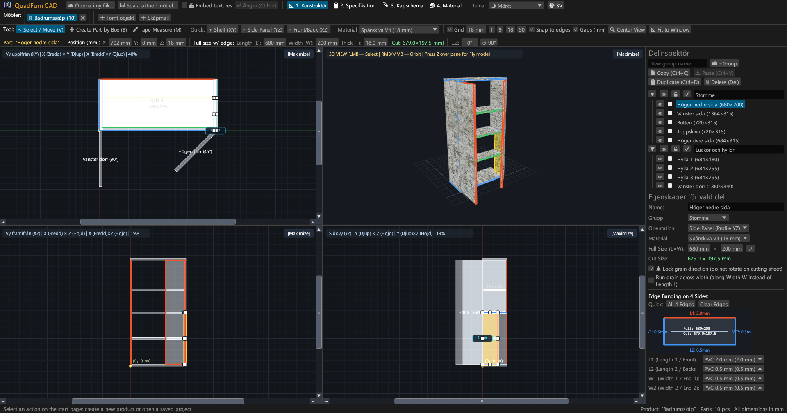
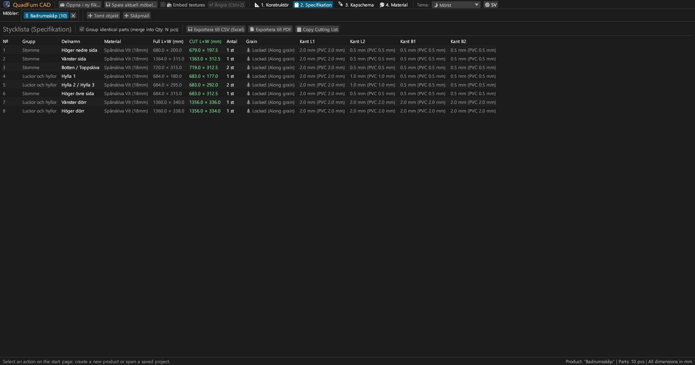
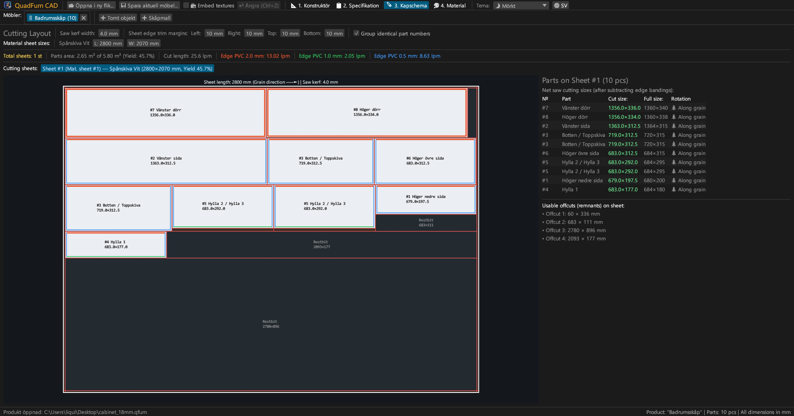
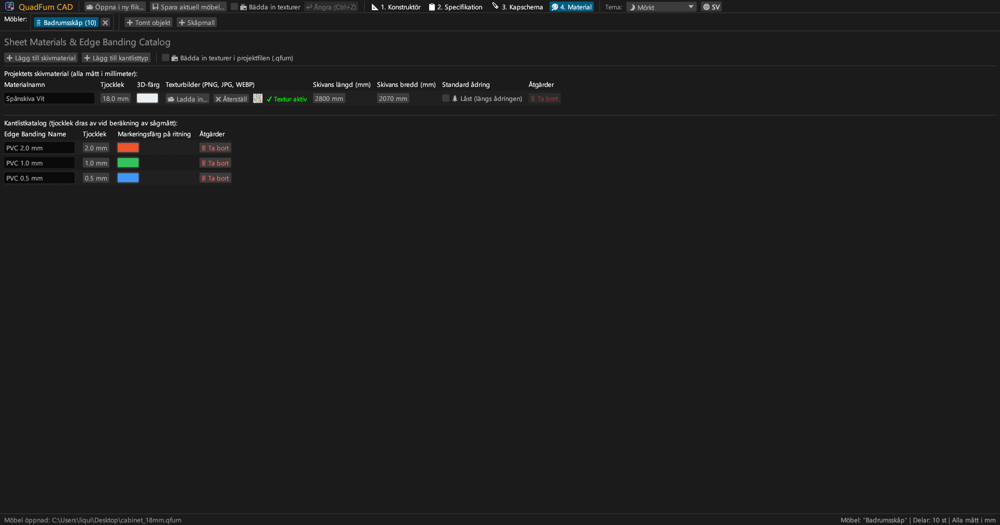
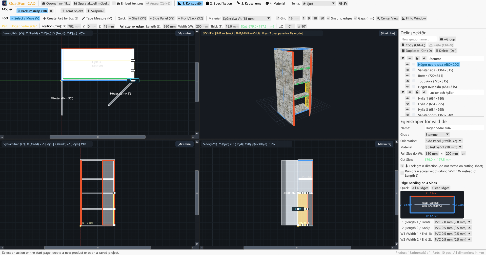
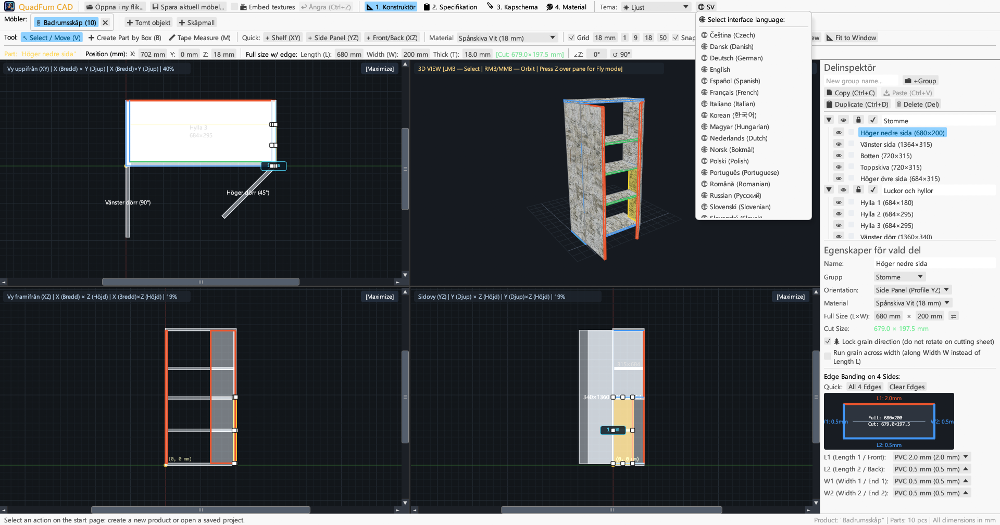

<div align="center">


# QuadFurn CAD

**CAD för skiv- och spånskivemöbler — Rumslig 4-vyers konstruktör + Giljotin kapoptimerare för skivor**

[](https://github.com/rbm13s/QuadFurn/actions/workflows/build.yml)
[](https://github.com/rbm13s/QuadFurn/releases)
[](https://www.rust-lang.org/)
[](https://github.com/emilk/egui)
[](https://wgpu.rs/)
[](#8-visuella-teman-och-lokalisering-på-22-språk)
[](#komma-igång)
[](../LICENSE)

<br/>

**Languages / Языки / Мови / Sprachen:**<br/>
[English](../README.md) •
[Русский](README-ru.md) •
[Українська](README-uk.md) •
[Deutsch](README-de.md) •
[Polski](README-pl.md) •
[Español](README-es.md) •
[Français](README-fr.md) •
[Italiano](README-it.md) •
[Português](README-pt.md) •
[Čeština](README-cs.md) •
[Slovenčina](README-sk.md) •
[Slovenščina](README-sl.md) •
[Nederlands](README-nl.md) •
[Dansk](README-da.md) •
[Norsk](README-no.md) •
**Svenska** •
[Magyar](README-hu.md) •
[Română](README-ro.md) •
[Türkçe](README-tr.md) •
[简体中文](README-zh-cn.md) •
[日本語](README-ja.md) •
[한국어](README-ko.md)

</div>

---

## Innehållsförteckning

- [Introduktion](#introduktion)
- [Skärmdumpar och visuell rundtur](#skärmdumpar-och-visuell-rundtur)
- [Nyckelfunktioner](#nyckelfunktioner)
- [Funktionell dokumentation](#funktionell-dokumentation)
  - [1. 4-vyers CAD-konstruktör & precisionskontroller](#1-4-vyers-cad-konstruktör--precisionskontroller)
  - [2. Aritmetiska uttryck i numeriska inmatningsfält](#2-aritmetiska-uttryck-i-numeriska-inmatningsfält)
  - [3. Kantlister och automatiskt avdrag för nettosågmått](#3-kantlister-och-automatiskt-avdrag-för-nettosågmått)
  - [4. 2D giljotin skäroptimering](#4-2d-giljotin-skäroptimering)
  - [5. Projektflikar och urklipp mellan projekt](#5-projektflikar-och-urklipp-mellan-projekt)
  - [6. Export av produktionspass (vektor-PDF, CSV, urklipp)](#6-export-av-produktionspass-vektor-pdf-csv-urklipp)
  - [7. Skiv-, textur- och kantlistkatalog](#7-skiv--textur--och-kantlistkatalog)
  - [8. Visuella teman och lokalisering på 22 språk](#8-visuella-teman-och-lokalisering-på-22-språk)
- [Styrning och tangentbordsgenvägar](#styrning-och-tangentbordsgenvägar)
- [Komma igång](#komma-igång)
- [Inställningar och filformat](#inställningar-och-filformat)
- [Projektarkitektur](#projektarkitektur)
- [Licens](#licens)

---

## Introduktion

**QuadFurn CAD** är ett högpresterande flerplattforms CAD-program skrivet i Rust, tillgängligt både som ett snabbt integrerat skrivbordsprogram (Windows, Linux, macOS) och som en installationsfri WebAssembly (WASM) onlineversion som körs direkt i moderna webbläsare. Det är framtaget för formgivning av skåp- och panelmöbler i laminerad spånskiva (melamin), MDF, HDF och plywood, komplett med automatisk stycklistgenerering och 2D giljotinkapningsoptimering för formatsågar.

QuadFurn förenar ergonomin från tre beprövade verktyg till ett sammanhållet arbetsflöde:
1. **4-vyers rumslig modellering**: Samtidig redigering i tre synkroniserade 2D ortogonala vyer (**Plan XY — Planritning**, **Front XZ — Fasad/Uppställning**, **Sida YZ — Sektion**) med rullningslister, magnetisk kantlåsning, knapp för att jämna ut fönsterstorlekar (`⊞ Jämna ut fönster`), intelligent tjockleksskydd för delar sedda från kant och en interaktiv **3D Orbit / Förstaperson flygläge (`Z` Noclip)** i realtid.
2. **Precisionstransformeringsfält**: Omedelbar numerisk inmatning av koordinater (`X`, `Y`, `Z`), skivmått (`L × W × T`) och vridningsvinkel (`∠Z`) med inbyggd formelberäkning direkt i inmatningsfälten (t.ex. `600-4` eller `720+18`).
3. **Skivsågning och automatiskt kantlistavdrag**: Automatiskt avdrag för tjockleken på PVC/ABS-kantlister på alla 4 sidor för att beräkna det exakta **nettosågmåttet för justersågen**, kopplat till en 2D giljotinoptimerare som respekterar träets ådringsriktning, sågklingans snittbredd och renkapning av skivans råkanter.

---

## Skärmdumpar och visuell rundtur

### 1. 4-vyers CAD-konstruktör (Mörkt tema)
Synkroniserade ortogonala plan (**Plan XY**, **Front XZ**, **Sida YZ**) och texturerad **3D-vy** med perspektivkorrigerad UV-mappning, 8-punkters storlekshandtag och höger **Komponentinspektör**.



### 2. Komponentlista (Stycklista) och specifikationer
Överskådlig tabell som visar både **Färdiga mått (`L × W`)** och **Nettosågmått för såg (`CUT L × W`)** efter avdrag för kantlister på respektive sida (`L1`, `L2`, `W1`, `W2`).



### 3. Giljotin kapoptimeringsplan för skivor
Nesting på standardskivor (`2800 × 2070 mm` osv.) med genomgående giljotinsnitt, klingförlust, kantbeskärning, visuella kantlistmarkeringar och förteckning över användbara spillbitar.



### 4. Skiv- och kantlistkatalog
Hantering av skivtjocklekar, 3D-färger, anpassade yttexturer (`PNG`, `JPG`, `WEBP`), ådringslås och typer av ABS/PVC-kantlister.



### 5. Stöd för Ljust tema
Modernt ljust tema med hög kontrast jämte det mörka temat, inklusive automatisk synkronisering med operativsystemets färgschema.



### 6. 22 inbyggda språk (Användargränssnitt och PDF-export)
Omedelbart språkbyte utan omstart via **`🌐`**-knappen i verktygsraden, automatisk detektering av operativsystemets språk vid första start och fullt översatta PDF-rapporter.



---

## Nyckelfunktioner

- **Synkroniserad 4-vyers arbetsyta**: Arbeta i Plan (`XY`), Front (`XZ`), Sida (`YZ`), eller maximera valfri vy med ett klick (`[Maximera]` / `[Återställ 4 vyer]`).
- **Hårdvaruaccelererad 3D-förhandsgranskning**: Orbit-kamera (`Höger musknapp`/`Mittenknapp`) + friflygande kamera i förstapersonsperspektiv (`tangent Z` + `WASD`/`Mellanslag`/`Ctrl`) med UV-texturer och precis OBB-strålkastning.
- **Magnetisk snäppfunktion och dynamiska avståndsmått**: Automatisk snäppning till rutnät (`1`, `9`, `18`, `50 mm` eller valfritt), magnetisk anslutning mot intilliggande ytor och kanter (`0 mm`) samt visning av verkliga avstånd i millimeter till intilliggande paneler.
- **Rektangelmarkering och grupptransformation**: Dra en markeringsrektangel i valfri 2D-vy för att flytta flera skivor samtidigt, duplicera (`Ctrl+D`) eller kopiera mellan olika öppna möbelprojekt (`Ctrl+C` / `Ctrl+V`).
- **Inbyggd miniräknare**: Alla numeriska fält hanterar matematiska formler som `600+100`, `800-36`, `720/2` eller `45+15`.
- **Automatiskt avdrag för kantlister vid kapning**: Tilldela kantlist (`0.4 mm`, `0.5 mm`, `1.0 mm`, `2.0 mm` osv.) på de 4 sidorna (`L1`, `L2`, `W1`, `W2`), så beräknar programmet omedelbart sågmåttet:
  $$\text{Såglängd} = L_{\text{färdig}} - E_{L1} - E_{L2}, \quad \text{Sågbredd} = W_{\text{färdig}} - E_{W1} - E_{W2}$$
- **2D giljotin-nestingmotor**: Flerskivalgoritm som tar hänsyn till träets fiberriktning, sågklingans snittbredd och renkapningsmarginaler på alla 4 sidor.
- **Komplett produktionspass i vektor-PDF A4 Liggande**: Exportera med ett klick på det aktiva språket:
  1. Komplett stycklista över alla komponenter
  2. Tekniska 4-vyers ritningar (`Plan XY`, `3D Isometrisk`, `Front XZ`, `Sida YZ`) med yttermått
  3. Detaljerade giljotinkapplaner för varje enskild skiva
  4. Skivöversikt och löpmeter kantlister med `+15 %` spilltillägg

---

## Funktionell dokumentation

### 1. 4-vyers CAD-konstruktör & precisionskontroller

Fliken **Konstruktör** (`📐 1. Konstruktör`) omfattar tre huvuddelar:

1. **Övre verktygsrader**:
   - **Ritverktyg**:
     - `↖ Välj / Flytta (V)`: Klicka för att välja ett element, dra för att flytta, eller använd de 8 handtagen i 2D för att ändra storlek. Dra i tomt utrymme för att öppna en markeringsrektangel.
     - `➕ Skapa komponent med ram (B)`: Dra en rektangel i en 2D-vy (`Plan XY`, `Front XZ` eller `Sida YZ`) för att skapa en skiva i det planet.
     - `📏 Måttband (M)`: Mät exakta avstånd från punkt till punkt (`ΔX`, `ΔY`, `L`) i millimeter.
   - **Snabbinsättning**: Knappar för snabb placering av hyllplan (`+ Hyllplan (XY)`), gavlar (`+ Gavel (YZ)`) eller luckor/ryggar (`+ Lucka/Rygg (XZ)`).
   - **Rutnät och snäppning**: Välj rutnätssteg (`1`, `9`, `18`, `50 mm`), magnetisk snäppning mot intilliggande kanter och dynamiska avstånd.
   - **Kamerajustering**:
     - `🔍 Centrera vy`: Centrerar kameran mot nollpunkten eller möbelns mitt.
     - `📐 Anpassa till fönster`: Beräknar automatiskt möbelns yttermått och skalar om i alla 4 fönster samtidigt.
   - **Precisionstransformeringsfält**: Direkt inmatning och redigering av koordinater `X`, `Y`, `Z`, elementstorlek `L`, `W`, `T`, grön sågmåttsetikett `[Såg: L × W mm]` samt vridningsvinkel `∠Z`.

2. **Fyra arbetsfönster**:
   - **2D ortogonala vyer (`Plan XY`, `Front XZ`, `Sida YZ`)** med rullningslister, millimeterlinjaler och färgade kantlistmarkeringar.
   - **3D-vy**: Orbit-rotation (`Höger` eller `Mittenmusknapp`), zoom med rullhjul, 3D-markering och **Förstaperson flygläge (Noclip)** (tryck **`Z`** över 3D-rutan och flyg med `WASD`, `Mellanslag`, `Ctrl`/`Skift`).

3. **Höger Komponentinspektör**:
   - Gruppering av element i **Grupper** (*Stomme*, *Luckor*, *Lådor*).
   - Synlighetsreglage (`👁`) och redigeringslås (`🔒`).
   - Materialval, orientering, dimensioner (`L × W` med växlingsknapp `⇄`), ådringslås (`🌲 Lås ådringsriktning`), tvärgående ådring (`🔄 Tvärgående ådring`) och interaktivt 4-sidigt kantlistschema.

---

### 2. Aritmetiska uttryck i numeriska inmatningsfält

Samtliga sifferfält i programmet hanterar matematiska beräkningar:
- **Addition och subtraktion**: Skriv t.ex. `600+100` eller `600-4` i ett fält med `600` och tryck `Enter` — värdet ändras direkt till `700` eller `596`.
- **Multiplikation, division och parenteser**: Uttryck som `(800-36)/2` eller `18*2` utvärderas automatiskt.
- Både punkt `.` och komma `,` accepteras som decimaltecken, och enheter (`mm`, `°`) filtreras bort automatiskt.

---

### 3. Kantlister och automatiskt avdrag för nettosågmått

- Varje skivkomponent har 4 kanter: **`L1`** (Längd 1 / Fram), **`L2`** (Längd 2 / Bak), **`W1`** (Bredd 1 / Sida 1) och **`W2`** (Bredd 2 / Sida 2).
- Om du tilldelar en PVC-kantlist på `2.0 mm` till `L1` och `0.5 mm` till `L2`, `W1`, `W2` på en skiva med måtten `680 × 200 mm`, räknar QuadFurn automatiskt ut **Nettomåttet som ska sågas**:
  - $\text{Såglängd } L = 680 - 2.0 - 0.5 = 677.5\text{ mm}$
  - $\text{Sågbredd } W = 200 - 0.5 - 0.5 = 199.0\text{ mm}$
- Kantlisterna visas tydligt med färgmarkeringar både i 2D/3D-vyerna och på skivoptimeringsplanen.

---

### 4. 2D giljotin skäroptimering

Fliken **Skivoptimeringsplan** (`🪚 3. Skivoptimeringsplan`) räknar ut bästa möjliga fördelning av komponenterna på råskivorna:
- **Justerbara sågparametrar**:
  - **Sågklingans snittbredd** (standard `4.0 mm`).
  - **Renkapningsmarginaler på råskivan** (`Vänster`, `Höger`, `Överkant`, `Nederkant`, standard `10 mm`) för att kapa bort transportskador.
- **Hänsyn till träets ådringsriktning**:
  - Komponenter med **Låst ådring (`🌲`)**: hålls strikt parallella med skivans längdriktning (`Skivlängd L`).
  - Komponenter med **Fri ådring**: tillåts roteras $90^\circ$ av optimeringsmotorn om det minskar spillet.
- **Visuell sågkarta och användbart spill**:
  - Varje skiva ritas upp med röda genomgående giljotinsnitt, komponentnummer, sågmått, kantlistmarkeringar och måttsatta användbara spillbitar.
  - Omfattande statistik: antal nödvändiga skivor, materialutnyttjande i procent (%), total såglängd och kantliståtgång i meter.

---

### 5. Projektflikar och urklipp mellan projekt

- **Startsida och senaste projekt**: Skapa en tom möbel, starta från en 2-dörrars mall, öppna `.qfurn`/`.json`-filer eller välj bland de **10 senast öppnade projekten**.
- **Flera möbelflikar samtidigt**: Konstruera flera skåpmoduler parallellt (dubbelklicka på fliknamnet för att byta namn).
- **Kopiera och klistra in mellan projekt**: Markera komponenter i en flik, tryck `Ctrl+C`, växla till en annan flik (eller en annan öppen instans av QuadFurn), och tryck `Ctrl+V`. Saknade material och kantlister skapas automatiskt i målprojektet.
- **Skydd mot dataförlust**: Vid stängning av en ändrad flik eller avslutning av programmet visas en bekräftelsedialog (`Spara och avsluta`, `Avsluta utan att spara`, `Avbryt`).

---

### 6. Export av produktionspass (vektor-PDF, CSV, urklipp)

I fliken **Stycklista** (`📋 2. Stycklista`):
1. **`📄 Exportera till PDF` (Vektoriellt A4 Liggande produktionspass)**:
   - **Sektion 1**: Fullständig stycklista med färdigmått, sågmått, kantlister och ådringsriktning.
   - **Sektion 2**: Tekniska 4-vyers ritningar (`Plan XY`, `3D Isometrisk`, `Front XZ`, `Sida YZ`) med yttermått.
   - **Sektion 3**: Detaljerade giljotinkapplaner för varje enskild skiva.
   - **Sektion 4**: Skivöversikt och förbrukning av kantlister (nettometer och $+15 \%$ säkerhetsmarginal).
   - Dokumentet skapas på det **aktiva språket** med inbäddade TrueType/CID-vektortypsnitt.
2. **`💾 Exportera till CSV (Excel)`**: Kalkylblad i UTF-8 med BOM och semikolon `;`, klart för Microsoft Excel eller LibreOffice Calc.
3. **`📋 Kopiera såglista`**: Kopierar sågmåtten till urklipp med tabulatorer för enkel import till externa optimeringsprogram eller kalkylblad.

---

### 7. Skiv-, textur- och kantlistkatalog

I fliken **Material** (`🎨 4. Material`):
- Skapa och redigera **Skivmaterial** (`Spånskiva 18 mm`, `MDF 16 mm`, `HDF 3 mm` osv.) med RGB-färger, råskivsmått (`L × W`) och förvalt ådringslås.
- Läs in yttexturer i formaten **`PNG`**, **`JPG`/`JPEG`** eller **`WEBP`** för fotorealistisk 3D-visning.
- **Portabilitet och automatisk textsökning**: När en `.qfurn`-fil öppnas söker QuadFurn automatiskt efter bilderna:
  1. Integrerade direkt i projektfilen (Base64)
  2. I samma mapp som `.qfurn`-projektfilen
  3. I en undermapp `./textures/` bredvid projektfilen
  4. Via den relativa sökvägen eller den ursprungliga absoluta sökvägen
- **Inbäddning av texturer i projektfilen (`📦 Bädda in texturer i projektfilen`)**: Aktivera detta val i verktygsraden eller under Material för att spara bilderna direkt som Base64 i `.qfurn`-filen. Filen blir helt självständig och kan flyttas fritt utan risk för saknade texturer.
- **Grafikkortsskydd**: Filer över 60 MB nekas med en tydlig varning, och extremt höga upplösningar (> 4096 px) skalas ned automatiskt.
- Hantering av **Kantlisttyper** med tjocklek i millimeter och färgmarkeringar. Radering av material eller kantlister som används kräver säkerhetsbekräftelse.

---

### 8. Visuella teman och lokalisering på 22 språk

- **Visuella teman**: Växla smidigt mellan **🌙 Mörkt**, **☀ Ljust** och **🖥 Systemtema** i den övre verktygsraden.
- **22 inbyggda språk**:
  `Svenska`, `English`, `Русский`, `Українська`, `Deutsch`, `Polski`, `Español`, `Français`, `Italiano`, `Português`, `Čeština`, `Slovenčina`, `Slovenščina`, `Nederlands`, `Dansk`, `Norsk`, `Magyar`, `Română`, `Türkçe`, `简体中文`, `日本語` och `한국어`.
- **Automatisk detektering vid första start**: Känner av operativsystemets språk automatiskt och ställer in det som standard. Valet sparas i `%APPDATA%\QuadFurn\settings.json`.

---

## Styrning och tangentbordsgenvägar

| Tangentbordsgenväg | Åtgärd |
| :--- | :--- |
| **`V`** | Aktivera verktyget **Välj och flytta** (8 storlekshandtag på ytan och 2 kanthandtag från kanten, plus rammarkering) |
| **`B`** | Aktivera verktyget **Skapa komponent med ram** i 2D-vyer |
| **`M`** | Aktivera **Måttband** i 2D-vyer |
| **Dra med `Vänster musknapp` (2D)** | Flytta komponenter, justera handtag eller dra markeringsram i tomt utrymme |
| **`Skift / Ctrl (Cmd) + Vänster musknapp` (2D)** | Lägg till eller ta bort komponent från flerval |
| **Dra med `Höger` / `Mittenmusknapp` (2D)** | Panorera vyn (2D pan) |
| **`Rullhjul på mus` (2D / 3D)** | Zooma in/ut centrerat kring markören |
| **Dra med `Höger` / `Mittenmusknapp` (3D)** | Orbit-rotation av 3D-kameran |
| **`Z` (över 3D-rutan)** | Slå på/av **Förstaperson flygläge (Noclip)** |
| **`W` `A` `S` `D` / `Mellanslag` / `Ctrl (Cmd)`** | Flyg fram/vänster/bakåt/höger/upp/ner i 3D (`Skift` för högre fart) |
| **`Ctrl + S` / `Cmd (⌘) + S`** | Spara den aktiva möbeln (`.qfurn` / `.json`) |
| **`Ctrl + Z` / `Cmd (⌘) + Z`** | Ångra senaste åtgärd (historik upp till 40 steg) |
| **`Ctrl + C` / `Cmd (⌘) + C`** | Kopiera markerade delar till urklipp |
| **`Ctrl + V` / `Cmd (⌘) + V`** | Klistra in delar (fungerar mellan olika flikar) |
| **`Ctrl + D` / `Cmd (⌘) + D`** | Duplicera markerade komponenter |
| **`Delete` / `Backspace`** | Ta bort markerade komponenter |
| **`←` `→` `↑` `↓` (2D-vyer)** | Flytta markerade delar med valt rutnätssteg (`Shift` för dubbelt steg) |

---

## Komma igång

### Förkompilerade installationspaket (GitHub Releases)
Varje ny utgåva bygger automatiskt färdiga paket via [GitHub Actions](https://github.com/rbm13s/QuadFurn/actions):
- **Windows (`x86_64`)**: `QuadFurn-windows-x86_64.zip` — portabel `QuadFurn.exe` med inbäddad ikon.
- **Linux (`Debian 12+ / Ubuntu 22.04+ x86_64`)**:
  - `quadfurn_<version>_amd64.deb` — officiellt installationspaket för Debian/Ubuntu (installerar binärfil, menyval och systemikoner):
    ```bash
    sudo apt install ./quadfurn_0.2.3_amd64.deb
    ```
  - `QuadFurn-linux-x86_64.tar.gz` — portabelt Linux-arkiv.
- **macOS (`Universellt: Apple Silicon M1–M4 + Intel x86_64`)**: `QuadFurn-macos-universal.zip` — infödd `QuadFurn.app` med Retina-ikon.

---

### Bygga från källkod

#### Förutsättningar
- [Rust Toolchain](https://rustup.rs/) (`stable`, utgåva Rust 2021)
- Systembibliotek på **Linux (Debian / Ubuntu)**:
  ```bash
  sudo apt-get update && sudo apt-get install -y \
    build-essential pkg-config libxcb-render0-dev libxcb-shape0-dev \
    libxcb-xfixes0-dev libxkbcommon-dev libxkbcommon-x11-dev libssl-dev \
    libgtk-3-dev libglib2.0-dev libatk1.0-dev libgdk-pixbuf-2.0-dev \
    libcairo2-dev libpango1.0-dev libgl1-mesa-dev fonts-dejavu-core fonts-noto-cjk
  ```
- **macOS**: Xcode Command Line Tools (`xcode-select --install`)
- **Windows**: Windows 10 / 11 med Visual C++ Build Tools

#### Kompileringskommandon
```bash
# Kör i utvecklingsläge
cargo run

# Bygg optimerad version för distribution
cargo build --release

# Kör enhetstester
cargo test
```

---

## Inställningar och filformat

- **Användarinställningar (`settings.json`)**:
  Sparas automatiskt i operativsystemets standardkonfigurationsmapp:
  - **Windows**: `%APPDATA%\QuadFurn\settings.json`
  - **Linux**: `~/.config/QuadFurn/settings.json`
  - **macOS**: `~/Library/Application Support/QuadFurn/settings.json`
  
  Lagrar:
  - `theme_choice` (`Dark`, `Light`, `System`)
  - `language` (`Sv`, `En`, `Ru` osv.)
  - `recent_projects` (upp till 10 senast öppnade filer)
- **Projektfiler (`.qfurn` / `.json`)**:
  Mänskligt läsbara JSON-filer i UTF-8 med alla komponenter, grupper, material, texturer, kantlister och såginställningar. Vid aktiverad inbäddning sparas texturer som Base64-strängar inuti filen.

---

## Projektarkitektur

```text
QuadFurn/
├── .github/
│   └── workflows/
│       └── build.yml          # CI/CD-arbetsflöden på GitHub Actions (Linux .deb/.tar.gz, macOS .app, Windows .zip)
├── assets/
│   ├── icon.jpeg              # Programikon och källbild
│   └── screenshots/           # Skärmdumpar för dokumentationen
├── docs/                      # Lokaliserad dokumentation på 22 språk
├── src/
│   ├── main.rs                # Startpunkt, hantering av projektflikar, startsida och tangentbordsgenvägar
│   ├── model.rs               # Datamodell (Project, PartBlock, SheetMaterial, EdgeBanding, OBB)
│   ├── viewport.rs            # 4-vyers kontroller, 2D och 3D rendering wgpu/painter
│   ├── snapping.rs            # Magnetisk snäppfunktion till rutnät och kanter, projektionsaxlar
│   ├── cutter.rs              # 2D giljotin skäroptimering och avdrag för kantlister
│   ├── export.rs              # Vektoriell PDF A4 Liggande exportör och CSV-exportör
│   ├── ui_panels.rs           # Transformeringsfält, Komponentinspektör, Stycklista, Skivoptimeringsplan och Material
│   └── i18n.rs                # Översättningsordböcker för 22 språk och automatisk språkidentifiering
├── build.rs                   # Automatisk konvertering av ICO-ikon för Windows och PE-resurs
├── Cargo.toml                 # Paketkonfiguration och beroenden
└── LICENSE                    # MIT-licens
```

---

## Licens

Detta projekt är licensierat under den öppna [MIT-licensen](../LICENSE) — fritt att använda, anpassa och distribuera för såväl kommersiella som privata ändamål.


