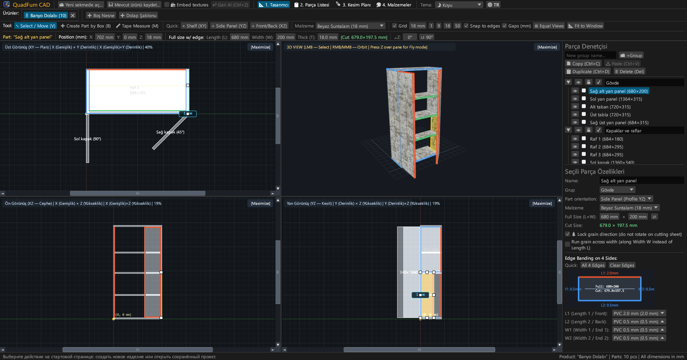
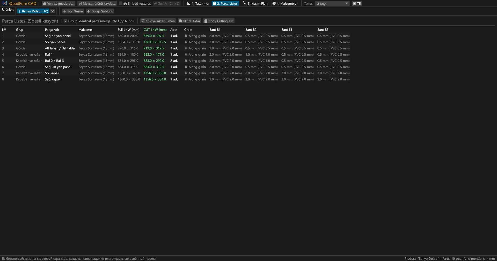
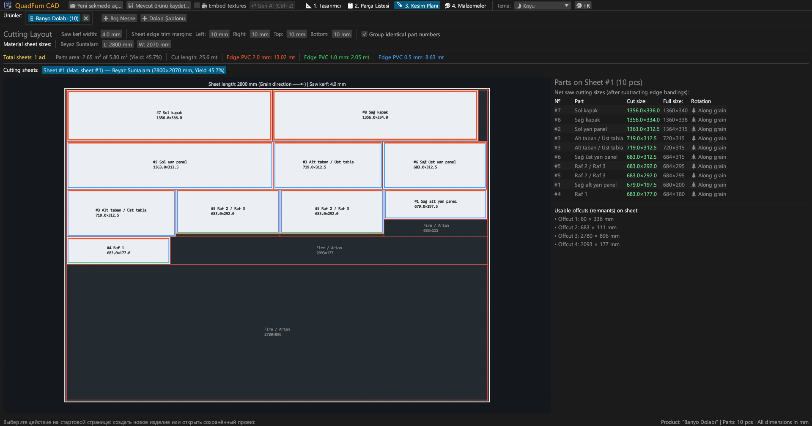
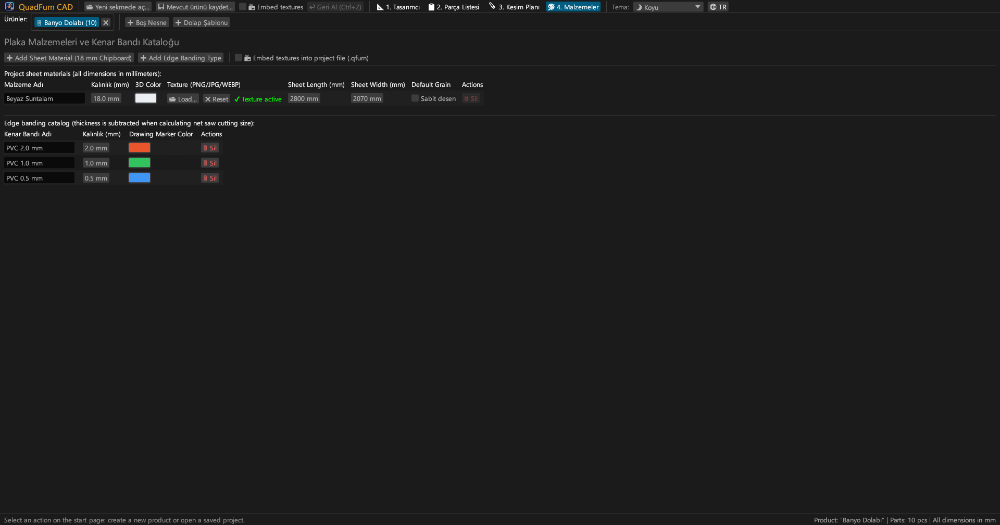
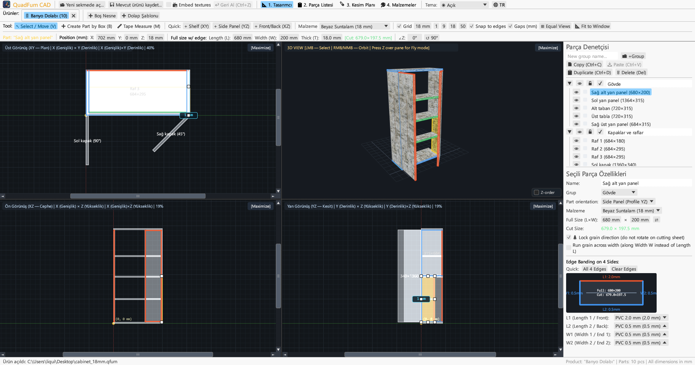
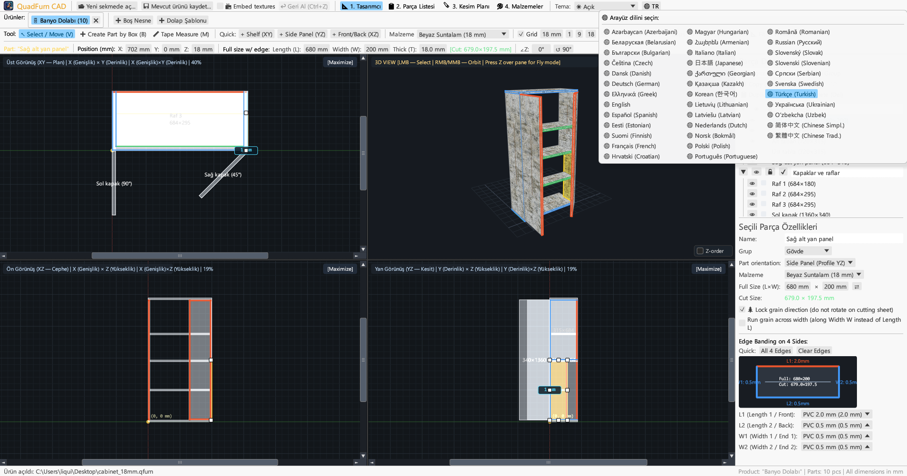

<div align="center">


# QuadFurn CAD

**Panel ve Sunta Mobilya CAD — 4 Görünümlü Mekansal Tasarımcı + Giyotin Panel Kesim Optimizasyonu**

[](https://github.com/rbm13s/QuadFurn/actions/workflows/build.yml)
[](https://github.com/rbm13s/QuadFurn/releases)
[](https://www.rust-lang.org/)
[](https://github.com/emilk/egui)
[](https://wgpu.rs/)
[](#8-görsel-temalar-ve-22-dil-desteği)
[](#başlarken)
[](../LICENSE)

<br/>

**Languages / Языки / Мови / Sprachen:**<br/>
[English](../README.md) •
[Русский](README-ru.md) •
[Українська](README-uk.md) •
[Deutsch](README-de.md) •
[Polski](README-pl.md) •
[Español](README-es.md) •
[Français](README-fr.md) •
[Italiano](README-it.md) •
[Português](README-pt.md) •
[Čeština](README-cs.md) •
[Slovenčina](README-sk.md) •
[Slovenščina](README-sl.md) •
[Nederlands](README-nl.md) •
[Dansk](README-da.md) •
[Norsk](README-no.md) •
[Svenska](README-sv.md) •
[Magyar](README-hu.md) •
[Română](README-ro.md) •
**Türkçe** •
[简体中文](README-zh-cn.md) •
[日本語](README-ja.md) •
[한국어](README-ko.md)

</div>

---

## İçindekiler

- [Giriş](#giriş)
- [Ekran Görüntüleri ve Görsel Tanıtım](#ekran-görüntüleri-ve-görsel-tanıtım)
- [Önemli Özellikler](#önemli-özellikler)
- [Fonksiyonel Dokümantasyon](#fonksiyonel-dokümantasyon)
  - [1. 4 Görünümlü CAD Tasarımcısı ve Hassas Kontroller](#1-4-görünümlü-cad-tasarımcısı-ve-hassas-kontroller)
  - [2. Sayısal Alanlarda Aritmetik İfadeler](#2-sayısal-alanlarda-aritmetik-ifadeler)
  - [3. Kenar Bandı ve Otomatik Net Testere Kesim Ölçüsü Düşümü](#3-kenar-bandı-ve-otomatik-net-testere-kesim-ölçüsü-düşümü)
  - [4. 2D Giyotin Panel Kesim Optimizasyonu](#4-2d-giyotin-panel-kesim-optimizasyonu)
  - [5. Çoklu Proje Sekmeleri ve Projeler Arası Pano](#5-çoklu-proje-sekmeleri-ve-projeler-arası-pano)
  - [6. Üretim Pasaportu Dışa Aktarma (Vektör PDF, CSV, Pano)](#6-üretim-pasaportu-dışa-aktarma-vektör-pdf-csv-pano)
  - [7. Panel Malzemeleri, Dokular ve Kenar Bandı Kataloğu](#7-panel-malzemeleri-dokular-ve-kenar-bandı-kataloğu)
  - [8. Görsel Temalar ve 22 Dil Desteği](#8-görsel-temalar-ve-22-dil-desteği)
- [Kontroller ve Klavye Kısayolları](#kontroller-ve-klavye-kısayolları)
- [Başlarken](#başlarken)
- [Ayarlar ve Dosya Formatları](#ayarlar-ve-dosya-formatları)
- [Proje Mimarisi](#proje-mimarisi)
- [Lisans](#lisans)

---

## Giriş

**QuadFurn CAD**, suntalam, MDF, HDF ve kontrplak gibi levha malzemelerden gövde ve panel mobilya tasarımı yapmak, otomatik parça kesim listesi üretmek ve 2D giyotin panel kesim optimizasyonu sağlamak amacıyla Rust ile geliştirilmiş yerel ve son derece hızlı bir masaüstü CAD uygulamasıdır.

QuadFurn, üç köklü aracın ergonomisini tek bir kusursuz iş akışında birleştirir:
1. **4 Görünümlü Mekânsal Modelleme**: Üç senkronize 2D dik projeksiyonda (**Üst XY — Plan**, **Ön XZ — Görünüş**, **Yan YZ — Kesit**) kaydırma çubukları, manyetik kenar yakalama ve eş zamanlı gerçek zamanlı **3D Yörünge / Birinci Şahıs Serbest Uçuş (`Z` Noclip)** ile tasarım.
2. **Hassas Dönüşüm Çubuğu**: Koordinatların (`X`, `Y`, `Z`), parça boyutlarının (`L × W × T`) ve dönüş açısının (`∠Z`) doğrudan metin kutuları içinden matematiksel formüllerle (örn. `600-4` veya `720+18`) anında girilmesi.
3. **Panel Kesimi ve Otomatik Kenar Bandı Düşümü**: Parça boyutlarından 4 kenardaki PVC/ABS bant kalınlıklarının otomatik düşülerek **net testere ebatlama ölçülerinin** hesaplanması ve ahşap desen yönü, testere bıçağı payı ve kenar tıraşlamalarını gözeten 2D giyotin optimizasyon algoritması.

---

## Ekran Görüntüleri ve Görsel Tanıtım

### 1. 4 Görünümlü CAD Tasarımcısı (Koyu Tema)
Senkronize dik açılı çizim görünümleri (**Üst XY**, **Ön XZ**, **Yan YZ**) ve perspektif düzeltmeli UV dokulu **3D Görünüm**, 8 noktalı boyutlandırma tutamaçları ve sağ taraftaki **Parça Denetçisi**.



### 2. Parça Listesi (Teknik Şartname) ve Kesim Ölçüleri
Hem **Net Bitmiş Ölçüleri (`L × W`)** hem de her kenardaki kenar bandı düşüldükten sonraki **Net Testere Kesim Ölçülerini (`CUT L × W`)** (`L1`, `L2`, `W1`, `W2`) gösteren ayrıntılı liste.



### 3. Giyotin Levha Kesim Şeması
Standart levha ebatları (`2800 × 2070 mm` vb.) üzerinde boydan boya giyotin kesim hatları, bıçak kalınlığı, kenar tıraşlama payları, kenar bant şeritleri ve ölçülendirilmiş artık parça dökümü.



### 4. Malzeme ve Kenar Bandı Kataloğu
Levha kalınlıkları, 3D renkler, özel yüzey dokuları (`PNG`, `JPG`, `WEBP`), ahşap desen kilitleme ve ABS/PVC kenar bandı tiplerinin yönetimi.



### 5. Açık Tema Desteği
Koyu temanın yanı sıra modern yüksek kontrastlı Açık Tema ve işletim sistemi renk düzeniyle otomatik eşzamanlama.



### 6. 22 Dahili Dil (Arayüz ve PDF Dışa Aktarım)
Üst araç çubuğundaki **`🌐`** simgesinden yeniden başlatma gerektirmeden anında dil değiştirme, ilk açılışta işletim sistemi dilini otomatik algılama ve çok dilli PDF çıktıları.



---

## Önemli Özellikler

- **Senkronize 4 Görünümlü Çalışma Alanı**: Üst (`XY`), Ön (`XZ`), Yan (`YZ`) görünümlerinde çalışın veya dilediğiniz pencereyi tek tıkla büyütün (`[Ekranı Kapla]` / `[4 Görünüme Dön]`).
- **Donanım Hızlandırmalı 3D Önizleme**: Yörünge kamerası (`Sağ fare tuşu`/`Orta tuş`) + birinci şahıs serbest uçuş kamerası (`Z tuşu` + `WASD`/`Boşluk`/`Ctrl`) ile UV doku kaplama ve hassas OBB ışın seçimi.
- **Manyetik Yakalama ve Dinamik Boşluk Ölçüleri**: Izgaraya otomatik yakalama (`1`, `9`, `18`, `50 mm` veya özel), komşu parça yüzey ve kenarlarına manyetik yapışma (`0 mm`) ve bitişik panellere olan net mesafelerin canlı gösterimi.
- **Kutu Seçimi ve Grup Hareketi**: Herhangi bir 2D görünümde çerçeve çizerek birden fazla parçayı seçin, birlikte taşıyın, çoğaltın (`Ctrl+D`) veya farklı mobilya sekmeleri arasında kopyalayıp yapıştırın (`Ctrl+C` / `Ctrl+V`).
- **Dahili Hesap Makinesi**: Tüm sayısal alanlar `600+100`, `800-36`, `720/2` veya `45+15` gibi matematiksel ifadeleri doğrudan kabul eder.
- **Otomatik Kenar Bandı Düşümü**: 4 kenara (`L1`, `L2`, `W1`, `W2`) PVC/ABS kenar bandı (`0.4 mm`, `0.5 mm`, `1.0 mm`, `2.0 mm` vb.) atayın; program testere kesim ölçüsünü anında hesaplar:
  $$\text{Kesim Boyu} = L_{\text{bitmiş}} - E_{L1} - E_{L2}, \quad \text{Kesim Eni} = W_{\text{bitmiş}} - E_{W1} - E_{W2}$$
- **2D Giyotin Yerleşim Motoru**: Ahşap desen yönü kısıtlamalarını, testere kesim genişliğini ve 4 taraflı kenar temizleme tıraşlamalarını tam olarak uygulayan çoklu levha yerleşimi.
- **Eksiksiz Vektör PDF Üretim Pasaportu (Yatay A4)**: Tek bir tıkla geçerli dilde oluşturulan kapsamlı üretim raporu:
  1. Detaylı parça listesi ve bitmiş/kesim ölçüleri
  2. 4 görünümlü teknik çizimler (`Üst XY`, `3D İzometrik`, `Ön XZ`, `Yan YZ`) ve dış gabariler
  3. Her bir levha için detaylı giyotin kesim planları
  4. Levha sarfiyatı ve `+%15` zayiat paylı kenar bandı metrajı

---

## Fonksiyonel Dokümantasyon

### 1. 4 Görünümlü CAD Tasarımcısı ve Hassas Kontroller

**Tasarımcı** sekmesi (`📐 1. Tasarımcı`) üç ana bölüme ayrılır:

1. **Üst Araç Çubukları**:
   - **Çizim Araçları**:
     - `↖ Seç / Taşı (V)`: Seçmek için tıklayın, taşımak için sürükleyin veya 2D görünümlerde 8 tutamacı kullanarak boyutlandırın. Boş alanda sürükleyerek seçim kutusu açın.
     - `➕ Kutu ile Parça Oluştur (B)`: 2D görünümlerde (`Üst XY`, `Ön XZ` veya `Yan YZ`) bir dikdörtgen sürükleyerek o düzleme uygun yeni bir panel ekleyin.
     - `📏 Mezura (M)`: Milimetre cinsinden noktadan noktaya net mesafe ölçümü (`ΔX`, `ΔY`, `L`).
   - **Hızlı Parça Ekleme**: Raf (`+ Raf (XY)`), dikme (`+ Dikme/Yan (YZ)`) veya kapak/arkalık (`+ Kapak/Arkalık (XZ)`) ekleme butonları.
   - **Izgara ve Yakalama**: Izgara adımını seçin (`1`, `9`, `18`, `50 mm`), kenarlara manyetik yapışmayı ve mesafe ölçülerini açıp kapatın.
   - **Kamera Çerçeveleme**:
     - `🔍 Görünümü Ortala`: Kamerayı orijine veya mobilyanın merkezine odaklar.
     - `📐 Pencereye Sığdır`: Mobilyanın dış ölçülerini hesaplar ve tüm 4 görünümü aynı anda ekrana sığdırır.
   - **Hassas Dönüşüm Çubuğu**: Koordinatların `X`, `Y`, `Z`, parça ebatlarının `L`, `W`, `T`, yeşil testere kesim etiketinin `[Kesim: L × W mm]` ve dönüş açısının `∠Z` doğrudan girilmesi.

2. **Dört Çalışma Penceresi**:
   - **2D Dik Projeksiyonlar (`Üst XY`, `Ön XZ`, `Yan YZ`)**: Kaydırma çubukları, milimetrik cetveller ve bantlı kenarların renkli çizgileri.
   - **3D Görünüm**: Yörünge dönüşü (`Sağ` veya `Orta fare tuşu`), tekerlekle yakınlaştırma, 3D parça seçimi ve **Birinci Şahıs Serbest Uçuş Modu (Noclip)** (3D penceresi üzerindeyken **`Z`** tuşuna basın ve `WASD`, `Boşluk`, `Ctrl`/`Shift` ile uçun).

3. **Sağ Parça Denetçisi**:
   - Parçaları özel **Gruplar** altında düzenleme (*Gövde*, *Kapaklar*, *Çekmeceler*).
   - Görünürlük (`👁`) ve kilit (`🔒`) denetimleri.
   - Malzeme seçimi, oryantasyon, boyutlar (`L × W` yön değiştirme `⇄`), desen kilidi (`🌲 Ahşap desen yönünü kilitle`), enine desen (`🔄 Enine desen`) ve interaktif 4 kenar bant diyagramı.

---

### 2. Sayısal Alanlarda Aritmetik İfadeler

Programdaki tüm sayısal giriş kutuları matematiksel ifadeleri destekler:
- **Toplama ve çıkarma**: `600` yazan bir kutuda `600+100` veya `600-4` yazıp `Enter` tuşuna basın — değer derhal `700` veya `596` olarak hesaplanır.
- **Çarpma, bölme ve parantezler**: `(800-36)/2` veya `18*2` gibi ifadeler anında çözümlenir.
- Ondalık ayırıcı olarak hem nokta `.` hem virgül `,` kullanılabilir; birimler (`mm`, `°`) otomatik olarak göz ardı edilir.

---

### 3. Kenar Bandı ve Otomatik Net Testere Kesim Ölçüsü Düşümü

- Her panelin 4 kenarı bulunur: **`L1`** (Boy 1 / Ön), **`L2`** (Boy 2 / Arka), **`W1`** (En 1 / Kenar 1) ve **`W2`** (En 2 / Kenar 2).
- `680 × 200 mm` boyutundaki bir parçada `L1` kenarına `2.0 mm`, `L2`, `W1`, `W2` kenarlarına `0.5 mm` PVC bant atandığında program otomatik olarak **Net Testere Kesim Ölçüsünü** bulur:
  - $\text{Kesim Boyu } L = 680 - 2.0 - 0.5 = 677.5\text{ mm}$
  - $\text{Kesim Eni } W = 200 - 0.5 - 0.5 = 199.0\text{ mm}$
- Bantlar hem 2D/3D çizimlerde hem de kesim şemasında ayırt edici renklerle vurgulanır.

---

### 4. 2D Giyotin Panel Kesim Optimizasyonu

**Kesim Şeması** sekmesi (`🪚 3. Kesim Şeması`) tüm parçaları levhalara en verimli şekilde yerleştirir:
- **Ayarlanabilir Kesim Parametreleri**:
  - **Testere Bıçağı Kalınlığı** (varsayılan `4.0 mm`).
  - **Levha Kenar Tıraşlama Payları** (`Sol`, `Sağ`, `Üst`, `Alt`, varsayılan `10 mm`) fabrika kenar hatalarını temizlemek için.
- **Ahşap Desen Yönüne Uyumluluk**:
  - **Deseni Kilitli (`🌲`) Parçalar**: Levha boyuna (`Levha Boyu L`) kesinlikle paralel kalır.
  - **Serbest Desenli Parçalar**: Fireyi azaltmak için optimizasyon motoru tarafından $90^\circ$ döndürülebilir.
- **Görsel Kesim Haritası ve Kullanılabilir Artık Parçalar**:
  - Her levha üzerinde kırmızı giyotin kesim hatları, parça numaraları, kesim ölçüleri, kenar bantları ve ölçülendirilmiş artık parçalar.
  - Kapsamlı istatistikler: gereken levha adedi, malzeme verimlilik yüzdesi (%), toplam kesim uzunluğu ve metre cinsinden bant sarfiyatı.

---

### 5. Çoklu Proje Sekmeleri ve Projeler Arası Pano

- **Başlangıç Sayfası ve Son Projeler**: Boş mobilya oluşturma, hazır 2 kapaklı dolap şablonuyla başlama, `.qfurn`/`.json` dosyalarını açma veya son açılan **10 projeye** hızlı erişim.
- **Eşzamanlı Çoklu Sekme**: Üst sekme çubuğunda birden fazla mobilyayı aynı anda tasarlayın (yeniden adlandırmak için sekme başlığına çift tıklayın).
- **Projeler Arası Kopyala ve Yapıştır**: Bir sekmedeki parçaları seçin, `Ctrl+C` yapın, diğer sekmeye geçin ve `Ctrl+V` tuşlarına basın. Eksik malzemeler hedef projede otomatik oluşturulur.
- **Veri Kaybı Koruması**: Değiştirilmiş bir sekme kapatılırken veya programdan çıkılırken onay penceresi görüntülenir (`Kaydet ve Çık`, `Kaydetmeden Çık`, `İptal`).

---

### 6. Üretim Pasaportu Dışa Aktarma (Vektör PDF, CSV, Pano)

**Teknik Şartname** sekmesinde (`📋 2. Şartname`):
1. **`📄 PDF Olarak Dışa Aktar` (Vektörel Yatay A4 Üretim Pasaportu)**:
   - **Bölüm 1**: Bitmiş ve kesim ölçüleri, bantlar ve desen yönüyle eksiksiz parça listesi.
   - **Bölüm 2**: Dış gabarileri içeren 4 görünümlü teknik çizim sayfaları (`Üst XY`, `3D İzometrik`, `Ön XZ`, `Yan YZ`).
   - **Bölüm 3**: Kullanılan her bir levha için detaylı giyotin kesim planları.
   - **Bölüm 4**: Levha sarfiyatı ve kenar bandı metrajı (net metre ve `+%15` zayiat payı).
   - Belge, gömülü TrueType/CID vektör yazı tipleriyle **etkin arayüz dilinde** oluşturulur.
2. **`💾 CSV (Excel) Olarak Dışa Aktar`**: Microsoft Excel ve LibreOffice ile tam uyumlu UTF-8 BOM noktalı virgül `;` ayrımlı tablo.
3. **`📋 Kesim Listesini Kopyala`**: Harici kesim optimizasyon yazılımlarına veya elektronik tablolara yapıştırmak üzere sekmeli metin olarak panoya kopyalar.

---

### 7. Panel Malzemeleri, Dokular ve Kenar Bandı Kataloğu

**Malzemeler** sekmesinde (`🎨 4. Malzemeler`):
- RGB renkleri, ham levha boyutları (`L × W`) ve varsayılan desen kilidiyle yeni **Levha Malzemeleri** ekleyin ve düzenleyin (`18 mm Suntalam`, `16 mm MDF`, `3 mm HDF` vb.).
- Gerçekçi 3D görünüm için **`PNG`**, **`JPG`/`JPEG`** veya **`WEBP`** formatlarında yüzey dokuları yükleyin.
- **Taşınabilirlik ve Otomatik Doku Bulma**: Bir `.qfurn` projesi açıldığında program dokuları sırasıyla arar:
  1. Proje dosyasının içine gömülü (Base64)
  2. `.qfurn` dosyasının bulunduğu klasörde
  3. Proje yanındaki `./textures/` alt klasöründe
  4. Göreli yol veya orijinal mutlak yol üzerinden
- **Dokuları Projeye Paketleme (`📦 Dokuları proje dosyasına göm`)**: Üst menüde veya Malzemeler sekmesinde bu seçeneği etkinleştirerek resimleri doğrudan Base64 olarak `.qfurn` dosyasına kaydedebilirsiniz. Proje tamamen bağımsız hale gelir ve doku kaybı riski olmadan her yere taşınabilir.
- **Ekran Kartı Güvenliği**: 60 MB'tan büyük resimler uyarıyla reddedilir, aşırı yüksek çözünürlüklü dokular (> 4096 px) GPU performansını korumak için otomatik ölçeklendirilir.
- Kalınlık ve işaret rengiyle **Kenar Bandı Tipleri** yönetimi. Kullanımdaki malzemelerin silinmesi güvenlik onayı gerektirir.

---

### 8. Görsel Temalar ve 22 Dil Desteği

- **Görsel Temalar**: Üst çubuktan **🌙 Koyu**, **☀ Açık** ve **🖥 Sistem** temaları arasında geçiş yapın.
- **22 Dahili Dil**:
  `Türkçe`, `English`, `Русский`, `Українська`, `Deutsch`, `Polski`, `Español`, `Français`, `Italiano`, `Português`, `Čeština`, `Slovenčina`, `Slovenščina`, `Nederlands`, `Dansk`, `Norsk`, `Svenska`, `Magyar`, `Română`, `简体中文`, `日本語` ve `한국어`.
- **İlk Açılışta Otomatik Algılama**: İşletim sisteminizin dilini otomatik olarak tanır ve varsayılan olarak ayarlar. Tercihler `%APPDATA%\QuadFurn\settings.json` dosyasında saklanır.

---

## Kontroller ve Klavye Kısayolları

| Kısayol | İşlem |
| :--- | :--- |
| **`V`** | **Seç ve Taşı** aracını etkinleştir (8 tutamaç ve kutu seçimiyle) |
| **`B`** | 2D görünümlerde **Kutu ile Parça Oluştur** aracını etkinleştir |
| **`M`** | 2D görünümlerde **Mezura** aracını etkinleştir |
| **`Sol Fare Tuşu` Sürükleme (2D)** | Parçaları taşıma, tutamaçla boyutlandırma veya boşlukta seçim kutusu açma |
| **`Shift + Sol Fare Tuşu` (2D)** | Parçayı çoklu seçime ekleme veya seçimden çıkarma |
| **`Sağ` / `Orta Tuş` Sürükleme (2D)** | Görünümü kaydırma (2D pan) |
| **`Fare Tekerleği` (2D / 3D)** | İmlece odaklı yakınlaştırma / uzaklaştırma |
| **`Sağ` / `Orta Tuş` Sürükleme (3D)** | 3D kamerayı yörüngede döndürme |
| **`Z` (3D penceresi üzerinde)** | **Birinci Şahıs Uçuş Modunu (Noclip)** aç / kapat |
| **`W` `A` `S` `D` / `Boşluk` / `Ctrl`** | 3D uçuşta ileri/sola/geri/sağa/yukarı/aşağı hareket (`Shift` hızlandırır) |
| **`Ctrl + S`** | Mevcut mobilyayı kaydet (`.qfurn` / `.json`) |
| **`Ctrl + Z`** | Son işlemi geri al (40 adıma kadar geçmiş) |
| **`Ctrl + C` / `Ctrl + V`** | Seçili parçaları Kopyala / Yapıştır (sekmeler arasında çalışır) |
| **`Ctrl + D`** | Seçili parçaları çoğalt |
| **`Delete` / `Backspace`** | Seçili parçaları sil |
| **`←` `→` `↑` `↓` (2D görünümler)** | Seçili parçaları seçilen ızgara adımı kadar kaydır (`Shift` ile iki katı) |

---

## Başlarken

### Hazır Kurulum Paketleri (GitHub Releases)
Her sürüm [GitHub Actions](https://github.com/rbm13s/QuadFurn/actions) aracılığıyla otomatik olarak hazır paketler üretir:
- **Windows (`x86_64`)**: `QuadFurn-windows-x86_64.zip` — simgesi gömülü taşınabilir `QuadFurn.exe`.
- **Linux (`Debian 12+ / Ubuntu 22.04+ x86_64`)**:
  - `quadfurn_<sürüm>_amd64.deb` — resmi Debian/Ubuntu paketi (uygulamayı, menü girdisini ve simgeleri kurar):
    ```bash
    sudo apt install ./quadfurn_0.2.3_amd64.deb
    ```
  - `QuadFurn-linux-x86_64.tar.gz` — taşınabilir Linux arşivi.
- **macOS (`Evrensel: Apple Silicon M1–M4 + Intel x86_64`)**: `QuadFurn-macos-universal.zip` — Retina simgeli yerel `QuadFurn.app`.

---

### Kaynak Koddan Derleme

#### Gereksinimler
- [Rust Toolchain](https://rustup.rs/) (`stable`, Rust 2021 sürümü)
- **Linux (Debian / Ubuntu)** sistem kütüphaneleri:
  ```bash
  sudo apt-get update && sudo apt-get install -y \
    build-essential pkg-config libxcb-render0-dev libxcb-shape0-dev \
    libxcb-xfixes0-dev libxkbcommon-dev libxkbcommon-x11-dev libssl-dev \
    libgtk-3-dev libglib2.0-dev libatk1.0-dev libgdk-pixbuf-2.0-dev \
    libcairo2-dev libpango1.0-dev libgl1-mesa-dev fonts-dejavu-core fonts-noto-cjk
  ```
- **macOS**: Xcode Komut Satırı Araçları (`xcode-select --install`)
- **Windows**: Visual C++ Derleme Araçları yüklü Windows 10 / 11

#### Derleme Komutları
```bash
# Geliştirme modunda çalıştır
cargo run

# Dağıtım için optimize edilmiş sürümü derle
cargo build --release

# Birim testlerini çalıştır
cargo test
```

---

## Ayarlar ve Dosya Formatları

- **Kullanıcı Ayarları (`settings.json`)**:
  İşletim sisteminin standart yapılandırma dizininde saklanır:
  - **Windows**: `%APPDATA%\QuadFurn\settings.json`
  - **Linux**: `~/.config/QuadFurn/settings.json`
  - **macOS**: `~/Library/Application Support/QuadFurn/settings.json`
  
  Saklanan veriler:
  - `theme_choice` (`Dark`, `Light`, `System`)
  - `language` (`Tr`, `En`, `Ru` vb.)
  - `recent_projects` (son açılan 10 dosya)
- **Proje Dosyaları (`.qfurn` / `.json`)**:
  Tüm parçaları, grupları, malzemeleri, dokuları, kenar bantlarını ve kesim ayarlarını içeren UTF-8 biçimli JSON dosyaları. Doku gömme seçeneği açıldığında resimler Base64 dizeleri olarak dosya içinde depolanır.

---

## Proje Mimarisi

```text
QuadFurn/
├── .github/
│   └── workflows/
│       └── build.yml          # GitHub Actions CI/CD (Linux .deb/.tar.gz, macOS .app, Windows .zip)
├── assets/
│   ├── icon.jpeg              # Uygulama logosu ve kaynak simgesi
│   └── screenshots/           # Dokümantasyon ekran görüntüleri
├── docs/                      # 22 dile çevrilmiş dokümantasyon
├── src/
│   ├── main.rs                # Giriş noktası, sekme yönetimi, başlangıç sayfası ve kısayollar
│   ├── model.rs               # Veri modeli (Project, PartBlock, SheetMaterial, EdgeBanding, OBB)
│   ├── viewport.rs            # 4 görünümlü çalışma alanı yöneticisi, 2D ve 3D wgpu/painter çizimi
│   ├── snapping.rs            # Izgara ve kenar yakalama, projeksiyon eksenleri
│   ├── cutter.rs              # 2D giyotin kesim optimizasyonu ve kenar bandı düşümü
│   ├── export.rs              # Vektörel A4 Yatay PDF ve CSV dışa aktarıcı
│   ├── ui_panels.rs           # Dönüşüm çubuğu, Parça Denetçisi, Şartname, Kesim Şeması ve Malzemeler
│   └── i18n.rs                # 22 dil için çeviri sözlükleri ve sistem dili algılama
├── build.rs                   # Windows ICO simge dönüşümü ve PE kaynağı
├── Cargo.toml                 # Paket yapılandırması ve bağımlılıklar
└── LICENSE                    # MIT Açık Kaynak Lisansı
```

---

## Lisans

Bu proje [MIT Lisansı](../LICENSE) altında lisanslanmıştır — ticari ve kişisel projelerde serbestçe kullanılabilir, değiştirilebilir ve dağıtılabilir.


