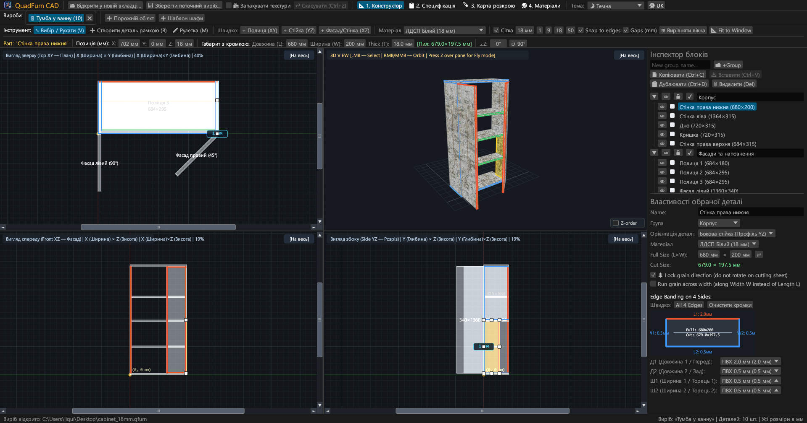
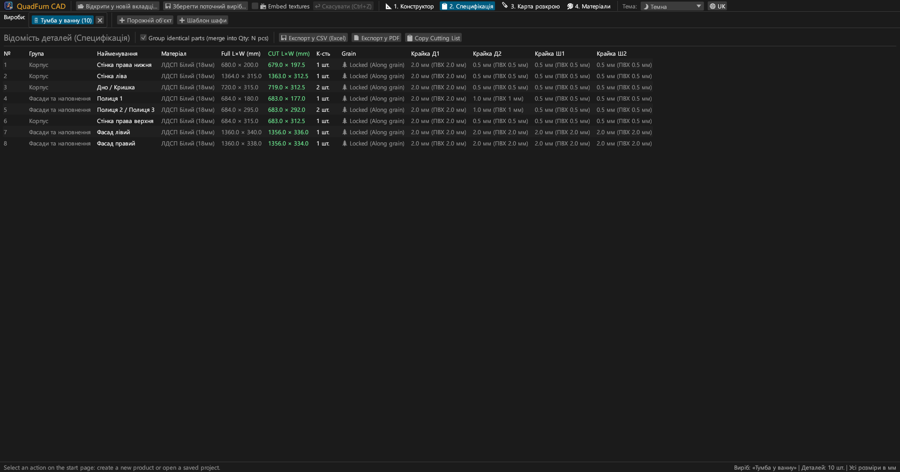
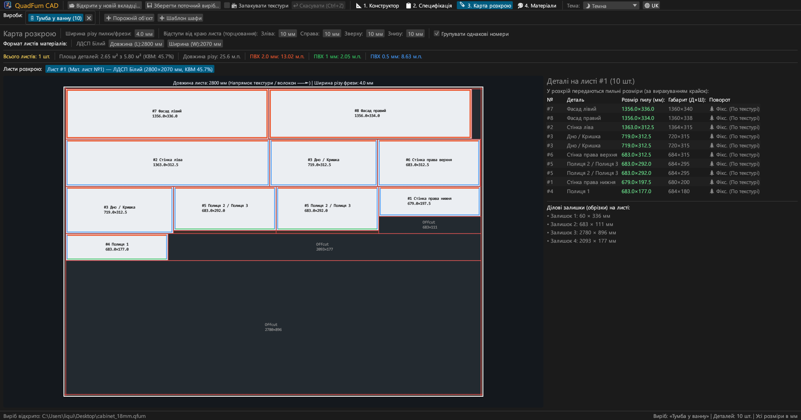
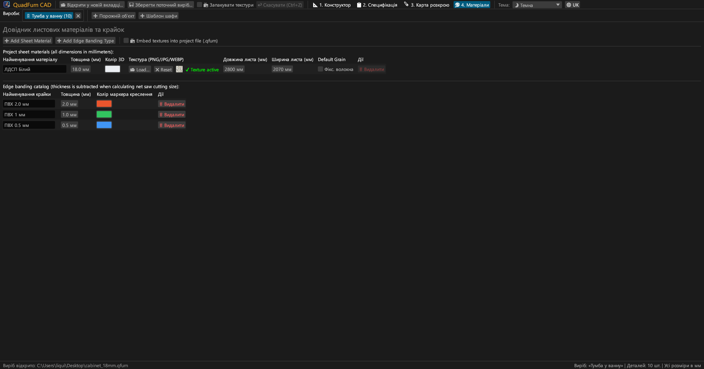
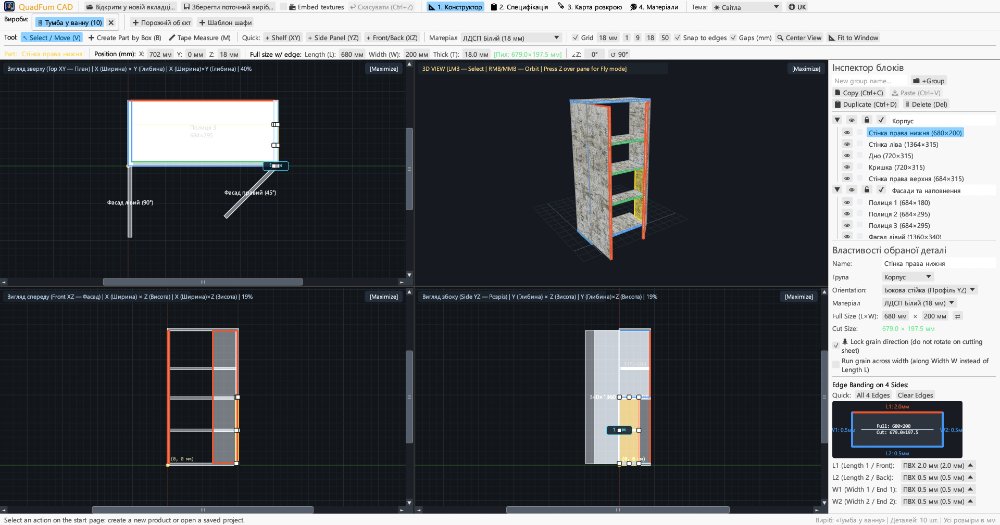
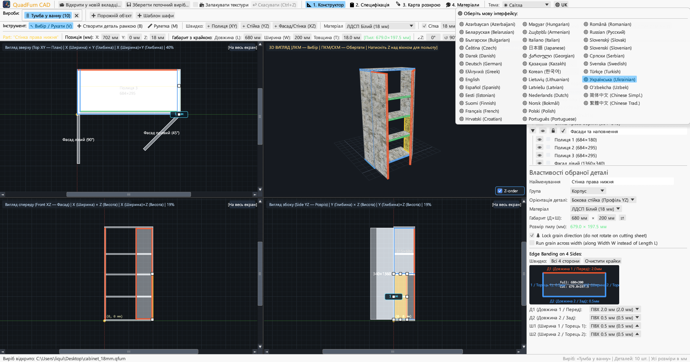

<div align="center">


# QuadFurn CAD

**САПР корпусних меблів з ЛДСП — 4-видовий просторовий конструктор + гільйотинний розкрій листових матеріалів**

[](https://github.com/rbm13s/QuadFurn/actions/workflows/build.yml)
[](https://github.com/rbm13s/QuadFurn/releases)
[](https://www.rust-lang.org/)
[](https://github.com/emilk/egui)
[](https://wgpu.rs/)
[](#8-теми-оформлення-та-локалізація-на-22-мови)
[](#швидкий-старт)
[](../LICENSE)

<br/>

**Languages / Языки / Мови / Sprachen:**<br/>
[English](../README.md) •
[Русский](README-ru.md) •
**Українська** •
[Deutsch](README-de.md) •
[Polski](README-pl.md) •
[Español](README-es.md) •
[Français](README-fr.md) •
[Italiano](README-it.md) •
[Português](README-pt.md) •
[Čeština](README-cs.md) •
[Slovenčina](README-sk.md) •
[Slovenščina](README-sl.md) •
[Nederlands](README-nl.md) •
[Dansk](README-da.md) •
[Norsk](README-no.md) •
[Svenska](README-sv.md) •
[Magyar](README-hu.md) •
[Română](README-ro.md) •
[Türkçe](README-tr.md) •
[简体中文](README-zh-cn.md) •
[日本語](README-ja.md) •
[한국어](README-ko.md)

</div>

---

## Зміст

- [Вступ](#вступ)
- [Скріншоти та візуальний огляд](#скріншоти-та-візуальний-огляд)
- [Ключові можливості](#ключові-можливості)
- [Функціональна документація](#функціональна-документація)
  - [1. 4-видовий CAD-конструктор та точне позиціонування](#1-4-видовий-cad-конструктор-та-точне-позиціонування)
  - [2. Математичні вирази у числових полях](#2-математичні-вирази-у-числових-полях)
  - [3. Крайкування та автоматичне віднімання припуску під крайку](#3-крайкування-та-автоматичне-віднімання-припуску-під-крайку)
  - [4. Оптимізація гільйотинного 2D-розкрою](#4-оптимізація-гільйотинного-2d-розкрою)
  - [5. Вкладки виробів та буфер обміну між проєктами](#5-вкладки-виробів-та-буфер-обміну-між-проєктами)
  - [6. Експорт виробничого паспорта (векторний PDF, CSV Excel, буфер)](#6-експорт-виробничого-паспорта-векторний-pdf-csv-excel-буфер)
  - [7. Довідник листових матеріалів, текстур та крайок](#7-довідник-листових-матеріалів-текстур-та-крайок)
  - [8. Теми оформлення та локалізація на 22 мови](#8-теми-оформлення-та-локалізація-на-22-мови)
- [Керування та гарячі клавіші](#керування-та-гарячі-клавіші)
- [Швидкий старт](#швидкий-старт)
- [Налаштування та формати файлів](#налаштування-та-формати-файлів)
- [Архітектура проєкту](#архітектура-проєкту)
- [Ліцензія](#ліцензія)

---

## Вступ

**QuadFurn CAD** — це високопродуктивна кросплатформна CAD-система на Rust, доступна як у вигляді швидкого нативного настільного додатка (Windows, Linux, macOS), так і у вигляді повноцінної браузерної WebAssembly (WASM) версії без необхідності встановлення. Програма розроблена для проєктування корпусних і панельних меблів з ламінованого ДСП (ЛДСП), МДФ, ХДФ та фанери, з автоматичним розрахунком специфікацій та оптимізатором гільйотинного 2D-розкрою плитних матеріалів.

QuadFurn поєднує найкращі практики трьох класичних інструментів в єдиний робочий процес:
1. **4-видове просторове моделювання**: Одночасна робота в трьох ортогональних проєкціях (**Зверху XY — План**, **Спереду XZ — Фасад**, **Збоку YZ — Розріз**) зі смугами прокрутки, магнітною прив'язкою, кнопкою вирівнювання вікон (`⊞ Вирівняти вікна`), інтелектуальним захистом товщини деталей з торця та інтерактивним **3D-вікном з орбітою та режимом вільного польоту (`Z` Noclip)**.
2. **Панель точної трансформації**: Миттєве введення числових координат (`X`, `Y`, `Z`), габаритних розмірів (`Д × Ш × Т`) та кута повороту (`∠Z`) із вбудованим калькулятором (наприклад, введення `600-4` або `720+18` прямо у поле).
3. **Розкрій плит та автоматичне врахування крайок**: Автоматичне віднімання товщини крайки ПВХ/АБС від габаритів деталей для отримання точних **пиляльних розмірів**, поєднане з гільйотинним 2D-розкроєм з урахуванням текстури (волокон), товщини пропилу пили та відступів обрізки країв листа.

---

## Скріншоти та візуальний огляд

### 1. 4-видовий конструктор (Темна тема)
Одночасні 2D-проєкції (**Зверху XY**, **Спереду XZ**, **Збоку YZ**) та текстуроване **3D-вікно** з коректним UV-мапінгом, сортуванням за глибиною, 8 інтерактивними маркерами зміни розміру та правим **Інспектором деталей**.



### 2. Відомість деталей (Специфікація) та експорт
Згрупована таблиця деталей із відображенням як **габаритних розмірів (`Д × Ш`)**, так і **пиляльних розмірів (`Пил Д × Ш`)** після віднімання товщини крайки з усіх чотирьох сторін (`Д1`, `Д2`, `Ш1`, `Ш2`).



### 3. Карти гільйотинного розкрою
Оптимальне розміщення деталей на стандартних листах (`2800 × 2070 мм` тощо) з наскрізними гільйотинними різами, врахуванням товщини пили, обрізки плит, кольоровими мітками крайок та списком корисних ділових залишків.



### 4. Довідник матеріалів та крайок
Керування товщинами ЛДСП/МДФ/ХДФ, кольорами у 3D, текстурами декорів (`PNG`, `JPG`, `WEBP`), габаритами листів, напрямком текстури та типами крайок ПВХ/АБС.



### 5. Підтримка світлої теми
Контрастна світла тема поруч із темною та автоматичною синхронізацією із системною темою ОС.



### 6. 22 вбудовані мови (інтерфейс та експорт у PDF)
Миттєве перемикання мови у верхньому меню через кнопку **`🌐`**, автовизначення мови ОС під час першого запуску та локалізований багатосторінковий експорт у PDF.



---

## Ключові можливості

- **Синхронізовані 4 вікна проєкцій**: Редагування у видах Зверху (`XY`), Спереду (`XZ`), Збоку (`YZ`) або максимізація будь-якого вікна в один клік (`[Розгорнути]` / `[4 Види]`).
- **3D-перегляд з апаратним прискоренням**: Обертання орбітою (`ПКМ`/`СКМ`) + вільний політ від першої особи (`Z` + `WASD`/`Пробіл`/`Ctrl`) з текстурами та OBB-трасуванням променя.
- **Магнітна прив'язка та вимірювання зазорів на льоту**: Автоприв'язка до кроку сітки (`1`, `9`, `18`, `50 мм` або довільний) та до граней сусідніх деталей стик у стик (`0 мм`), а також динамічні винесення відстаней до сусідніх панелей.
- **Рамкове виділення та групова трансформація**: Виділення рамкою в будь-якому 2D-вікні кількох деталей, їх спільне переміщення, дублювання (`Ctrl+D`) та копіювання/вставка між відкритими виробами (`Ctrl+C` / `Ctrl+V`).
- **Вбудований калькулятор**: Усі числові поля приймають вирази вигляду `600+100`, `800-36`, `720/2` або `45+15`.
- **Автоматичне віднімання крайки**: Призначення крайки ПВХ/АБС (`0.4 мм`, `0.8 мм`, `1.0 мм`, `2.0 мм` тощо) на будь-яку з 4 граней (`Д1`, `Д2`, `Ш1`, `Ш2`) із розрахунком пиляльного розміру:
  $$\text{Пил Довжина} = L_{\text{габ}} - E_{L1} - E_{L2}, \quad \text{Пил Ширина} = W_{\text{габ}} - E_{W1} - E_{W2}$$
- **Рушій гільйотинного розкрою**: Розкрій на кілька листів з урахуванням напрямку текстури дерева, ширини пропилу пили та відступів обрізки листа з 4 сторін.
- **Векторний PDF-паспорт виробу з 4 розділів**: Експорт повного альбому формату A4 Альбомна обраною мовою:
  1. Специфікація деталей
  2. 4 проєкції виробу (`Зверху XY`, `3D Ізометрія`, `Спереду XZ`, `Збоку YZ`)
  3. Карти розкрою для кожного листа
  4. Зведена відомість матеріалів та крайок з розрахунком погонних метрів та запасом `+15%`

---

## Функціональна документація

### 1. 4-видовий CAD-конструктор та точне позиціонування

Вкладка **Конструктор** (`📐 1. Конструктор`) розділена на три основні області:

1. **Верхня панель інструментів**:
   - **Інструменти редактора**:
     - `↖ Вибір / Зсув (V)`: Вибір деталі кліком, переміщення затисканням всередині, зміна розміру маркерами (8 маркерів для деталей пласком та 2 маркери довжини/ширини для деталей з торця). Затискання на порожньому місці розтягує **рамку виділення** кількох деталей. Під час перетягування: затиснутий **`Shift`** блокує рух вздовж однієї осі (тільки горизонталь або вертикаль), затиснутий **`Ctrl` (`Cmd`)** вимикає прилипання до граней, а затиснутий **`Alt`** створює копію деталі в точці відпускання.
     - `➕ Створити деталь рамкою (B)`: Розтягування прямокутника у будь-якому 2D-вікні створює панель, орієнтовану в площині цього вікна (`Полиця XY`, `Стійка YZ`, `Панель XZ`).
     - `📏 Лінійка (M)`: Вимірювання точних відстаней (`ΔX`, `ΔY`, `L`) у міліметрах у 2D-проєкціях.
   - **Швидке вставлення деталей**: Кнопки в один клік (`+ Полиця (XY)`, `+ Стійка (YZ)`, `+ Панель (XZ)`).
   - **Сітка та прив'язки**: Увімкнення сітки, вибір кроку (`1`, `9`, `18`, `50 мм`), магнітне прилипання до граней (`Прив'язка до граней`) та відображення зазорів до сусідів (`Зазори (мм)`).
   - **Керування камерою**:
     - `🔍 По центру`: Центрує всі камери на моделі.
     - `📐 Вписати у вікно`: Розраховує загальний габарит і масштабує всі 4 вікна так, щоб виріб комфортно помістився цілком.
   - **Панель точної трансформації**: Відображення та редагування координат `X`, `Y`, `Z`, габаритів `Довжина (L)`, `Ширина (W)`, `Товщина (T)`, зелений бейдж пиляльного розміру `[Пил: Д × Ш мм]` та кута повороту `∠Z` (для кутових секцій та скошених фасадів під `45°`, `90°` тощо).

2. **4 вікна проєкцій**:
   - **Вид зверху (`Зверху XY — План`)**, **Вид спереду (`Спереду XZ — Фасад`)** та **Вид збоку (`Збоку YZ — Розріз`)** оснащені інтерактивними смугами прокрутки, міліметровими лінійками та кольоровими маркерами крайки по периметру деталей.
   - **3D-вид**: Обертання орбітою (`ПКМ` або `СКМ`), наближення (`Колесо миші`), вибір деталей кліком та **Режим польоту від першої особи** (натискання **`Z`** над 3D-вікном захоплює курсор для польоту на `WASD`, `Пробіл`, `Ctrl`/`Shift`).

3. **Правий інспектор (`Інспектор блоків` та `Властивості деталі`)**:
   - Організація деталей за **Групами** (*Корпус*, *Фасади*, *Шухляди*).
   - Індивідуальне та групове перемикання **Видимості (`👁`)** та **Блокування (`🔒`)**.
   - Налаштування матеріалу, габаритів (`Д × Ш` з кнопкою швидкої зміни орієнтації `⇄`), блокування текстури (`🌲 Фіксувати напрямок текстури`) та інтерактивна схема 4 сторін крайки.

---

### 2. Математичні вирази у числових полях

Усі числові поля введення в QuadFurn CAD (координати `X/Y/Z`, розміри `L/W`, кут `∠Z`, крок сітки, товщина плит, розміри листів, пропил пили та відступи) підтримують математичні вирази:
- **Додавання та віднімання**: Клікніть по полю зі значенням `600`, введіть `600+100` (або `600-4`) і натисніть `Enter` — значення автоматично стане `700` (або `596`).
- **Множення, ділення та дужки**: Підтримуються вирази вигляду `(800-36)/2` або `18*2`.
- Як десятковий роздільник приймаються як крапка `.`, так і кома `,`, а суфікси одиниць (`мм`, `mm`, `°`) відсікаються автоматично.

---

### 3. Крайкування та автоматичне віднімання припуску під крайку

У меблевому виробництві товщина крайки повинна відніматися від чистового габариту деталі перед її розпилюванням на форматно-розкроювальному верстаті:
- У кожної деталі 4 крайки: **`Д1`** (Довжина 1 / Передня), **`Д2`** (Довжина 2 / Задня), **`Ш1`** (Ширина 1 / Торець 1) та **`Ш2`** (Ширина 2 / Торець 2).
- Призначення, наприклад, крайки ПВХ `2.0 мм` на `Д1` та ПВХ `0.4 мм` на `Д2`, `Ш1`, `Ш2` для деталі `680 × 200 мм` дає **чистий пиляльний розмір**:
  - $\text{Пил } L = 680 - 2.0 - 0.4 = 677.6\text{ мм}$
  - $\text{Пил } W = 200 - 0.4 - 0.4 = 199.2\text{ мм}$
- Кольорові маркери наочно відображаються на 2D-кресленнях, у 3D та на картах розкрою.

---

### 4. Оптимізація гільйотинного 2D-розкрою

Вкладка **Розкрій** (`🪚 3. Розкрій`) автоматично вкладає всі видимі деталі на листи відповідних матеріалів:
- **Параметри розпилу**:
  - **Ширина пропилу пили** (за замовчуванням `4.0 мм`)
  - **Відступи обрізки листа** (`Зліва`, `Справа`, `Зверху`, `Знизу`, за замовчуванням `10 мм`) для зняття пошкодженого заводського краю.
- **Врахування напрямку волокон**:
  - Деталі з **Фіксованою текстурою (`🌲`)** ніколи не повертаються поперек волокон плити (`Довжина листа L`).
  - Деталі з **Вільною текстурою** можуть повертатися на $90^\circ$ алгоритмом для максимального коефіцієнта використання матеріалу (КВМ).
- **Карти розкрою та ділові залишки**:
  - Відображення листів із лініями гільйотинних різів, номерами деталей `#1..#N`, пиляльними розмірами, кольоровими смугами крайок та маркованими корисними **Залишками**.
  - Підсумкове зведення: кількість листів, площа деталей та листів ($\text{м}^2$), КВМ (%), загальна довжина пропилу пили ($\text{м}$) та витрата кожного типу крайки в погонних метрах.

---

### 5. Вкладки виробів та буфер обміну між проєктами

- **Стартова сторінка та нещодавні проєкти**: Під час запуску відкривається стартова сторінка з можливістю створити порожній виріб, відкрити готовий шаблон тумби, завантажити файл `.qfurn`/`.json` або вибрати з **10 останніх відкритих проєктів**.
- **Кілька відкритих виробів**: Відкриття кількох проєктів одночасно у вкладках верхньої панелі (подвійний клік по вкладці дозволяє перейменувати виріб).
- **Копіювання та вставлення між проєктами**: Виділіть деталі, натисніть `Ctrl+C`, перейдіть в іншу вкладку виробу та натисніть `Ctrl+V`. Відсутні матеріали та крайки переносяться автоматично.
- **Захист від втрати незбережених даних**: Під час закриття зміненої вкладки або виходу з програми з'являється діалог підтвердження (`Зберегти та вийти`, `Вийти без збереження`, `Скасувати`).

---

### 6. Експорт виробничого паспорта (векторний PDF, CSV Excel, буфер)

У вкладці **Специфікація** (`📋 2. Специфікація`) доступні три формати експорту:
1. **`📄 Експорт у PDF` (Багатосторінковий векторний альбом A4 Альбомна)**:
   - **Розділ 1**: Повна специфікація деталей із пиляльними розмірами, текстурою та крайками.
   - **Розділ 2**: Сторінка видів конструктора (`Зверху XY`, `3D Ізометрія`, `Спереду XZ`, `Збоку YZ`) із загальними габаритами.
   - **Розділ 3**: Карти розкрою для кожного листа.
   - **Розділ 4**: Зведений каталог матеріалів та крайок із витратою в погонних метрах (чиста витрата та із запасом $+15\%$).
   - *Примітка*: PDF формується **активною мовою інтерфейсу** із вбудованими TrueType-шрифтами (`Identity-H` + `/ToUnicode` CMap для пошуку та копіювання тексту).
2. **`💾 Експорт у CSV (Excel)`**: Таблиця з роздільником `;` у кодуванні UTF-8 з BOM для прямого відкриття в Excel.
3. **`📋 Копіювати таблицю пилу`**: Копіювання пиляльних розмірів через табуляцію в буфер обміну для вставлення у сторонні програми розкрою або електронні таблиці.

---

### 7. Довідник листових матеріалів, текстур та крайок

У вкладці **Матеріали** (`🎨 4. Матеріали`):
- Додавання, редагування та видалення **Листових матеріалів** (`ЛДСП 18 мм`, `МДФ 16 мм`, `ХДФ 3 мм` тощо) з налаштуванням кольору в 3D, розмірів листа (`Довжина × Ширина`) та фіксації текстури за замовчуванням.
- Завантаження текстур декорів у форматах **`PNG`**, **`JPG`/`JPEG`** або **`WEBP`** для реалістичного 3D-відображення.
- **Портативність текстур та відносні шляхи**: Під час збереження проєкт обчислює відносні шляхи до файлів текстур. Під час перенесення `.qfurn` на інший комп'ютер пошук текстур виконується:
  1. Безпосередньо з тіла проєкту (Base64)
  2. У тій же папці, де лежить файл `.qfurn`
  3. У підпапці `./textures/` поруч із проєктом
  4. За відносним шляхом
- **Пакування текстур у проєкт (`📦 Упаковувати текстури у файл проєкту`)**: Прапорець пакування (доступний у верхньому меню та в панелі матеріалів) зберігає зображення текстур прямо всередині JSON-файлу `.qfurn` у форматі Base64. Файл стає повністю автономним і не втрачає зображення при пересиланні.
- **Безпека GPU**: Файли текстур понад 60 МБ блокуються з попередженням, а зображення надвисокої роздільності автоматично масштабуються для стабільної продуктивності відеокарти.
- Додавання, редагування та видалення **Типів крайок** із налаштуванням товщини (`мм`) та кольору маркера. Видалення матеріалу або крайки, що використовується, супроводжується попередженням з безпечним перепризначенням.

---

### 8. Теми оформлення та локалізація на 22 мови

- **Колірні теми**: Перемикання між **🌙 Темною**, **☀ Світлою** та **🖥 Системною** темами у верхньому меню.
- **22 вбудовані мови**:
  `Українська`, `English`, `Русский`, `Deutsch`, `Polski`, `Español`, `Français`, `Italiano`, `Português`, `Čeština`, `Slovenčina`, `Slovenščina`, `Nederlands`, `Dansk`, `Norsk`, `Svenska`, `Magyar`, `Română`, `Türkçe`, `简体中文`, `日本語`, `한국어`.
- **Автовизначення мови ОС**: Під час першого запуску QuadFurn автоматично визначає мову операційної системи. Обрана мова та тема зберігаються в `%APPDATA%\QuadFurn\settings.json`.

---

## Керування та гарячі клавіші

| Клавіша / Сполучення | Дія |
| :--- | :--- |
| **`V`** | Інструмент **Вибір і переміщення** (8 маркерів для деталей пласком і 2 маркери з торця, плюс рамкове виділення) |
| **`B`** | Інструмент **Створити деталь рамкою** у 2D-вікнах |
| **`M`** | Інструмент **Лінійка** у 2D-вікнах |
| **Затискання `ЛКМ` (2D)** | Переміщення вибраних деталей, зміна розмірів за маркери або виділення рамкою |
| **`Shift + ЛКМ` Перетягування (2D)** | Переміщення деталі строго вздовж однієї осі (по горизонталі або вертикалі) |
| **`Ctrl / Cmd + ЛКМ` Перетягування (2D)** | Вимкнення магнітного прилипання до граней під час перетягування |
| **`Alt + ЛКМ` Перетягування (2D)** | Швидке дублювання (копіювання) деталі в точку переміщення |
| **`Shift / Ctrl (Cmd) + ЛКМ` (2D)** | Додавання / виключення деталі з групи виділення |
| **Затискання `ПКМ` / `СКМ` (2D)** | Панорамування 2D-камери |
| **`Колесо миші` (2D / 3D)** | Масштабування (зум) камери до курсора |
| **Затискання `ПКМ` / `СКМ` (3D)** | Обертання 3D-орбіти навколо моделі |
| **`Z` (над вікном 3D)** | Увімкнення / вимкнення **Режиму польоту від першої особи (Noclip)** (не залежить від розкладки) |
| **`W` `A` `S` `D` / `Пробіл` / `Ctrl (Cmd)`** | Політ уперед/вліво/назад/вправо/вгору/вниз у 3D (`Shift` для прискорення) |
| **`Ctrl + S` / `Cmd (⌘) + S`** | Зберегти поточний виріб меблів (`.qfurn` / `.json`) |
| **`Ctrl + Z` / `Cmd (⌘) + Z`** | Скасувати останню дію в активному виробі (до 40 кроків, не залежить від розкладки) |
| **`Ctrl + C` / `Cmd (⌘) + C`** | Копіювати вибрані деталі в буфер обміну |
| **`Ctrl + V` / `Cmd (⌘) + V`** | Вставити деталі (працює між різними вкладками) |
| **`Ctrl + D` / `Cmd (⌘) + D`** | Дублювати вибрані деталі |
| **`Delete` / `Backspace`** | Видалити вибрані деталі |
| **`←` `→` `↑` `↓` (у 2D-виглядах)** | Зсув вибраних деталей на крок вибраної сітки (`Shift` — подвійний крок) |

---

## Швидкий старт

### Готові збірки (GitHub Actions / Релізи)
Під час кожного коміту та релізу автоматично збираються готові пакунки в [GitHub Actions](https://github.com/rbm13s/QuadFurn/actions):
- **Windows (`x86_64`)**: `QuadFurn-windows-x86_64.zip` — портативний виконуваний файл `QuadFurn.exe` з вбудованою іконкою.
- **Linux (`Debian 12+ / Ubuntu 22.04+ x86_64`)**:
  - `quadfurn_<version>_amd64.deb` — інсталяційний пакунок Debian/Ubuntu (встановлює бінарник, пункт у системному меню та іконку):
    ```bash
    sudo apt install ./quadfurn_0.2.4_amd64.deb
    ```
  - `QuadFurn-linux-x86_64.tar.gz` — портативний standalone-архів.
- **macOS (`Universal: Apple Silicon M1–M4 + Intel x86_64`)**: `QuadFurn-macos-universal.zip` — нативний бандл `QuadFurn.app` з Retina-іконкою `.icns`.

---

### Збирання з вихідного коду

#### Необхідні компоненти
- [Rust Toolchain](https://rustup.rs/) (`stable`, редакція Rust 2021)
- Системні бібліотеки для **Linux (Debian / Ubuntu)**:
  ```bash
  sudo apt-get update && sudo apt-get install -y \
    build-essential pkg-config libxcb-render0-dev libxcb-shape0-dev \
    libxcb-xfixes0-dev libxkbcommon-dev libxkbcommon-x11-dev libssl-dev \
    libgtk-3-dev libglib2.0-dev libatk1.0-dev libgdk-pixbuf-2.0-dev \
    libcairo2-dev libpango1.0-dev libgl1-mesa-dev fonts-dejavu-core fonts-noto-cjk
  ```
- **macOS**: Інструменти командного рядка Xcode (`xcode-select --install`)
- **Windows**: Windows 10 / 11 зі встановленим MSVC Build Tools

#### Команди збирання та запуску
```bash
# Запуск у режимі розробки
cargo run

# Збирання оптимізованого релізного бінарника
cargo build --release

# Запуск тестів (розкрій, парсер математики, буфер обміну, багатомовний PDF)
cargo test
```

---

## Налаштування та формати файлів

- **Користувацькі налаштування (`settings.json`)**:
  Зберігаються автоматично у стандартній директорії конфігурації ОС:
  - **Windows**: `%APPDATA%\QuadFurn\settings.json` (`C:\Users\<User>\AppData\Roaming\QuadFurn\settings.json`)
  - **Linux**: `$XDG_CONFIG_HOME/QuadFurn/settings.json` або `~/.config/QuadFurn/settings.json`
  - **macOS**: `~/Library/Application Support/QuadFurn/settings.json`
  
  Зберігають:
  - `theme_choice` (`Dark`, `Light`, `System`)
  - `language` (`En`, `Ru`, `Uk`, `De`, `Fr`, `Es`, `It`, `Pl`, `Cs`, `Sk`, `Da`, `Nl`, `No`, `Sv`, `Hu`, `Ro`, `Sl`, `Pt`, `Tr`, `Ko`, `ZhCn`, `Ja`)
  - `recent_projects` (до 10 останніх відкритих файлів проєктів `.qfurn` / `.json`)
- **Файли проєктів (`.qfurn` / `.json`)**:
  Зрозумілі для людини файли JSON у кодуванні UTF-8, що містять усі деталі, групи, матеріали, текстури, крайки та параметри розкрою виробу. При увімкненій опції `embed_textures` байти зображень текстур зберігаються прямо всередині JSON як рядки Base64.

---

## Архітектура проєкту

```text
QuadFurn/
├── .github/
│   └── workflows/
│       └── build.yml          # CI/CD GitHub Actions (Linux .deb/.tar.gz, macOS Universal .app, Windows .zip)
├── assets/
│   ├── icon.jpeg              # Вихідне зображення логотипа для іконок Windows/Linux/macOS
│   └── screenshots/           # Скріншоти інтерфейсу для документації
├── docs/                      # Локалізована документація (22 мови)
├── src/
│   ├── main.rs                # Точка входу, вкладки виробів, стартова сторінка, налаштування та хоткеї
│   ├── model.rs               # Структури даних (Project, PartBlock, SheetMaterial, EdgeBanding, OBB)
│   ├── viewport.rs            # 4-видовий контролер робочої області, 2D-орто та 3D wgpu/painter рендер
│   ├── snapping.rs            # Магнітна сітка та прив'язка деталей, проєкційні осі
│   ├── cutter.rs              # Групування специфікації, віднімання крайки та гільйотинний 2D-розкрій
│   ├── export.rs              # Генератор багатосторінкового векторного PDF, експорт у CSV та списків розкрою
│   ├── ui_panels.rs           # Верхня панель трансформації, інспектор деталей, вкладки специфікації, розкрою та матеріалів
│   └── i18n.rs                # Словники локалізації на 22 мови та автовизначення мови ОС
├── build.rs                   # Конвертація assets/icon.jpeg у мультирозмірний ICO та вбудовування ресурсів PE
├── Cargo.toml                 # Маніфест пакунка та залежності
└── LICENSE                    # Ліцензія MIT
```

---

## Ліцензія

Проєкт поширюється під вільною ліцензією [MIT License](../LICENSE) — ви можете безкоштовно використовувати, модифікувати та розповсюджувати його як в особистих, так і в комерційних проєктах.


