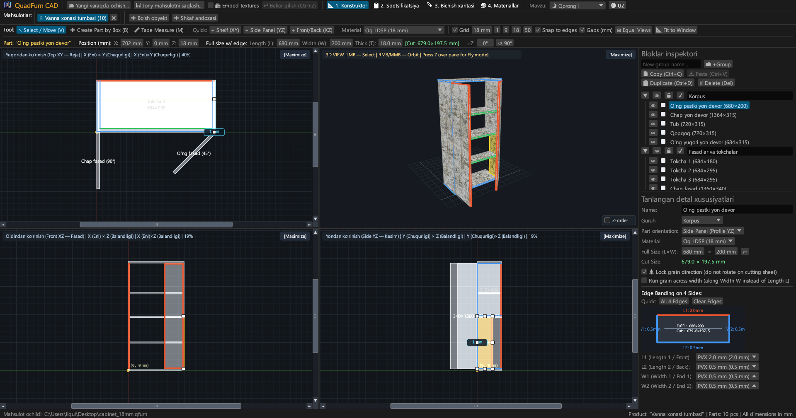
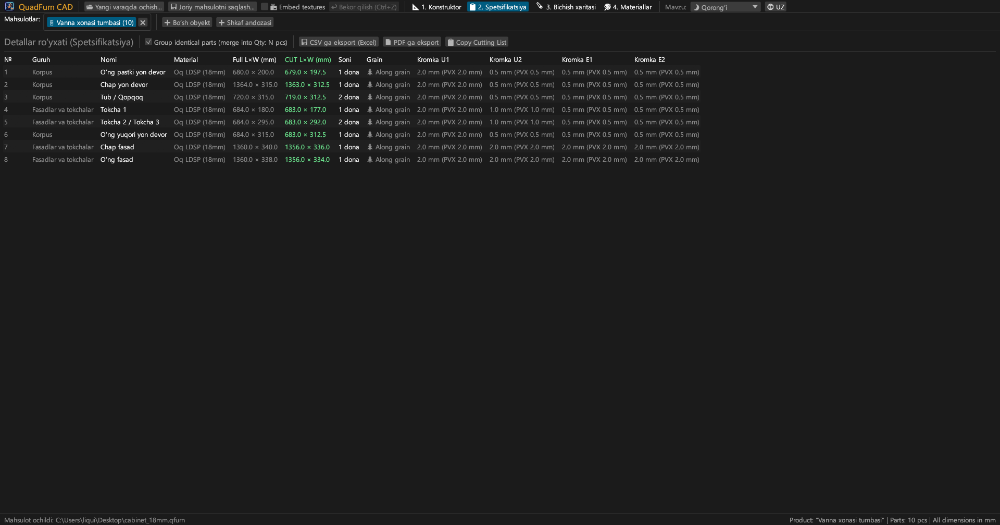
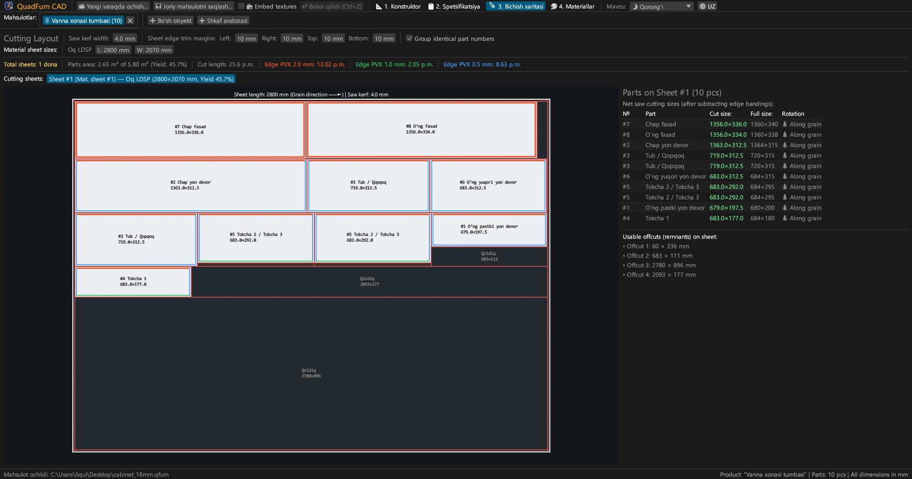
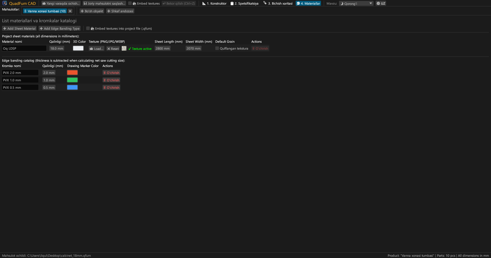
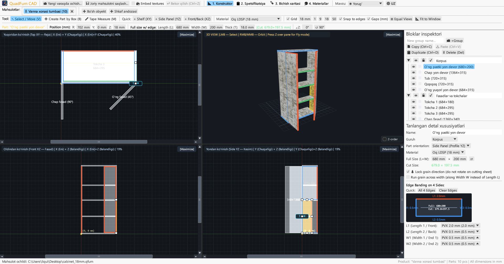
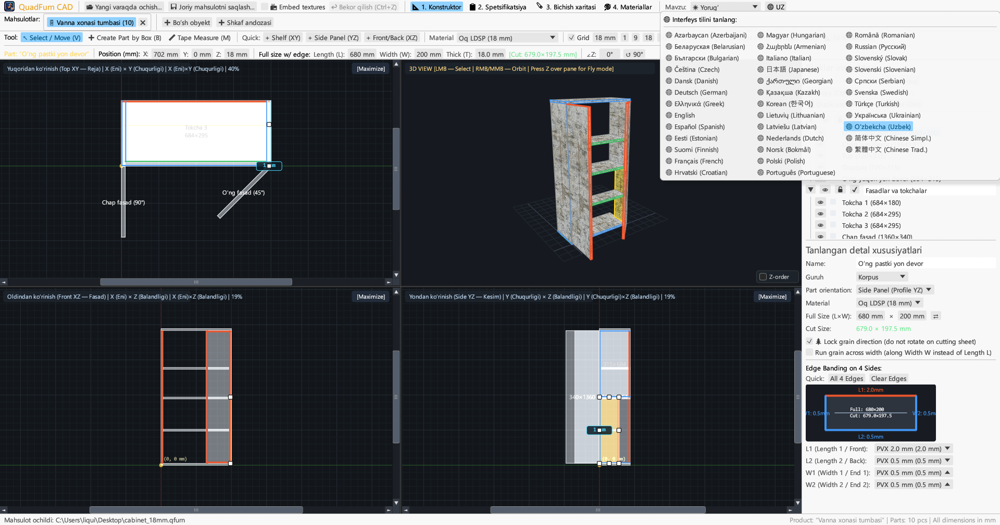

# QuadFurn CAD

**DSP korpus mebellari CAD — 4 koʻrinishli fazoviy konstruktor + list materiallarini gilyotina usulida bichish optimizatori**

 

👉 **[🚀 QuadFurn CAD-ni brauzerda ishga tushiring (WebAssembly)](https://rbm13s.github.io/QuadFurn/app/)** • **[🌐 Rasmiy veb-sayt](https://rbm13s.github.io/QuadFurn/uz.html)**

 

**Languages / Языки / Мови / Sprachen:** 
[English](../README.md) •
[Русский](README-ru.md) •
[Українська](README-uk.md) •
[Беларуская](README-be.md) •
[Қазақша](README-kk.md) •
[ქართული](README-ka.md) •
[Հայերեն](README-hy.md) •
[Azərbaycan](README-az.md) •
**Oʻzbekcha** •
[Deutsch](README-de.md) •
[Français](README-fr.md) •
[Español](README-es.md) •
[Italiano](README-it.md) •
[Português](README-pt.md) •
[Polski](README-pl.md) •
[Čeština](README-cs.md) •
[Slovenčina](README-sk.md) •
[Slovenščina](README-sl.md) •
[Български](README-bg.md) •
[Српски](README-sr.md) •
[Hrvatski](README-hr.md) •
[Nederlands](README-nl.md) •
[Dansk](README-da.md) •
[Norsk](README-no.md) •
[Svenska](README-sv.md) •
[Suomi](README-fi.md) •
[Eesti](README-et.md) •
[Latviešu](README-lv.md) •
[Lietuvių](README-lt.md) •
[Magyar](README-hu.md) •
[Română](README-ro.md) •
[Türkçe](README-tr.md) •
[Ελληνικά](README-el.md) •
[简体中文](README-zh-cn.md) •
[繁體中文](README-zh-tw.md) •
[日本語](README-ja.md) •
[한국어](README-ko.md)

---

## Mundarija

- [Kirish](#kirish)
- [Skrinshotlar va vizual sharh](#skrinshotlar-va-vizual-sharh)
- [Asosiy imkoniyatlar](#asosiy-imkoniyatlar)
- [Funksional hujjatlar](#funksional-hujjatlar)
- [Boshqaruv va tezkor tugmalar](#boshqaruv-va-tezkor-tugmalar)
- [Litsenziya](#litsenziya)

---

## Kirish

**QuadFurn CAD** — laminatlangan DSP, MDF va faneradan korpus mebellarini loyihalash, texnik shartlarni avtomatik yaratish va listlarni 2D gilyotina usulida bichishni optimallashtirish uchun Rust-da yaratilgan yuqori mahsuldorlikka ega krossplatformali CAD dasturidir.

---

## Skrinshotlar va vizual sharh

### 1. 4 koʻrinishli CAD konstruktor (Qorongʻi mavzu)
Sinxron 2D proyeksiyalar (**Yuqoridan XY**, **Oldindan XZ**, **Yondan YZ**) va **3D oyna**:

### 2. Qismlar spetsifikatsiyasi
Qirra tasmasi qalinligi ayirilgandan keyingi kesish oʻlchamlari:

### 3. Gilyotina usulida bichish xaritalari
Standart listlarda optimal joylashtirish:

### 4. Materiallar va qirralar katalogi
List qalinliklari, ranglar va teksturalar (`PNG`, `JPG`, `WEBP`):

### 5. Yorugʻ mavzu
Kontrastli yorugʻ mavzu:

### 6. 37 ta oʻrnatilgan til
37 ta interfeys tili oʻrtasida darhol almashish:

---

## Litsenziya

Loyiha erkin [MIT License](../LICENSE) litsenziyasi ostida tarqatiladi.
