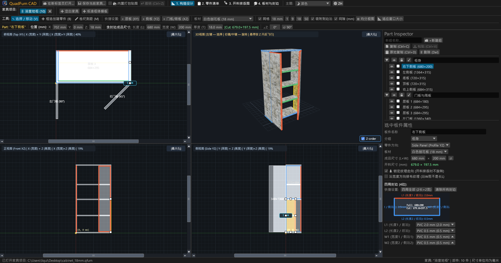
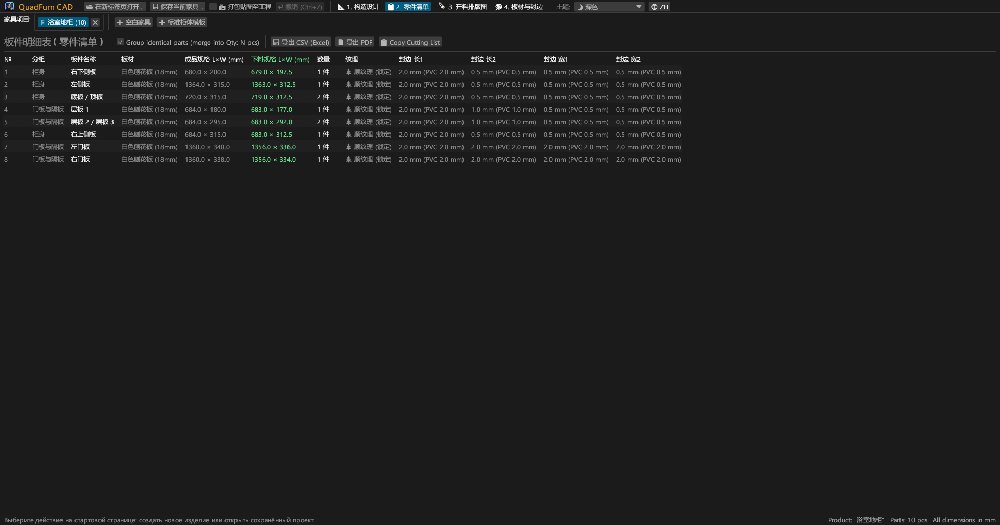
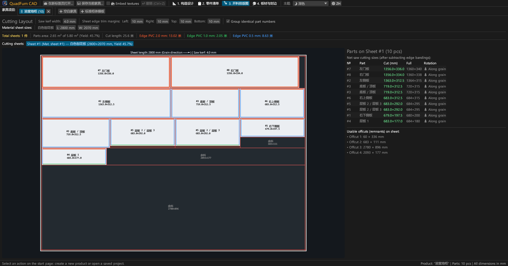
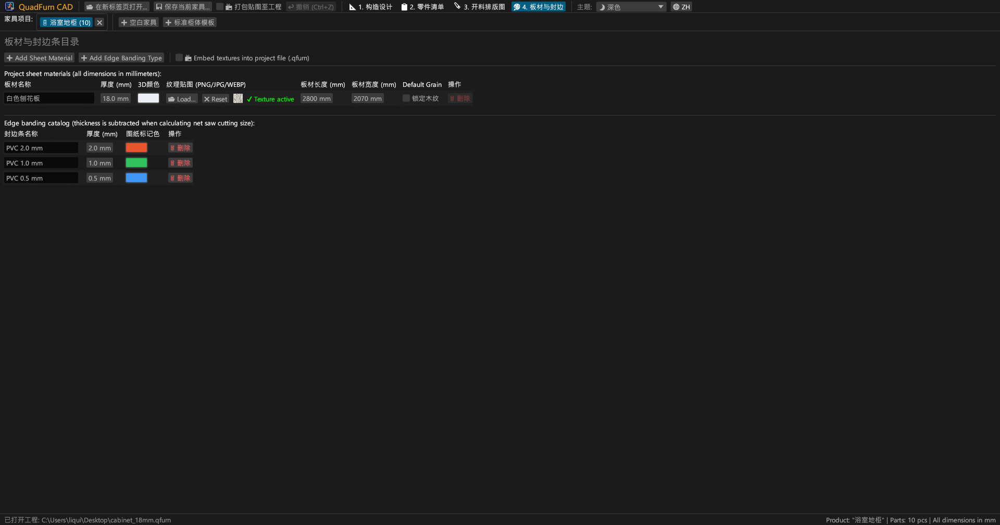
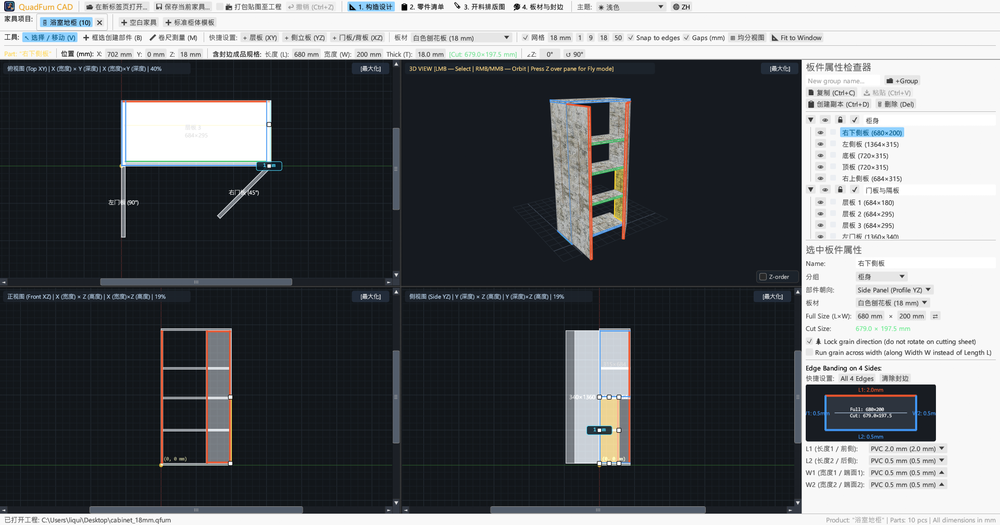
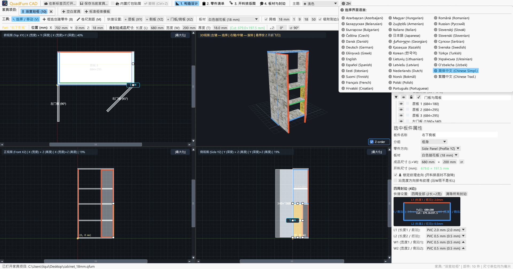

<div align="center">


# QuadFurn CAD

**板式与颗粒板家具 CAD 软件 — 4 视口空间建模设计器 + 剪板机式板材开料优化排版引擎**

[](https://github.com/rbm13s/QuadFurn/actions/workflows/build.yml)
[](https://github.com/rbm13s/QuadFurn/releases)
[](https://www.rust-lang.org/)
[](https://github.com/emilk/egui)
[](https://wgpu.rs/)
[](#8-界面主题与-22-种语言本地化)
[](#快速上手)
[](../LICENSE)

<br/>

**Languages / Языки / Мови / Sprachen:**<br/>
[English](../README.md) •
[Русский](README-ru.md) •
[Українська](README-uk.md) •
[Deutsch](README-de.md) •
[Polski](README-pl.md) •
[Español](README-es.md) •
[Français](README-fr.md) •
[Italiano](README-it.md) •
[Português](README-pt.md) •
[Čeština](README-cs.md) •
[Slovenčina](README-sk.md) •
[Slovenščina](README-sl.md) •
[Nederlands](README-nl.md) •
[Dansk](README-da.md) •
[Norsk](README-no.md) •
[Svenska](README-sv.md) •
[Magyar](README-hu.md) •
[Română](README-ro.md) •
[Türkçe](README-tr.md) •
**简体中文** •
[日本語](README-ja.md) •
[한국어](README-ko.md)

</div>

---

## 目录

- [软件简介](#软件简介)
- [界面截图与功能导览](#界面截图与功能导览)
- [核心特性](#核心特性)
- [功能文档详解](#功能文档详解)
  - [1. 4 视口 CAD 设计器与精准几何控制](#1-4-视口-cad-设计器与精准几何控制)
  - [2. 数值输入框内联算术表达式计算](#2-数值输入框内联算术表达式计算)
  - [3. 封边条厚度自动扣除与净开料尺寸计算](#3-封边条厚度自动扣除与净开料尺寸计算)
  - [4. 2D 剪板机式板材开料优化排版](#4-2d-剪板机式板材开料优化排版)
  - [5. 多产品标签页与跨工程复制粘贴](#5-多产品标签页与跨工程复制粘贴)
  - [6. 生产工艺单导出（矢量 PDF、Excel CSV、剪贴板）](#6-生产工艺单导出矢量-pdfexcel-csv剪贴板)
  - [7. 板材原料、贴图材质与封边条库](#7-板材原料贴图材质与封边条库)
  - [8. 界面主题与 22 种语言本地化](#8-界面主题与-22-种语言本地化)
- [操作指南与键盘快捷键](#操作指南与键盘快捷键)
- [快速上手](#快速上手)
- [设置与文件格式](#设置与文件格式)
- [项目架构](#项目架构)
- [开源协议](#开源协议)

---

## 软件简介

**QuadFurn CAD** 是一款使用 Rust 编写的超高速、原生跨平台桌面级家具 CAD 软件，专为颗粒板（刨花板/三聚氰胺板）、中纤板（MDF）、高密度板（HDF）以及多层实木板板式柜体家具的设计、自动化零部件明细表生成以及 2D 剪板机式开料套料优化而设计。

QuadFurn 深度融合了三款经典工业设计软件的人机工程学优势：
1. **4 视口空间多维建模**：在三个同步联动的 2D 正交投影视图（**俯视 XY — 平面图**、**主视 XZ — 正立面**、**侧视 YZ — 侧剖面**）中协同编辑，配备 视口滚动条、边缘磁性吸附以及实时 **3D 环绕 / 第一人称自由飞行模式（`Z` 键 Noclip）**。
2. **精准几何变换工具栏**：支持即时输入与修改零部件三维坐标（`X`, `Y`, `Z`）、全尺寸（`L × W × T`）以及绕垂直轴旋转角度（`∠Z`），所有输入框均内置算术表达式求值引擎（例如直接输入 `600-4` 或 `720+18` 并自动求值）。
3. **开料排版与封边厚度自动扣除**：自动从板件成品尺寸的四周扣除 PVC/ABS 封边条厚度以得到准确的**推台锯净开料尺寸**，并配合严格遵循木纹走向、锯片锯路缝宽以及板材四周边角修边量的 2D 贯通式剪板优化算法。

---

## 界面截图与功能导览

### 1. 4 视口 CAD 设计器（暗黑主题）
同步联动的 2D 正交投影视图（**俯视 XY**、**主视 XZ**、**侧视 YZ**）与具备透视校正 UV 贴图渲染的 **3D 视图**，辅以 8 点式交互变形手柄及右侧**零部件属性检查器**。



### 2. 零部件清单（BOM 规格表）与开料数据
清晰明了的明细表，同时列出板件的**成品外形尺寸（`L × W`）**以及扣除各边（`L1`, `L2`, `W1`, `W2`）封边厚度后的**推台锯净开料尺寸（`CUT L × W`）**。



### 3. 2D 剪板机式开料排版图
在标准大板（如 `2800 × 2070 mm`）上进行贯通式套料排版，清晰展示推台锯贯通剪切红线、锯缝间隙、修边余量、封边彩色色标以及带具体尺寸的可利用余料（余板）统计。



### 4. 板材原料与封边条库
自由管理板材厚度、3D 材质颜色、自定义表面贴图（`PNG`, `JPG`, `WEBP`）、默认纹理走向锁以及各规格 ABS/PVC 封边条。



### 5. 明亮主题（浅色模式）
现代化高对比度明亮主题，与暗黑主题无缝切换，并支持跟随 Windows/macOS/Linux 系统外观自动同步。



### 6. 内置 22 种国际语言（界面与 PDF 导出）
点击顶部工具栏的 **`🌐`** 图标即可无需重启瞬间切换语言，首次启动自动检测操作系统语言环境，并支持生成对应语言的矢量 PDF 工艺报告。



---

## 核心特性

- **同步联动的 4 视口工作区**：在俯视图（`XY`）、正视图（`XZ`）、侧视图（`YZ`）中随意绘制，或一键最大化任意视口（`[最大化]` / `[恢复 4 视口]`）。
- **硬件加速 3D 实时渲染**：轨道环绕相机（`右键`/`中键`拖拽） + 第一人称自由飞行（鼠标悬停 3D 时按 **`Z`** 键 + `WASD`/`空格`/`Ctrl` 巡游），具备高质量 UV 贴图与极高精度的 OBB 有向包围盒射线拾取。
- **磁性边缘吸附与动态间距标注**：自动吸附网格步长（`1`, `9`, `18`, `50 mm` 或自定义），磁吸至邻近板件表面及角点（`0 mm` 无缝对齐），并实时显示与邻近板件的动态净间距尺寸。
- **框选多选与组合变换**：在任一 2D 视图中拖动矩形框选区一次性选中多个部件，整体平移移动、原位复制（`Ctrl+D`）或在不同家具方案标签页之间跨项目复制粘贴（`Ctrl+C` / `Ctrl+V`）。
- **内联算术计算引擎**：所有尺寸输入框均支持数学算式输入，例如输入 `600+100`、`800-36`、`720/2` 或 `45+15`。
- **锯切净开料尺寸自动计算**：为板件的 4 个边（`L1`, `L2`, `W1`, `W2`）指定不同厚度的 PVC/ABS 封边条（`0.4 mm`、`0.5 mm`、`1.0 mm`、`2.0 mm` 等），系统立即计算净开料尺寸：
  $$\text{开料长度} = L_{\text{成品}} - E_{L1} - E_{L2}, \quad \text{开料宽度} = W_{\text{成品}} - E_{W1} - E_{W2}$$
- **2D 剪板机式排料算法**：多板材全局排料，严格遵循木材纹理方向锁定、锯片切割缝隙损耗以及大板四周边料修整清边量。
- **4 大板块矢量 PDF A4 横向生产工艺单导出**：一键导出包含以下内容的生产级图纸：
  1. 完整零部件明细表（含成品与净下料尺寸、封边与纹理信息）
  2. 4 视口工程图页面（`俯视 XY`、`3D 轴测图`、`正视 XZ`、`侧视 YZ`）附带家具外廓总尺寸标注
  3. 每一张原料大板的详细剪板锯切排料图
  4. 原料板材消耗统计与封边条总米数清单（含 `+15%` 工艺损耗预估）

---

## 功能文档详解

### 1. 4 视口 CAD 设计器与精准几何控制

**设计器** 标签页（`📐 1. 设计器`）划分为三大核心交互区：

1. **顶部控制栏与变换栏**：
   - **交互工具**：
     - `↖ 选择与移动 (V)`：单击选中板件，按住拖动板件位置，或拖拽 2D 视图中部件的 8 个变换控制手柄调整尺寸。在空白区域拖拽可拉出矩形框以进行批量多选。
     - `➕ 框选新建部件 (B)`：在 2D 视图（`俯视 XY`、`正视 XZ` 或 `侧视 YZ`）中拖拽画框，即可直接生成贴合该基准面的板件（层板、侧立板、门板/背板）。
     - `📏 测量卷尺 (M)`：在 2D 视图中精确测量任意两点间的距离与坐标差（`ΔX`, `ΔY`, `L`，单位毫米）。
   - **快捷部件生成**：一键添加标准板件（`+ 层板 (XY)`、`+ 侧立板 (YZ)`、`+ 门板/背板 (XZ)`）。
   - **网格与吸附控制**：设置网格捕捉步长（`1`, `9`, `18`, `50 mm`），开启/关闭邻近边缘磁吸（`吸附至边缘`）以及板件间净距标注（`间距 (mm)`）。
   - **镜头对焦**：
     - `🔍 视图居中`：将所有视图相机复位对齐至模型几何中心。
     - `📐 适应窗口`：自动计算当前家具整体包围盒边界，并按比例缩放以完整铺满全部 4 个视口。
   - **精准几何变换栏**：直接显示并修改活动部件的 `X`, `Y`, `Z` 坐标、长宽厚尺寸 `L`, `W`, `T`、绿色下料尺寸标签 `[开料: L × W mm]` 以及水平旋转角 `∠Z`（便于制作 45° 或 90° 倾斜摆放的转角门板）。

2. **4 视口核心交互区**：
   - **2D 正交投影视图（`俯视 XY — 平面`、`主视 XZ — 正立面`、`侧视 YZ — 侧剖面`）**：配备平滑交互滚动条、精确到毫米的刻度标尺，并在板件轮廓边缘以不同颜色直观标注封边条。
   - **3D 视图**：支持鼠标右键/中键轨道环绕旋转、滚轮视角缩放、三维板件点击选中，以及**第一人称自由飞行漫游（Noclip）**（鼠标停留在 3D 窗口时按下键盘 **`Z`** 键锁定鼠标，使用 `WASD` 前后左右飞行，`空格` 上升，`Ctrl`/`Shift` 下降与加速）。

3. **右侧零部件属性检查器**：
   - 部件自定义**分组**管理（如 *柜体框架*、*门板与前沿*、*抽屉组件*）。
   - 分组及独立部件的**显示/隐藏（`👁`）**与**锁定编辑（`🔒`）**。
   - 板件所属材质、空间放置朝向、尺寸设置（`L × W` 快捷互换 `⇄`）、纹理走向控制（`🌲 锁定纹理方向`、`🔄 纹理沿宽度横向延伸`）以及直观的 4 边封边选择器。

---

### 2. 数值输入框内联算术表达式计算

软件内的所有数值输入框（三维坐标 `X/Y/Z`、长宽 `L/W`、旋转角 `∠Z`、网格步长、板材厚度、原料规格、锯缝宽度等）均原生支持算术公式直接计算：
- **加法与减法**：在一个数值为 `600` 的输入框中键入 `600+100` 或 `600-4` 并回车确认，系统自动求值为 `700` 或 `596`。
- **乘除法与括号嵌套**：支持形如 `(800-36)/2` 或 `18*2` 等复合表达式。
- 自动兼容小数点 `.` 与逗号 `,`，并能自动滤除尾随的单位符号（如 `mm`、`°` 等）。

---

### 3. 封边条厚度自动扣除与净开料尺寸计算

- 每个矩形板件包含 4 个边：**`L1`**（长度边 1 / 前端）、**`L2`**（长度边 2 / 后端）、**`W1`**（宽度边 1 / 侧边 1）和 **`W2`**（宽度边 2 / 侧边 2）。
- 例如对于一块成品尺寸为 `680 × 200 mm` 的层板，若在 `L1` 边贴 `2.0 mm` 厚 PVC 封边条，其余三边 `L2`、`W1`、`W2` 均贴 `0.5 mm` 封边条，软件会自动计算出**推台锯实际下料尺寸**：
  - $\text{开料长度 } L = 680 - 2.0 - 0.5 = 677.5\text{ mm}$
  - $\text{开料宽度 } W = 200 - 0.5 - 0.5 = 199.0\text{ mm}$
- 在 2D/3D 图纸与排版图上，贴有封边条的边缘均绘制有清晰的彩色边框标记。

---

### 4. 2D 剪板机式板材开料优化排版

**开料排版** 标签页（`🪚 3. 开料排版`）能够自动将当前方案中的所有板件合理套料排布在对应材质的原料大板上：
- **可自由调节的切割工艺参数**：
  - **锯片锯路宽度**（默认 `4.0 mm`）。
  - **大板四周边沿修边量**（`左`、`右`、`上`、`下`，默认 `10 mm`），用于切除运输磕碰或破损毛边。
- **木纹走向约束控制**：
  - **锁定纹理（`🌲`）的部件**：绝不允许发生 90° 旋转，必须严格与原料大板的长向纹理平行。
  - **自由纹理部件**：优化算法可根据板面利用率自动将其旋转 90° 以节省原料。
- **可视化锯切排版图与余料统计**：
  - 绘制红色一刀到底的剪板机贯通锯切线、标注部件编号、开料净尺寸、封边彩色条，并对每一块可再利用的余料矩形标明尺寸。
  - 提供详尽的统计报表：所需板材总张数、板材实际利用率（%）、累计锯切直线米数以及各规格封边条总用量。

---

### 5. 多产品标签页与跨工程复制粘贴

- **启动页与历史工程**：启动时可直接新建空白家具、基于预置的双门柜模板创建、浏览打开本地 `.qfurn`/`.json` 文件，或从**最近打开的 10 个工程**中秒级复原。
- **多标签页并行编辑**：在顶部标签栏内同时打开和设计多个不同的柜体模块（双击标签标题即可重命名）。
- **跨工程跨窗口复制粘贴**：在一个家具标签页中选中部件按下 `Ctrl+C`，切换到另一个标签页（乃至另一个运行中的 QuadFurn 进程）按下 `Ctrl+V`。被复制部件引用的新板材与封边类型会自动在目标工程中补齐创建。
- **防丢失安全提示**：关闭修改过的标签页或退出程序时，会自动弹出安全确认对话框（`保存并退出`、`不保存退出`、`取消`）。

---

### 6. 生产工艺单导出（矢量 PDF、Excel CSV、剪贴板）

在 **明细表** 标签页（`📋 2. 明细表`）中：
1. **`📄 导出为 PDF`（多页 A4 横向矢量生产工艺单）**：
   - **第 1 部分**：完整零部件明细表（成品尺寸、下料尺寸、封边代码、纹理信息）。
   - **第 2 部分**：4 视口设计器图纸页（`俯视 XY`、`3D 轴测图`、`主视 XZ`、`侧视 YZ`）并标明家具外部总长宽高。
   - **第 3 部分**：按大板张数逐页列出的高精度剪板锯排版图。
   - **第 4 部分**：材料用量汇总表及封边条线性米数明细（含 `+15%` 生产损耗裕量）。
   - 全文采用**当前选定界面语言**生成，内置矢量 TrueType/CID 字体（完美支持汉字、西里尔文及拉丁文）。
2. **`💾 导出为 CSV (Excel)`**：带 BOM 头的 UTF-8 编码分号 `;` 分隔电子表格，直接双击即可使用 Microsoft Excel 或 WPS 打开。
3. **`📋 复制下料明细清单`**：以制表符分隔格式将所有开料尺寸复制到剪贴板，方便快速粘贴至外部专业开料软件或电子表格。

---

### 7. 板材原料、贴图材质与封边条库

在 **材质库** 标签页（`🎨 4. 材质库`）中：
- 自由创建与修改**板材原料**（如 `18mm 颗粒板`、`16mm MDF`、`3mm 背板 HDF` 等），支持自定义 RGB 基础色、原料长宽尺寸（`L × W`）及默认纹理锁定规则。
- 导入 **`PNG`**、**`JPG`/`JPEG`** 或 **`WEBP`** 格式的高清真实木纹贴图。
- **智能便携式贴图寻址**：在其他电脑上打开 `.qfurn` 项目文件时，QuadFurn 会按如下顺序自动定位贴图文件：
  1. 项目文件内部直接打包存储（Base64 字符串）
  2. 与 `.qfurn` 项目工程文件同级的根目录
  3. 工程同级目录下的 `./textures/` 子文件夹
  4. 相对路径以及原始绝对路径
- **贴图内嵌打包（`📦 将贴图内嵌打包至工程文件`）**：在顶部保存按钮旁或材质库工具栏中勾选该选项，即可在保存时将当前工程使用的贴图以 Base64 格式直接写入 `.qfurn` 文件内部。导出的单个文件可在任意电脑上双击打开，绝无贴图丢失问题。
- **显存与硬件安全保护**：超过 60 MB 的图片文件将提示阻断，分辨率过高的贴图（> 4096 像素）会自动进行安全降采样以确保 GPU 运行丝滑顺畅。
- 灵活配置各种厚度（毫米）与标识颜色的**封边条规格**。删除被项目引用的材料或封边时会弹出安全转移与重分配确认。

---

### 8. 界面主题与 22 种语言本地化

- **界面色彩主题**：在顶部控制栏右侧可自由切换 **🌙 暗黑主题**、**☀ 明亮主题** 以及 **🖥 跟随系统**。
- **内置 22 种语言**：
  `简体中文`、`English`、`Русский`、`Українська`、`Deutsch`、`Polski`、`Español`、`Français`、`Italiano`、`Português`、`Čeština`、`Slovenčina`、`Slovenščina`、`Nederlands`、`Dansk`、`Norsk`、`Svenska`、`Magyar`、`Română`、`Türkçe`、`日本語` 和 `한국어`。
- **首次运行系统语言自动适配**：首次启动会自动识别操作系统的界面语言并直接应用对应语言包。用户偏好设置自动保存在 `%APPDATA%\QuadFurn\settings.json` 中。

---

## 操作指南与键盘快捷键

| 快捷键 | 功能操作 |
| :--- | :--- |
| **`V`** | 切换至 **选择与移动** 工具（含 8 点缩放手柄与拉框多选） |
| **`B`** | 切换至 **框选新建部件** 工具（在 2D 视图中拖动生成板件） |
| **`M`** | 切换至 **测量卷尺** 工具（在 2D 视图中精确测量间距） |
| **按住 `鼠标左键` 拖拽 (2D)** | 平移选中板件、拖拽手柄拉伸缩放、或在空白处拖拽框选多个板件 |
| **`Shift + 鼠标左键` (2D)** | 将点击的板件加入或移出当前多选组 |
| **按住 `鼠标右键` / `中键` 拖拽 (2D)** | 平移当前 2D 画布视口 |
| **`鼠标滚轮` (2D / 3D)** | 以鼠标指针所在位置为中心放大 / 缩小视图 |
| **按住 `鼠标右键` / `中键` 拖拽 (3D)** | 环绕旋转 3D 观察相机 |
| **`Z` 键 (光标位于 3D 窗口上)** | 开启 / 退出 **第一人称自由飞行漫游模式 (Noclip)** |
| **`W` `A` `S` `D` / `空格` / `Ctrl`** | 3D 飞行模式下前进/向左/后退/向右/上升/下降（按住 `Shift` 加速） |
| **`Ctrl + S`** | 保存当前家具工程（`.qfurn` / `.json`） |
| **`Ctrl + Z`** | 撤销上一步操作（支持最多 40 步撤销历史记录） |
| **`Ctrl + C` / `Ctrl + V`** | 复制 / 粘贴选中的板件（支持跨标签页复制粘贴） |
| **`Ctrl + D`** | 原位快速克隆复制作业部件 |
| **`Delete` / `Backspace`** | 删除当前选中的板件 |
| **`←` `→` `↑` `↓` (2D 视图)** | 按当前网格步长微调移动所选零件（按住 `Shift` 步长翻倍） |

---

## 快速上手

### 预编译安装包下载（GitHub Releases）
每次代码提交与正式发布，均通过 [GitHub Actions](https://github.com/rbm13s/QuadFurn/actions) 全自动构建绿色运行包：
- **Windows (`x86_64`)**：`QuadFurn-windows-x86_64.zip` — 纯绿色便携版 `QuadFurn.exe`，内置高清应用程序图标。
- **Linux (`Debian 12+ / Ubuntu 22.04+ x86_64`)**：
  - `quadfurn_<版本号>_amd64.deb` — Debian/Ubuntu 官方安装包（自动配置系统二进制命令、启动菜单项以及高分辨率图标）：
    ```bash
    sudo apt install ./quadfurn_0.2.3_amd64.deb
    ```
  - `QuadFurn-linux-x86_64.tar.gz` — 绿色解压即用版 Linux 压缩包。
- **macOS (`Universal 通用架构：Apple Silicon M1–M4 + Intel x86_64`)**：`QuadFurn-macos-universal.zip` — 原生封装的 `QuadFurn.app`，带 Retina `.icns` 矢量图标。

---

### 从源码编译运行

#### 依赖环境准备
- [Rust 工具链](https://rustup.rs/)（`stable` 分支，Rust 2021 Edition）
- **Linux (Debian / Ubuntu)** 系统底层开发库：
  ```bash
  sudo apt-get update && sudo apt-get install -y \
    build-essential pkg-config libxcb-render0-dev libxcb-shape0-dev \
    libxcb-xfixes0-dev libxkbcommon-dev libxkbcommon-x11-dev libssl-dev \
    libgtk-3-dev libglib2.0-dev libatk1.0-dev libgdk-pixbuf-2.0-dev \
    libcairo2-dev libpango1.0-dev libgl1-mesa-dev fonts-dejavu-core fonts-noto-cjk
  ```
- **macOS**：安装 Xcode Command Line Tools（`xcode-select --install`）
- **Windows**：安装 Windows 10 / 11 以及 Visual Studio C++ 生成工具

#### 构建与测试指令
```bash
# 开发模式运行
cargo run

# 构建发布版高度优化二进制文件
cargo build --release

# 运行自动化单元测试
cargo test
```

---

## 设置与文件格式

- **用户全局配置文件 (`settings.json`)**：
  自动存储在各操作系统的标准配置路径下：
  - **Windows**：`%APPDATA%\QuadFurn\settings.json`
  - **Linux**：`~/.config/QuadFurn/settings.json`
  - **macOS**：`~/Library/Application Support/QuadFurn/settings.json`
  
  记录保存：
  - `theme_choice`（`Dark`, `Light`, `System`）
  - `language`（`ZhCn`, `En`, `Ru` 等）
  - `recent_projects`（最近打开的 10 个项目路径列表）
- **工程数据文件 (`.qfurn` / `.json`)**：
  基于纯 UTF-8 编码的标准 JSON 文本格式，包含所有板件几何参数、分组结构、材质定义、贴图数据、封边设定以及锯切开料配置。开启贴图打包时，贴图数据将直接以 Base64 编码保存在该文本中。

---

## 项目架构

```text
QuadFurn/
├── .github/
│   └── workflows/
│       └── build.yml          # GitHub Actions 跨平台持续集成与发布（Linux .deb/.tar.gz, macOS .app, Windows .zip）
├── assets/
│   ├── icon.jpeg              # 应用程序 Logo 及 Windows/Linux/macOS 原始图标资源
│   └── screenshots/           # 软件说明文档截图
├── docs/                      # 22 种语言的完整本地化文档
├── src/
│   ├── main.rs                # 软件主入口、多标签工程管理器、启动页、全局快捷键与设置
│   ├── model.rs               # 核心数据模型（Project, PartBlock, SheetMaterial, EdgeBanding, OBB 包围盒）
│   ├── viewport.rs            # 4 视口工作区控制器、2D 与 3D wgpu/painter 绘制管线
│   ├── snapping.rs            # 磁性网格与边缘吸附系统、正交投影轴计算
│   ├── cutter.rs              # 2D 剪板机式排料引擎、封边扣除与下料清单分组
│   ├── export.rs              # 多语言矢量 PDF 生产图纸生成器、Excel CSV 与开料清单格式导出
│   ├── ui_panels.rs           # 顶部精准变换栏、属性检查器、明细表、排版与材质界面
│   └── i18n.rs                # 22 种语言国际化翻译字典与操作系统语言环境自动识别
├── build.rs                   # Windows 平台自动生成多分辨率 ICO 并嵌入 PE 资源
├── Cargo.toml                 # Cargo 包配置与依赖项清单
└── LICENSE                    # MIT 开源授权协议
```

---

## 开源协议

本项目基于宽松的 [MIT 开源协议](../LICENSE) 分发发行 — 允许任何个人或企业免费用于商业开发、二次修改与再分发。


