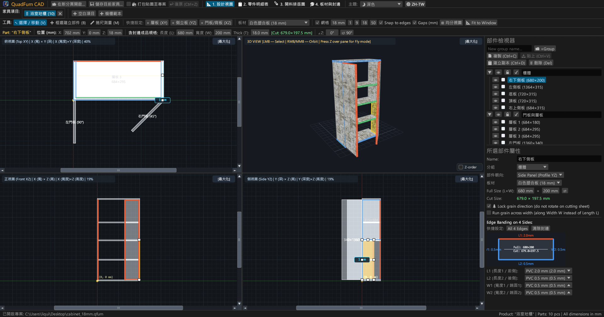
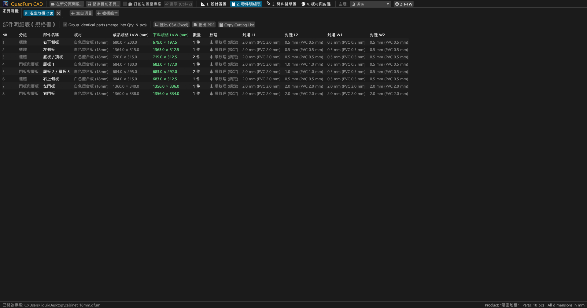
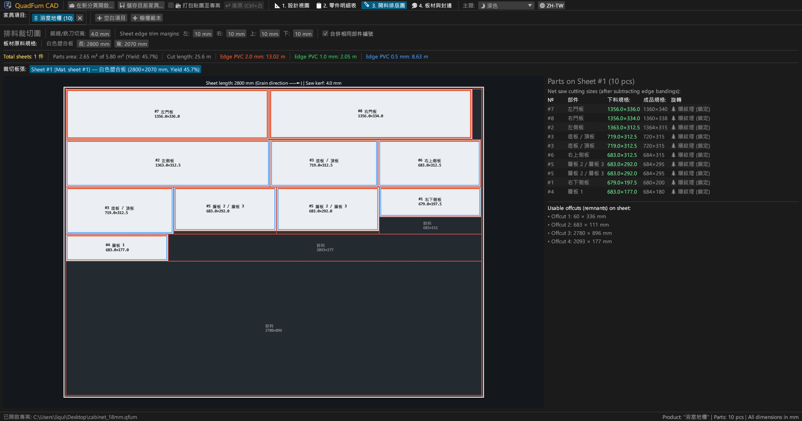
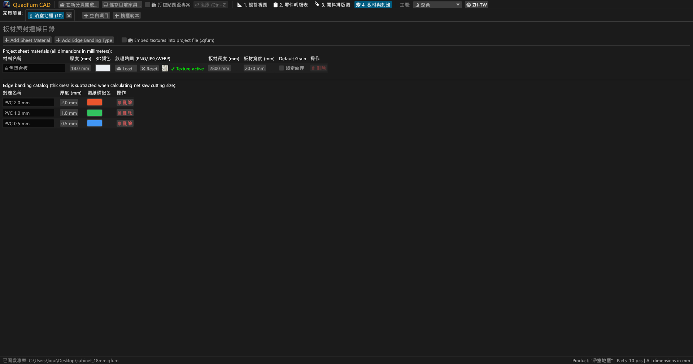
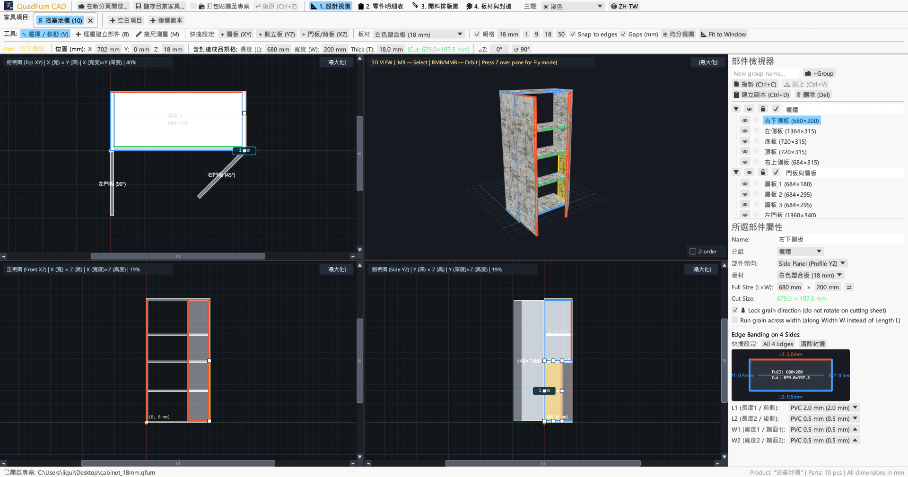
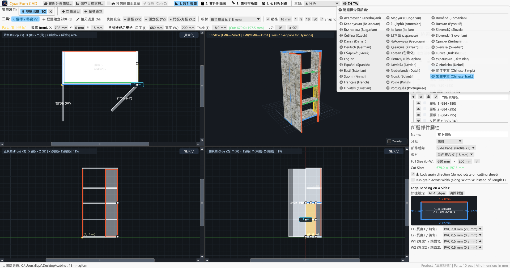

# QuadFurn CAD

**系統板材家具 CAD — 4 視圖空間設計器 + 裁板機斷頭台下料排版優化器**

 

👉 **[🚀 在瀏覽器中直接試用 QuadFurn CAD (WebAssembly)](https://rbm13s.github.io/QuadFurn/app/)** • **[🌐 官方網站](https://rbm13s.github.io/QuadFurn/zh-tw.html)**

 

**Languages / Языки / Мови / Sprachen:** 
[English](../README.md) •
[Русский](README-ru.md) •
[Українська](README-uk.md) •
[Беларуская](README-be.md) •
[Қазақша](README-kk.md) •
[ქართული](README-ka.md) •
[Հայերեն](README-hy.md) •
[Azərbaycan](README-az.md) •
[Oʻzbekcha](README-uz.md) •
[Deutsch](README-de.md) •
[Français](README-fr.md) •
[Español](README-es.md) •
[Italiano](README-it.md) •
[Português](README-pt.md) •
[Polski](README-pl.md) •
[Čeština](README-cs.md) •
[Slovenčina](README-sk.md) •
[Slovenščina](README-sl.md) •
[Български](README-bg.md) •
[Српски](README-sr.md) •
[Hrvatski](README-hr.md) •
[Nederlands](README-nl.md) •
[Dansk](README-da.md) •
[Norsk](README-no.md) •
[Svenska](README-sv.md) •
[Suomi](README-fi.md) •
[Eesti](README-et.md) •
[Latviešu](README-lv.md) •
[Lietuvių](README-lt.md) •
[Magyar](README-hu.md) •
[Română](README-ro.md) •
[Türkçe](README-tr.md) •
[Ελληνικά](README-el.md) •
[简体中文](README-zh-cn.md) •
**繁體中文** •
[日本語](README-ja.md) •
[한국어](README-ko.md)

---

## 目錄

- [軟體簡介](#軟體簡介)
- [介面截圖與功能導覽](#介面截圖與功能導覽)
- [核心亮點功能](#核心亮點功能)
- [功能詳解文檔](#功能詳解文檔)
  - [1. 4 視圖多維聯動 CAD 設計器與精確定位](#1-4-視圖多維聯動-cad-設計器與精確定位)
  - [2. 數值輸入框即時算術運算式支援](#2-數值輸入框即時算術運算式支援)
  - [3. 封邊厚度扣除與推台鋸淨開料尺寸計算](#3-封邊厚度扣除與推台鋸淨開料尺寸計算)
  - [4. 2D 貫通式剪板裁板排版優化算法](#4-2d-貫通式剪板裁板排版優化算法)
  - [5. 多專案分頁標籤與跨專案板件複製貼上](#5-多專案分頁標籤與跨專案板件複製貼上)
  - [6. 一鍵導出生產護照（向量 PDF、Excel CSV、剪貼簿）](#6-一鍵導出生產護照向量-pdfexcel-csv剪貼簿)
  - [7. 板材原料庫、貼圖紋理與封邊條管理](#7-板材原料庫貼圖紋理與封邊條管理)
  - [8. 介面主題與 37 種語言本地化](#8-介面主題與-37-種語言本地化)
- [操作指南與快捷鍵速查](#操作指南與快捷鍵速查)
- [快速上手](#快速上手)
- [設定檔與檔案格式](#設定檔與檔案格式)
- [專案架構](#專案架構)
- [開源授權條款](#開源授權條款)

---

## 軟體簡介

**QuadFurn CAD** 是一款採用 Rust 語言開發的高效能跨平台家具 CAD 軟體，既提供原生的極速桌面應用程式（Windows、Linux、macOS），又提供完全無需安裝、可在現代網頁瀏覽器中直接運行的 WebAssembly (WASM) 線上版本。專為顆粒板（塑合板/美耐板）、中密度纖維板（MDF）、高密度板（HDF）以及多層實木夾板板式系統家具的空間設計、板件明細表自動生成以及 2D 裁板機斷頭台貫通式排版優化而設計。

QuadFurn 深度整合了三項關鍵製造能力：
1. **4 視圖空間聯動建模**：在三個同步聯動的 2D 正交投影視圖（**俯視 XY — 平面圖**、**主視 XZ — 正立面**、**側視 YZ — 側剖面**）中即時協同編輯，配備視圖捲軸、邊緣磁性吸附、視圖均分按鈕（`⊞ 均分視圖`）、端面視角板厚智能防誤改保護以及即時 **3D 旋轉 / 第一人稱自由飛行模式（`Z` 鍵 Noclip）**。
2. **精準幾何變換工具欄**：支援即時輸入與修改板件三維座標（`X`, `Y`, `Z`）、全尺寸（`L × W × T`）以及繞垂直軸旋轉角度（`∠Z`），所有數值輸入框均內建算術運算式即時計算（例如直接輸入 `600-4` 或 `720+18` 自動求值）。
3. **開料排版與封邊厚度自動扣除**：自動從成品板件四周扣除 PVC/ABS 封邊條厚度以計算出準確的**淨開料下料尺寸**，並配合嚴格遵循木紋方向、鋸片鋸路切削寬度以及大板四週修邊預留量的 2D 貫通式剪切優化演算法。

---

## 介面截圖與功能導覽

### 1. 4 視圖 CAD 設計器（暗黑主題）
同步聯動的 2D 正交投影視圖（**俯視 XY**、**主視 XZ**、**側視 YZ**）與具備透視校正 UV 貼圖彩現的 **3D 視圖**，輔以 8 點式互動變形控制項與右側**板件屬性檢查器**。

### 2. 板件規格清單（BOM 表）與下料數據
清晰的板件明細表，同時列出板件的**成品外形尺寸（`L × W`）**以及扣除四周（`L1`, `L2`, `W1`, `W2`）封邊厚度後的**推台鋸淨開料尺寸（`CUT L × W`）**。

### 3. 2D 裁板機排版下料圖
在標準大板（如 `2800 × 2070 mm`）上進行貫通式套料排版，展示裁切線、鋸縫間隙、修邊餘量、封邊彩色標註以及具體尺寸的可利用餘料統計。

### 4. 板材原料庫與封邊條
自由管理板材厚度、3D 顏色、自訂表面貼圖（`PNG`, `JPG`, `WEBP`）、紋理方向鎖定以及各規格 PVC/ABS 封邊條。

### 5. 亮色介面主題
高對比度亮色主題，並支援與 Windows 系統主題自動同步。

### 6. 37 種內建介面語言（UI 與 PDF 導出）
透過頂部工具列 **`🌐`** 選擇器隨時切換 37 種語言，初次啟動自動偵測作業系統語言，並支援多語系向量 PDF 導出。

---

## 操作指南與快捷鍵速查

| 按鍵 / 快捷鍵 | 功能說明 |
| :--- | :--- |
| **`V`** | 啟用 **選取與移動** 工具（8 點式控制項、框選矩形） |
| **`B`** | 在 2D 視圖中啟用 **框選建立板件** 工具 |
| **`M`** | 在 2D 視圖中啟用 **捲尺測量** 工具 |
| **按住 `滑鼠左鍵` 拖曳 (2D)** | 移動選取板件、拖曳尺寸控制項或在空白處框選 |
| **`Shift + 滑鼠左鍵` 拖曳 (2D)** | 嚴格鎖定水平或垂直單一方向移動 |
| **`Ctrl / Cmd + 滑鼠左鍵` 拖曳 (2D)** | 移動時暫時略過磁性邊緣吸附 |
| **`Alt + 滑鼠左鍵` 拖曳 (2D)** | 在目標位置快速複製（原地保留原板件） |
| **`Shift / Ctrl + 滑鼠左鍵` (2D)** | 將板件加入/移出目前多選群組 |
| **按住 `右鍵` / `中鍵` 拖曳 (2D)** | 2D 正交攝影機視角平移 |
| **`滑鼠滾輪` (2D / 3D)** | 以游標為中心縮放視圖 |
| **按住 `右鍵` / `中鍵` 拖曳 (3D)** | 3D 視角圍繞目標旋轉 |
| **`Z` (游標懸停在 3D 視圖)** | 開啟 / 關閉 **第一人稱自由飛行模式 (Noclip)** |
| **`W` `A` `S` `D` / `空白鍵` / `Ctrl`** | 3D 飛行模式中前進/向左/後退/向右/上升/下降（`Shift` 加速） |
| **`Ctrl + S` / `Cmd + S`** | 儲存目前家具專案（`.qfurn` / `.json`） |
| **`Ctrl + Z` / `Cmd + Z`** | 復原上一步操作（支援最高 40 步歷史復原） |
| **`Ctrl + C` / `Ctrl + V`** | 複製 / 貼上選取板件（支援跨專案分頁傳遞材料與封邊） |
| **`Ctrl + D`** | 原地帶位移複製選取板件 |
| **`Delete` / `Backspace`** | 刪除選取板件 |
| **`←` `→` `↑` `↓` (2D)** | 按目前格線間距微調移動板件（`Shift` 為雙倍間距） |

---

## 開源授權條款

本專案採用 [MIT License](../LICENSE) 開源授權條款 — 您可以自由免費使用、修改及商業發行。
